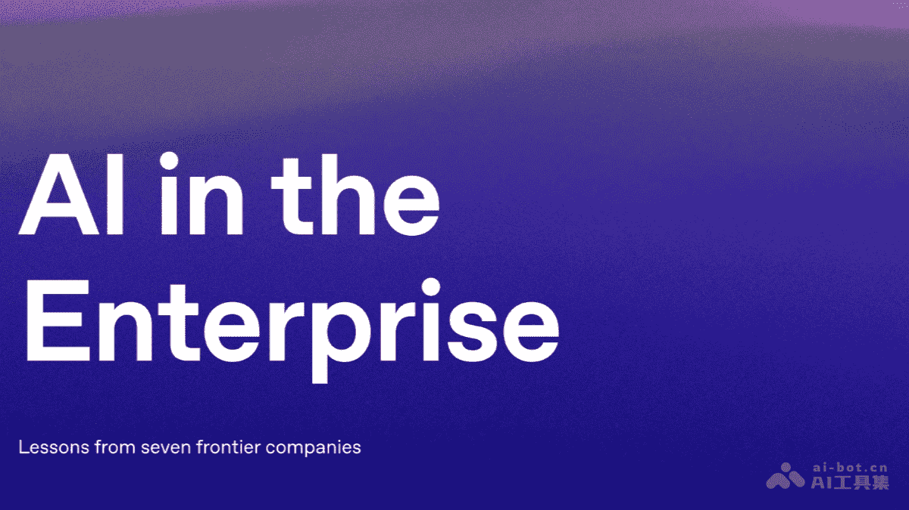
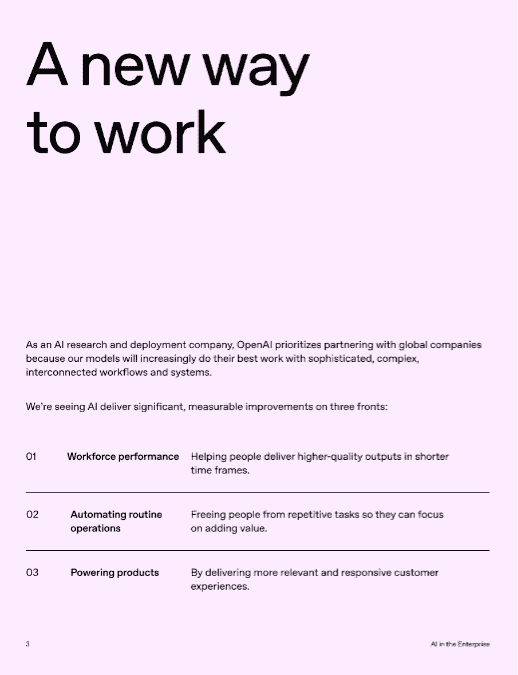
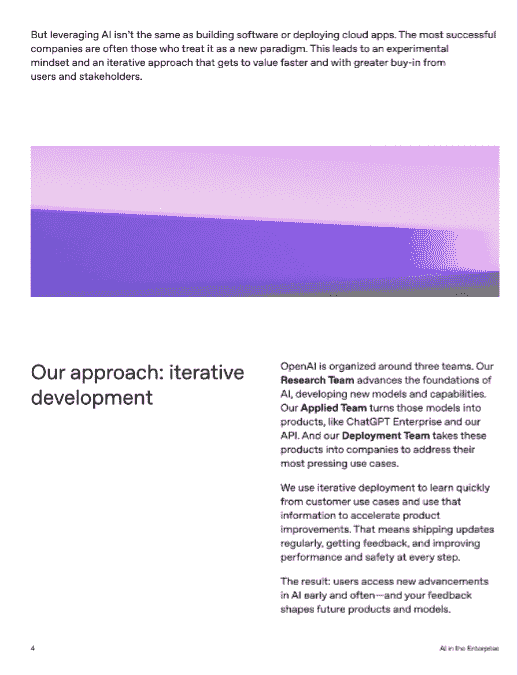
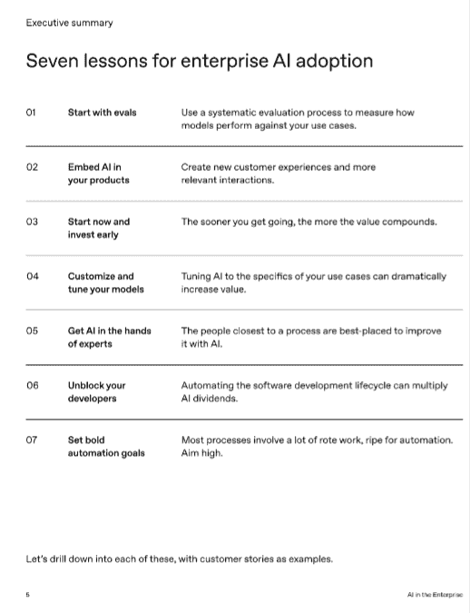

# OpenAI《企业中的人工智能》（PDF文件）

> 来源：[https://gotoaiworld.feishu.cn/docx/ZYlgdOmauokjGCxNYaMcepuqn6d](https://gotoaiworld.feishu.cn/docx/ZYlgdOmauokjGCxNYaMcepuqn6d)

OpenAI《企业中的人工智能》重点介绍了AI在企业中的实际应用与成功经验。文档用摩根士丹利、Klarna、Lowe’s等七家前沿企业的案例，总结企业高效落地AI的七大核心策略，从系统评估起步、将AI嵌入产品、尽早投资迭代、定制模型、赋能专家、解放开发者资源及设定高自动化目标。OpenAI强调AI应用需用迭代开发模式，结合实验性思维与严格评估，聚焦高回报场景。数据显示，AI显著提升了企业效率（如Klarna客服响应时间缩短80%）、客户体验（Indeed职位匹配率提升13%）和商业价值。

## 企业中的AI

OpenAI与全球公司合作，将AI融入复杂的工作流程和系统中，带来工作绩效提升、流程自动化及增强产品体验等显著改进，强调成功企业将AI视为新范式，基于实验心态和迭代方法快速实现价值。

AI在企业中的三大提升方向：

+   **工作绩效提升**：帮助人们在更短的时间内交付更高质量的工作成果。

+   **流程自动化**：让人们从重复性任务中解脱出来，专注于创造价值。

+   **增强产品体验**：提供更相关、更响应客户需求的体验来增强产品。

## 我们的方法：迭代开发

OpenAI围绕研究、应用和部署三个团队展开工作，基于迭代部署从客户用例中快速学习，加速产品改进，让用户能更早更频繁地接触AI新进展，同时用户反馈也能塑造未来产品和模型。

## 企业AI落地的七大经验

总结七条核心原则，涵盖评估、产品嵌入、早期投资、模型定制等，辅以企业案例说明实践效果。

+   **从评估开始**：摩根士丹利为例，通过严格的评估流程衡量AI模型在特定用例中的表现，确保质量和安全，最终使98%的顾问每天使用OpenAI，大幅提升工作效率和客户关系维护能力。

+   **将AI嵌入产品**：用全球最大的求职网站Indeed为例，用GPT-4o mini改善求职匹配，基于AI分析数据和生成自然语言，为求职者提供更具人性化的职位推荐理由，显著提高求职申请量和雇主招聘成功率。

+   **尽早投资，持续迭代**：全球支付网络和购物平台Klarna为例，展示早期引入AI助手优化客户服务，基于持续测试和改进，实现服务效率大幅提升、利润显著增长，且促进员工对AI的广泛使用和组织内AI知识的积累。

+   **定制与微调模型**：财富50强家居改善公司Lowe’s为例，基于微调OpenAI模型，解决产品数据不完整或不一致的问题，提高产品标签准确性和错误检测能力，改善电商搜索功能。

+   **让专家主导AI应用**：全球银行领导者BBVA为例，将AI交给员工使用，让他们在各自领域发现AI驱动的解决方案，在信用风险评估、法律合规问答、客户服务等多个部门实现效率提升和流程优化。

+   案例：BBVA银行 员工创建2900个定制GPT工具，法律团队年处理4万条政策咨询。

+   **解放开发者**：拉丁美洲最大的电商和金融科技公司Mercado Libre为例，介绍与OpenAI合作构建开发平台层Verdi，帮助开发者快速、一致地构建AI应用，加速AI应用开发，提升库存管理、欺诈检测、产品描述定制等多方面的能力。

+   **设定大胆的自动化目标**：OpenAI自身为例，构建内部自动化平台，将AI嵌入现有工作流程，实现支持团队工作效率的大幅提升，处了大量任务，让员工专注于更有影响力的工作。

## 结论

强调企业用AI实现改进成果的普遍性，指出成功企业基于开放、实验性的思维方式，结合严格的评估和安全防护措施，围绕高回报、低努力的用例进行迭代学习，将这种学习应用到新领域，实现更快速、更准确的流程、更个性化的客户体验及更有价值的工作。