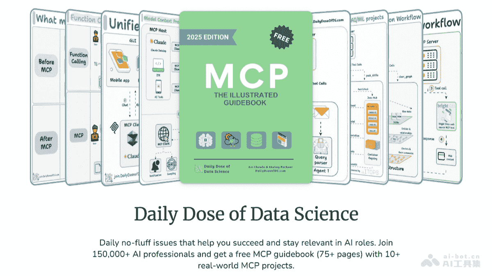
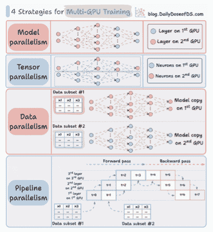
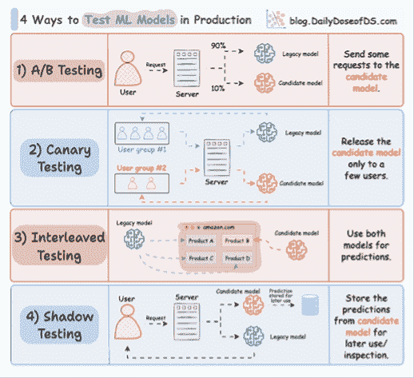
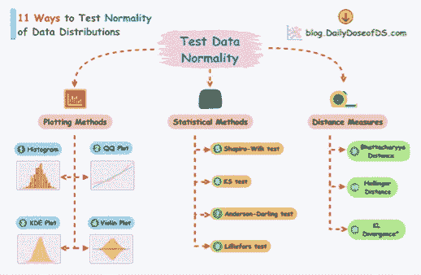
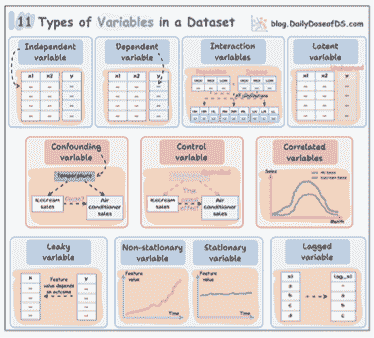
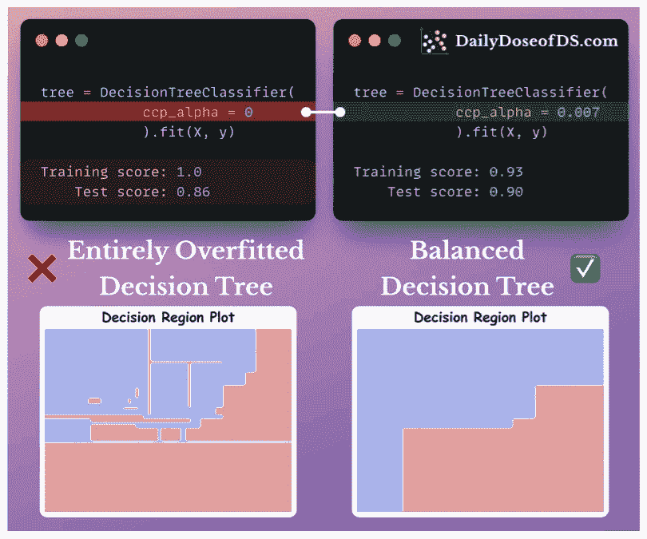
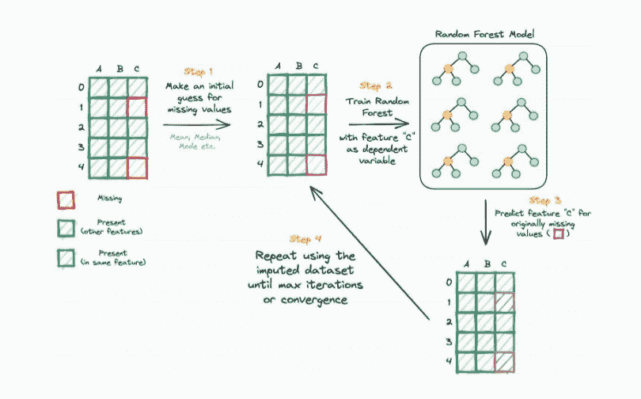

# AI Engineering Hub（PDF文件）- AI教程资料

> 来源：[https://gotoaiworld.feishu.cn/docx/ZFKpdKqxWoSOf0xYFPucrGsGncc](https://gotoaiworld.feishu.cn/docx/ZFKpdKqxWoSOf0xYFPucrGsGncc)

AI Engineering Hub 是开源项目，提供关于大语言模型（LLM）、检索增强生成（RAG）和 AI 智能体应用搭建的深入教程与实践案例。AI Engineering Hub 包含理论讲解，提供大量可操作的代码示例，帮助用户快速上手。项目在 GitHub 上获得了 12.6K 的 Star，核心教程被整理成一本 500 多页的 PDF，方便用户学习。AI Engineering Hub 适合初学者、实践者和研究人员，鼓励社区贡献，共同推动 AI 技术的发展。

## AI Engineering Hub课程内容简介

AI Engineering Hub 课程资料是全面实用的数据科学与机器学习指南，涵盖从基础到高级的核心主题。全文分为两大板块：

+   **深度学习**：包括迁移学习、联邦学习、多任务学习等前沿范式，以及混合精度训练、梯度检查点等优化技术，并深入探讨大语言模型（LLMs）的微调与部署策略。

+   **经典机器学习**：覆盖特征工程、回归分析、决策树、聚类等传统方法，结合统计理论与实际案例（如处理数据漂移、缺失值），并揭示常见误区（如随机分割的陷阱）。

资料提供数据分析工具（如Pandas、SQL）、可视化技巧（如桑基图、🐧图）及Python面向对象编程的高级用法。全文通过代码示例、可视化图表和实验对比，兼顾理论与实践，适合不同水平的学习者。附带的评估工具可帮助读者定位最相关章节，高效提升技能。

## AI Engineering Hub的课程内容

### Deep Learning（深度学习）

#### **学习范式**

+   迁移学习、微调、多任务学习和联邦学习：

+   **迁移学习**：基于预训练模型（基础模型）在相关任务上训练后，替换最后几层并冻结其他层权重，适应小数据新任务。

+   **微调**：调整预训练模型的部分或全部权重，直接适配新数据。

+   **多任务学习（MTL）**：共享层处理多个任务，任务特定分支独立训练，提升泛化并节省计算资源。

+   **联邦学习**：在分散设备上训练模型，聚合参数而非数据，保护隐私（如手机用户数据）。

+   **联邦学习简介**：模型分发到设备本地训练，仅上传参数至中心服务器聚合，避免数据集中存储。

+   **构建多任务学习模型**：

+   PyTorch实现：共享层+任务分支，梯度累加更新，动态任务权重分配（如按验证准确率调整）。

+   Active Learning（主动学习）：从少量标注数据开始，模型筛选低置信度样本人工标注，迭代优化（适用于标注成本高的场景）。

#### **运行时和内存优化**

+   **动量**：通过梯度移动平均减少震荡，加速收敛（超参数需调优）。

+   **混合精度训练**：混合float16和float32：前向/梯度计算用float16加速，权重更新用float32保精度，需损失缩放避免梯度消失。

+   **梯度检查点**：分段存储激活值，反向传播时重新计算，节省50-60%内存（牺牲15-25%时间）。

+   **梯度累积**：

+   小批量训练时累积多批次梯度再更新，模拟大批量效果（不减少时间，但降低内存压力）。

+   **4 Strategies for Multi-GPU T**raining（多GPU训练的4种策略）

+   **模型并行**：层拆分到不同GPU，需频繁通信。

+   **张量并行**：单张量操作拆分（如矩阵乘法分块计算）。

+   **数据并行**：模型复制，数据分片训练后梯度聚合。

+   **流水线并行**：微批次流水线处理，提升GPU利用率。

#### **杂项**

+   **标签平滑**：调整标签分布，降低真实类概率，均匀分配余量，防止模型过度自信（提升泛化，但降低预测置信度）。

+   **焦点损失**：针对类别不平衡，通过权重因子（γ）和逆类别频率（α）降低易分类样本的损失贡献。

+   **How Dropout Actual**ly Works?（Dropout原理）：训练时随机丢弃神经元，保留的激活值缩放1/(1-p)以保持推理一致性（p为丢弃率）。

+   **CNN中Dropout的问题**：破坏卷积层的空间相关性，建议在全连接层使用。

+   **隐藏层与激活函数的真实作用**：解释隐藏层如何提取特征层次，激活函数如何引入非线性。

+   **训练前打乱数据**：避免批次间数据顺序影响模型收敛。

#### **模型压缩**

+   **知识蒸馏）**：教师模型指导学生模型，压缩模型尺寸。

+   **激活剪枝**：剪枝低重要性神经元减少计算量，需动态评估重要性。

#### **部署**

+   从Jupyter Notebook部署模型：简化从开发到生产的模型迁移流程。

+   **生产环境模型测试方法**：包括A/B测试、影子部署等生产环境验证方法。

+   **版本控制与模型注册**：追踪模型迭代，管理生产环境发布。

#### **大语言模型**

+   **Where Did the GPU** Memory Go?（GPU内存管理）：分析训练LLM时的显存占用瓶颈与优化策略。

+   全模型微调 vs. LoRA vs. RAG：对比适用场景：全参数微调资源消耗大，LoRA（低秩适配）高效，RAG（检索增强）动态扩展知识。

+   **5种LLM微调技术**：包括适配器微调、前缀微调等轻量化微调技术详解。

### Classical ML（经典机器学习）

#### **ML基础**

+   **10种算法的时间复杂度**：对比SVM、随机森林等10种算法的训练/推理时间复杂度。

+   **25个关键数学定义**：涵盖概率、线性代数等核心概念。

+   **如何可靠改进多分类概率模型**：通过Platt Scaling等方法校准多分类概率输出。

+   **模型改进可能无效的原因：**数据质量、评估指标选择等陷阱。

+   **16种算法的损失函数**：包括逻辑回归、SVM等的损失函数公式。

+   **10种常见损失函数**：如交叉熵、Huber损失的适用场景。

+   **如何正确使用训练/验证/测试集**：数据划分策略与避免信息泄露。

+   **5种交叉验证技术**：k折、留一法等实现与选择。

+   **交叉验证后步骤**：模型选择与最终评估流程。

+   **双下降与偏差-方差权衡**：解释模型复杂度与泛化的非线性关系。

#### **统计基础**

+   **MLE与EM的区别**：MLE适用于完整数据，EM处理隐变量（如聚类）。

+   **置信区间与预测区间**：解释两者差异及计算方法。

+   **为何OLS是无偏估计**：数学推导与高斯-马尔可夫定理。

+   **巴氏距离**：衡量概率分布相似性的指标。

+   **为何选择马氏距离）：**马氏距离考虑协方差结构的优势。

+   **11种数据正态性检验方法**：包括Shapiro-Wilk、🐧图等。

+   **概率与似然**：概念辨析与最大似然估计的联系。

+   **11种关键概率分布**：如泊松分布、指数分布的应用场景。

+   **连续概率分布的常见误解**：解释概率密度函数的非概率含义。

#### **特征定义、工程与选择**

+   **数据集中11种变量类型**：涵盖名义变量（无序类别）、序数变量（有序等级）、连续变量等，指导数据预处理时的编码与分析方法选择。

+   **周期性特征编码**：对时间序列中的周期性特征（如小时、月份）使用sin/cos编码，保留循环连续性（如23:59与00:01的接近性）。

+   **特征离散化**：将连续特征分箱（如年龄分段），平衡信息损失与模型鲁棒性，适用于逻辑回归等线性模型。

+   **7种分类数据编码方法**：包括独热编码（稀疏类别）、目标编码（高基数类别）、哈希编码（内存优化）等，解决类别变量数值化问题。

+   **打乱特征重要性评估**：通过随机打乱特征值观察模型性能变化，量化特征重要性，避免过拟合无关特征。

+   **探针特征选择法**：生成随机噪声特征，筛选重要性低于噪声的特征并剔除，提升模型泛化能力。

#### **回归分析**

+   **MSE的数学原理**：均方误差（MSE）的凸性保证梯度下降收敛到全局最优，且对异常值敏感（平方放大误差）。

+   **Sklearn线性回归无超参数**：因使用闭式解（解析解）直接计算权重，无需迭代优化，但无法处理大规模数据（需梯度下降）。

+   **泊松回归 vs. 线性回归**：泊松回归通过对数连接函数处理计数数据（如事件次数），线性回归拟合连续目标变量。

+   **虚拟变量陷阱**：类别变量编码时需忽略一个类别（如性别中的“男性”），避免设计矩阵秩缺失导致多重共线性。

+   **广义线性模型（GLMs）**：扩展线性回归至指数族分布（如二项分布、泊松分布），通过连接函数关联线性预测与目标变量。

+   **零膨胀回归**：针对零值过多的计数数据（如保险索赔），结合逻辑回归（是否为零）与泊松回归（计数部分）。

#### **决策树与集成方法**

+   **随机森林压缩为单棵树**：通过提取重要规则路径，将森林简化为单一决策树，牺牲部分精度以提升可解释性。

+   **决策树必然过拟合**：因其低偏差特性（完美拟合训练数据），需通过剪枝、限制深度或集成方法（如随机森林）控制方差。

+   **AdaBoost原理**：迭代训练弱分类器（如浅层树），调整样本权重聚焦误分类样本，加权投票提升整体性能。

+   **袋外验证（OOB）**：利用随机森林中未采样数据（约37%）作为验证集，无需额外划分数据即可评估模型。

#### **降维**

+   **PCA方差解释**：选择主成分时保留95%累计方差，平衡降维效果与信息损失，适用于特征相关性高的场景。

+   **t-SNE vs. PCA**：t-SNE通过t分布保留局部相似性（适合可视化聚类），PCA保留全局方差（适合预处理）。

+   **核PCA**：通过核函数（如RBF）映射数据到高维空间，处理非线性结构，计算复杂度高于线性PCA。

#### **Section 2.7: 聚类**

+   KMeans vs. 高斯混合模型（GMM）：KMeans硬分配样本到最近簇，GMM软分配（概率归属），后者更灵活但需更多计算资源。

+   **DBSCAN++优化**：减少邻域查询次数，通过采样核心点加速密度聚类，适合大规模数据。

+   层次化DBSCAN（HDBSCAN）：自动确定簇数量，识别变密度簇，优于传统DBSCAN的固定参数限制。

#### **相关性分析**

+   **皮尔逊相关性的局限**：仅检测线性关系，Spearman秩相关可捕捉单调非线性关系（如指数关系）。

+   **Anscombe四重奏启示**：相同统计量（均值、方差、相关系数）可能对应完全不同的数据分布，需可视化验证。

#### **缺失数据处理**

+   缺失值类型（MCAR/MAR/MNAR）：MCAR（完全随机缺失）可删除，MNAR（非随机缺失）需建模缺失机制（如生存分析）。

+   **MissForest插补**：基于随机森林迭代预测缺失值，适用于混合类型数据（数值+类别），优于均值/中位数填充。

#### **数据分析工具**

+   Pandas/Polars/SQL/PySpark语法对照：如分组聚合：Pandas的groupby vs. PySpark的groupBy，帮助跨平台迁移代码。

+   GPU加速Pandas（RAPIDS cuDF）：利用GPU并行化数据操作（如排序、JOIN），加速大规模数据处理，兼容Pandas API。

#### **SQL高级操作**

+   **半连接（Semi Join）**：仅返回左表中与右表匹配的行（如WHERE EXISTS），过滤无需右表字段时效率高于INNER JOIN。

+   **慎用NOT IN**：右表含NULL值时结果可能为空，改用NOT EXISTS或LEFT JOIN + IS NULL更安全。

#### **Python面向对象**

+   描述符（Descriptors）：通过get/set方法控制属性访问，实现延迟计算、类型校验（如@property底层机制）。

+   PyTorch不直接调用forward()：model()自动触发forward，集成钩子（如前置/后置处理）与自动微分，保持计算图完整性。

## AI Engineering Hub的项目地址

+   **GitHub仓库**：https://github.com/patchy631/ai-engineering-hub

## AI Engineering Hub的适用人群

+   **初学者**：为对 AI 感兴趣但缺乏经验的学习者提供基础概念讲解和实践指南，帮助快速入门。

+   **开发者和实践者**：为工程师和开发者提供具体代码示例和实践案例，助力在实际项目中应用 AI 技术。

+   **研究人员**：为学术研究者提供前沿技术动态和研究案例，便于分享和交流研究成果。

+   **数据科学家**：为数据专业人士提供结合 AI 技术的数据处理和模型优化指南，提升工作效率。

+   **技术爱好者**：为技术爱好者提供最新 AI 工具和框架的实践案例，满足探索新技术的需求。