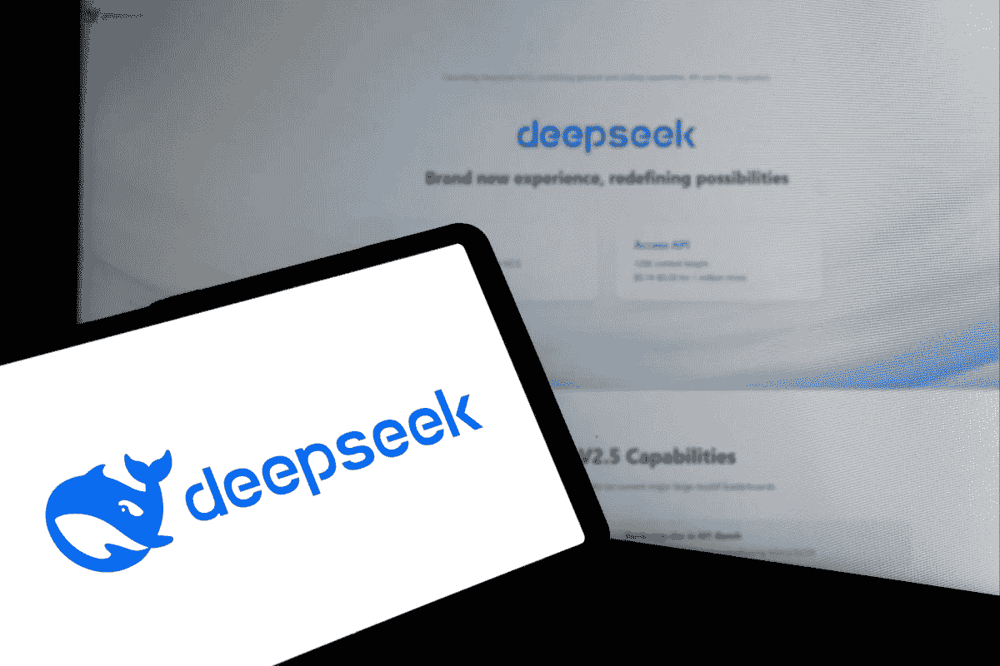
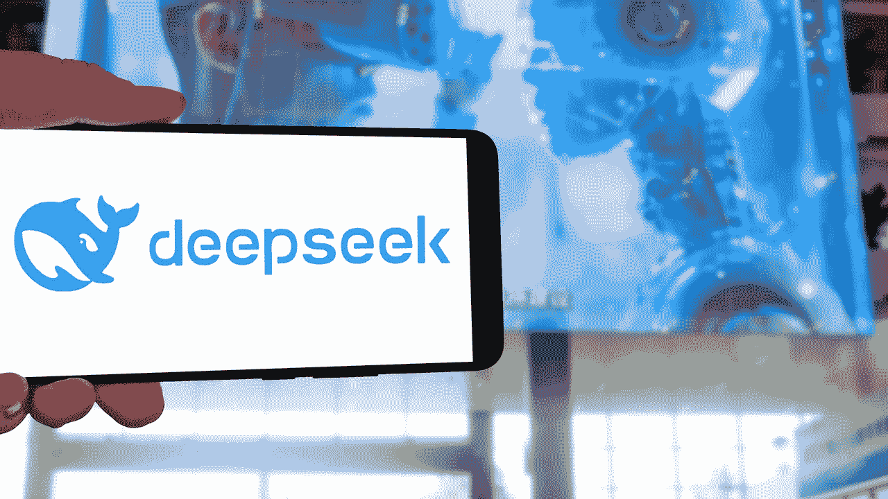

# DeepSeek大模型技术文档库

> 来源：[https://gotoaiworld.feishu.cn/docx/SjbFdR1TlooLmFxKpgTcufYUnVd](https://gotoaiworld.feishu.cn/docx/SjbFdR1TlooLmFxKpgTcufYUnVd)

# 一、DeepSeek 大模型产品矩阵全景图

> DeepSeek（深度求索）是由中国量化投资机构幻方量化孵化的人工智能研究公司，成立于 2023 年，总部位于杭州。

DeepSeek（深度求索）是由中国量化投资机构幻方量化孵化的人工智能研究公司，成立于 2023 年，总部位于杭州。其核心团队由来自浙江大学、清华大学等顶尖高校及 Google Brain、微软亚洲研究院的技术专家组成，专注于大语言模型（LLM）与多模态技术的底层创新。以下从技术、产品、应用、市场等维度展开解析：

### 一、技术突破：低成本高性能的架构革新

1.  混合专家模型（MoE）
DeepSeek 的核心模型（如 V3、R1）采用 MoE 架构，总参数达 6710 亿，但每个 token 仅激活 370 亿参数，显著降低计算量。这种设计使训练成本仅为行业标杆的 1/10，例如 DeepSeek-V3 的全训练仅需 278.8 万 H800 GPU 小时，成本约 557.6 万美元。

1.  FP8 训练技术
首次在大规模模型上验证 FP8（8 位浮点精度）训练的可行性，结合 DeepGEMM 库优化矩阵乘法，使推理速度提升至传统模型的 1.8 倍，同时减少内存占用。例如，在 H800 GPU 上，DeepGEMM 的计算峰值达 580 万亿次 / 秒，内存带宽利用率突破 3000GB / 秒。

1.  强化学习与知识蒸馏
通过无监督强化学习（RL）直接优化推理能力，无需传统监督微调（SFT）。例如，DeepSeek-R1 在 AIME 2025 数学测试中准确率达 87.5%，超越 OpenAI o1 模型。同时，知识蒸馏技术将大模型能力迁移至小模型，如 R1-Distill-Qwen-32B 在代码生成任务中性能媲美 o1-mini。

### 二、产品矩阵：从通用模型到行业解决方案

1.  基础模型系列

+   DeepSeek-V3：6710 亿参数的 MoE 模型，支持 13 万 token 长上下文，在数学推理（AIME 测试）、代码生成（Codeforces Elo 2029）等任务中表现优异。

+   DeepSeek-R1：专为复杂推理设计，通过强化学习提升逻辑能力，在金融、医疗等领域的专业问答准确率达 92%。

+   DeepSeek-Coder：支持 338 种编程语言，上下文窗口扩展至 128k，代码生成性能超越 GPT-4 Turbo。

1.  行业垂直应用

+   金融：江苏银行引入 R1 模型实现智能合同质检，审核时间从 4 小时缩短至 15 分钟，年节省成本超 2000 万元。

+   物流：顺丰同城接入 DeepSeek 优化订单调度，配送效率提升 23%，油耗降低 15%。

+   医疗：深圳 “健康深云” App 集成多模态模型，皮肤病识别准确率 99.8%，急诊分流率提升 35%。

1.  开源工具链
开源 FlashMLA（GPU 推理优化）、DeepEP（MoE 通信库）、DeepGEMM（FP8 矩阵运算）等项目，形成覆盖训练、推理、存储的全链条工具集。例如，FlashMLA 使 H800 GPU 的响应延迟降至微秒级，GitHub Star 数 5 天内突破 1 万。

### 三、市场表现与生态布局

1.  用户增长与国际化
2025 年 1 月全球用户达 1.25 亿，登顶 140 国应用商店下载榜，印度市场贡献 1/6 流量。第三方平台（如 Cursor、Kaggle）的 R1 模型调用量增长近 20 倍，但自有平台因延迟较高（部分场景超 5 秒）导致用户流失。

1.  商业化与资本运作

+   API 定价：每百万 token 输出成本 8 元，仅为 GPT-4 的 1/10。

+   合作伙伴：与浪潮信息、中科曙光合作建设智算中心，联合科大讯飞推出 “星火助学” 教育应用。

+   上市计划：2025 年 7 月启动科创板 IPO，预计 11 月挂牌，募资用于算力扩建与技术研发。

1.  开源生态构建
通过 MIT 协议开放模型权重与训练框架，吸引开发者共建生态。例如，基于 DeepSeek 工具链的 AI 代理框架 SuperAgentX 已支持 300 + 智能体，覆盖编程、写作等场景。

### 四、挑战与应对策略

1.  技术瓶颈

+   幻觉率：在医疗、法律等专业领域，R1 模型幻觉率达 14.3%，需通过引入外部知识库（如医疗文献库）优化。

+   多轮对话：超 3 轮对话逻辑断裂率 60%，计划通过记忆增强网络（RAM）提升上下文连贯性。

1.  国际竞争与合规

+   澳大利亚、意大利以数据安全为由限制使用，DeepSeek 通过开源代码审计、本地化部署（如中东合资公司）应对。

+   与欧盟研究机构合作开展可信 AI 研究，提供符合 GDPR 的隐私计算方案。

1.  人才与资金压力

+   核心团队流失（如 R1 开发者罗福莉加入小米），需通过股权激励与海外研究院建设吸引人才。

+   投资者因股价波动撤资，需依赖上市融资与主权基金支持。

### 五、行业影响与未来展望

1.  技术民主化
低成本模型与开源工具降低 AI 开发门槛，推动中小企业智能化。例如，云南白药通过 DeepSeek API 快速搭建产品知识图谱，研发效率提升 50%。

1.  算力国产化
与寒武纪、海光合作优化国产芯片适配，在昇腾 910B 上实现 R1 模型推理效率提升 40%。

1.  前沿探索
布局量子 - AI 融合、边缘计算等领域，开发轻量化模型支持端侧推理，目标 2026 年实现 130B 模型在智能音箱本地运行。

DeepSeek 以 “技术开源 + 行业深耕” 策略，正从模型供应商转型为 AI 基础设施服务商。其挑战在于平衡开源生态与商业变现，同时突破国际技术封锁。若能持续优化核心技术、拓展垂直场景，有望重塑全球 AI 竞争格局。