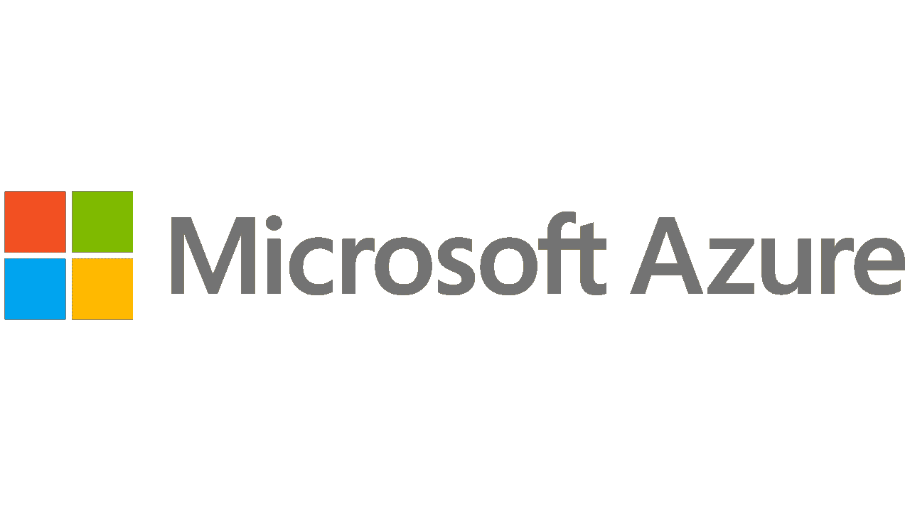
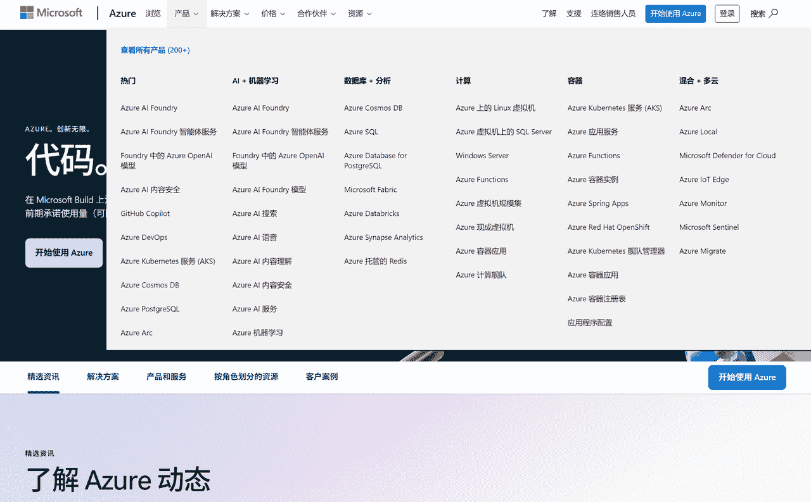
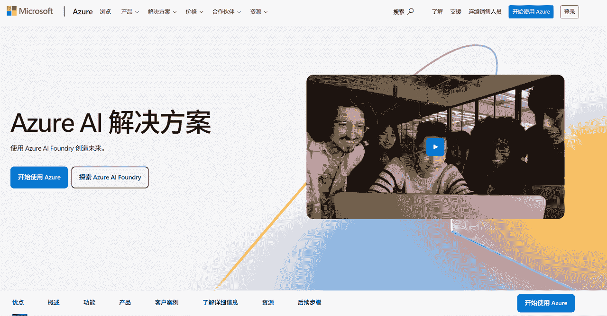
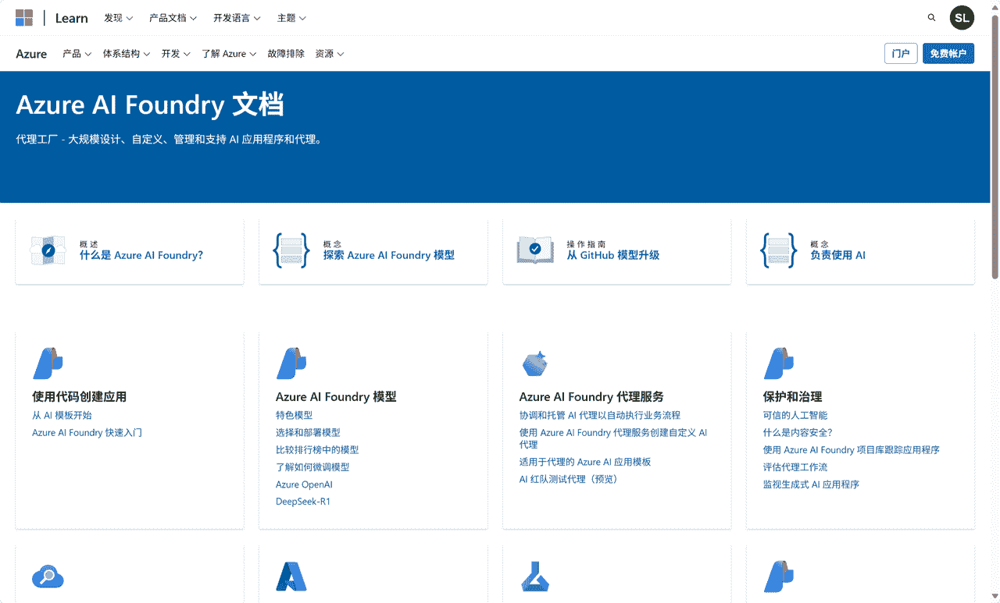
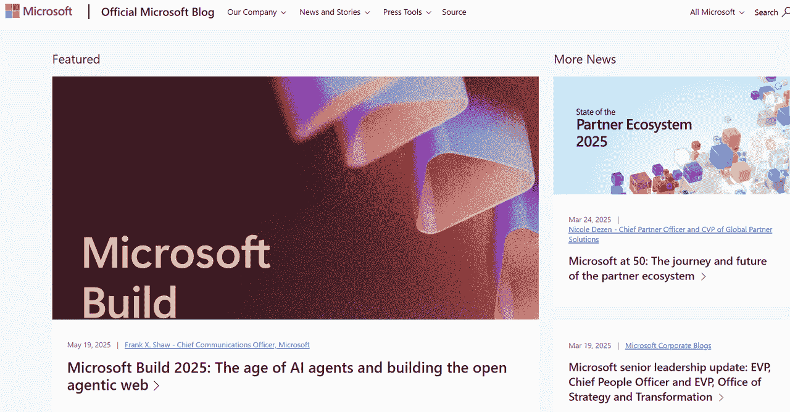
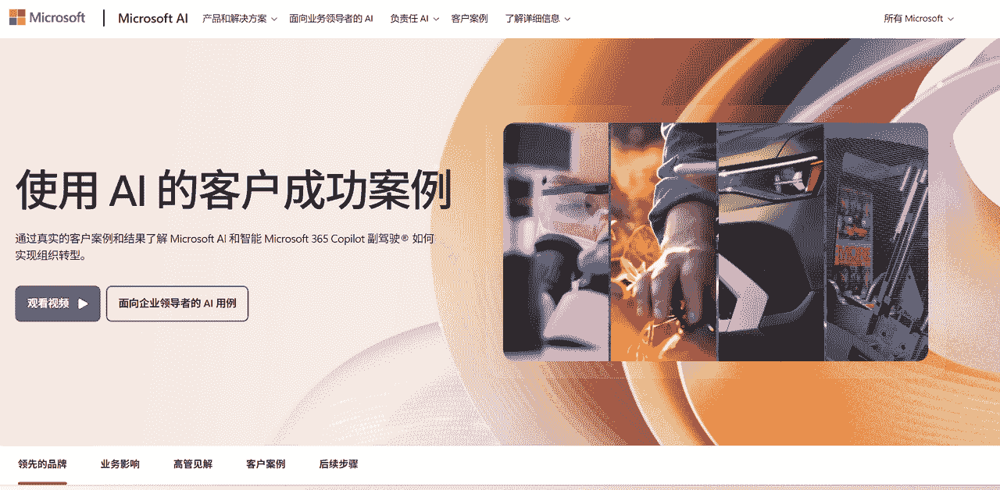
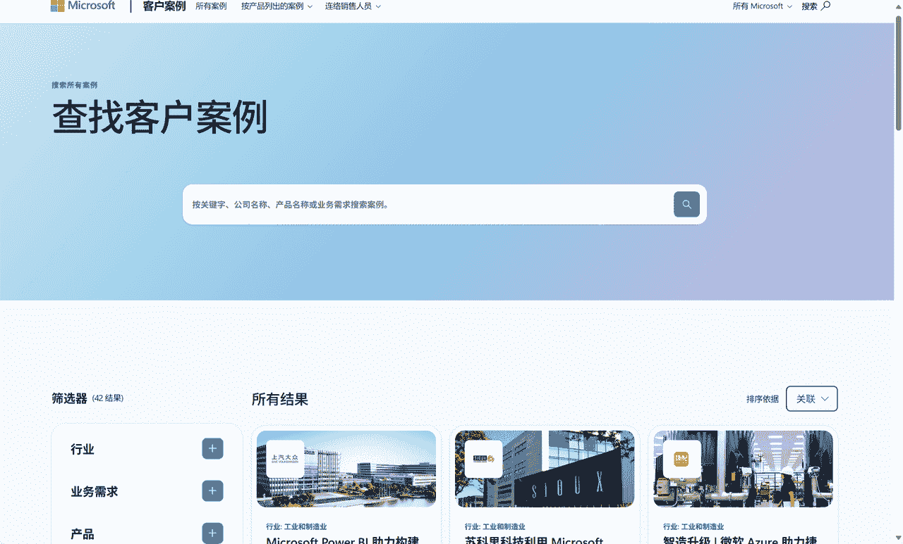
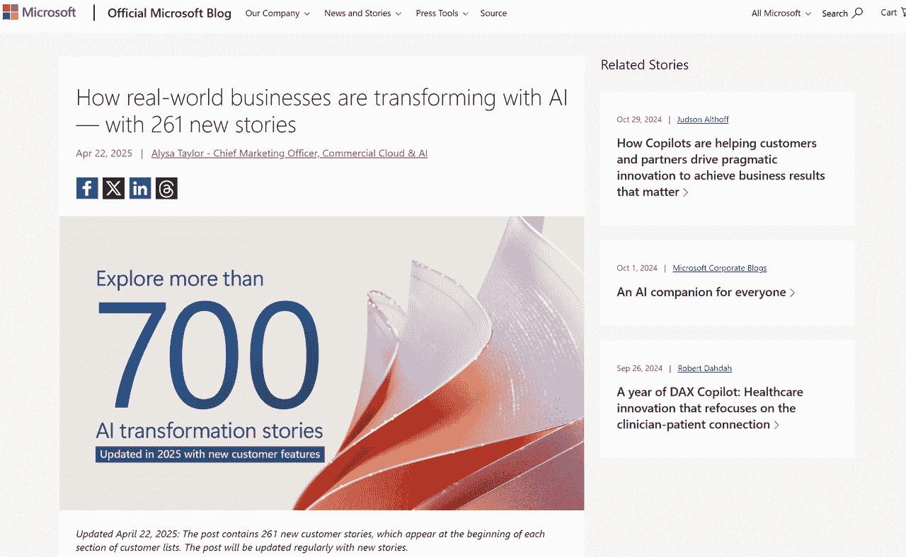

# Microsoft Azure AI 技术文档库

> 来源：[https://gotoaiworld.feishu.cn/docx/AFfqdGhZToBA9KxiEsNcOG02noc](https://gotoaiworld.feishu.cn/docx/AFfqdGhZToBA9KxiEsNcOG02noc)

# 一、微软AI 产品矩阵全景图

> Azure AI 解决方案

>

## 1.1 微软Azure AI产品矩阵全景图

使用 Azure AI Foundry 创造未来

https://azure.microsoft.com/zh-cn

https://azure.microsoft.com/zh-cn/solutions/ai/

## 1.2 Azure AI Foundry实验室

https://ai.azure.com/labs

# 二、Azure AI Foundry 文档库

> **目标一：**制定具体、细化、可拆解的目标

https://learn.microsoft.com/zh-cn/azure/ai-foundry/

# 九、微软AI Blog

https://blogs.microsoft.com/

# 十、案例中心

## 1.1 微软AI客户成功案例

https://www.microsoft.com/zh-cn/ai/ai-customer-stories?msockid=19935c696a296c44172a49e46be96d9b

## 1.2 微软中国客户成功案例

https://www.microsoft.com/zh-cn/customers/search

## 1.3 微软700+数字化转型案例库

https://blogs.microsoft.com/blog/2025/04/22/https-blogs-microsoft-com-blog-2024-11-12-how-real-world-businesses-are-transforming-with-ai/

微软作为全球AI领导者之一，发布了700个真实的Agent智能体、Microsoft Copilot应用案例，来帮助大家真实地了解到底AI是如何改变我们的工作模式。

这些客户有世界500强企业，有各领域的独角兽，也有世界常青藤名校，业务范围涵盖金融、医疗、科技、教育、汽车制造、零售、电商、能源、航空航天等众多领域。

