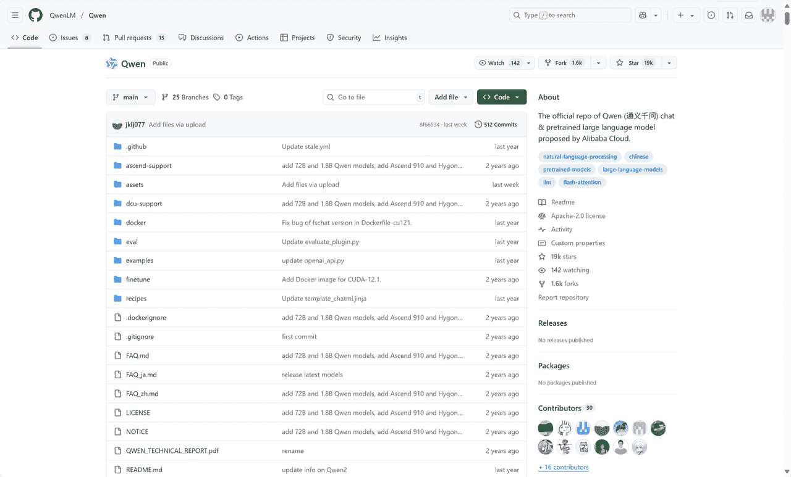
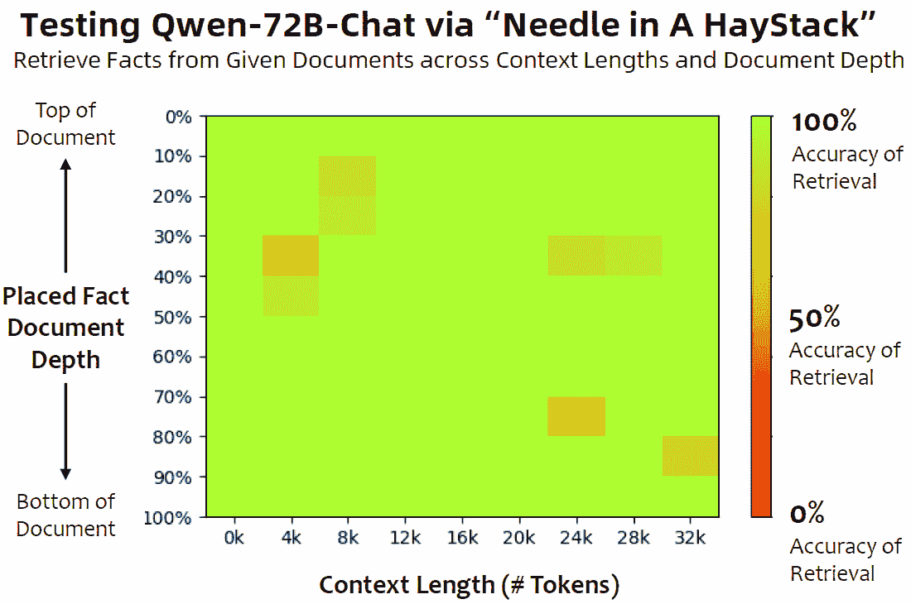
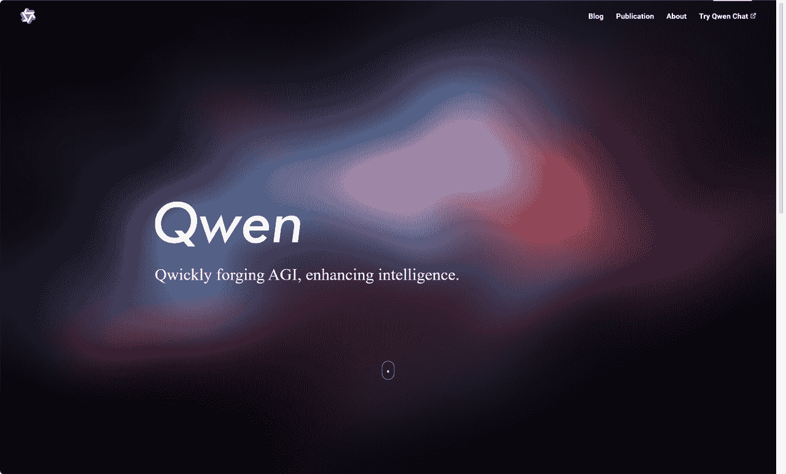
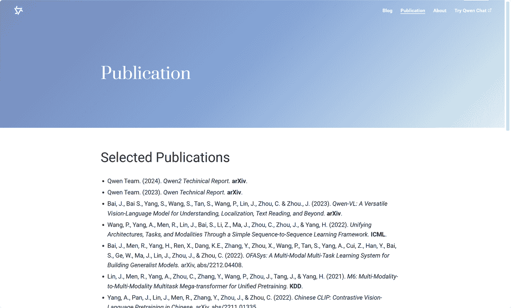
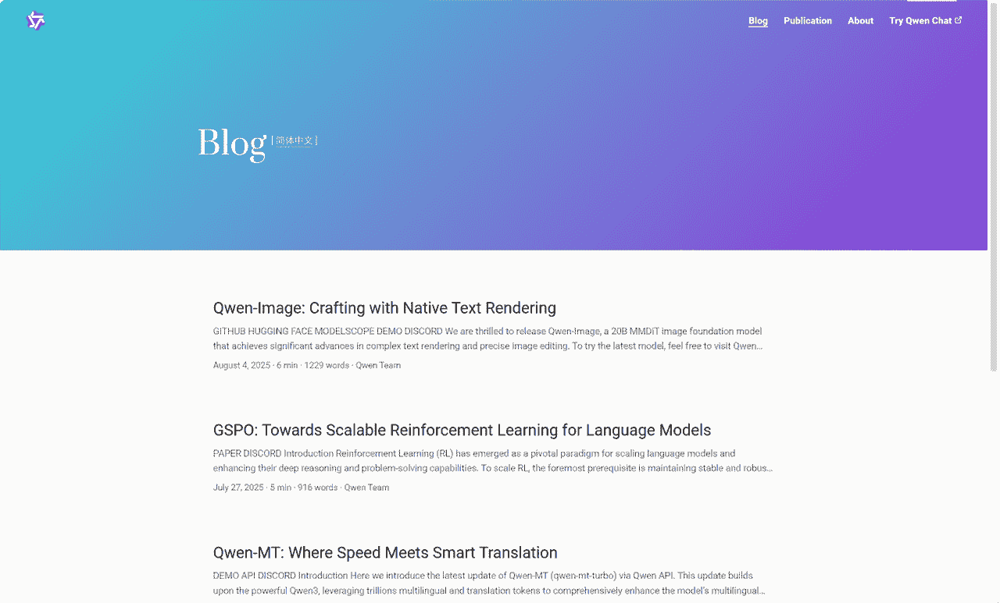
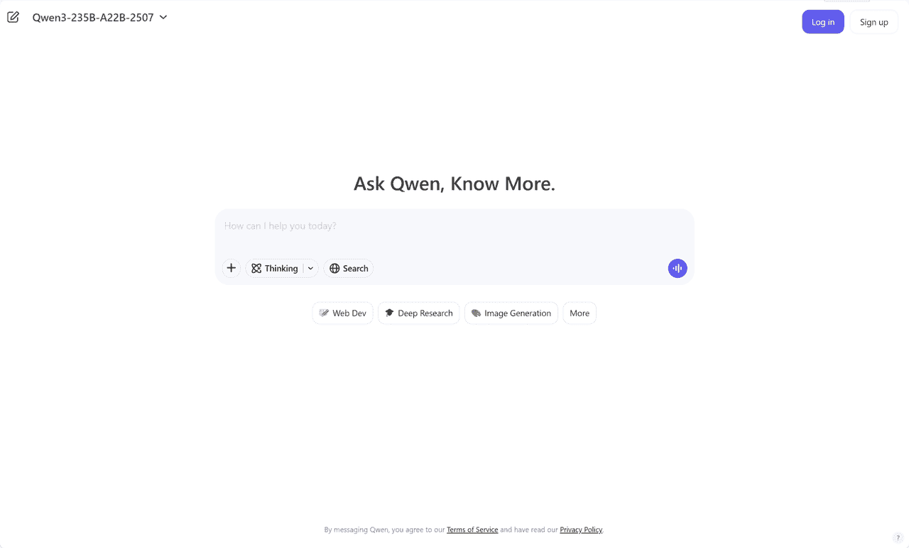
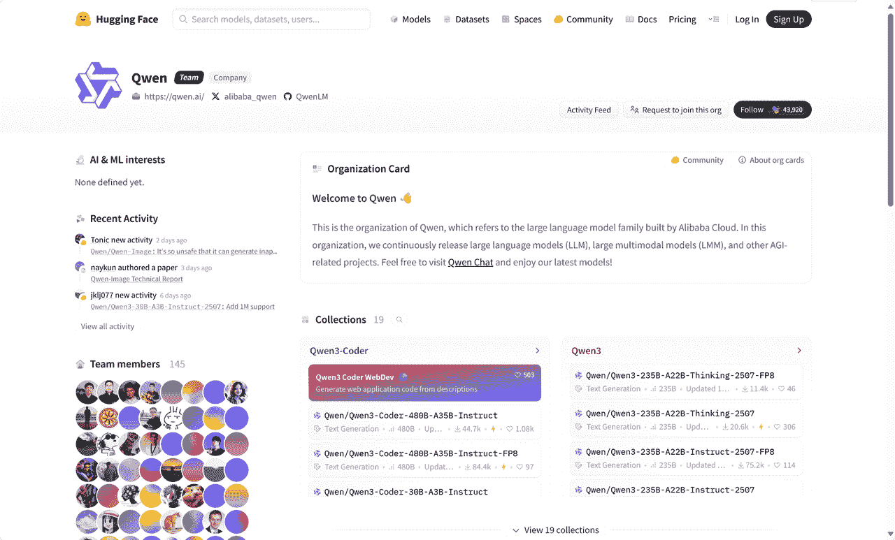
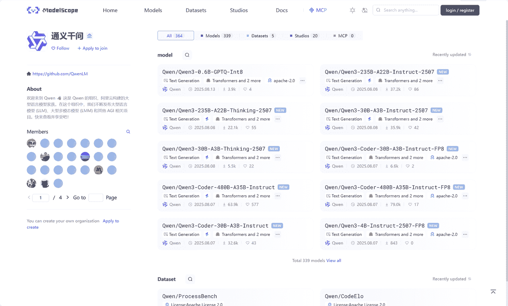

# QwenLM GitHub开源项目

> 来源：[https://gotoaiworld.feishu.cn/docx/XfImdypf9oOQ4IxcOwmcM1OQnKs](https://gotoaiworld.feishu.cn/docx/XfImdypf9oOQ4IxcOwmcM1OQnKs)

# 一、QwenLM GitHub

https://github.com/QwenLM/Qwen

[中文](https://github.com/QwenLM/Qwen/blob/main/README_CN.md)[  ｜](https://github.com/QwenLM/Qwen/blob/main/README_JA.md)  En[glish  ｜](https://github.com/QwenLM/Qwen/blob/main/README_FR.md)  日本[語 ｜  Fr](https://github.com/QwenLM/Qwen/blob/main/README_ES.md)ançais ｜  Español

🤗 H[ugging Face ](https://huggingface.co/Qwen)  |   🤖 Mo[delScope  ](https://modelscope.cn/organization/qwen) |    📑 Pap[er   ](https://arxiv.org/abs/2309.16609) ｜   🖥️ Demo[

WeC](https://modelscope.cn/studios/qwen/Qwen-72B-Chat-Demo/summary)[hat (🛰️)   ](https://github.com/QwenLM/Qwen/blob/main/assets/wechat.png)|   Dis[cord   ](https://discord.gg/CV4E9rpNSD)｜   API

## 1.Inference Performance

Thi[s section p](https://qianwen-res.oss-cn-beijing.aliyuncs.com/profile.py)rovides the statistics of speed and memory of models in different precisions. The speed and memory profiling are conducted using this script.

We measured the average inference speed (tokens/s) and GPU memory usage of generating 2048 with the models in BF16, Int8, and Int4.

🤗 H[ugging Face ](https://huggingface.co/Qwen)  |   🤖 Mo[delScope  ](https://modelscope.cn/organization/qwen) |    📑 Pap[er   ](https://arxiv.org/abs/2309.16609) ｜   🖥️ Demo[

WeC](https://modelscope.cn/studios/qwen/Qwen-72B-Chat-Demo/summary)[hat (🛰️)   ](https://github.com/QwenLM/Qwen/blob/main/assets/wechat.png)|   Dis[cord   ](https://discord.gg/z3GAxXZ9Ce)｜   API|   Web   |   APP

Important

[Qwen2已开，欢迎关注](https://github.com/QwenLM/Qwen2)！看这里：QwenLM/Qwen2

Qwen2模型代码和用法相比此前版本有较大不同，因此我们使用新的repo进行维护。此repo (QwenLM/Qwen) 已停止主要更新维护。

Warning

请勿混用[Qwen](https://github.com/QwenLM/Qwen)和[Qwen2](https://github.com/QwenLM/Qwen2)代码，两者并不兼容。

我们开源了Qwen（通义千问）系列工作，当前开源模型的参数规模为18亿（1.8B）、70亿（7B）、140亿（14B）和720亿（72B）。本次开源包括基础模型Qwen，即Qwen-1.8B、Qwen-7B[、Qwe](https://arxiv.org/abs/2309.16609)n-14B、Qwen-72B，以及对话模型Qwen-Chat，即Qwen-1.8B-Chat、Qwen-7B-Chat、Qwen-14B-Chat和Qwen-72B-Chat。模型链接在表格中，请点击了解详情。同时，我们公开了我们的技术报告，请点击上方论文链接查看。

当前基础模型已经稳定训练了大规模高质量且多样化的数据，覆盖多语言（当前以中文和英文为主），总量高达3万亿token。在相关基准评测中，Qwen系列模型拿出非常有竞争力的表现，显著超出同规模模型并紧追一系列最强的闭源模型。此外，我们利用SFT和RLHF技术实现对齐，从基座模型训练得到对话模型。Qwen-Chat具备聊天、文字创作、摘要、信息抽取、翻译等能力，同时还具备一定的代码生成和简单数学推理的能力。在此基础上，我们针对LLM对接外部系统等方面针对性地做了优化，当前具备较强的工具调用能力，以及最近备受关注的Code Interpreter的能力和扮演Agent的能力。我们将各个大小模型的特点列到了下表。

在这个项目中，你可以了解到以下内容

+   快速上手Qwen-Chat教程，玩转大模型推理

+   量化模型相关细节，包括GPTQ和KV cache量化

+   推理性能数据，包括推理速度和显存占用

+   微调的教程，帮你实现全参数微调、LoRA以及Q-LoRA

+   部署教程，以vLLM和FastChat为例

+   搭建Demo的方法，包括WebUI和CLI Demo

+   搭建API的方法，我们提供的示例为OpenAI风格的API

+   更多关于Qwen在工具调用、Code Interpreter、Agent方面的内容

+   长序列理解能力及评测

+   使用协议

+   ...

如果遇到问题，请优先考虑查询[FAQ](https://github.com/QwenLM/Qwen/blob/main/FAQ.md)。如仍未解决，随时提出issue（但建议使用英语或提供翻译，有助于帮助更多用户）。如果想帮助我们提升，欢迎提交Pull Requests！

想和我们一起讨论和聊天的话，赶紧加入我们的🛰️群和Discord server（入口见文档开头部分）！

## 2.新闻

+   2023[.11.](https://github.com/QwenLM/Qwen/blob/main/examples/system_prompt.md)30 🔥 我们推出 Qwen-72B 和 Qwen-72B-Chat，它们在 3T tokens上进行训练，并支持 32k 上下文。同时也发布了 Qwen-1.8B 和 Qwen-1.8B-Chat。我们还增强了 Qwen-72B-Chat 和 Qwen-1.8B-Chat 的系统指令（System Prompt）功能，请参阅示例文档。此外，我们还对昇腾910以及海光DCU实现了推理的支持，详情请查看ascend-support及dcu-support文件夹。

+   2023年10月17日 我们推出了Int8量化模型Qwen-7B-Chat-Int8和Qwen-14B-Chat-Int8。

+   2023年9月25日 在魔搭社区（ModelScope）和Hug[ging Fac](https://github.com/QwenLM/qwen.cpp)e推出[Qwen-14B和Q](https://github.com/QwenLM/Qwen-Agent)wen-14B-Chat模型，并开源 qwen.cpp 和 Qwen-Agent。Qwen-7B和Qwen-7B-Chat的代码和模型也同步得到更新。请使用最新的代码和模型！

+   相比原版Qwen-7B，新版用了更多训练数据（从2.2T增加到2.4T tokens），序列长度从2048扩展至8192。整体中文能力以及代码能力均有所提升。

+   2023年9月12日 支持Qwen-7B和Qwen-7B-Chat的微调，其中包括全参数微调、LoRA以及Q-LoRA。

+   2023年8月21日 发布Qwen-7B-Chat的Int4量化模型，Qwen-7B-Chat-Int4。该模型显存占用低，推理速度相比半精度模型显著提升，在基准评测上效果损失较小。

+   2023年8月3日 在魔搭社区（ModelScope）和Hugging Face同步推出Qwen-7B和Qwen-7B-Chat模型。同时，我们发布了技术备忘录，介绍了相关的训练细节和模型表现。

## 3.评测表现

Qwen系列模型相比同规模模型均实现了效果的显著提升。我们评测的数据集包括MMLU、C-Eval、 GSM8K、 MATH、HumanEval、MBPP、BBH等数据集，考察的能力包括自然语言理解、知识、数学计算和推理、代码生成、逻辑推理等。Qwen-72B在所有任务上均超越了LLaMA2-70B的性能，同时在10项任务中的7项任务中超越GPT-3.5.

[对于以上所有对比模型，](https://opencompass.org.cn/leaderboard-llm)我们列出了其官方汇报结果与OpenCompass结果之间的最佳分数。

[更多](https://qianwen-res.oss-cn-beijing.aliyuncs.com/QWEN_TECHNICAL_REPORT.pdf)的实验结果和细节请查看我们的技术备忘录。点击这里。

## 4.部署要求

+   python 3.8及以上版本

+   pytorch 1.12及以上版本，推荐2.0及以上版本

+   transformers 4.32及以上版本

+   建议使用CUDA 11.4及以上（GPU用户、flash-attention用户等需考虑此选项）

# 二、Qwen开源项目文档

https://qwenlm.github.io/

## 1.Qwen GitHub 发表论文

https://qwenlm.github.io/publication/

## 2.Qwen GitHub Blog 技术博客

https://qwenlm.github.io/blog/

## 3.Qwen Chat体验试用

https://chat.qwen.ai/

# 三、Qwen HuggingFace

https://huggingface.co/Qwen

# 四、Qwen ModelScope

<https://modelscope.cn/organization/Qwen>

https://modelscope.cn/organization/Qwen