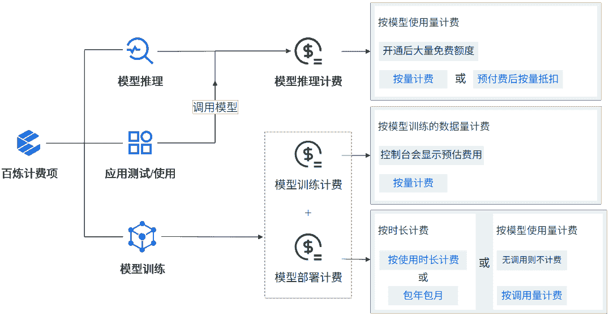
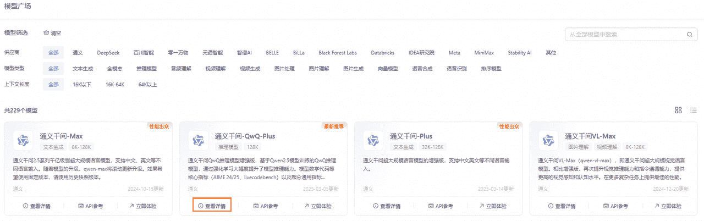

# 大模型产品计费

> 来源：[https://gotoaiworld.feishu.cn/docx/JUaOdf5dvo6u0fxlBXIcsXcGnPf](https://gotoaiworld.feishu.cn/docx/JUaOdf5dvo6u0fxlBXIcsXcGnPf)

# 一、大模型产品计费

更新时间：2025-08-12 21:05:45

[产品详情](https://www.aliyun.com/product/bailian)

|  | **通义千问系列大模型** |  |  |  |  |  | **通义千问开源大模型** |  |  |
| --- | --- | --- | --- | --- | --- | --- | --- | --- | --- |

| 模型 | **qwen-plus** | **qwen-turbo** | **qwen-max** | qwen3-coder-plus | **qwen3-30b-a3b** | **qwen-mt-plus** | **qwen3-235b-a22b** | **qwq-32b** | **qwen2.5-omni-7b** |
| --- | --- | --- | --- | --- | --- | --- | --- | --- | --- |
| 模型 | 极强推理效果 | 高效率，低成本 | 极强推理能力 | 卓越的代码生成能力 | 超强的推理能力 | 专业翻译模型 | 同规模业内SOTA水平 | 超强大的推理能力 | 多模态理解生成大模型 |
| 适用 | 适合复杂任务 | 适合简单任务 | 适合复杂任务 | 代码编程任务 | 推理等复杂任务 | 适合翻译任务 | 复杂推理任务 | 数学推理、编程等任务 | 多模态交互类复杂任务 |
| 免费 | 拥抱AI感恩大放送：新用户首开免费领通义大模型[千万toke](https://help.aliyun.com/zh/model-studio/new-free-quota)ns，最长有效期达180天。立即查看 &gt; |  |  |  |  |  |  |  |  |
| 模型 | 输入 0.0008起 | 输入 0.0003 | 输入 0.0024 | 输入 0.004起 | 输入 0.00075 | 输入 0.0018 | 输入 0.002 | 输入 0.002 | 输入 0.0006 |

# 二、新人免费额度

## **有效期**

新[人免](https://help.aliyun.com/zh/model-studio/billing-for-model-studio)费额度有效期通常是30~180天，从开通阿里云百炼或模型申请通过之日起计算。超过有效期或免费额度消耗完后，继续使用模型推理服务将产生计费。

https://help.aliyun.com/zh/model-studio/new-free-quota?spm=a2c4g.11186623.help-menu-2400256.d_0_18_1.19852918U7BhKL&scm=20140722.H_2766612._.OR_help-T_cn~zh-V_1

