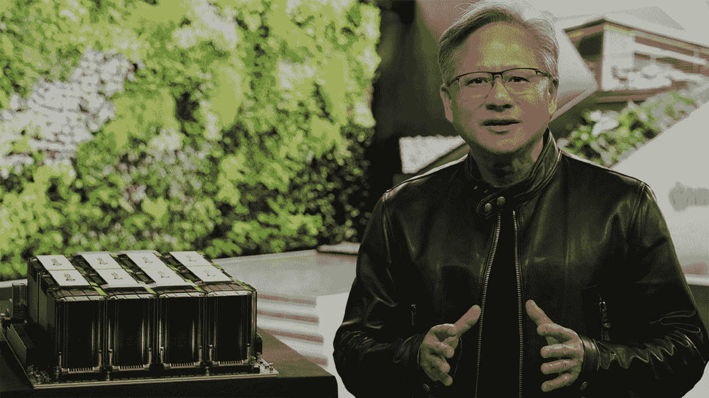
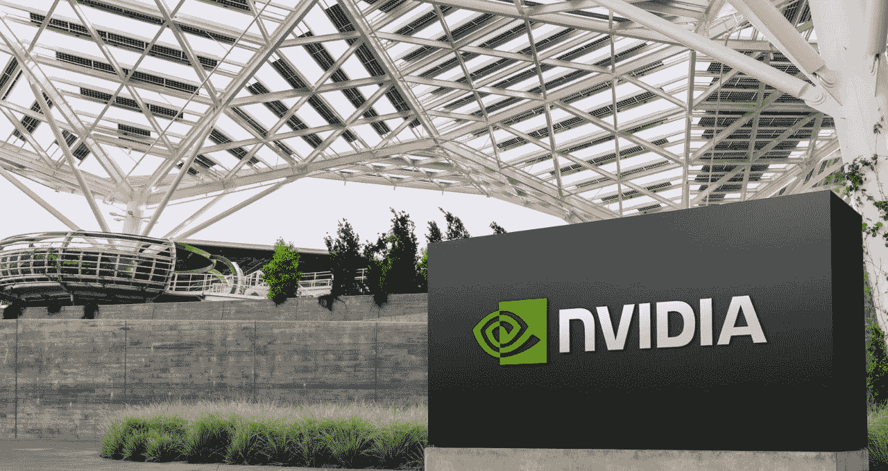

# NVIDIA 技术文档库

> 来源：[https://gotoaiworld.feishu.cn/docx/C47XdXICOorRqDxIxnfco01snWh](https://gotoaiworld.feishu.cn/docx/C47XdXICOorRqDxIxnfco01snWh)

NVIDIA（纳斯达克股票代码：NVDA）是全球领先的人工智能计算公司，总部位于美国加利福尼亚州圣克拉拉。自1993年由黄仁勋、Chris Malachowsky和Curtis Priem创立以来，NVIDIA从专注图形芯片的厂商发展成为驱动全球AI革命的核心引擎，其技术深刻重塑了计算、图形、自动驾驶、工业数字化等多个领域。

### 一、技术创新与产品矩阵

#### 1. **加速计算与AI基础设施**

NVIDIA开创的加速计算范式彻底改变了复杂问题的解决方式。其核心产品包括：

+   **Blackwell架构GPU**：2025年推出的Blackwell架构代表了当前AI计算的巅峰。以RTX PRO 6000 Blackwell Server Edition为例，该GPU通过2080亿晶体管和台积电4NP工艺，实现了传统CPU集群45倍的加速性能。第四代光追技术、DLSS 4（深度学习超级采样技术）和神经着色器的结合，使其在生成式设计、科学模拟等场景中表现卓越。

+   **DGX系列超级计算机**：专为企业级AI训练和推理设计，例如DGX Cloud已登陆微软Azure Marketplace，为开发者提供全托管的AI基础设施。

#### 2. **图形技术与工业数字化**

+   **RTX系列显卡**：从消费级GeForce到专业级RTX PRO，NVIDIA通过光线追踪和AI技术（如DLSS 3）重新定义了图形逼真度。2025年SIGGRAPH大会上发布的RTX PRO Blackwell工作站GPU，在渲染性能和AI推理能力上较前代提升数倍。

+   **Omniverse平台**：基于OpenUSD的工业数字化平台，支持跨行业协作与物理级仿真。例如，其与开源模拟器CARLA的整合，为自动驾驶研发提供了高度逼真的虚拟测试环境。

#### 3. **AI模型与工具生态**

+   **CUDA生态系统**：作为GPU通用计算的基石，CUDA工具包（CUDA Toolkit）已成为全球开发者首选的加速计算框架，支持从深度学习到科学计算的广泛应用。

+   **开源模型与物理AI**：Nemotron系列模型（如Nemotron Nano 2）在复杂任务推理中效率提升6倍，成本降低60%；Cosmos Reason作为70亿参数的视觉语言模型，赋予机器人和AI智能体物理推理能力，推动工厂自动化和智慧城市发展。

### 二、市场地位与行业影响

#### 1. **全球半导体领域的领导者**

根据Gartner 2024年数据，NVIDIA以767亿美元营收首次登顶全球半导体厂商，市场份额达11.7%，其数据中心业务全年营收1152亿美元，占总营收的88%，成为核心增长引擎。在独立GPU市场，NVIDIA仍占据82%的份额，持续领跑消费级和专业级市场。

#### 2. **合作伙伴与生态构建**

NVIDIA与全球顶级厂商建立了深度合作：

+   **数据中心领域**：思科、戴尔、联想等五大IT厂商同步支持Blackwell架构的RTX PRO服务器，推动企业数据中心向AI加速基础设施升级。

+   **工业与城市智能化**：与埃森哲（Accenture）合作开发智能虚拟围栏提升工业安全，与麦视通（Milestone Systems）共建城市级视觉语言模型，优化交通监控和设施管理。

### 三、战略方向与未来布局

#### 1. **物理AI与智能体革命**

NVIDIA将物理AI视为下一个万亿级市场，其目标是让AI系统理解物理定律并与现实世界交互。例如，通过Omniverse构建的数字孪生和Cosmos世界模型，机器人可在虚拟环境中学习并迁移至真实场景，这一技术已应用于仓储物流和能源设施管理。

#### 2. **可持续计算与能效创新**

面对数据中心能耗挑战，NVIDIA通过硬件优化（如Blackwell架构的机密计算技术）和软件工具（如CUDA-X优化库）实现能效提升。例如，RTX PRO Blackwell服务器通过整合数百台CPU服务器，显著降低硬件成本和碳排放。

### 四、技术文档库与开发者资源

NVIDIA技术文档库（[docs.nvidia.com](https://docs.nvidia.com)）是开发者获取权威技术资料的核心平台，涵盖：

+   **API与工具指南**：包括CUDA Toolkit、TensorRT、TAO Toolkit等详细文档，支持从模型训练到边缘部署的全流程开发。

+   **行业解决方案**：针对自动驾驶（DRIVE AV）、医疗影像（Clara Discovery）、工业仿真（Omniverse）等领域的专用技术手册。

+   **最佳实践与案例**：提供Blackwell架构在生成式AI、物理模拟中的实战案例，帮助开发者快速落地应用。

作为AI时代的“数字大脑”，NVIDIA正通过硬件、软件、生态的协同创新，推动AI从实验室走向工业化应用。无论是探索万亿参数大模型，还是构建智慧城市的数字孪生，NVIDIA始终以“加速计算”为核心，引领人类社会向智能未来跃迁。