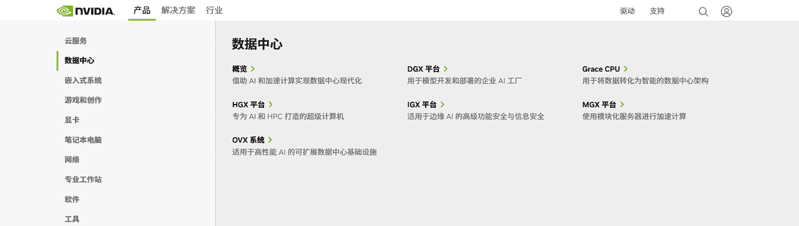
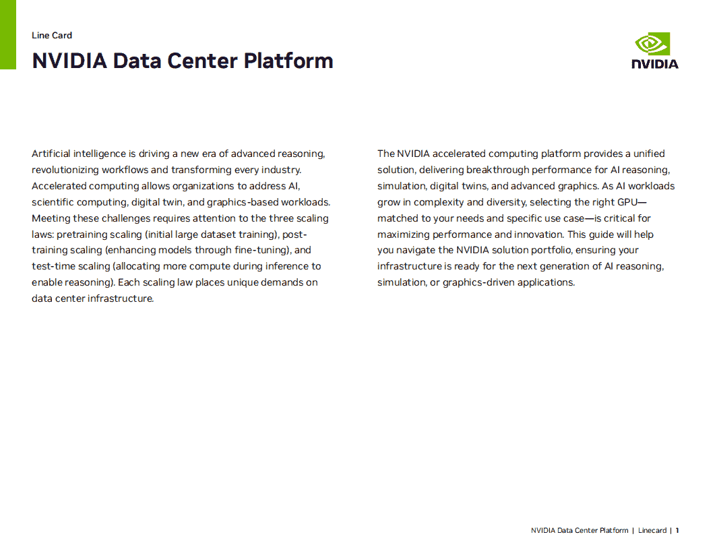
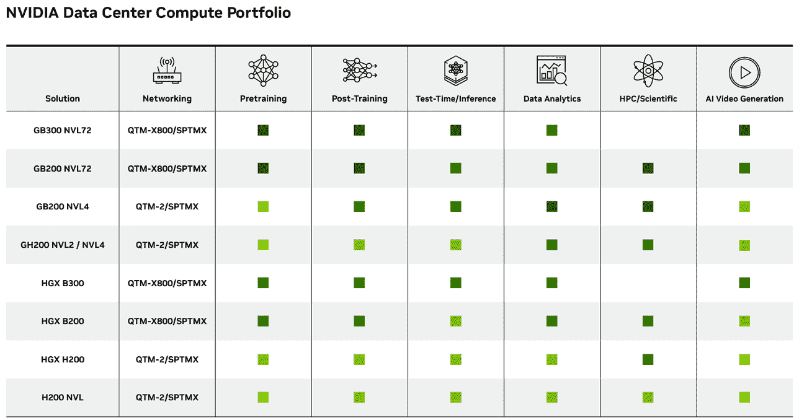
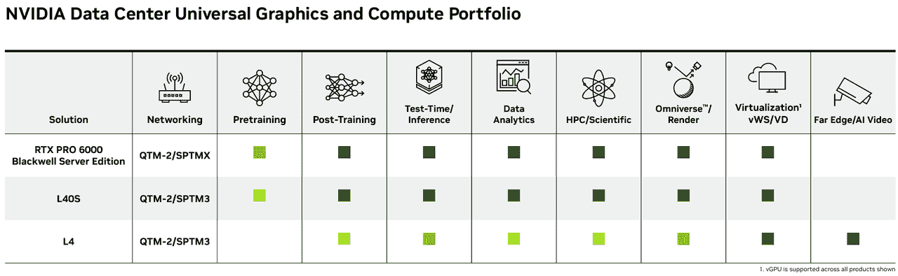
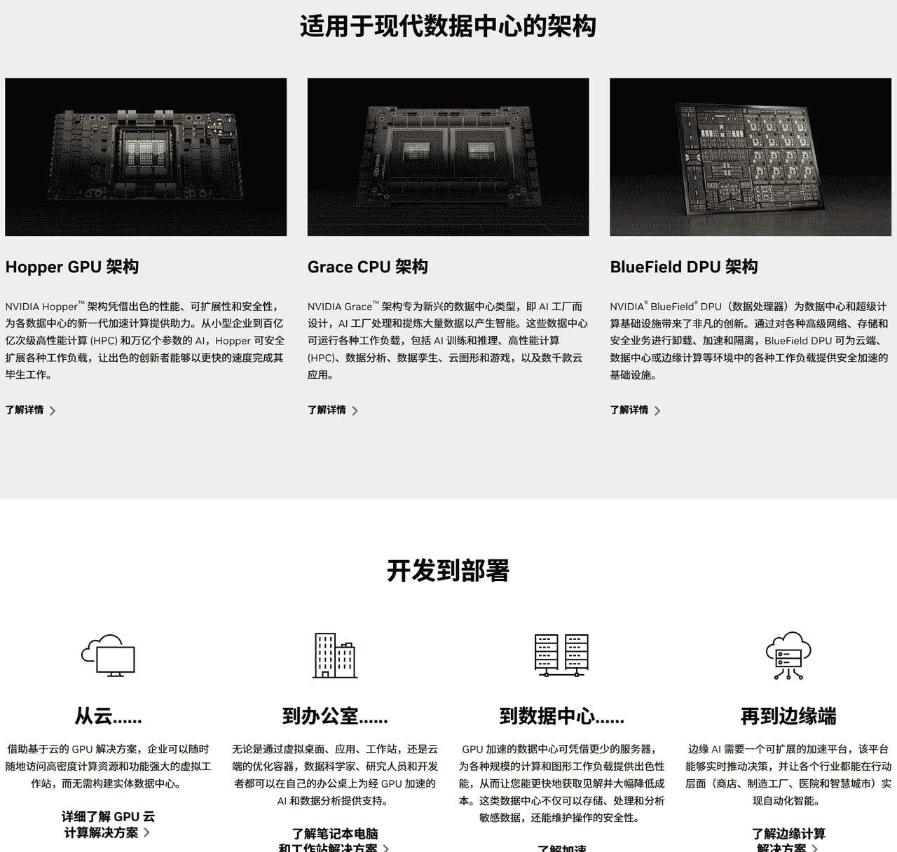

# NVIDIA 产品矩阵

> 来源：[https://gotoaiworld.feishu.cn/docx/HpV5dw4ubos3BVxCEkkcFkADnOc](https://gotoaiworld.feishu.cn/docx/HpV5dw4ubos3BVxCEkkcFkADnOc)

NVIDIA 的产品矩阵围绕加速计算与 AI 技术构建，覆盖数据中心、边缘计算、高性能计算（HPC）等场景，各平台在定位、硬件架构、应用领域上存在显著差异：

# 一、数据中心核心平台

#### 1. DGX 平台：企业级 AI 工厂

+   定位：专为企业级 AI 全流程开发设计，提供从模型训练到部署的一站式解决方案。

+   硬件：整合 NVIDIA GPU（如 Blackwell 架构）、CPU（如 Grace）及软件栈（CUDA、TensorRT），例如 DGX Cloud 已集成至微软 Azure。

+   特点：预集成 AI 开发工具链，支持开箱即用，适合金融、医疗等需要快速落地 AI 应用的行业。

+   差异：封闭式设计，不支持硬件定制，强调标准化与端到端优化。

#### 2. HGX 平台：AI 与 HPC 超级计算机

+   定位：面向超大规模 AI 训练和 HPC 任务，如石油勘探模拟、气候模型等blogs.nvidia.cn。

+   硬件：采用 Blackwell Ultra GPU、第五代 NVLink（1.8 TB/s 带宽）及 Quantum-X InfiniBand 网络，支持多 GPU 集群扩展nvidia.cn。

+   特点：模块化设计，允许 OEM 厂商定制服务器（如戴尔 XE9680），推理性能较前代提升 11 倍nvidia.cn。

+   差异：侧重硬件灵活性，适合需要极致算力的科研与工业场景。

#### 3. OVX 系统：高性能 AI 可扩展基础设施

+   定位：专为生成式 AI、数字孪生等高性能场景设计，如影视渲染、工业仿真nvidia.com。

+   硬件：配置 L40S GPU（48GB 显存）、ConnectX-7 网络及 BlueField-3 DPU，单机架支持 8 颗 GPUnvidia.com。

+   特点：通过 Omniverse 平台实现物理级仿真，支持液冷技术应对高功耗需求nvidia.com。

+   差异：强调整合高速网络与 DPU，提升数据中心能效与扩展性。

#### 4. Grace CPU：数据中心架构基石

+   定位：专为数据密集型工作负载设计，如数据分析、AI 推理nvidia.cn。

+   硬件：基于 ARM Neoverse V2 核心，集成 LPDDR5X 内存（带宽 500GB/s），能效比是传统 x86 的 2 倍nvidia.cn。

+   特点：支持 SCF（可扩展一致性结构），提升核心间通信效率，适用于天气预测、图数据库等场景nvidia.cn。

+   差异：作为独立 CPU 架构，与 GPU 协同优化整体计算效率。

# 二、边缘计算与分布式架构

#### 1. IGX 平台：功能安全边缘 AI

+   定位：工业级边缘计算，适用于自动驾驶、医疗设备等对安全性要求极高的场景nvidia.com。

+   硬件：基于 Orin 芯片，支持功能安全认证（如 ISO 26262），提供 10 年生命周期支持nvidia.com。

+   特点：集成 AI Enterprise 软件，支持高带宽传感器数据处理，可在无网络环境下稳定运行nvidia.com。

+   差异：强调实时决策与安全冗余，与 EGX（通用边缘平台）、Jetson（嵌入式设备）形成互补。

#### 2. MGX 平台：模块化加速计算架构

+   定位：面向灵活部署需求，支持从边缘到数据中心的多场景nvidia.com。

+   硬件：采用开放式设计，兼容 Grace CPU、x86 或 Arm 架构，支持 L40S、H100 等多代 GPUnvidia.com。

+   特点：液冷歧管与 54V 汇流排设计，单机架支持 120kW 功率密度，适合高密度 AI 推理集群NVIDIA英伟达中国。

+   差异：通过标准化组件降低开发成本，OEM 厂商可定制服务器（如 QCT、Supermicro），缩短上市时间nvidia.com。

# 三、核心差异对比

# 四、技术协同与生态整合

+   硬件协同：

+   HGX 与 MGX：在数据中心中，HGX 提供算力密集型模块（如 8-GPU 节点），MGX 通过液冷与电源管理优化机架级部署，例如 GB200 NVL72 系统整合 72 颗 Blackwell GPUNVIDIA英伟达中国。

+   IGX 与 OVX：边缘端 IGX 处理实时数据，OVX 在数据中心进行深度分析，形成 “边缘 - 核心” 闭环（如智慧城市的交通监控与云端优化）nvidia.com。

+   软件生态：

+   所有平台共享 CUDA-X、TensorRT 等基础工具，但针对特定场景优化：

+   DGX 集成 TAO Toolkit 简化模型微调，

+   OVX 深度整合 Omniverse 实现物理级仿真，

+   IGX 通过 AI Enterprise 提供边缘专用安全框架nvidia.com。

# 五、行业适配策略

+   金融与医疗：优先选择 DGX，因其预集成工具链可快速满足合规性要求。

+   科研与能源：HGX 与 Grace CPU 的组合可提升气候模拟、石油勘探等 HPC 任务的效率（如 Grace 在天气预测中能效提升 4.3 倍）nvidia.cn。

+   工业与自动驾驶：IGX 的功能安全认证与 10 年生命周期支持，成为宝马、沃尔沃等企业的首选nvidia.com。

+   超大规模云服务：OVX 的可扩展性与 MGX 的模块化设计，帮助 AWS、阿里云构建弹性 AI 基础设施nvidia.com。

NVIDIA 通过分层产品矩阵，将加速计算能力渗透到从数据中心到边缘的每个环节，同时通过硬件创新（如 Blackwell 架构、NVLink）与生态协作（如与戴尔、联想合作），持续巩固其在 AI 时代的 “数字大脑” 地位。

# 六、NVIDIA 数据中心及企业级GPU产品

NVIDIA Data Center Platform

[line-card.pdf](https://internal-api-drive-stream.feishu.cn/space/api/box/stream/download/all/OhTJbZ6JVoPvbrxcKfvcXqihnae)

https://www.nvidia.cn/data-center/

## 1.Hopper GPU 架构

NVIDIA Hopper(™) 架构凭借出色的性能、可扩展性和安全性，为各数据中心的新一代加速计算提供助力。从小型企业到百亿亿次级高性能计算 (HPC) 和万亿个参数的 AI，Hopper 可安全扩展各种工作负载，让出色的创新者能够以更快的速度完成其毕生工作。

Hopper 采用先进的台积电 4N 工艺制造，拥有超过 800 亿个晶体管，采用五项突破性创新技术为 NVIDIA H200 和 H100 Tensor Core GPU 提供动力支持。在这些创新技术的加持下，新一代 Hopper 与上一代相比，在生成式 AI 训练和推理方面实现了惊人的速度提升。

https://www.nvidia.cn/data-center/technologies/hopper-architecture/

### 1.1、基于Hopper架构的核心产品

Hopper架构的旗舰产品为**NVIDIA H100 Tensor Core GPU**，主要有两种形态，同时衍生出与CPU结合的超级芯片，具体如下：

1.  **H100 SXM5**

+   形态：SXM5模块（适用于高密度服务器集群）

+   核心配置：132个流式多处理器（SM）、528个第四代Tensor Core、80GB HBM3内存、50MB L2缓存

+   工艺：台积电4N定制工艺，800亿晶体管，die size 814mm²

1.  **H100 PCIe Gen 5**

+   形态：PCIe卡（适用于通用服务器部署）

+   核心配置：114个SM、456个第四代Tensor Core、80GB HBM2e内存、50MB L2缓存

+   功耗：350W（低于SXM5版本的700W）

1.  Grace Hopper Superchip

+   形态：H100 GPU与Grace CPU通过芯片级互连（900GB/s带宽）结合的超级芯片

+   定位：面向TB级加速计算，为大模型AI和HPC workload提供10倍性能提升

### 1.2、性能对比（以A100为基准）

Hopper架构的H100相比前代Ampere架构的A100，在计算能力、内存效率、架构特性等方面实现了显著突破，具体对比如下：

##### 1. 计算性能：多数据类型吞吐量跃升

基于第四代Tensor Core和FP8新格式，H100在AI和HPC核心计算场景中性能大幅提升，关键数据如下：

| 数据类型/计算单元 | A100性能 | H100 SXM5性能 | 性能提升倍数 |
| --- | --- | --- | --- |
| FP8 Tensor Core（稀疏） | N/A | 4000 TFLOPS | 6.4x（vs A100 FP16） |
| FP16/BF16 Tensor Core | 624 TFLOPS（稀疏） | 2000 TFLOPS（稀疏） | 3.2x |
| TF32 Tensor Core | 312 TFLOPS（稀疏） | 1000 TFLOPS（稀疏） | 3.2x |
| FP64 Tensor Core | 19.5 TFLOPS | 60 TFLOPS | 3.1x |
| INT8 Tensor Core | 1248 TOPS（稀疏） | 4000 TOPS（稀疏） | 3.2x |

注：“稀疏”指启用结构化稀疏特性（性能翻倍），数据来自文档Table 2

##### 2. 内存与缓存：带宽和容量双重突破

H100通过HBM3内存和更大L2缓存优化数据供给效率：

+   **内存带宽**：

+   A100：1555 GB/s（HBM2）

+   H100 SXM5：3000 GB/s（HBM3），提升约2倍；H100 PCIe：2000 GB/s（HBM2e），提升约1.3倍。

+   **L2缓存**：

+   A100：40MB

+   H100：50MB（提升25%），可缓存更大模型片段，减少HBM访问次数。

+   **内存容量**：

+   A100：40GB HBM2

+   H100：80GB（翻倍），支持更大规模模型单机部署。

##### 3. 架构创新：针对性加速关键场景

Hopper架构引入多项创新特性，针对性提升特定 workload 性能：

+   Transformer Engine：结合FP8和FP16动态精度切换，为大语言模型（如GPT-3）提供**9倍AI训练速度**和**30倍推理速度**提升（vs A100）。

+   **DPX指令**：加速动态规划算法（如基因组学的Smith-Waterman、机器人路径优化的Floyd-Warshall），性能提升**7倍**（vs A100）。

+   **线程块集群与分布式共享内存**：支持跨SM的线程协作，数据交换效率提升**7倍**（vs A100通过全局内存交换），优化64K FFT、直方图等算法性能（提升1.7-3倍）。

+   Tensor Memory Accelerator（TMA）：硬件加速张量数据搬运，释放线程资源专注计算，单线程即可驱动H100全内存带宽，效率远超A100的软件地址生成方式。

##### 4. 互连技术：集群级性能跃升

H100通过第四代NVLink和NVLink Switch System提升多GPU协作效率：

+   **NVLink带宽**：

+   A100：600 GB/s（第三代NVLink）

+   H100：900 GB/s（第四代NVLink），提升50%，是PCIe Gen5的7倍。

+   **集群扩展性**：NVLink Switch System支持**256个GPU跨节点互联**，全互联带宽达57.6 TB/s，256-GPU集群可提供1 ExaFLOP FP8稀疏计算能力；相比A100集群，二分带宽提升9倍，all-reduce吞吐量提升4.5倍。

##### 5. 能效与密度

+   工艺升级：从A100的台积电7nm（N7）升级至H100的台积电4N，相同功耗下频率更高，性能/瓦提升显著。

+   单机架算力：H100 SXM5集群的AI算力是同规模A100集群的6倍以上。

### 1.3、总结

Hopper架构的H100通过第四代Tensor Core（FP8支持）、Transformer Engine、HBM3内存、NVLink网络等创新，实现了从单机到集群的全方位性能突破，尤其在大模型AI、HPC、基因组学等数据密集型场景中，相比A100平均提升3-6倍性能，成为支撑exascale计算和万亿参数模型的核心引擎。

https://developer.nvidia.com/blog/nvidia-hopper-architecture-in-depth/

## 2.Grace CPU 架构

NVIDIA Grace™ 架构专为新兴的数据中心类型，即 AI 工厂而设计，AI 工厂处理和提炼大量数据以产生智能。这些数据中心可运行各种工作负载，包括 AI 训练和推理、高性能计算 (HPC)、数据分析、数据孪生、云图形和游戏，以及数千款云应用。

随着模型的复杂性激增，加速计算和能源效率对于满足 AI 需求变得至关重要。NVIDIA Grace™ CPU 是一款突破性的 Arm® CPU，具有超强的性能和效率。它可以与 GPU 紧密结合以增强加速计算能力，也可以作为强大而高效的独立 CPU 进行部署。NVIDIA Grace CPU 是新一代数据中心的基础，可采用多种配置来满足不同数据中心的需求。

# 七、NVIDIA GPU主流芯片对比

#### 一、GPU 分类体系（按场景 / 定位）

NVIDIA GPU 分为数据中心级、专业级、消费级、嵌入式四大核心品类，覆盖从超算到边缘的全场景需求：

#### 二、核心型号与性能对比（2025 年主流产品）

##### ▶ 数据中心级 GPU（训练 / 推理主力）

注：GB200 为 Grace+Blackwell 超级芯片，FP4 精度较 H100 FP8 显存占用减少 50%，推理成本降低至 1/25（文档数据）

##### ▶ 专业级 GPU（图形 / 计算融合）

案例：拉斯维加斯球顶巨幕使用 150 台 A6000 实时渲染 8K 动画，单卡支持 120 帧 / 秒（摘要 2）。

##### ▶ 消费级 GPU（游戏 / 创作）

实测：RTX 5070 Ti 笔记本在《黑神话：悟空》中达 90 帧，生成 7B 模型速度 77 tokens/s，满足日常 AI 需求（摘要 3、5）。

##### ▶ 嵌入式 / 边缘 GPU

#### 三、关键技术对比（架构演进）

注：Blackwell 通过 FP4 将大模型显存占用减半，支持 27 万亿参数模型单机推理（文档数据）。

#### 四、选型建议

1.  大模型训练：

+   首选：B300 Ultra（72 GPU 集群），支持十万亿参数模型，训练速度是 H100 的 4 倍（文档）。

+   次选：H100 SXM5，适合 400 亿参数以下模型（如 Meta Llama 3）。

1.  企业级推理：

+   高并发：GB200（192GB 显存），单卡支持 2000 亿参数模型，延迟 10 秒（文档）。

+   边缘 / 低功耗：L40S（48GB GDDR6），推理成本比 A100 低 60%（摘要 2）。

1.  专业图形 / 创作：

+   工作站：RTX Pro 6000（96GB HBM3e），支持 4K 实时渲染 + AI 降噪（如 Blender 加速 3 倍）。

+   笔记本：RTX 5080（16GB GDDR7），DLSS 4 下《霍格沃茨之遗》帧率超 120 帧（摘要 3）。

1.  消费级需求：

+   游戏 + AI：RTX 5070 Ti（12GB GDDR7），8000 元级性价比之王，满足 Stable Diffusion 和 3A 游戏。

+   发烧友：RTX 5090（24GB GDDR7），支持 8K 光追 + 本地部署 14B 模型（如 DeepSeek-R1）。

#### 五、总结：架构代际决定性能边界

+   Hopper（H100）：定义大模型训练标准，FP8 精度是 2023-2024 年主力。

+   Blackwell（GB200）：开启 FP4 时代，通过显存压缩和统一架构，解决大模型部署成本难题。

+   Grace 系列：CPU+GPU 超级芯片，通过 NVLink-C2C（900GB/s）消除数据搬运瓶颈，重构数据中心架构。

未来趋势：光量子混合计算（2027+）、机架级共享内存（如 B300 的 20TB）将进一步突破传统 GPU 的算力天花板，推动 AI 从 “训练密集” 转向 “推理工业化”。

# 八、NVIDIA各平台定义与核心定位

## 1. DGX Platform（企业级 AI 工厂）

+   定义：NVIDIA 推出的端到端 AI 开发与部署平台，整合 GPU（如 Blackwell 架构）、CPU 及预优化软件栈（CUDA、TensorRT、AI Enterprise 套件），提供从模型训练到生产的全流程支持。

+   核心特性：

+   硬件：DGX SuperPOD 集群支持多节点扩展，单机可集成 8 颗 GPU；DGX Station 桌面系统适合小团队开发。

+   软件：预装 MLOps 工具链（如 Kubernetes、Docker），支持一键部署生成式 AI 模型（如 Llama 3）。

+   场景：金融风控（反欺诈模型实时推理）、医疗影像分析（3D 病理切片诊断）、制造业数字孪生（产线优化）。

## 2. Grace CPU（数据中心架构基石）

+   定义：基于 Arm Neoverse V2 架构的高性能 CPU，专为数据密集型工作负载设计，可与 GPU 协同形成 “超级芯片”。

+   核心特性：

+   硬件：72 个 Arm 核心，LPDDR5X 内存（带宽 500GB/s，功耗仅为 DDR5 的 1/5）；双芯片通过 NVLink-C2C 互连形成 “Grace 超级芯片”，总带宽 900GB/s。

+   性能：AI 推理能效比 x86 CPU 高 4.3 倍，天气预测等 HPC 任务速度提升 2 倍。

+   场景：数据分析（PB 级日志实时处理）、大模型推理（175B 参数模型本地化部署）、云服务（AWS Graviton 替代方案）。

## 3. HGX Platform（AI 与 HPC 超级计算机）

+   定义：面向超大规模 AI 训练和 HPC 的模块化平台，支持多 GPU 互连与高速网络扩展。

+   核心特性：

+   硬件：Blackwell Ultra GPU（72 颗集成于单机架）、第五代 NVLink（1.8TB/s 带宽）、Quantum-X InfiniBand 网络（800Gb/s）。

+   性能：Llama 3.1 405B 模型训练速度较 Hopper 架构提升 4 倍，推理延迟降低至 10 秒。

+   场景：十万亿参数大模型训练（如 DeepSeek R1-671B）、石油勘探（地震数据三维建模）、气候模拟（全球 1km 分辨率气象预测）。

## 4. IGX Platform（边缘 AI 与功能安全）

+   定义：工业级边缘计算平台，专为自动驾驶、医疗设备等对安全性要求极高的场景设计。

+   核心特性：

+   硬件：基于 Orin 芯片，支持 ISO 26262 功能安全认证，提供 10 年生命周期支持；集成 ConnectX-7 SmartNIC（超低延迟网络）。

+   软件：预装 Holoscan（医疗传感器处理）、Metropolis（视觉 AI）、Isaac（机器人框架），支持生成式 AI 边缘部署。

+   场景：自动驾驶（激光雷达实时感知）、手术机器人（AI 辅助操作）、工业质检（晶圆缺陷检测）。

## 5. MGX Platform（模块化加速计算）

+   定义：开放式模块化服务器架构，支持从边缘到数据中心的灵活部署。

+   核心特性：

+   硬件：兼容 Grace CPU、x86 或 Arm 架构，支持 L40S、H100 等多代 GPU；液冷歧管与 54V 汇流排设计，单机架功率密度达 120kW。

+   灵活性：OEM 厂商可定制服务器（如 QCT、Supermicro），缩短上市时间至 3 个月。

+   场景：5G 基站（实时视频分析）、混合云（AI 推理资源池化）、边缘超算（智慧城市数据处理）。

## 6. OVX Systems（高性能 AI 基础设施）

+   定义：专为生成式 AI、数字孪生设计的可扩展数据中心系统，整合 GPU、网络与存储。

+   核心特性：

+   硬件：多颗 L40S GPU（48GB 显存）、ConnectX-7 网络、BlueField-3 DPU（数据处理单元）；支持液冷技术，单机架功耗 600kW。

+   性能：Omniverse 平台实现物理级仿真，影视渲染速度较传统 CPU 集群提升 45 倍。

+   场景：生成式 AI（Stable Diffusion 3D 渲染）、数字孪生（城市交通仿真）、工业设计（汽车空气动力学模拟）。

## 7.核心差异对比（按场景 / 架构 / 扩展性）

NVIDIA 通过 **D**GX（标准化 AI 工厂）、HGX（超算级算力）、IGX（边缘安全）、MGX（模块化部署）、OVX（高性能渲染） 的分层布局，结合 Grace CPU 的能效优势，构建了从数据中心到边缘的全场景覆盖。各平台通过硬件创新（如 Blackwell 架构、NVLink 5.0）与软件生态（CUDA-X、Omniverse）的协同，巩固了其在 AI 时代 “数字大脑” 的地位，推动 AI 从实验室走向工业化应用。