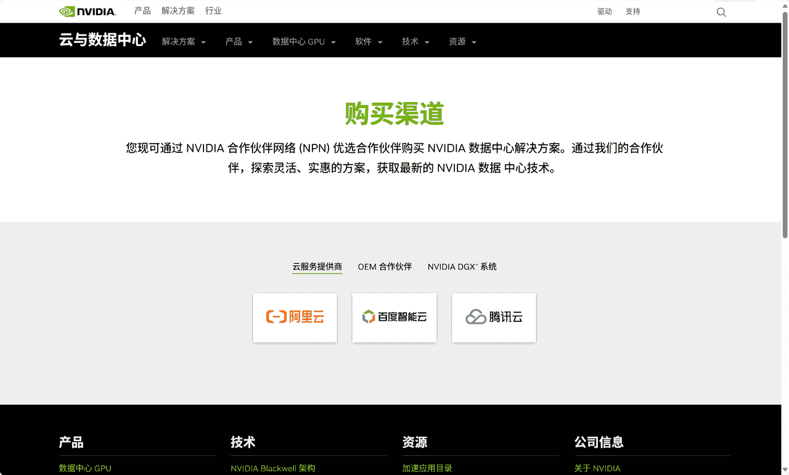
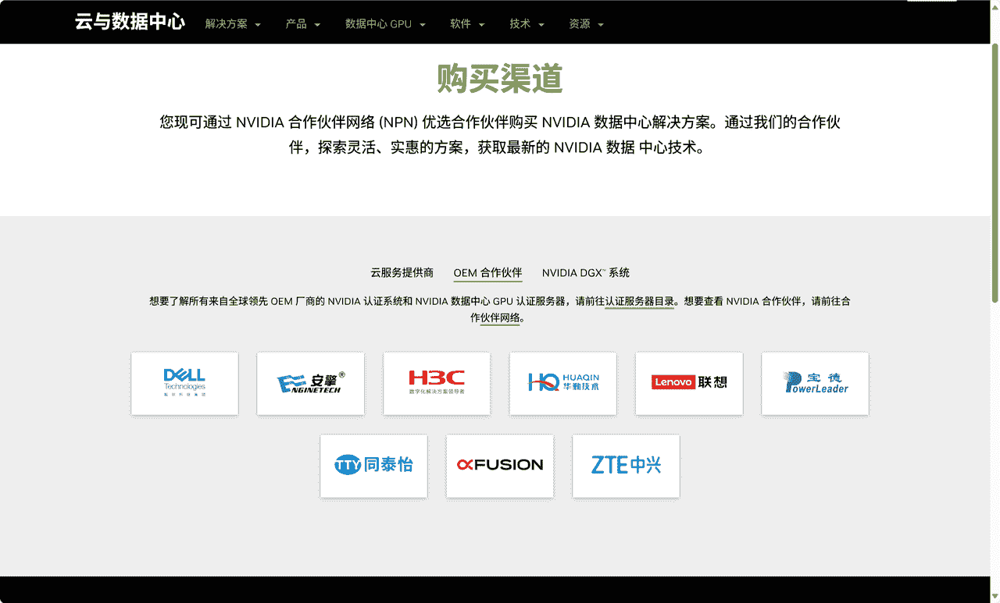
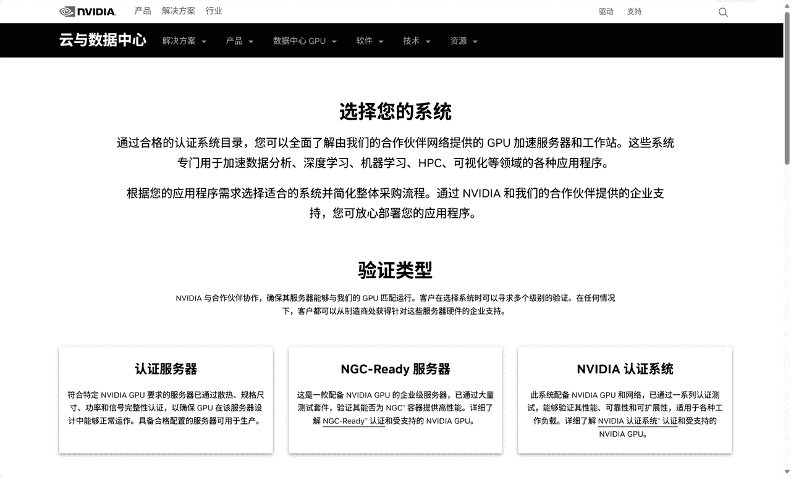

# NVIDIA 全球合作伙伴及采购渠道

> 来源：[https://gotoaiworld.feishu.cn/docx/HpxMdgKQjodcKYxJtK0c7H3Yn0b](https://gotoaiworld.feishu.cn/docx/HpxMdgKQjodcKYxJtK0c7H3Yn0b)

# 一、NVIDIA 全球合伙伙伴

## 1、国际服务器厂商

1.  戴尔（Dell Technologies）

+   合作重点：推出搭载 RTX PRO 6000 Blackwell GPU 的 PowerEdge R7725 2U 服务器，整合 NVIDIA AI Enterprise 软件及网络解决方案，覆盖 AI 训练、数据分析和图形渲染场景。

+   典型产品：PowerEdge R7725（双 RTX PRO 6000 GPU）、PowerEdge XE9680（多 H100 GPU 节点）。

1.  HPE（惠普企业）

+   合作重点：与 NVIDIA 联合开发基于 Blackwell 架构的超算级服务器，支持液冷技术和 NVLink 5.0 互连，适用于气候模拟、生物医药等 HPC 场景。

+   典型产品：HPE Cray EX（集成 72 颗 Blackwell GPU）。

1.  联想（Lenovo）

+   合作重点：推出 ThinkSystem SR670 V3 服务器，支持 8 颗 H100 GPU，针对金融风控和医疗影像分析优化。

+   典型产品：ThinkSystem SR670 V3（NVIDIA AI Enterprise 认证）。

1.  思科（Cisco）

+   合作重点：将 RTX PRO 6000 GPU 整合到 UCS C 系列服务器，提供从硬件到网络的端到端解决方案，适用于企业级 AI 推理。

1.  Supermicro（超微）

+   合作重点：推出基于 Grace CPU 和 Blackwell GPU 的超级服务器，支持 192GB 统一内存池，适用于 27 万亿参数大模型推理。

1.  华硕（ASUS）、富士通（Fujitsu）、技嘉（GIGABYTE）

+   合作重点：推出搭载 A100/H100 GPU 的高密度服务器，覆盖边缘 AI 和中小型企业训练需求。

## 2、中国本土服务器厂商

1.  浪潮信息（Inspur）

+   合作重点：NVIDIA 在中国的核心合作伙伴，推出基于 A100/H100 的 AI 服务器（如 NF5468M5），液冷技术能效比提升 30%，广泛应用于互联网、政府和能源行业。

1.  宝德（Powerleader）

+   合作重点：中国加速服务器市场前三，提供从板卡到整机的定制化 GPU 服务器，覆盖 AI 训练和推理全流程。

1.  中科曙光（Sugon）

+   合作重点：在 HPC 领域与 NVIDIA 合作，推出搭载 H100 GPU 的超算节点，用于气象预测和石油勘探。

## 3、云服务与解决方案提供商

1.  AWS、微软 Azure、Google Cloud（GCP）

+   合作重点：提供基于 NVIDIA GPU 的云服务器实例（如 AWS P5 实例、Azure ND 系列），支持生成式 AI 和大模型训练。

1.  IBM

+   合作重点：将 NVIDIA GPU 与 Power 处理器结合，推出 Power Systems 加速计算系统，适用于认知计算和科学模拟。

## 4、合作特点与行业影响

+   技术协同：合作伙伴基于 NVIDIA GPU 开发液冷服务器（如浪潮 i24）、模块化架构（如 MGX 平台），推动数据中心能效提升。

+   行业覆盖：金融、医疗、制造等领域的头部企业通过 NVIDIA 合作伙伴的服务器实现 AI 落地，例如宝德为医疗行业提供 3D 病理分析解决方案。

+   地缘因素：受美国出口管制影响，华为等中国厂商与 NVIDIA 的直接合作受限，但浪潮等企业仍通过合规渠道获取 GPU 并参与生态。

如需获取具体厂商的产品型号或行业案例，可进一步查询 NVIDIA 官方认证服务器目录或合作伙伴官网。

# 二、NVIDIA 全球采购渠道

## 1、NVIDIA 官方合作伙伴网络（NPN）

通过 NVIDIA 认证的解决方案提供商直接采购，覆盖硬件、软件及技术支持：

+   国际合作伙伴：

+   B[oxx：提供搭载 RTX P](mailto:sales@boxx.com)RO GPU 的工作站和服务器，支持 AI 训练与图形渲染场景，官网可直接询价（sales@boxx.com）。

+   Colfax International：定制化 HPC 集群与 GPU 服务器，服务 Fortune 1000 企业及科研机构，支持液冷与高密度部署。

+   Mark III Systems：NVIDIA Elite 级合作伙伴，提供 DGX 系统租赁及 “全栈 AI pipeline” 服务，适合企业级 AI 开发。

+   国内合作伙伴：

+   神州数码（Digital China）：NVIDIA 中国区核心分销商，覆盖 RTX PRO、DGX 及 HGX 平台，提供本地化交付与售后。

+   联强国际（Synnex）：代理 NVIDIA 数据中心产品，服务政府、金融及电信行业。

## 2、服务器厂商渠道

国际与本土服务器厂商提供预集成 NVIDIA GPU 的整机方案：

+   戴尔（Dell）：PowerEdge R7725 等机型搭载 RTX PRO 6000 Blackwell GPU，官网或线下渠道可配置采购。

+   浪潮信息（Inspur）：NF5468M5 等 AI 服务器集成 A100/H100 GPU，支持液冷技术，适合国内互联网与政府客户。

+   HPE、联想（Lenovo）：通过其全球分销网络销售搭载 NVIDIA GPU 的服务器，部分型号支持定制化配置。

## 3、云服务与租赁平台

无需硬件采购，通过云服务商获取 GPU 算力：

+   AWS、微软 Azure、Google Cloud：提供基于 NVIDIA GPU 的实例（如 AWS P5、Azure ND 系列），按小时 / 月计费，适合短期项目或弹性需求。

+   NVIDIA DGX Cloud：全托管 AI 基础设施，可直接在微软 Azure Marketplace 租赁 DGX 资源。

## 4、行业解决方案提供商

针对特定领域（如医疗、制造）提供定制化 GPU 服务器：

+   医疗领域：如联影医疗与 NVIDIA 合作开发医疗影像 AI 服务器，集成 RTX PRO GPU 与 Clara Discovery 软件。

+   工业领域：埃森哲（Accenture）通过 NVIDIA IGX 平台为工厂部署边缘 AI 服务器，支持功能安全认证。

## 5、教育与科研渠道

学术机构可通过专项计划采购：

+   NVIDIA 学术计划：高校与研究机构可申请折扣采购 DGX 系统或 GPU 集群，部分项目提供免费算力支持。

## 6、注意事项

1.  型号合规性：部分高端 GPU（如 Blackwell Ultra）受出口管制影响，需确认本地合规性后采购。

1.  售后服务：通过官方合作伙伴采购可享受 NVIDIA 原厂技术支持（如 DGX 系统提供 90 天免费技术咨询）。

1.  定制需求：若需特殊配置（如液冷、多 GPU 互连），建议直接联系 NVIDIA 解决方案工程师（sales@nvidia.com）。

如需获取完整合作伙伴名单，可访问 NVIDIA 官网的“Where to Buy” 页面，筛选地区与产品类型。

https://www.nvidia.cn/data-center/where-to-buy/

