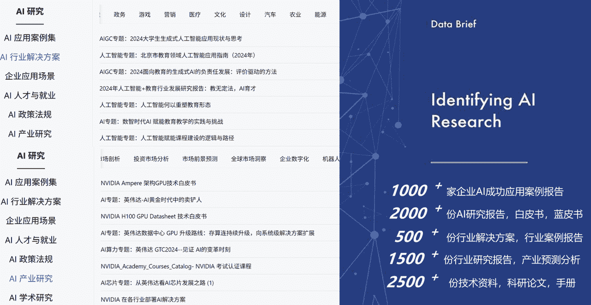
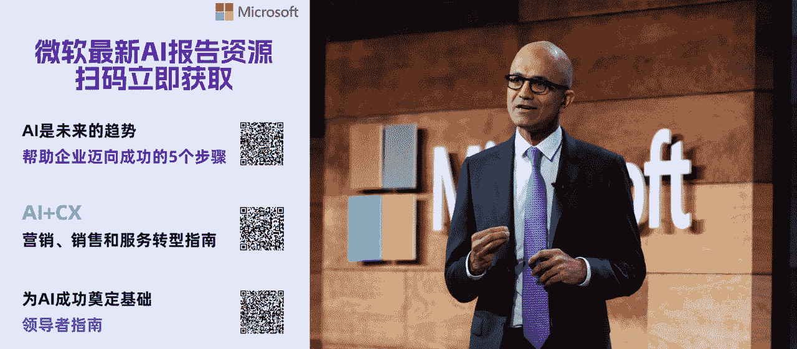
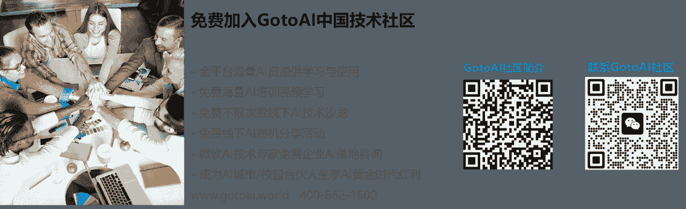
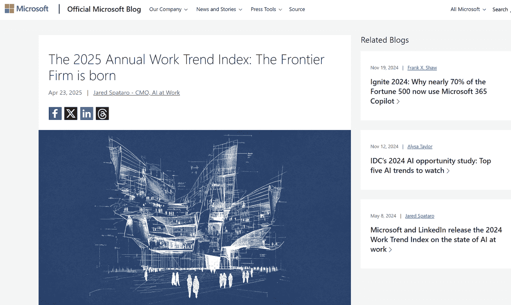

# AI 研究报告

> 来源：[https://gotoaiworld.feishu.cn/docx/Ry8udkMLwoyOyxxVz5FcStIyn6g](https://gotoaiworld.feishu.cn/docx/Ry8udkMLwoyOyxxVz5FcStIyn6g)

# 一、研究报告内容

> 输入 @ 插入相关文档，介绍项目成立的背景

#### 资料库内容覆盖领域

+   AI 技术方向：AIGC、大模型、AI + 算力、AI 写作、AI 绘画、AI 音频、AI 视频、AI 设计、AI 编程、AI 聊天、AI 办公、AI 提示指令、AI 训练模型等

+   AI + 行业应用：数字人、机器人、元宇宙、AI + 游戏、AI + 法律、AI + 电商、AI + 汽车、AI + 教育、AI + 广告、AI + 医疗、AI + 工业、AI + 出版、AI + 保险、AI + 银行、AI + 金融、AI + 交通、AI + 文旅、AI + 服装、AI + 食品、AI + 化工、AI + 电网、AI + 零售、AI + 客服、AI + 餐饮、AI + 地产、AI + 物流、AI + 直播、AI + 美容、AI + 农业等

+   知名工具 / 模型：文言一心、chatGPT、复旦 moss、Mijourney、通义千问、DALL・E-2、谷歌 Bard、Stable Diffusion、微软 Bing、华为盘古、Claude、清华 OpenBMB 等。

# 二、研究报告全景图

> **AI 应用案例集，AI行业解决方案，企业应用场景分析，A**I人才与就业，AI政策法规，AI产业研究

微软2025报告：企业AI化的三大趋势

The 2025 Annual Work Trend Index: The Frontier Firm is born

https://blogs.microsoft.com/blog/2025/04/23/the-2025-annual-work-trend-index-the-frontier-firm-is-born/

