# Microsoft 公司

> 来源：[https://gotoaiworld.feishu.cn/docx/G6VMdOR7poB6IZx6MZHctBRcnXb](https://gotoaiworld.feishu.cn/docx/G6VMdOR7poB6IZx6MZHctBRcnXb)

# 一、Microsoft AI 研究网站

> 输入 @ 插入相关文档，介绍项目成立的背景

1.  AI and Microsoft Research

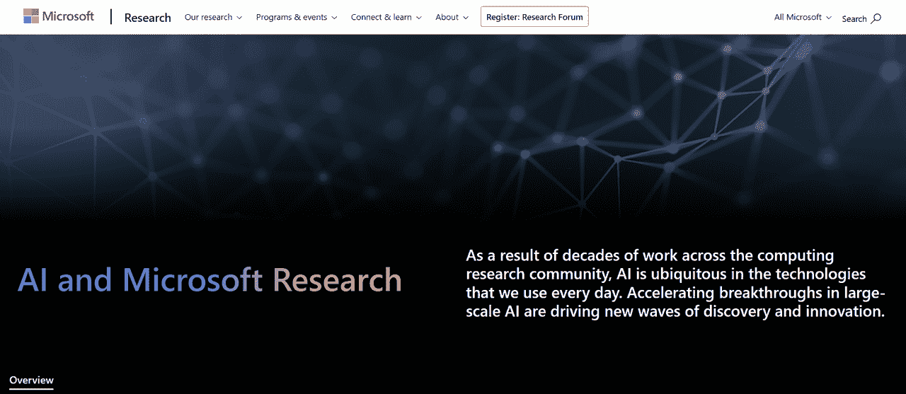

https://www.microsoft.com/en-us/research/focus-area/ai-and-microsoft-research/?msockid=32d22e7f0285690d3255386403b56895

1.  AI research archive

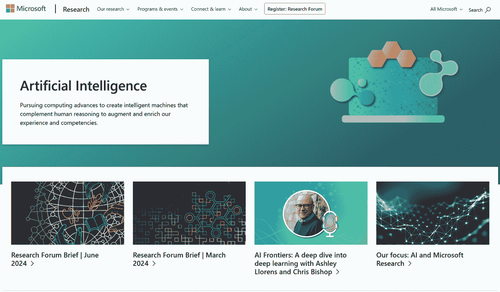

https://www.microsoft.com/en-us/research/research-area/artificial-intelligence/?

1.  Microsoft Research Forum

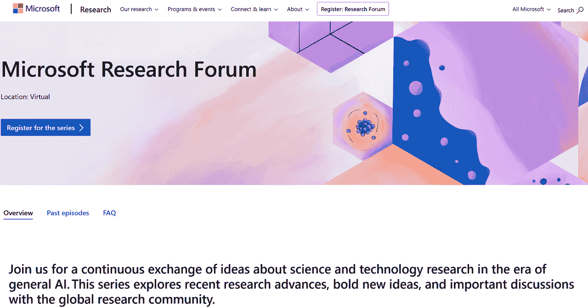

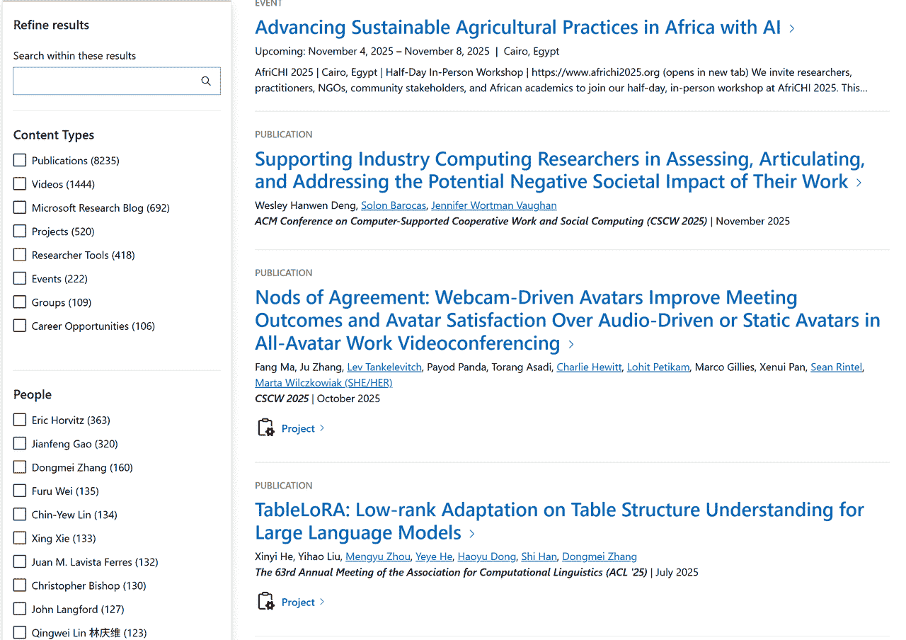

1.  Microsoft Research Podcast

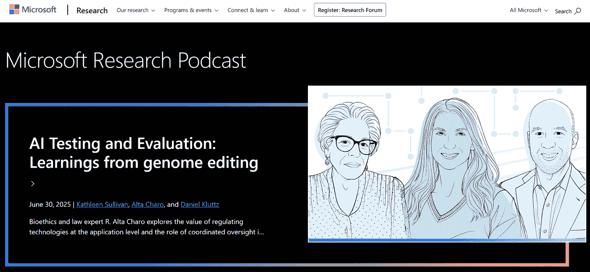

# 二、Microsoft AI研究报告清单

> **目标一：**制定具体、细化、可拆解的目标

> **目标二：**......

2025  Responsible AI Transparency Report

https://cdn-dynmedia-1.microsoft.com/is/content/microsoftcorp/microsoft/msc/documents/presentations/CSR/Responsible-AI-Transparency-Report-2025.pdf

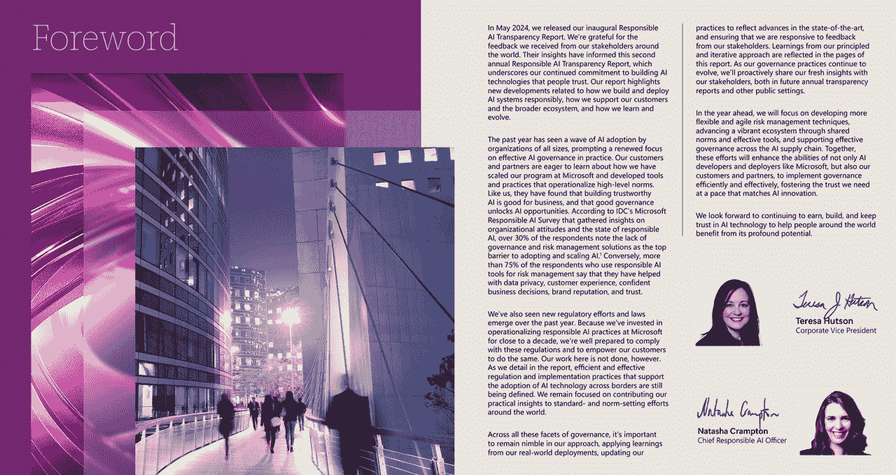

The Impact of Generative AI on Critical Thinking: Self-Reported  Reductions in Cognitive Effort and Confidence Effects From a Survey of Knowledge Workers

生成性人工智能对批判性思维的影响

https://www.microsoft.com/en-us/research/wp-content/uploads/2025/01/lee_2025_ai_critical_thinking_survey.pdf?msockid=32d22e7f0285690d3255386403b56895

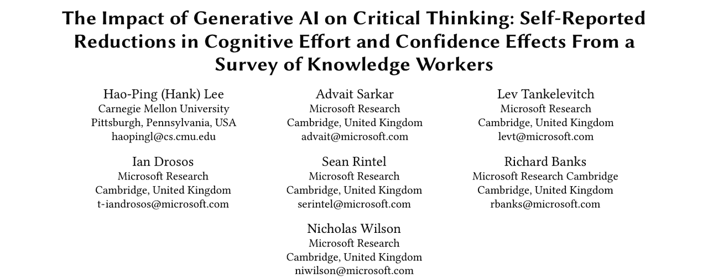

负责任的人工智能的商业案例

https://marketingassets.microsoft.com/gdc/gdcnUixiy/original

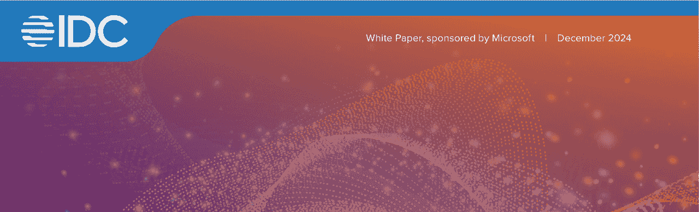

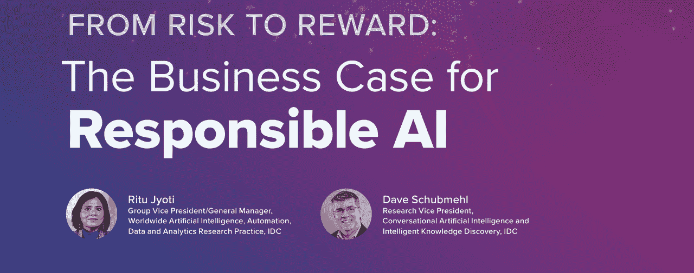

真实工作场所中的生成式 AI

Generative AI in Real-World Workplaces

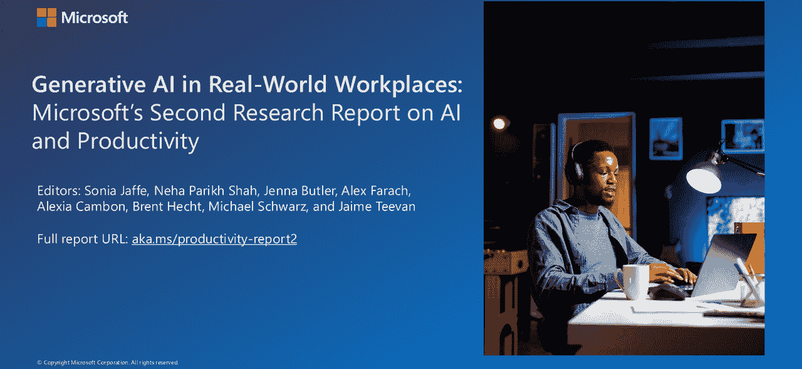

https://www.microsoft.com/en-us/research/publication/generative-ai-in-real-world-workplaces/?msockid=32d22e7f0285690d3255386403b56895

https://www.microsoft.com/en-us/research/wp-content/uploads/2024/07/Generative-AI-in-Real-World-Workplaces-Deck.pdf

https://www.microsoft.com/en-us/research/wp-content/uploads/2024/07/Generative-AI-in-Real-World-Workplaces.pdf

The New Future of Work

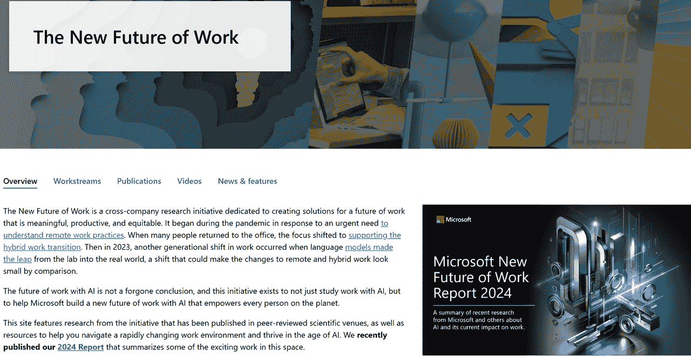

https://www.microsoft.com/en-us/research/project/the-new-future-of-work/?msockid=32d22e7f0285690d3255386403b56895

Microsoft New Future of Work Report 2024

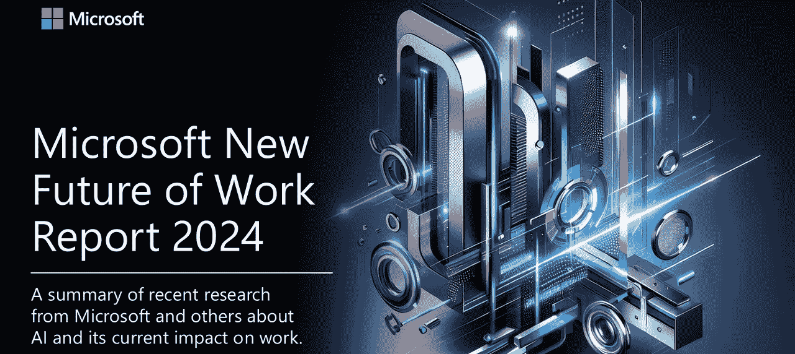

https://www.microsoft.com/en-us/research/wp-content/uploads/2024/12/NFWReport2024_1.27.2025.pdf

https://www.microsoft.com/en-us/research/publication/microsoft-new-future-of-work-report-2024/

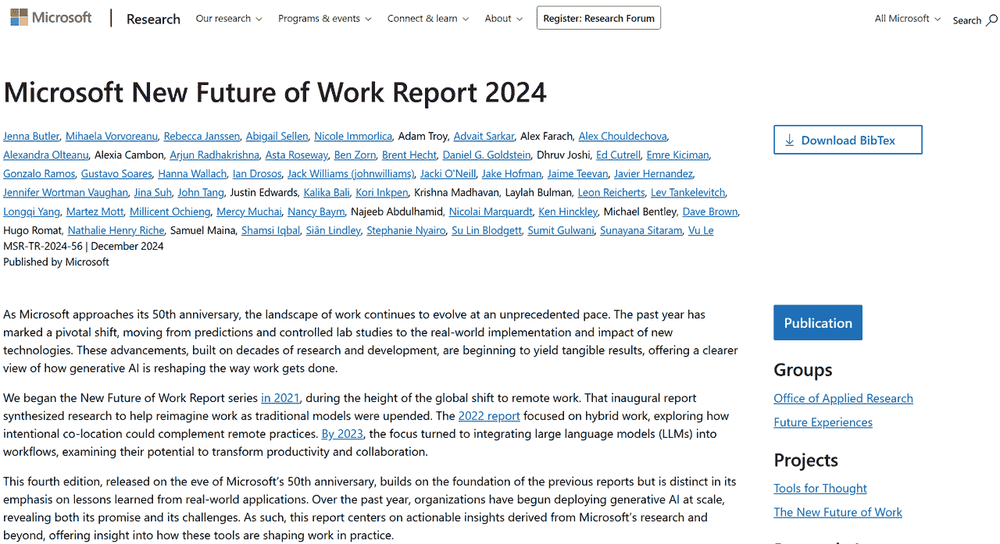