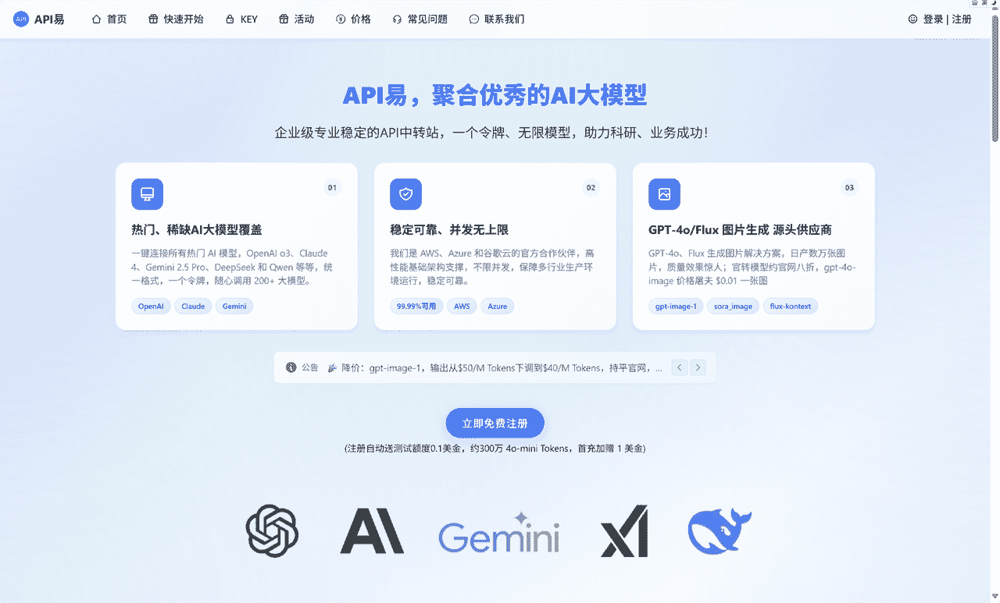

# 主流大模型的国外第三方平台

> 来源：[https://gotoaiworld.feishu.cn/docx/SmmmdseqaoLMgxxALx9cE10rn9d](https://gotoaiworld.feishu.cn/docx/SmmmdseqaoLMgxxALx9cE10rn9d)

# OpenAI、Gemini 等主流大模型的国外第三方平台

以下是一些可以安全、无障碍地使用 OpenAI、Gemini 等主流大模型的国外第三方平台：

+   **Poe**：由美国问答网站 Quora 推出的 AI 机器人聚合平台。它上架了 GPT-4o 的机器人，免费用户每天有 3000 积分，对于 GPT-4o 模型来说，每次对话消耗 300 积分，即每天可免费对话 10 次。此外，Claude 3 和 Gemini 1.5 Flash 等模型也可以在 Poe 上免费使用。该平台对 IP 的限制较小，使用相对容易。

https://poe.com/

+   **OpenRouter**：一个 API 聚合平台，支持集成 OpenAI、Anthropic、Cohere、Mistral 等多个供应商的大模型 API。它提供了一个统一的 API 接口，简化了调用过程，用户可以通过一个 API 密钥调用多种大模型 API。平台采用企业级加密技术保护所有传输数据，并严格遵守 GDPR 等数据保护法规，还为使用 OpenAI 服务的用户提供了额外的匿名化选项，进一步降低隐私风险。

https://openrouter.ai/

## 一、国内主流 OpenRouter 落地服务商（2026 最新）

### 秘塔科技（Metatask）

+   **定位**：OpenRouter 国内核心落地服务商，提供企业级合规方案

+   **核心服务**

+   国内对公支付（人民币）、开具增值税专票

+   国内专线（低延迟、稳定直连）

+   企业 SLA、技术支持、合规咨询

+   模型管理、用量监控、成本优化

+   **对接方式**

+   官网：https://metatask.com

+   企业对接：business@metatask.com

+   🛰️：metatask001

### n1n.ai

+   **定位**：AI 聚合服务平台，OpenRouter 国内合规中转

+   **核心服务**

+   人民币对公结算、增值税发票

+   国内专线、高可用集群

+   企业级 API 管理、权限控制

+   多模型统一调用、成本分析

+   **对接方式**

+   官网：[https://n1n.ai](https://n1n.ai)

+   商务：contact@n1n.ai

### Ofox.ai

+   **定位**：国内 AI 模型聚合平台，兼容 OpenRouter 生态

+   **核心服务**

+   国内直连、低延迟（0.5–1.5s）

+   人民币支付、发票

+   兼容 OpenAI/OpenRouter 接口，迁移成本低

+   **对接方式**

+   官网：[https://ofox.ai](https://ofox.ai)

+   商务：bd@ofox.ai

### 硅基流动（SiliconFlow）

+   **定位**：AI 基础设施服务商，提供 OpenRouter 国内落地

+   **核心服务**

+   国内专线、高可用

+   企业级结算、发票

+   模型调度、成本优化

+   **对接方式**

+   官网：https://siliconflow.cn

+   商务：bd@siliconflow.cn

---

## 二、服务商核心能力对比（企业选型）

---

## 三、对接要点（企业必看）

### 前期准备

+   明确需求：月预估用量、模型类型（GPT‑4o/Claude/Gemini 等）、是否需要 SLA

+   准备资料：公司营业执照、开票信息、联系人

+   确定方案：自用 / 代理分销、是否需要定制化

### 对接流程（通用）

1.  **初步沟通**：联系服务商商务，说明 OpenRouter 落地需求

1.  **方案评估**：服务商提供报价、SLA、专线方案、发票说明

1.  **合同签署**：签署国内服务协议（含 OpenRouter 落地条款）

1.  **账户开通**：服务商分配国内账号，配置专线、API 密钥

1.  **测试验证**：测试调用、延迟、稳定性、发票流程

1.  **正式上线**：批量充值、用量监控、技术支持

### 关键谈判点

+   **价格**：OpenRouter 官方原价 + 服务商服务费（通常 5%–15%）

+   **发票**：增值税专票（6% 税率），开票类目（技术服务 / 信息技术服务）

+   **SLA**：可用性（99.9%+）、故障响应时间、赔付条款

+   **专线**：延迟（<2s）、稳定性、是否独享

+   **结算**：对公转账、月结 / 预存、对账周期

+   **数据合规**：数据存储、传输、出境合规承诺

### 风险提示

+   无官方授权：服务商均为国内落地，非 OpenRouter 直接授权

+   价格波动：服务商服务费可能调整，建议锁定长期价格

+   合规风险：确保服务商具备网络安全、数据合规资质

+   服务稳定性：优先选择有成熟 OpenRouter 落地案例的服务商

### 一、秘塔科技（Metatask/Metasota）

**定位**：OpenRouter 国内核心落地服务商，企业级合规方案

+   **官网**：https://metasota.ai秘塔科技

+   **商务邮箱**：

+   business@metatask.com（OpenRouter 企业对接）

+   wutingting@metasota.ai秘塔科技

+   shishaofei@metasota.ai

+   **联系电话**：

+   17610899961秘塔科技

+   18513775680

+   **商务微****信**：metasota02秘塔科技

+   **办公地址**：

+   上海：徐汇区龙台路 180 号 F2 大楼 3 楼模速空间 313 室秘塔科技

+   北京：朝阳区远洋国际中心 C 座 2604秘塔科技

+   成都：高新区天府二街 368 号绿地之窗 2 栋 1212秘塔科技

---

### 二、n1n.ai

**定位**：AI 聚合服务平台，OpenRouter 国内合规中转

+   **官网**：[https://n1n.ai](https://n1n.ai)

+   **商务邮箱**：contact@n1n.ai

+   **商务🛰️**：n1n-ai（👸号 / 企业🛰️）

+   **对接入口**：官网首页 “商务合作” 表单

---

### 三、Ofox.ai

**定位**：国内 AI 模型聚合平台，兼容 OpenRouter 生态

+   **官网**：[ht](https://ofox.ai)[tps://ofox.ai](https://ofox.ai)

+   **商务邮箱**：bd@ofox.ai

+   **商务🛰️**：ofoxai（企业🛰️）

+   **对接入口**：官网 “企业服务”→“商务合作”

---

### 四、硅基流动（SiliconFlow）

**定位**：AI 基础设施服务商，OpenRouter 国内落地

+   **官网**：https://siliconflow.cn

+   **商务邮箱**：bd@siliconflow.cn

+   **商务电话**：400-888-9999（企业服务专线）

+   **商务🛰️**：siliconflow（👸号 / 企业🛰️）

+   **对接入口**：官网 “企业服务”→“合作咨询”

---

### 五、对接建议（高效沟通）

1.  **邮件主题统一**：【OpenRouter 企业落地合作】+ 公司名称 + 预估月用量

1.  **首次沟通必带信息**：

+   公司名称、行业、主体类型（大陆 / 香港）

+   月调用量、目标模型（GPT-4o/Claude/Gemini 等）

+   需求：对公支付、增值税专票、专线、SLA、分销

1.  **优先对接**：秘塔科技（OpenRouter 落地成熟）、n1n.ai（聚合服务完善）

+   **API 易**：这是一个专注于提供 OpenAI 和 Claude API 中转服务的平台，也支持 Gemini 等主流模型。它将用户请求经美国服务器直接发送并即时响应，保障服务稳定。数据传输采用 TLS 1.3 协议加密，仅记录基础日志用于故障排查和计费，不会存储或查看用户的 API 请求内容，能有效保护用户数据安全。

https://www.apiyi.com/

+   **聚合 AI**：该平台集成了 OpenAI、Gemini 等多种大模型。它可以解决地域限制问题，将非允许使用国家用户的请求先做合法化处理，再与官方对接传递。同时，聚合 AI 采用开源中转程序 New - api 实现转发，仅通过程序日志功能收集用户请求基本参数以方便计费，不保留任何 content 内容，重视用户的数据隐私。

+   **UniAPI**：提供 OpenAI、Gemini、Claude 等 AI 模型的反向代理 API 接口，无需境外网络环境即可便捷访问。它高度重视用户隐私和数据安全，只负责数据转发，不保存数据信息，采取严格的安全措施来保护用户的信息和交互数据。

AIOnly- 江苏

https://www.aiionly.com/