# AI战略顾问及AI讲师团队

> 来源：[https://gotoaiworld.feishu.cn/docx/Bu9QdK6Avom9TMxoFbec78oOnHb](https://gotoaiworld.feishu.cn/docx/Bu9QdK6Avom9TMxoFbec78oOnHb)

# 一、核心AI战略技术顾问

> GotoAI 技术社区核心技术骨干来自Microsoft, AWS, Googel, 阿里，腾讯，华为，字节跳动全球AI领域顶级厂商的技术咨询和服务团队以及国内最早的AI技术社区的布道者，包括：微软Semantic Kernel(SK)中文社区，LangChain中文社区，Prompt Engineering中文社区，ModelScope魔搭,Meta Llama中文，Hugging Face中文社区，AIGC技术社区

## **Steven Li **

资深微软AI技术顾问/专家，微软认证AI架构师，微软MCT培训讲师，前埃森哲(中国)有限公司解决方案技术专家。国内最早接受美国OpenAI及Microsoft内部技术专家培训和通过微软全球Azure AI认证考试的AI大模架构师。专注于AI大模型技术研究，AI大模型应用开发，AI行业应用解决方案研究，AI工作坊和解决方案咨询服务。

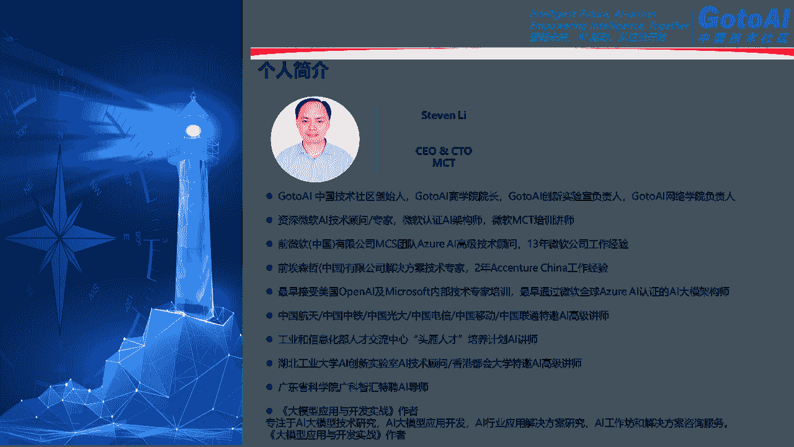

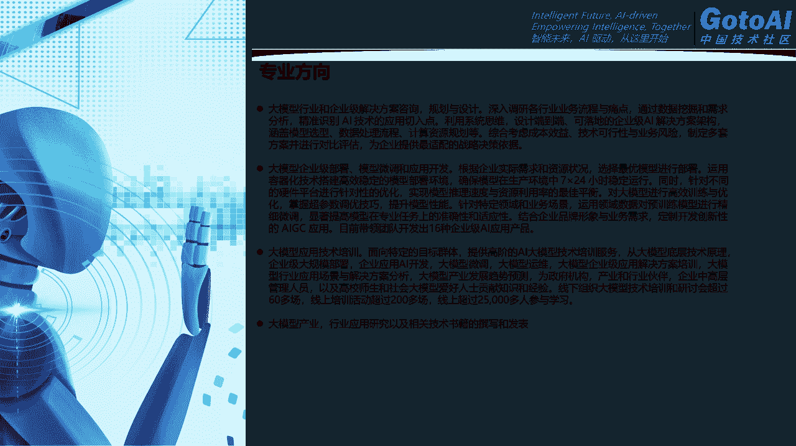

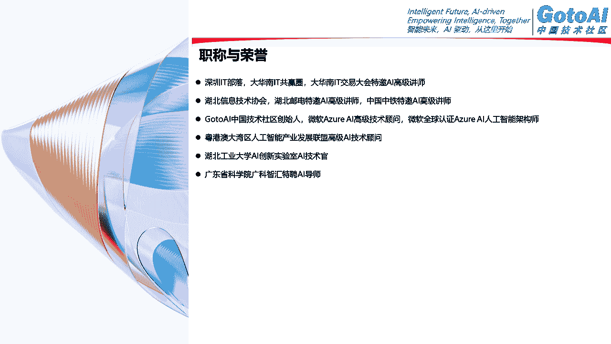

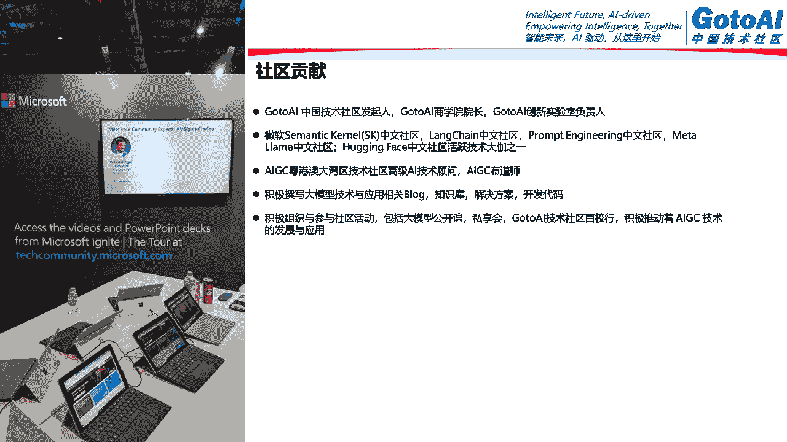

# 二、核心培训讲师团队

## 1.微软体系

### **宋立恒**

前微软公司技术专家，微软MVP，微软认证讲师MCT,中国计算机协会人工智能专委会委员， 中国计算机学会专家员会

### **Jack Sun**

资深微软AI技术顾问，微软认证AI架构师，微软MCT培训讲师，前微软(中国)有限公司MCS团队高级技术顾问，北京联合大学主修计算机科学。

### **Leon Liang 梁立权**

资深微软AI技术顾问，微软MCT培训讲师，前微软(中国)有限公司Azure架构师，云解决方案技术顾问，武汉理工大学主修计算机科学。

### **Tim Zhang**

前微软MCS 技术解决方案专家，微软认证培训讲师MCT，前东方瑞通资深培训讲师, 国内知名智算厂商AI技术专家

### **Jim Shu 舒永春**

微软认证讲师（MCT），微软最有价值专家（MVP）,前微软公司解决方案技术顾问

### **Liang Yao**

微软认证讲师（MCT）, 前微软公司EPG解决方案技术顾问, Microsoft 365 资深讲师

### **衣明志**

前微软公司技术专家，微软MVP，微软认证讲师MCT

### Bink Zhang 张斌

前微软云、腾讯云、AWS技术顾问，前广东电信研究院高级工程师

### Yi Zhang 张弈

前微软云、华为云、腾讯云技术顾问，国内某人工智能研究院高级研究员

### **陈堰平**

前微软公司技术专家，微软MVP，微软认证讲师MCT

### **Samuel Xia**

前微软公司MCS技术顾问，资深技术工程师

### Chris Yang 杨超

前微软MCS团队资深开发工程师，前腾讯云资深AI开发工程师，台湾某跨国企业AI开发总监

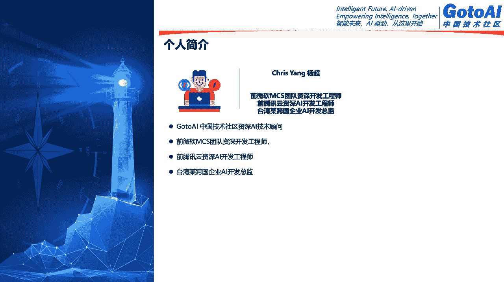

### **Eric Sun**

前微软Azure AI, Copilot技术专家，微软MVP最有价值专家

### **周爱华**

微软认证讲师（MCT）前微软公司Azure AI 解决方案技术顾问,Microsoft 365 资深讲师

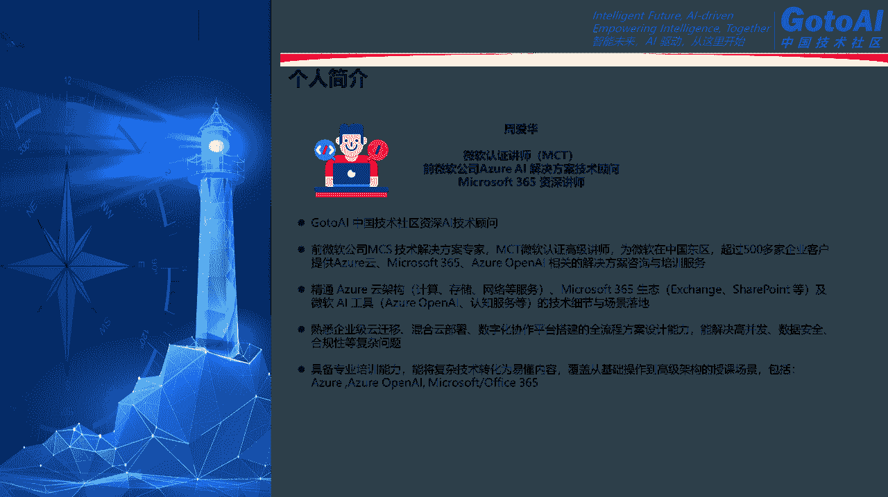

### 沈佳涛

前微软PSG团队资深工程师，前京东云技术解决方案专家，国内某教育网络科技集团AI技术总监

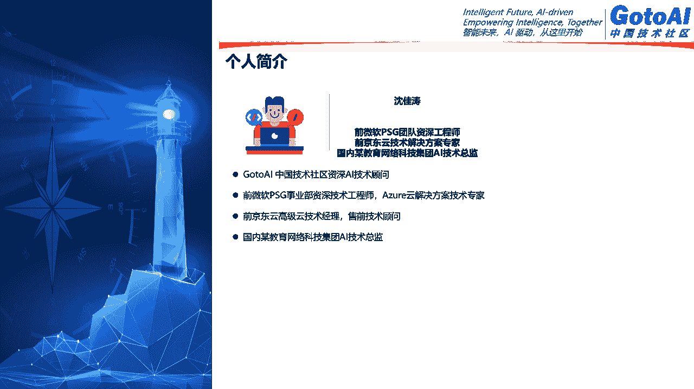

## 2.IBM体系

### **Terry Wan**

资深微软AI技术顾问，微软MCT培训讲师，前IBM企业云技术顾问，主修计算机科学。

## 3.腾讯体系

### **李建辉**

前腾讯混元大模型技术团队高级算法工程师，前VIVO集团高级算法工程师

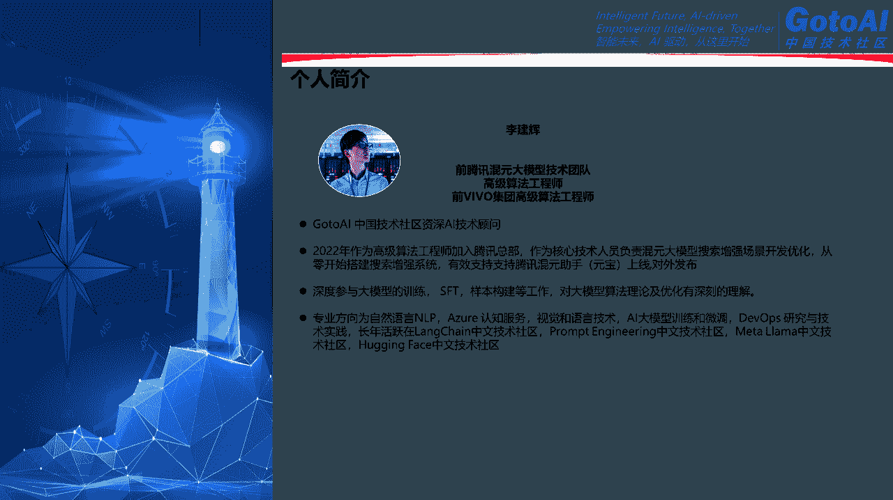

### **Alec Chen**

前腾讯云产品解决方案技术顾问，国内知名云和AI平台运维经理，AI驱动运维、多模态资源管理、 部署自动化技术专家

### Bink Zhang 张斌

前微软云、腾讯云、AWS技术顾问，前广东电信研究院高级工程师

### Yi Zhang 张弈

前微软云、华为云、腾讯云技术顾问，国内某人工智能研究院高级研究员

### Chris Yang 杨超

前微软MCS团队资深开发工程师，前腾讯云资深AI开发工程师，台湾某跨国企业AI开发总监

## 4.百度体系

### **Jeff Liu 刘杰**

前百度智能云主任架构师、天津多模态数据创新研究院高级AI研究员

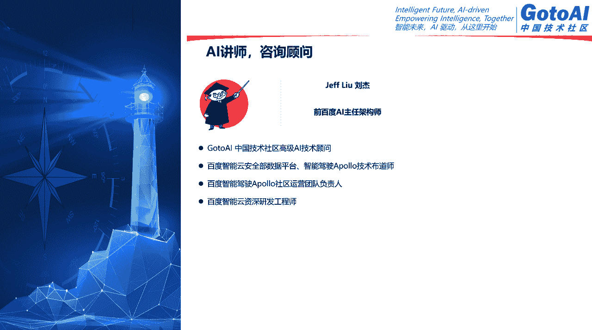

## 5.阿里体系

### **Alen Han**

阿里达摩院人工智能高级训练师， 国内知名电信研究院AI高级研究员

### **韩巧梅**

资深AI培训讲师，AIGC应⽤专家, 企业AI系统架构师

## 6.AWS 体系

### Bink Zhang 张斌

前微软云、腾讯云、AWS技术顾问，前广东电信研究院高级工程师

## 7.华为体系

### Yi Zhang 张弈

前微软云、华为云、腾讯云技术顾问，国内某人工智能研究院高级研究员

## 8.京东云体系

### 沈佳涛

前微软PSG团队资深工程师，前京东云技术解决方案专家，国内某教育网络科技集团AI技术总监

### 刘义

前京东集团数据中台开发负责人，国内某跨国企业AI开发总监

## 9.字节跳动

## 10.互联网大厂

### 王世航

国内某互联网大厂AI产品开发总监，AI+法律行业资深算法技术专家

### **洪玉材**

全球最大互联网消费类软件企业资深开发人员，GitHub开源社区重要贡献者

## 11.高校科研机构

### **何玮**

泛血管血流动力学与医学人工智能领域专家/ 复旦大学博士后

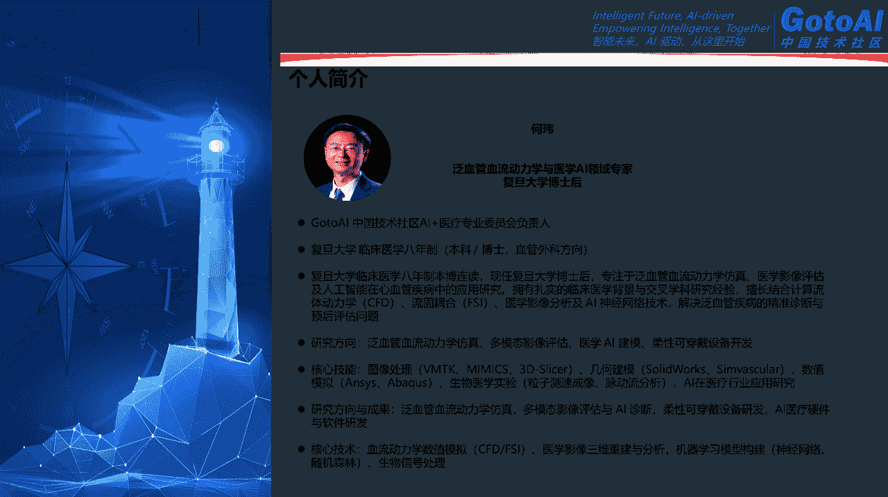

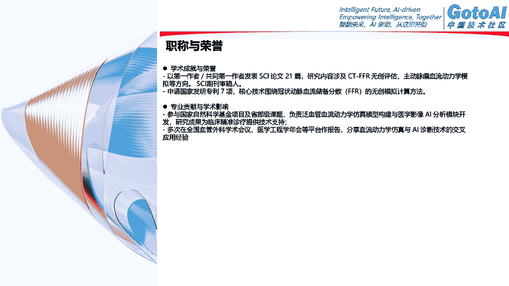

### 张云波

华为开发者专家，上海交通大学高净值研究院高级AI讲师，《DeepSeek企业级AI应用实践》作者

### **熊建军**

资源AI培训讲师，北京大学，厦门大学, 浙江大学客座教授

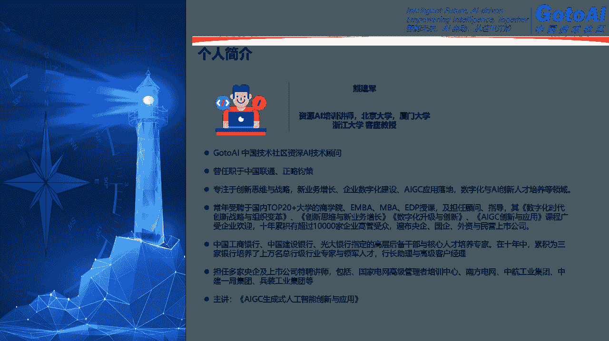

## 12.大型企业

###

## 13.咨询机构

### UCCA尤伦斯当代艺术中心

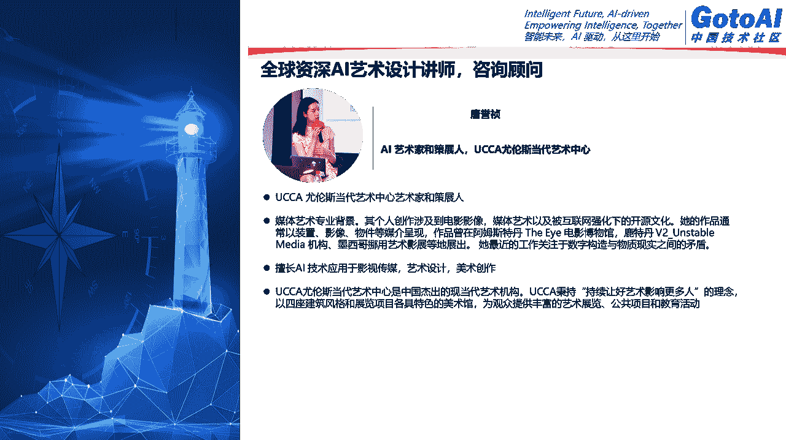