# AI大模型培训课程全景图

> 来源：[https://gotoaiworld.feishu.cn/docx/JYwIdMJhBoR9hNxl09dccn5CnFf](https://gotoaiworld.feishu.cn/docx/JYwIdMJhBoR9hNxl09dccn5CnFf)

> GotoAI 中国技术社区诚邀您成为 AI + 教育合伙人！在这里，以您的热情与资源，结合我们的专业优势，撬动巨额财富，获取令人咋舌的高回报收益，改写人赚钱富版图！！

> 顺势而为，乘风而上，抓住AI时代红利期，携手一飞冲天！！！！

> 联系我们：partner@gotoai.world  400-862-1600  13510708175

## 一、人社部人工智能训练师认证培训

> 2025 年人工智能训练师最全攻略来了！最高补贴14,950元！

未来警报| 你的工作安全吗？ 行业还在原地踏步吗？

随着人工智能的不断迭代，AI 技术正以前所未有的速度重塑我们的世界。在这个变革的浪潮中，你的企业和我们每个人是否准备好迎接挑战？

《人工智能训练师》是经人力资源社会保障部门备案的用人单位和社会培训评价组织在备案职业(工种)范围内依据国家职业技能标准和备案的评价规范对劳动者进行职业技能等级认定， 对经认定合格者颁发职业技能等级证书。

《人工智能训练师》的职业技能等级分为5个等级，由低到高分别是五级至一级：五级、四级、三级、 二级、一级。

其中， 职业技能等级证书指的是全国通用的权威证书，无需年审，终身有效，一证一码，可在国家官方网站(人力资源社会保障部技能鉴定中心全国联网查询系统查询)联网查询。

### （一）、人工智能训练师的含金量

#### 1、积分入户
根据广州市积分入户管理办法，取得人工智能训练师证书可以获得最低 10 分，最高 20 分(工作每满一年加 5 分，最高不超过20分)的入户积分。 其他城市入户积分管理办法以当地政策为准。

#### 2、职称贯通
职称评定职业技能等级证书直接对应职称证书，个人能力体现，权威性和社会认可度高。职业技能等级证书与职称证书互通，不同的职业技能等级证书可以按照要求评定对应的等级职称，是个人能力体现， 权威性和社会认可度高。 根据职称评定政策： ①取得三 级(高级工)职业技能等级后，从事相应专业技术技能工作满 2 年，可评助理级职称-人工智能助理工程师。 ②取得二级(技师)职业技能等级后，从事相应专业技术技能工作满 3 年。可评中级职称人工智能工程师。 ③取得一级(高级技师)职业技能等级后，从事相应专业技术技能工作满 4 年。可评副高级职称-人工智能高级工程师。

#### 3、升职加薪
职业技能等级证书是专业的象征，是对专业技术能力的肯定，可增加职业竞争力，不同级别等级证书对应了相应岗位和薪资， 不仅如此，在有些国企单位，拥有初级职 业技能等级证(最低等级)的职工，月薪涨幅在 300-500 元之间(等级越高涨幅越大，与每个企业薪酬标准有关)。

#### 4、招投标项目
部分政府招投标项目要求，招投标企业或者单位必须要具备拥有国家认证的职业资格证书或者职业技能等级证书的职工，而且是中级和高级以上的，可见，拥有职业 技能等级证书是有效的镀金方式。

#### 5、享受国家补贴
国家相关政策明确取得五级(初级)、四级(中级)、三级(高级)、二级(技 师)、一级(高级技师)技能证书的可享受职业技能提升补贴标准分别为1000、 1500、2400、3000、3600元；人工智能训练师属于当地的紧缺职业(工种)的，取得三级(高级)技能证书的可享受当地职业技能提升补贴(补贴金额上浮不高于标准 30%)。

### （二）、技能等级与职业方向

#### 1、人工智能训练师五级(初级工)
1 主要从事数据采集，数据标注，智能系统运维等方向的工作。

2 可胜任的岗位：数据标注员、数据采集员

#### 2、人工智能训练师四级(中级工)
①主要从事数据管理和质量把控，数据处理，数据标注，数据审核，智能运维等方向工作。

②专业要求：数学，物理学，统计学，电子与信息大类，教育与体育大类，医药卫生大类，装备制造大类。

③可胜任的岗位：数据标注工程师、数据审核员

#### 3、人工智能训练师三级(高级工)
①主要从事业务流程设计和分析， 人工智能算法训练和测试，智能产品设计等方向的工作。

②专业要求：数学，物理学，统计学，电子与信息大类，教育与体育大类，医药卫生大类，装备制造大类。

③可胜的任岗位：人工智能产品经理、人工智能售前工程师、人工智能项目管理、初级人工智能算法工程师

#### 4、人工智能训练师二级(技师)
①主要从事业务流程设计和分析，人工智能算法训练和测试，智能产品设计等方向的工作。

②可胜的任岗位：人工智能高级产品经理、人工智能方案工程师、中级人工智能算法工程师

#### 5、人工智能训练师一级(高级技师)
①主要从事 AI+行业和业务场景融合创新，业务架构和流程设计，人工智能算法训练、测试和优化，并且能产品化，智能产品应用解决方案设计和实施推广，培训和指导等方向的工作。

②可胜的任岗位：人工智能高级产品经理、人工智能架构工程师、首席技术官(CTO)、高级人工智能算法工程师

### （三）、报考条件

#### 1、具备以下条件之一者，可申报五级/初级工：
（ 1） 年满 16 周岁，拟从事本职业或相关职业工作。

（ 2） 年满 16 周岁，从事本职业或相关职业工作。

#### 2、具备以下条件之一者，可申报四级/中级工：
（ 1）累计从事本职业或相关职业工作满 5 年。

（ 2）取得本职业或相关职业五级/初级工职业资格(职业技能等级)证书后，累计从事本职 业或相关职业工作满3年。

（ 3）取得本专业或相关专业的技工院校或中等及以上职业院校、专科及以上普通高等学校毕业证书(含在读应届毕业生)。

#### 3、具备以下条件之一者，可申报三级/高级工：
（ 1） 累计从事本职业或相关职业工作满10年。

（ 2） 取得本职业或相关职业四级/中级工职业资格(职业技能等级)证书后，累计从事本职业或相关职业工作满4年。

（ 3） 取得符合专业对应关系的初级职称(专业技术人员职业资格)后，累计从事本职业或相关职业工作满 1 年。

（ 4） 取得相关专业的技工院校高级工班及以上毕业证书(含在读应届毕业生)。

（ 5） 取得本职业或相关职业四级/中级工职业资格(职业技能等级)证书，并取得高等职业 学校、专科及以上普通高等学校本专业或相关专业毕业证书(含在读应届毕业生)。

（ 6）取得经评估论证的高等职业学校、 专科及以上普通高等学校本专业或相关专业的毕业证书(含在读应届毕业生)。

#### 4、 具备以下条件之一者，可申报二级/技师：
（ 1）取得本职业或相关职业三级/高级工职业资格(职业技能等级)证书后，累计从事本职业或相关职业工作满5年。

（ 2）取得符合专业对应关系的初级职称(专业技术人员职业资格)后，累计从事本职业或相关职业工作满 5 年，并在取得本职业或相关职业三级/高级工职业资格(职业技能等级) 证书后，从事本职业或相关职业工作满 1 年。

（ 3）取得符合专业对应关系的中级职称(专业技术人员职业资格)后，累计从事本职业或相关职业工作满 1 年。

（ 4）取得本职业或相关职业三级/高级工职业资格(职业技能等级)证书的高级技工学校、技师学院毕业生， 累计从事本职业或相关职业工作满2年。

（ 5） 取得本职业或相关职业三级/高级工职业资格(职业技能等级)证书满2年的技师学院 预备技师班、技师班学生。

#### 5、 具备以下条件之一者，可申报一级/高级技师：
（ 1）取得本职业或相关职业二级/技师职业资格(职业技能等级)证书后，累计从事本职业或相关职业工作满 5 年。

（ 2）取得符合专业对应关系的中级职称后，累计从事本职业或相关职业工作满 5年，在取得本职业或相关职业二级/技师职业资格(职业技能等级)证书后，从事本职业或相关职 业工作满1 年。

（ 3）取得符合专业对应关系的高级职称(专业技术人员职业资格)后, 累计从事本职业或相关职业工作满1 年。

相关职业：包括但不限于人工智能工程技术人员、呼叫中心服务员、电子商务师等职业。相关专业： 包括但不限于电子与信息大类、医学卫生大类、装备制造大类、教育与体育大类等专业；电子与信息大类：包括电子信息类、集成电路类、计算机类、通信类等专业。医学卫生大类：涉及护理类、药学、 中医药类、医学技术类、康复治疗类、健康管理与促进类、公共卫生与卫生管理类等专业。装备制造大类： 包括机电设备类、机械设计制造类、自动化类、轨道装备类、汽车制造类、航空装备类、船舶与海洋工程装备类等专业。教育与体育大类：涵盖教育类、语言类、体育类等专业。

### （四）、培训及考试内容

1、 培训以及考试方式：采取线上培训、线下考试方式。

2、 线上培训时间： 按照不同级别所要求的学时进行培训

2023年广东省人力资源和社会保障厅、广东省财政厅、关于印发广东省职业技能培训补贴管理办法的通知

https://www.gd.gov.cn/zwgk/gongbao/2023/20/content/post_4229750.html

### （五）、证书样例

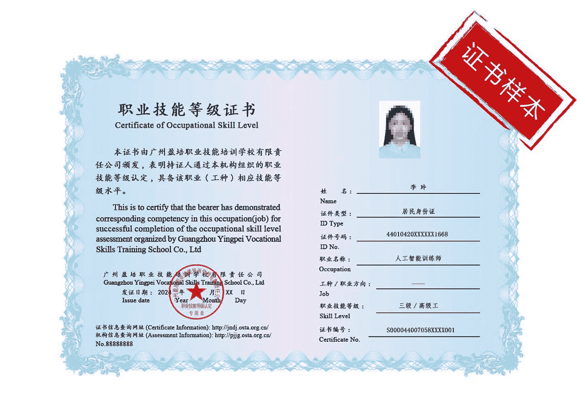

### （六）、政府补贴

广东省人力资源和社会保障厅 广东省财政厅关于印发《广东省职业技能培训补贴（指导）标准目录（2025年版）》的通知

https://hrss.gd.gov.cn/zwgk/xxgkml/bmwj/qtwj/dwjs/content/post_4677694.html

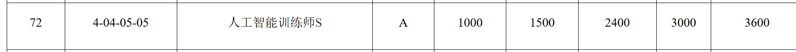

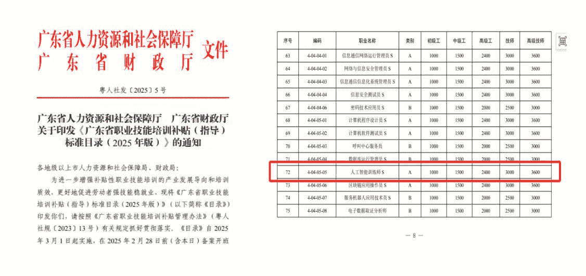

#### 职业技能提升补贴

1.补贴对象:

具有我省户籍或在我省就业的劳动者(含在粤就业的外省来粤务工人员、港澳台人员)，不含机关事业单位在编人员、全日制在校学生、已依法享受养老保险待遇人员。

劳动者应年满16周岁，其中男性年龄不超过60周岁，女性年龄不超过55周岁。劳动者应具有我省户籍，或者在我省参加社会保险，或者在我省进行失业登记。

2.适用条件:

劳动者自学或自主参加职业技能培训后，参加由省级人力资源社会保障部门公布的备案社会培训评价组织开展的职业技能等级认定，，取得《广东省职业技能提升补贴(指导)标准目录》范围内相应证书，

3.补贴标准:

按照《广东省职业技能提升补贴(指导)标准目录》确定的补贴标准给予补劳动者获得当地发布的急需紧缺职业(工种)目录范围内职业(工种)高级工(三级)以上贴。证书的，补贴标准可最高上浮30%，具体执行标准由各地市自行确定。

4.申领期限:

证书核发之日起12个月内。

5.补贴申领:

劳动者在省职业技能提升培训补贴申领管理信息系统上，向户籍地、参保地或者就业地人力资源社会保障部门提出申请，按要求填报信息并上传相关材料。

6.补贴限制：

劳动者申领职业技能提升补贴，已享受同一职业(工种)高等级证书补贴的，不再享受该职业(工种)低等级证书补贴。

### （七）、培训收费

### （八）、会员权益

## 二、工信部人工智能工程师认证培训

> 提前获得AI人工智能技能证书，赢得职场先天优势，高薪高成长空间，由AI赋能即将步入职场学生！

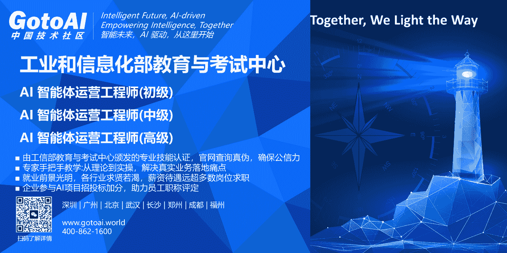

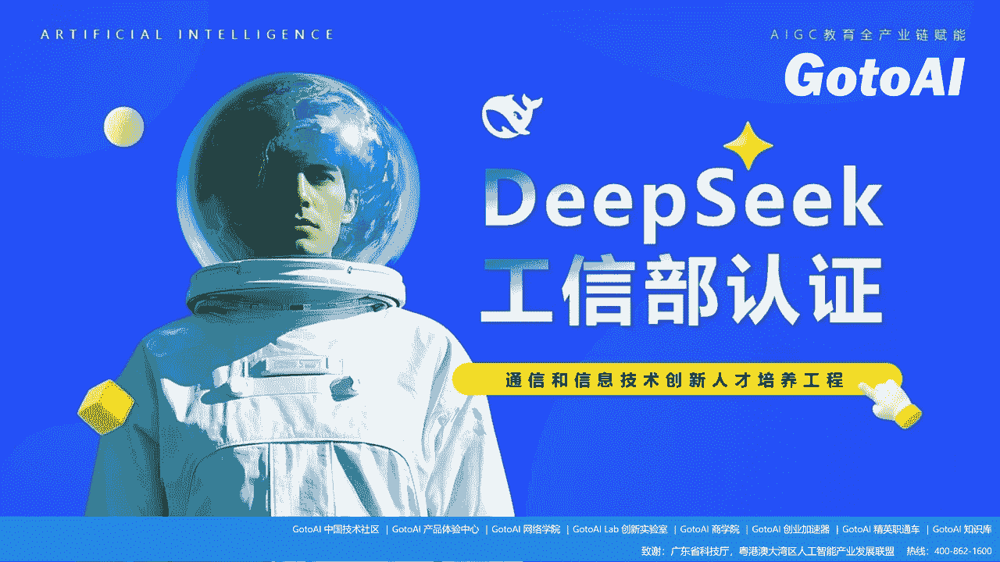

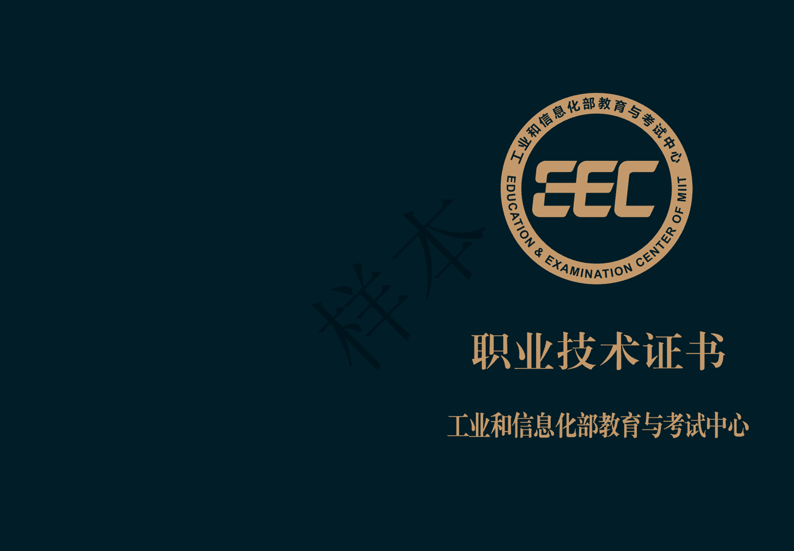

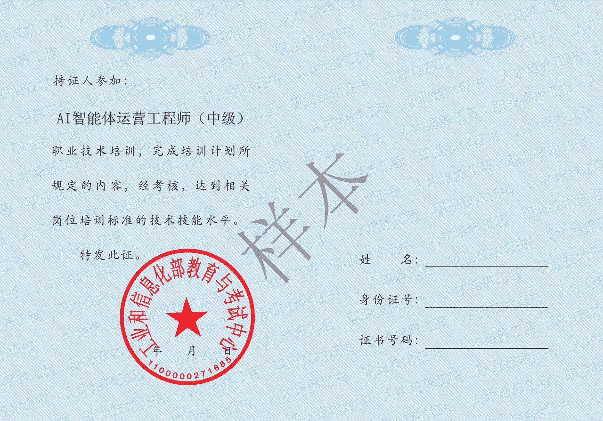

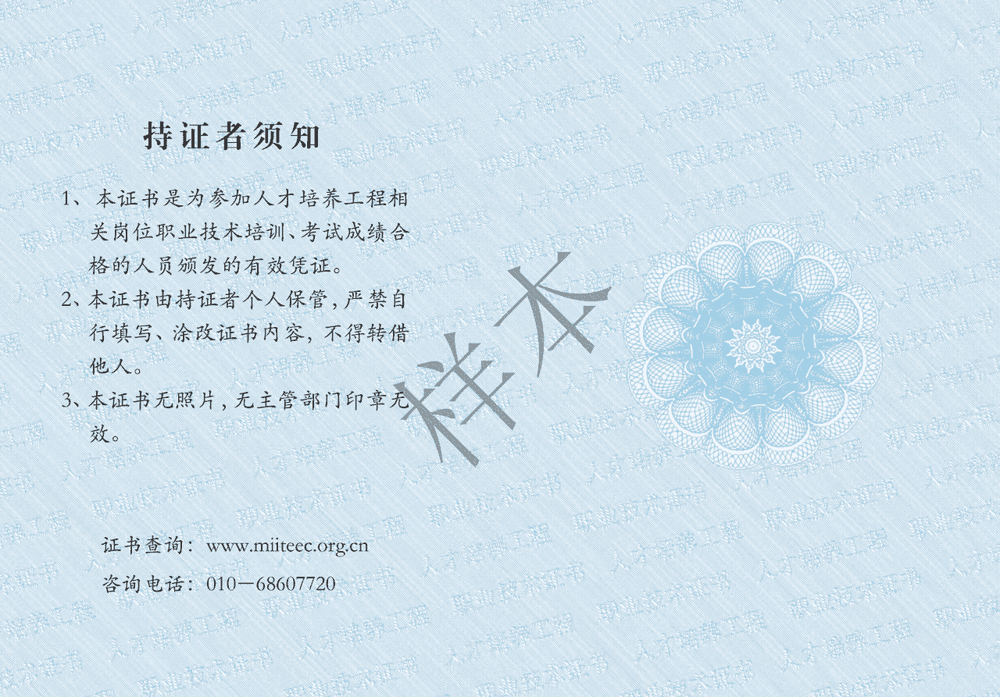

[AI智能体运营工程师（初级）考试题库](https://oas76xd8hm.feishu.cn/wiki/NF5RwtEfpi3QZ9ky1m2cjdhxnLa?from=from_copylink)（初级题库最终版）

[AI智能体运营工程师（中级）考试题库 ](https://w1l7bkrqiuj.feishu.cn/docx/S36xdy4euoXBORxUVU3c6SeDnph?from=from_copylink)（中级题库最终版）

[智能体运营工程师高级考核题库完整版](https://cbe85pxjd1.feishu.cn/docx/VjbLdbnR7okeHpxZO87clUwxnee?from=from_copylink)（高级题库最终版）

## 三、微软Azure AI人工智能全球认证培训

> Azure AI助理工程师认证，AI高级架构师认证培训，全球认可，职场王牌，外企高薪就业入场券，全球打工畅行无阻，移民欧美，澳州加分，提前获得全球AI技术绝对优势，承诺就业。

微软人工智能认证证书（英文名：Azure AI Fundamentals）是由微软官方最新研发的一项有关人工智能的认证证书。想要获得该证书，需通过AI-900测试或者AI-102。

微软AI人工智能证书分为两个等级：

初级：AI900认证

中级：AI102认证

微软认证全景图

https://arch-center.azureedge.net/Credentials/Certification-Poster_en-us.pdf

微软人工智能认证证书具有多方面的价值，主要体现在以下几点：

- 职业发展助力

- 增强专业可信度：获得该证书能展示个人在人工智能概念和技术方面的专业能力，是对自身技能的有力证明，可提升在数据分析师、机器学习工程师、AI开发人员等岗位上的专业形象，在同行中脱颖而出，让雇主更直观地了解持证人的AI知识水平和应用能力。

- 拓宽职业道路：AI技术在各行业的应用日益广泛，拥有此证书可在不同领域和岗位间转换，增加职业选择机会。例如，系统管理员获得认证后可向AI工程师、云架构师、数据科学家等方向发展；网络管理员能借助认证知识优化网络性能和安全，拓展到AI相关的网络管理领域；销售 specialists能更好地理解AI技术在销售中的应用，如利用AI分析客户数据、预测销售趋势，从而开拓新的职业发展路径。

- 提升薪资待遇：根据行业报告，拥有Azure AI认证的工程师，平均薪资水平高于行业平均水平20%。在就业市场上，微软AI人工智能证书是衡量一个人是否具备AI技术能力的重要标准，拥有该证书的人才往往具有较高的竞争力，能够获得更好的职业发展和薪资待遇。

- 学习提升价值

- 构建知识体系：备考过程有助于学习者系统地掌握人工智能的基础知识，包括机器学习、计算机视觉、自然语言处理、语音识别等多个领域，以及Azure云计算平台上相关AI服务的应用，帮助建立起全面的AI知识架构，为深入学习和研究AI技术打下坚实基础。

- 紧跟技术潮流：AI领域发展迅速，通过准备认证考试，学习者需要不断关注最新的技术动态和行业趋势，保持对新技术的敏感度，从而促使持证人持续学习和更新知识，以适应AI行业的快速变化。

- 行业认可优势

- 全球广泛认可：微软认证在全世界90多个国家认可有效，是全球范围内具有较高知名度和权威性的IT认证之一。Azure AI Fundamentals作为微软官方认证的人工智能证书，在国际上受到广泛认可，具有较高的含金量，为持证人在全球范围内的职业发展提供了有力支持。

- 企业招聘参考：在企业招聘AI人才时，微软Azure AI认证是重要的参考标准之一。特别是AI-102认证，作为Azure AI领域的核心认证，专注于验证在Azure平台上设计和实施AI解决方案的核心能力，能让企业快速筛选出具备相关专业能力的人才，对于求职者来说，是进入知名企业和参与重要AI项目的敲门砖。

## 四、企业AI大模型咨询与工作坊

> 面向企业高层管理人员，解构AI大模型最新技术成果，发展趋势，行业应用场景，应用案例分享，企业AI战略定位与战略规划，企业AI应用落地路线图，最佳实践指南，企业投资AI技术路线图，架构，AI对企业的产品，业务和管理变革赋能，组织和员工能力重构规划，企业AI+人才培养体系。

火热预约中！！

Workshop时间：2-3个小时

Speaker: 微软高级AI咨询顾问

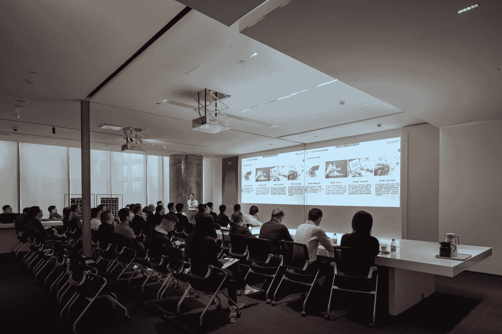

## 五、大模型应用与开发精英特训营

> 大模型应用与开发，模型私有化部署，模型训练，微调等最前沿技术等全方位知识讲解，并结合5个实战项目，3个月时间高强度训练最顶尖的AI大模型应用与开发工程师，面向计算机，信息技术，大数据等相关专业，专科及以上学生，冲刺年收入50万元以上职位，大模型应用与开发方向，精英特训营，承诺就业

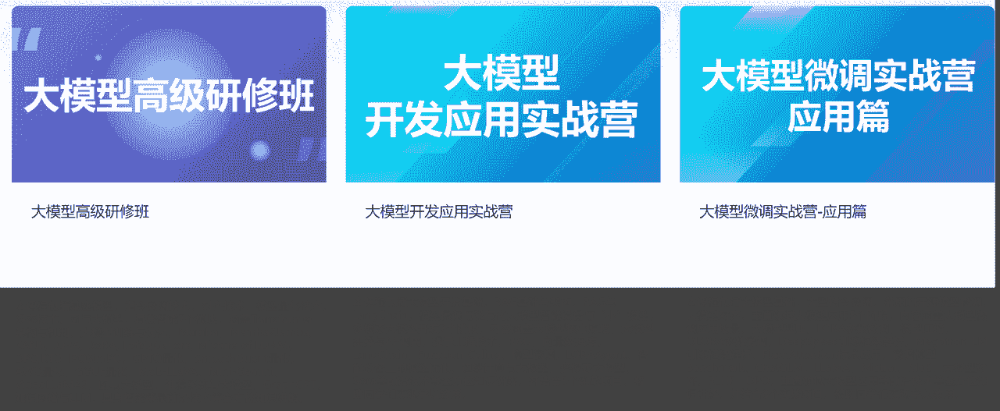

课程示例：

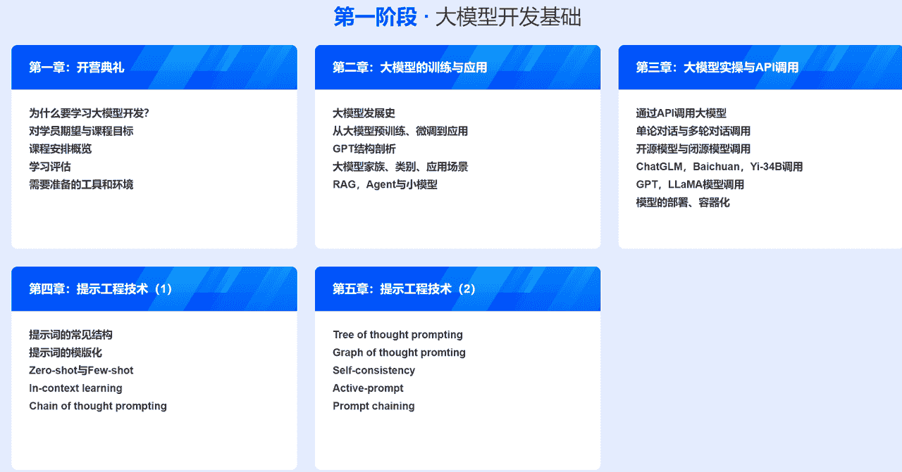

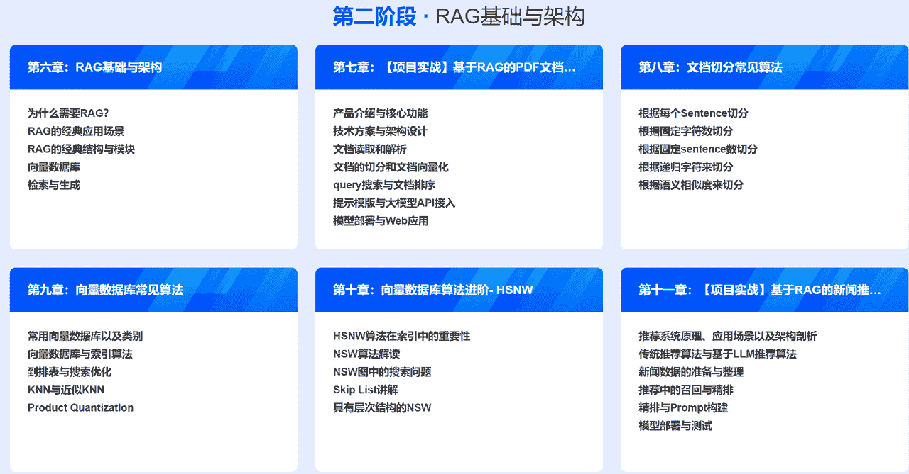

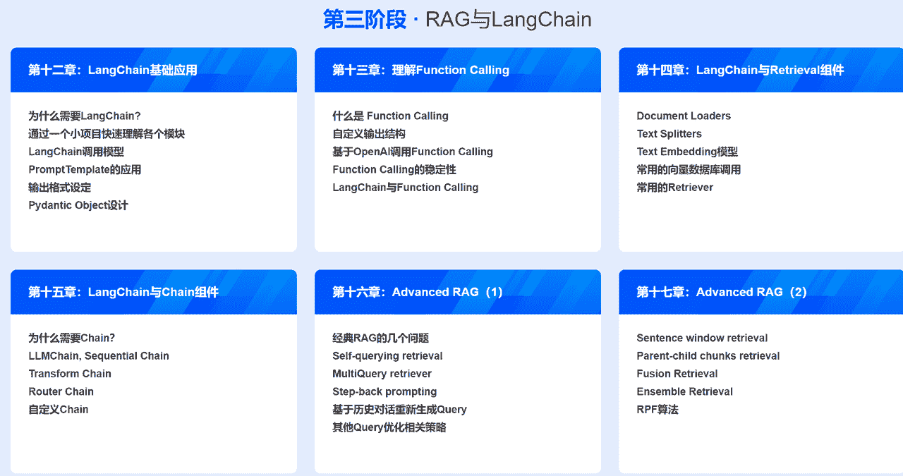

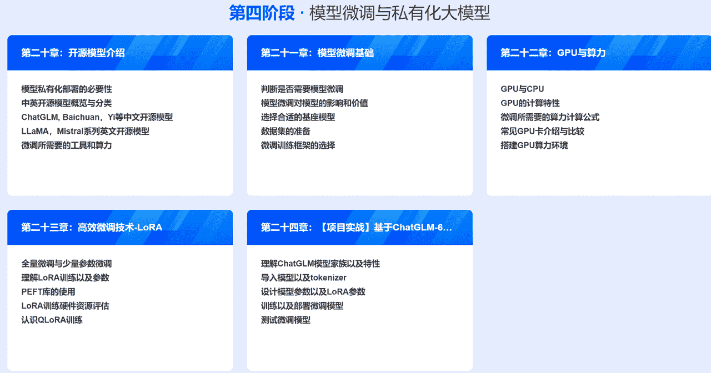

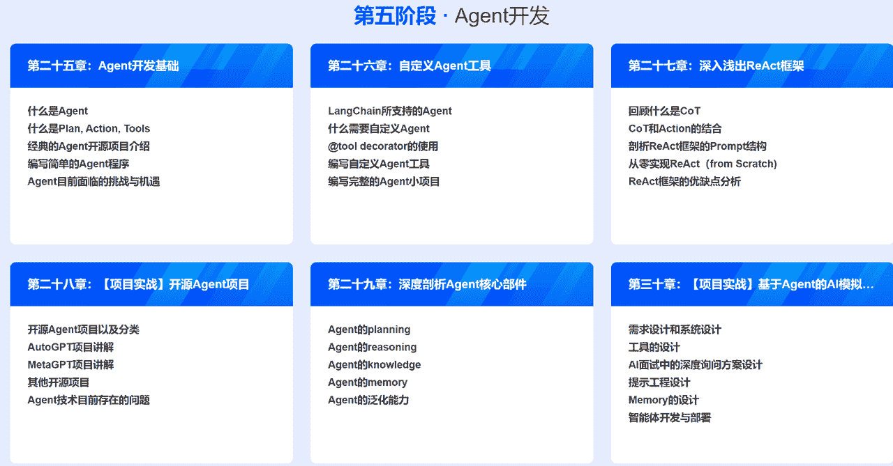

## 六、AI 智能化办公应用培训课程

> DeepSeek应用高效办公秘籍

DeepSeek应用高效办公秘籍

### 培训亮点

深度学习Deepseek办公能力

Deepseek+多维表格效能提升

办公问题场景化+解决方案可视化

DeepSeek应用高效办公秘籍

### 手把手实操

文本创作 方案策划 PPT美化 会议记要

创意海报 数字人 智能分工 流程图矩阵

智能客服 数据可视化 智能工作流设计

### 培训方式

小班VIP教学导师+助教课后辅导沉浸式 +应用场景+深度学习

DeepSeek 基础智能化办公课程

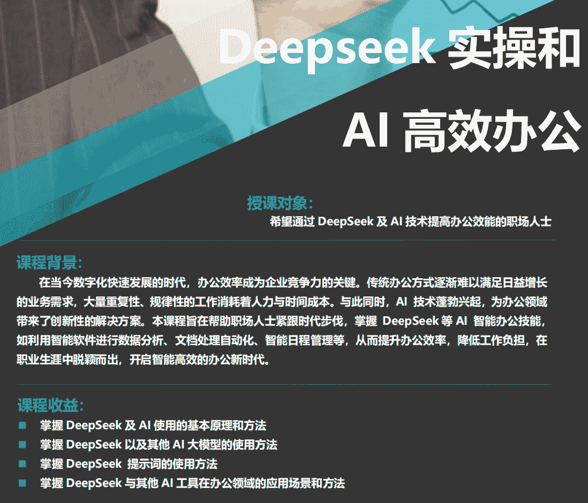

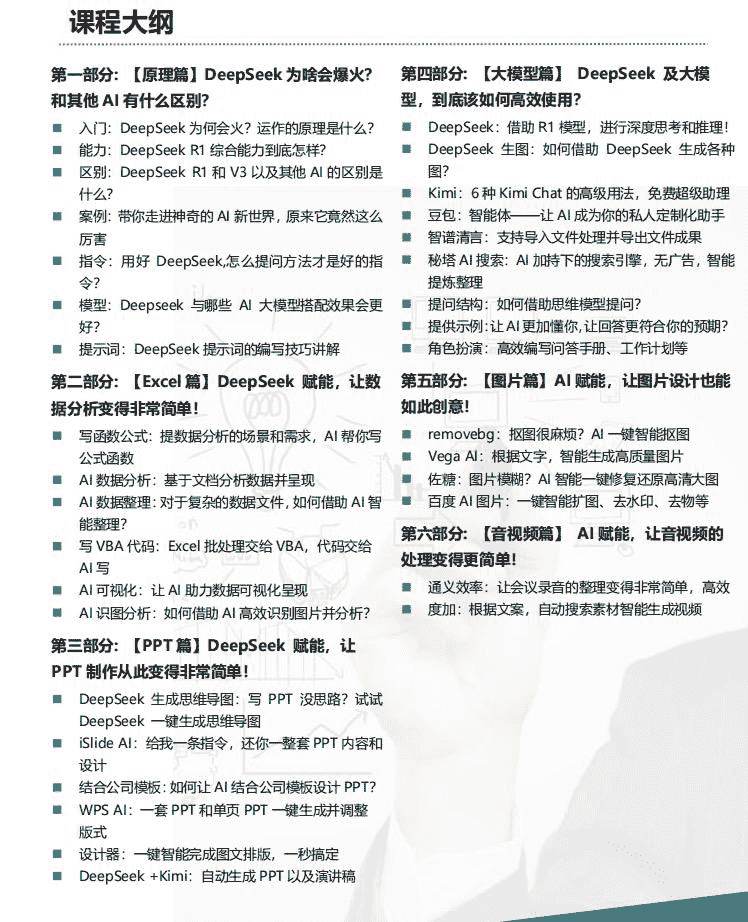

2025-04-19 武汉 2025-06-14 北京 2025-09-27 北京 2025-11-22 上海 2026-01-17 北京

随着人工智能技术的迅猛发展，DeepSeek、文心一言、华为盘古、讯飞星火、抖音豆包等国产AI大模型正崭露头角、方兴未艾，成为当下备受瞩目的研究和应用领域。伴随着人工智能技术的广泛普及与商业化步伐的加快，各类AI工具如雨后春笋般涌现，呈现出百花齐放的景象。无论是AI对话、AI绘画、AI短视频，还是AI+PPT、AI+Excel、AI写作、AI文案、AI数字人等领域，都展现出了强大的生命力，彰显出AI技术的无限潜力。

以DeepSeek为代表的AI工具在各行业发挥着举足轻重的作用，不仅大幅提升了工作效率，更激发了前所未有的创新创意。它们以智能化、自动化的方式，助力人们轻松应对复杂繁琐的任务，释放出更多的时间和精力去专注于更具创造性的工作。人工智能技术的快速发展，正在深刻改变着我们的生活方式和工作模式，而这些AI工具的广泛应用，无疑为这一变革注入了强大的动力。

如今，AI技术已经成为各行各业的热门话题，各行业纷纷掀起了学习AI技术的浪潮，越来越多的企业开始注重AI技术的学习和应用。希望通过AI的赋能来提升竞争力，并获得更多发展机遇。

本课程将深入剖析AI技术的核心逻辑，系统讲解AI技术在各行业实际场景下的应用方法。我们将引导大家掌握AI热门实用工具的操作技能，探索AI与岗位的结合点，从而改进工作流程，提升工作效率，实现自动化办公。同时，我们还将帮助企业降低成本、增加效益，大幅提升组织运转效率，为企业的发展和创新注入新的活力。

通过本课程的学习，您将能够深入了解AI技术的魅力与潜力，掌握AI在实际工作中的应用技巧，从而为自己的职业生涯和企业发展打开全新的篇章。

本课程适合各行业职场人士，包括决策者、管理者、初学者和AI从业者，希望通过学习AI技术来优化工作流程、提高工作效率和质量的广大职场人士。

1. 高层决策者：了解人工智能技术，助力战略制定，推动业务决策。
2. 中层管理者：运用人工智能技术，提升组织效率，创新工作流程。
3. AI初学人员：实践人工智能技术，提高工作效率，提升产出质量。
4. AI从业人员：深入学习专业知识，扩宽职业路径，助力职业发展。

1. 掌握AI技术的核心应用逻辑，改进工作方法，优化工作流程，实现智慧办公。
2. 掌握AI实用工具的操作技能，提升问题解决能力，高效圆满地完成工作任务。
3. 掌握AI赋能幻灯片设计制作的方法，提高幻灯片产出效率、品质和演示效果。
4. 掌握AI赋能Excel数据分析的方法，提高数据处理的效率和数据分析准确性。
5. 掌握AI赋能写作和文案策划的方法，提高公文写作效率和文案的营销转化率。
6. 掌握AI赋能绘画和艺术创作的方法，实现绘画和艺术创作的高品质和新突破。
7. 掌握AI赋能优质短视频制作的方法，提升短视频剪辑制作的效率和创意表达。
8. 掌握AI赋能智能数字人的制作方法，提升客户服务智能化和直播内容数字化。
9. 树立AI思维，增强创造力和创新力，提升实际应用能力，轻松驾驭AI技术。

开场热身技巧：使用AI工具1分钟制作PPT+1分钟绘画。

# 第一章 【AI基础知识篇】初识AI，揭开AI人工智能的神秘面纱

本章目标：走进AI大门，开启全新的奇妙世界！引领您深入探索AI人工智能的精彩世界，了解人工智能在不同领域的应用和前景。我们将深入剖析人工智能在行业应用、商业创新方面的重要性，让您对AI的商业价值、发展机遇有更清晰的认识。同时，我们还将介绍国内AI发展的现状，探讨主要的AI大模型和热门的AI工具，帮助您更全面地了解这一引人注目的领域。通过揭开AI的神秘面纱，我们期待让您对人工智能有更深入的理解和热爱。

## 1. AI人工智能【基础知识】

### 1.1 基本定义：什么是AI人工智能，它可以做什么？

### 1.2 专业术语：解读专业术语AIGC、Prompt、API

### 1.3 核心思维：AI人工智能的核心价值和核心思维

### 1.4 商业价值：AI人工智能对企业的四个商业价值

### 1.5 行业应用：AI在各行业的应用场景和落地案例

### 1.6 产业政策：国家政策解读，洞察AI产业新机会

### 1.7 发展机遇：新商业模式，从“互联网+”到“AI+”

## 2. 国内主要的【AI大模型/工具/平台及特点】

### 2.1 DeepSeek大模型
### 2.2 华为盘古大模型
### 2.3 百度文心大模型
### 2.4 腾讯混元大模型
### 2.5 讯飞星火认知大模型
### 2.6 字节跳动豆包大模型
### 2.7 阿里巴巴通义大模型
### 2.8 月之暗面Kimi大模型
### 2.9 昆仑万维天工大模型
### 2.10 中科院紫东太初大模型
### 2.11 智谱华章智谱清言大模型
### 2.12 商汤商量(日日新)大模型
### 2.13 书生通用大模型等等

## 3. AI工具/平台【课堂实操/演练】

### 3.1 DeepSeek入门实操演练
### 3.2 文心一言入门实操演练
### 3.3 抖音豆包入门实操演练
### 3.4 Kimi助手入门实操演练
### 3.5 讯飞星火入门实操演练
### 3.6 智谱清言入门实操演练

## 4. AI工具/平台【课堂产出/成果】

每位学员在老师指导下，现场安装并体验3款常用主流AI工具，学会提问、绘画等基本使用方法，养成善用AI思维，为后续课程做好准备。

# 第二章 【逻辑与提问篇】万能公式，掌握AI提问的核心逻辑

本章目标：本章教你和AI对话交流的秘诀，学会AI提问的万能公式，树立AI思维，快速提升对话能力，开创职场发展的新天地！带你深入AI领域，轻松学会定义AI角色，完成各类职场任务，提高解决问题的能力，探索无尽的创新可能，满足企业经营管理需求！

## 1. AI对话提问【应用场景/案例】

各行业的客户服务、人机交互、虚拟助手、教育咨询、文章撰写等场景

## 2. 国内主流【AI聊天机器人工具/平台】

DeepSeek、文心一言、抖音豆包、讯飞星火、KIMI助手、智谱清言、腾讯元宝等。

## 3. AI对话提问【提示词基本写法】

提示词Prompt的基本写法

## 4. AI对话提问【课堂实操/演练】

### 4.1 AI提问万能公式：BRTR原则

`BRTR原则=说明背景(B)+定义角色(R)+布置任务(T)+提出要求(R)`

根据企业的商业实例现场演练

### 4.2 AI提问万能公式：CO-STAR提问法

根据企业的商业实例现场演练

## 5. AI对话提问【课堂产出/成果】

每位学员在老师指导下，使用AI对话工具，通过万能提问公式，快速提升对话能力，完成本职工作，解决职场问题，满足企业需求。

# 第三章 【AI职场写作篇】妙笔生花，AI助力公文写作与职场汇报

本章目标：全面讲解利用AI辅助公文写作，一键自动生成职场公文。手把手带领学员，通过各公文类别、多场景写作练习，掌握专业强大的AI写作工具。AI不仅能起草公文、校对和润色文章，而且能让公文处理零差错，从而提文写作效率，提升写作质量，让写作更得心应手，让职场汇报轻松，让你成为最炙手可热的职场精英！

## 1. AI职场写作【应用场景/案例】

各行业的公文写作、材料撰写、职场报告、新闻通稿等场景

## 2. AI职场写作【生成工具/平台】

DeepSeek、讯飞写作、文心一言、抖音豆包、新华妙笔等免费职场写作生成工具

## 3. AI职场写作【主要功能/流程】

### 3.1 资料整理：搜集资料、内容总结、提炼重点
### 3.2 内容撰写：撰写标题、撰写大纲、内容扩写

## 4. AI职场写作【课堂实操/演练】

### 4.1 巧用AI写计划总结
### 4.2 巧用AI写市场调研
### 4.3 巧用AI写通知通告
### 4.4 巧用AI审核修改公文

## 5. AI职场写作【课堂产出/成果】

每位学员在老师指导下，掌握AI公文写作工具，搜集资料、提炼重点、撰写内容，创作生成自己的职场汇报材料。

# 第四章 【AI+PPT设计篇】智能排版，高效制作专业美观的PPT

本章目标：本章教你如何借助AI工具快速生成PPT大纲及内容，并自动生成PPT汇报材料。通过使用这些工具，PPT内容一键排版、页面自动美化，您只需花费短短1分钟的时间，就能轻松生成精美的幻灯片，极大地节省了PPT制作的时间成本。借助AI工具智能排版，可以设计出更具吸引力和专业性的演示文稿，从而提升展示效果。您无需在排版和设计方面花费过多的精力，可以更专注于内容创作和表达，从而提高演示效果和沟通效率，为您的职场生涯增添精彩！

## 1. AI生成PPT【应用场景/案例】

各行业的内部汇报、工作总结、商务演示、方案提案、峰会路演、教学等场景

## 2. 国内免费【AI+PPT生成工具/平台】

KIMI助手、金山WPS AI、通义千问、智谱清言、讯飞智文等PPT生成工具

## 3. AI生成PPT【主要功能/流程】

### 3.1 输入主题或上传文档
### 3.2 生成PPT大纲和内容
### 3.3 自动搜索图片和配图
### 3.4 选择模板，生成PPT
### 3.5 智能美化，调整排版

## 4. AI生成PPT【课堂实操/演练】

### 4.1 巧用KIMI助手生成PPT报告
### 4.2 巧用WPS AI生成PPT报告

## 5. AI生成PPT【课堂产出/成果】

每位学员在老师指导下，掌握AI生成PPT工具，快速生成自己的PPT大纲和PPT作品

# 第五章 【AI+Excel数据分析篇】精准高效，人人都是数据分析师

本章目标：教你使用AI工具，更快更准确地进行数据清洗和整理，完成复杂的Excel操作，从而提高10倍工作效率，节省大量时间和精力。通过AI工具，发现数据之间的潜在关联和趋势，提升数据分析的深度和广度。同时，AI工具可自动化生成图表和报告，使数据分析结果更直观易懂。总之，借助AI辅助Excel数据分析，可以快速做出决策，提高工作效率和准确性，让你在职场中脱颖而出！

## 1. AI+Excel数据分析【应用场景/案例】

各行业的数据处理、数据分析、数据呈现、制作可视化报表等场景

## 2. 国内免费【AI+Excel数据分析工具/平台】

DeepSeek、金山WPS AI、镝数图表、酷表、抖音豆包等5款数据分析工具

## 3. AI+Excel数据分析【主要功能/流程】

### 3.1 数据轻松收集：从文章中提取数据，获取多源数据
### 3.2 数据智能处理：快速进行数据整理、多表数据合并
### 3.3 巧写函数代码：AI助力公式函数，简单快捷又准确
### 3.4 数据快速分析：多维数据透视分析，形成分析文章
### 3.5 数据自动展示：AI自动生成图表、可视化分析报表

## 4. AI+Excel数据分析【课堂实操/演练】

### 4.1 巧用AI写函数公式
### 4.2 巧用AI写条件格式
### 4.3 巧用AI生成数据分析结论
### 4.4 巧用AI快速查找匹配
### 4.5 巧用AI进行数据汇总
### 4.6 巧用AI计算数据占比
### 4.7 巧用AI进行多表汇总
### 4.8 巧用AI制作词云图
### 4.9 巧用AI制作区域地图
### 4.10 巧用AI将批量发票整理成表格

## 5. AI+Excel数据分析【课堂产出/成果】

每位学员在老师指导下，掌握AI+Excel数据分析工具，快速生成自己的Excel（WPS）数据分析报表。

# 第六章 【AI绘画与设计篇】神笔马良，人人都能成为画家和设计师

本章目标：全面讲解AI文生图、图生图的方法。没有绘画基础，也能绘制出大师级美术作品；没有设计功底，也能创作出高端设计作品。让你掌握多种风格的绘画技巧，轻松搞定商业用图需求；让你快速成为一名优秀的美工，即使不擅长PS也能设计出的海报！利用AI技术的智能辅助，让您在艺术创作和设计领域取得更大的突破，达到新的境界！

## 1. AI绘画【应用场景/案例】

各行业的产品设计、广告设计、建筑设计，美术创作、网文配图、电商、影视等场景

## 2. 国内免费【AI绘画工具/平台】

文心一格、通义万相、讯飞星火、商汤秒画、抖音豆包、LIBLIB等免费AI绘画工具

## 3. AI绘画【主要功能/流程】

### 3.1（文生图）提示词优化
### 3.2（图生图）参考图选择
### 3.3 模型选择、风格选择
### 3.4 种子、步数参数设置
### 3.5 生成数量、分辨率设置

## 4. AI绘画【课堂实操/演练】

### 4.1 AI文生图工具实操演练
### 4.2 AI图生图工具实操演练

## 5. AI【免费修图工具实操/演练】

### 5.1 巧用AI工具智能抠图
### 5.2 巧用AI工具去除图片水印
### 5.3 巧用AI工具模糊图变超清

## 6. AI绘画【课堂产出/成果】

每位学员在老师指导下，掌握AI文生图、图生图绘画工具，了解修图和设计工具，制作生成自己的绘画和设计作品。

# 第七章 【AI生成视频篇】流量密码，一键成片打造优质短视频

本章目标：全面讲解文字生成视频和图片生成视频的方法，帮助您快速实现从文案到视频的自动制作。我们将教您如何利用AI智能配音技术，通过一键输入文本即可自动生成配音（包括全网热门发音人），一键添加字幕，制作出爆款短视频。利用AI技术将帮助您轻松提升视频制作效率，实现更高水平的创意表达和营销推广，开启视频创作的全新时代！

## 1. AI短视频【应用场景/案例】

各行业的营销、广告，电商、影视、教育、社交等场景

## 2. 国内免费AI短视频【生成工具/平台】

抖音即梦AI、快手可灵AI、腾讯智影、商汤如影等AI视频/数字人生成工具

## 3. AI短视频【课堂实操/演练】

### 3.1 海量素材：无需担心素材版权，轻松获取资源
### 3.2 智能抠像：人物、产品一键智能抠图、换背景
### 3.3 智能配音：全网热门的媲美真人发声的AI配音
### 3.4 智能字幕：一键智能识别字幕，加字幕更简单
### 3.5 图文成片：只需1分钟，图文快速生成短视频

## 4. AI短视频【课堂产出/成果】

每位学员在老师指导下，掌握文生视频、图生视频工具与视频剪辑工具，利用海量优质免版权素材，制作生成自己的AI短视频作品。

——【整体答疑，总结提高】——

本课程是由国家版权局权威认证的【版权课程】，是由AI人工智能实战派讲师、全国十强培训师——李老师老师，结合国产AI行业的快速发展和终端单位的办公需求编写的AI智能办公精品课程。

李老师老师是AI人工智能职场应用资深实战派讲师、AI+Office智能办公与职场效能提升实战专家、2018中国讲师金话筒奖全国十强培训师、2019-2021年度培训行业标杆人物、2020-2021年度中国十强讲师、中国科学院人才中心特邀讲师、北京大学光华管理学院特邀讲师、金山办公KVP最有价值专家、微软办公软件国际认证MOS大师级专家、Office高效办公权威专家。

李老师老师拥有12门国家版权局权威认证的版权课程，其中有5门AI版权课程。李老师老师具有14年专职培训经验，2024年讲授139场AI课程，课程好评率常年在98%以上。

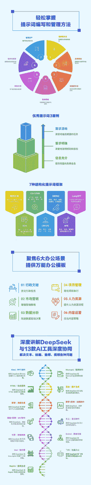

# 七、企业AI 定制化课程

面向政府企、事业单位，教育机构，行业协会，职场人士提供AI智能办公，场景化的AI应用定制化培训，AI+办公，AI+新媒体，AI+人力资源，AI+财务等应用课程，企业全员AI 内训课程。

# 八、麻省理工青少年 AI 素养线上课程

麻省理工青少年 AI 素养线上课程（Day of AI）是一个由麻省理工学院（MIT）推出的学习平台，旨在为全球 K12 学生提供 AI 基础知识和应用技能的学习资源。课程内容丰富全面，涵盖了 AI 素养基础、AI 应用以及超越 AI 素养（AI 编程）等多个方面。

课程从 AI 的基本概念入手，逐步深入，确保学生在没有技术或编码背景的情况下也能轻松理解。每门课程平均包含四小时的实践活动，通过创造性探索、讨论和游戏等方式，让学生在互动中学习 AI 及其社会影响。课程根据学生年龄分为小学、初中和高中三个层次，确保内容适合不同年龄段的学习者。

该课程不仅注重 AI 技术知识的普及，还重视 AI 伦理问题。每个课题后都有讨论题，引导学生思考 AI 的道德和社会影响。同时，每一个知识点最后都有 AI 实践活动，鼓励学生利用所学知识编写程序、制作海报等，培养他们的创造力和动手能力。

课程采用经研究验证的主动学习教学法，将学术课程与实践项目相结合，激励学生成为积极、有见识且富有创造力的人工智能使用者和设计者。

## 1. 课程目标

帮助 K12 阶段学生理解 AI 基础概念、应用场景及背后技术原理，掌握 AI 编程基础技能，培养创新思维、实践能力与批判性思维，引导学生思考 AI 的伦理与社会影响，形成正确价值观，为未来在 AI 领域的学习和职业发展奠定基础。

## 2. 课程对象

小学、初中、高中各阶段学生，根据年龄和认知水平进行分层教学。

## 3. 课程内容

### AI 素养基础
为学生提供基础的人工智能素养技能，帮助他们理解 AI 的定义、工作原理，以及与机器学习的关系等。

### AI 应用
聚焦 AI 在现实生活中的广泛应用，如语音助手、推荐系统、智能家居等领域，培养孩子的应用能力和创新思维。

### 超越 AI 素养（AI 编程）
深入探索机器学习和深度学习的高级概念，了解神经网络原理，引导孩子进行系统设计，探讨 AI 在社会中的复杂角色、政策法规等，通过项目驱动学习，培养解决问题的能力和跨学科思维。

## 4. 课程亮点

### 权威保障
源自麻省理工学院的专业课程，为孩子提供高质量的 AI 学习资源。

### 全面系统
涵盖 AI 素养基础、应用及编程等多方面内容，让孩子全方位掌握 AI 知识。

### 分层教学
根据小学、初中、高中不同年龄段的特点，设计专属课程，确保每个孩子都能轻松跟上。

### 实践导向
每门课程均包含丰富的实践活动，通过讨论、游戏等方式，让孩子在互动中深刻理解 AI。

### 重视伦理
特别关注 AI 伦理问题，培养孩子的道德判断力和社会责任感。

### 创新教法
采用麻省理工的主动学习教学法，结合学术课程与实践项目，激发孩子的创造力和批判性思维。

## 5. 教学方法

采用讲授法、实践操作法、小组讨论法、项目驱动法相结合的方式。理论知识讲解后，安排充足时间让学生实践操作，小组合作完成项目任务，鼓励学生积极讨论，分享想法。

## 6. 考核方式

小学阶段：以课堂表现（参与度、发言质量）、作品展示（创意绘画、游戏改进成果）为主要考核依据。初中阶段：综合课堂表现、项目报告（图像识别项目的完成质量、分析深度）、小组辩论表现进行考核。高中阶段：根据项目实践成果（项目的创新性、功能性、代码质量）、项目报告（需求分析、技术实现、伦理探讨内容）以及答辩表现进行评价。

## 7. 学习收获

掌握 AI 基础知识和技能，为未来的学习和职业发展打下坚实基础。

提升创新思维和实践能力，能够将所学知识应用到实际问题中。

培养批判性思维和道德判断力，正确理解和使用 AI 技术。
