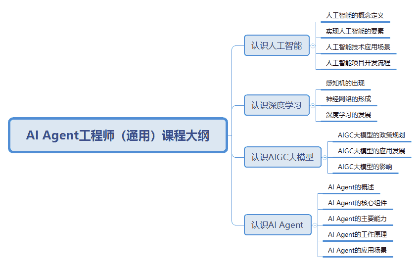
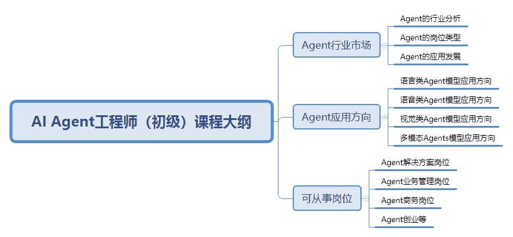

# AI Agent工程师（初级）

> 来源：[https://gotoaiworld.feishu.cn/docx/ISUwdlGfOoFKojx2JAacC6uYnoc](https://gotoaiworld.feishu.cn/docx/ISUwdlGfOoFKojx2JAacC6uYnoc)

# 课程概述

AI Agent工程师（初级）课程定位是以社会和企业对人工智能等新工科技能人才的需求为目标，为社会和企业培养合格的人工智能技术应用人员，该课程对标的是能够在企业中从事Agent解决方案和业务管理的人员。

培养对象包括高校在校学生、企事业单位在职人员、转行转业人员、以及其他对人工智能和Agent感兴趣的人员等。培养方式是线上课程培训学习和线上考试。

# 课程目标

AI Agent工程师（初级）课程内容主要包括人工智能和深度学习、Agent的基础知识，以及大模型、AIGC与Agent的关系，AI Agent的架构组件、AI Agent的工作原理、AI Agent的应用场景、AI Agent的行业分析、AI Agent的岗位类型、AI Agent的应用发展、语言类Agent模型应用方向、语音类Agent模型应用方向、视觉类Agent模型应用方向、多模态Agents模型应用方向、和未来的发展趋势等，可从事的岗位有Agent解决方案岗位、Agent业务管理岗位、Agent商务岗位，以及Agent创业等。

# 考核评价

学员完成学习后，参加工信部教育与考试中心组织的统一考试。考试重点有人工智能的基本概念、应用场景、开发流程；深度学习的概念、人工神经网络基础；大模型和AIGC的概念定义、大模型和AIGC的应用发展；AI Agent的架构组件、AI Agent的工作原理、AI Agent的应用场景、AI Agent的行业分析、AI Agent的岗位类型、AI Agent的应用发展、语言类Agent模型应用方向、语音类Agent模型应用方向、视觉类Agent模型应用方向、多模态Agents模型应用方向。

AI Agent工程师（初级）题库题目数量共300道，考核随机抽选35道，其中单选题10道（共20分），多选题5道（共10分），判断题5道（共10分），填空题10道（共30分），简答题5道（共30分）

# 详细介绍

# AI Agent工程师（初级）

## **一、课程概述：**

AI Agent工程师（初级）课程定位是以社会和企业对人工智能等新工科技能人才的需求为目标，为社会和企业培养合格的人工智能技术应用人员，该课程对标的是能够在企业中从事Agent解决方案和业务管理的人员。课程内容主要围绕Agent的基础知识和Agent在不同领域的应用方向和未来的发展趋势为主，可从事的岗位有Agent解决方案岗位、Agent业务管理岗位、Agent商务岗位，以及Agent创业等。

## **二、培养对象：**

1、高校、职校在校及应往届毕业学生

2、政府、企事业单位在职人员

3、转行转业及再就业人员

4、对AI和Agent感兴趣的其他人员

## **三、学习方式：**

1、线上培训学习

2、线上课程练习

3、线上模拟考试

4、线上习题AI解析

5、线上个性化学习推荐

## **四、培训内容：**

AI Agent工程师（初级）培训内容主要包括人工智能和深度学习、Agent的基础知识，以及大模型、AIGC与Agent的关系，AI Agent的架构组件、AI Agent的工作原理、AI Agent的应用场景、AI Agent的行业分析、AI Agent的岗位类型、AI Agent的应用发展、语言类Agent模型应用方向、语音类Agent模型应用方向、视觉类Agent模型应用方向、多模态Agents模型应用方向、和未来的发展趋势等，可从事的岗位有Agent解决方案岗位、Agent业务管理岗位、Agent商务岗位，以及Agent创业等。

## **五、培养目标：**

1、掌握Al Agent核心架构及实现原理

2、具备行业解决方案设计能力

3、掌握技术选型与实施评估方法

4、建立技术发展趋势预判能力

## **六、考核目标：**

学员完成学习后，参加工信部教育与考试中心组织的统一考试。考试重点有人工智能的基本概念、应用场景、开发流程；深度学习的概念、人工神经网络基础；大模型和AIGC的概念定义、大模型和AIGC的应用发展；AI Agent的架构组件、AI Agent的工作原理、AI Agent的应用场景、AI Agent的行业分析、AI Agent的岗位类型、AI Agent的应用发展、语言类Agent模型应用方向、语音类Agent模型应用方向、视觉类Agent模型应用方向、多模态Agents模型应用方向。

## **七、考核试题：**

AI Agent工程师（初级）题库题目数量共300道，考核随机抽选35道，其中单选题10道（共20分），多选题5道（共10分），判断题5道（共10分），填空题10道（共30分），简答题5道（共30分），满分100分，60分通过。