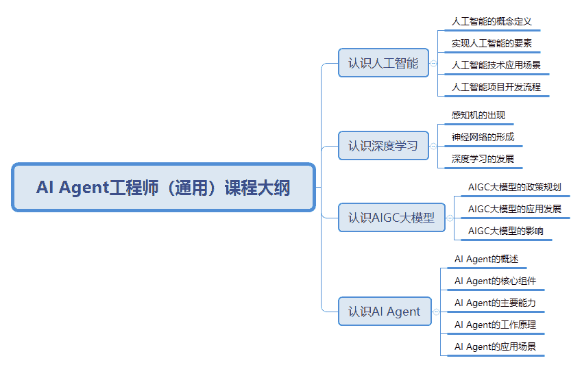
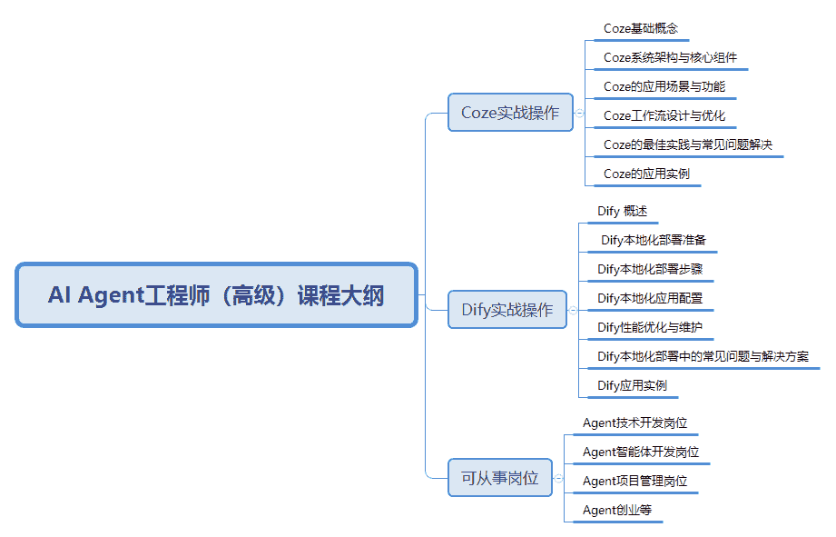

# AI Agent工程师（高级）

> 来源：[https://gotoaiworld.feishu.cn/docx/HDbSdaTUKoqlRSxMCIgceH4Anrc](https://gotoaiworld.feishu.cn/docx/HDbSdaTUKoqlRSxMCIgceH4Anrc)

# 课程概述

AI Agent工程师（高级）课程定位是以社会和企业对人工智能等新工科技能人才的需求为目标，为社会和企业培养合格的人工智能技术应用人员，该课程对标的是能够在企业中从事Agent应用智能体设计和应用开发的人员。培养方式是线上课程培训学习和线上考试。

# 课程目标

AI Agent工程师（高级）培训内容主要包括Coze系统架构与核心组件、Coze的应用场景与功能、Coze工作流设计与优化、Coze的常见问题解决、Coze的应用实操演练、Dify的本地化部署操作、Dify的本地化应用配置、Dify的性能优化与维护、Dify的常见问题解决、Dify的应用实例等，可从事的岗位有Agent应用岗位、Agent产品设计岗位、Agent产品运营岗位、Agent创业等。

# 考核评价

学员完成学习后，参加工信部教育与考试中心组织的统一考试。考试重点有Coze系统架构与核心组件、Coze的应用场景与功能、Coze工作流设计与优化、Coze的常见问题解决、Coze的应用实操演练、Dify的本地化部署操作、Dify的本地化应用配置、Dify的性能优化与维护、Dify的常见问题解决、Dify的应用实例等。

AI Agent工程师（高级）题库题目数量共300道，考核随机抽选35道，其中单选题10道（共20分），多选题5道（共10分），判断题5道（共10分），填空题10道（共30分），简答题5道（共30分），满分100分，60分通过。

# 详细介绍

**AI Agent工程师（高级）**

## **一、课程概述：**

AI Agent工程师（高级）课程定位是以社会和企业对人工智能等新工科技能人才的需求为目标，为社会和企业培养合格的人工智能技术应用人员，该课程对标的是能够在企业中从事Agent应用智能体设计和应用开发的人员。课程内容主要围绕Agent应用的数据处理、Agent应用智能体构建、Agent技术应用开发、Agent项目开发管理。可从事的岗位有Agent技术开发岗位、Agent智能体开发岗位、Agent项目管理岗位，以及Agent创业等。

## **二、培养对象：**

1、针对Coze和Dify的架构优化及企业级部署的开发人员

2、评估AI平台在业务中的集成应用落地的产品设计人员

3、利用AI工具构建行业应用，优化业务流程的业务人员

4、负责Dify的本地化部署、性能调优与维护的运维人员

5、学习AI工具应用开发，探索行业解决方案的售前人员

## **三、学习方式：**

1、线上培训学习

2、线上课程练习

3、线上模拟考试

4、线上个性化学习推荐

## **四、培训内容：**

AI Agent工程师（高级）培训内容主要包括Coze系统架构与核心组件、Coze的应用场景与功能、Coze工作流设计与优化、Coze的常见问题解决、Coze的应用实操演练、Dify的本地化部署操作、Dify的本地化应用配置、Dify的性能优化与维护、Dify的常见问题解决、Dify的应用实例等，可从事的岗位有Agent应用岗位、Agent产品设计岗位、Agent产品运营岗位、Agent创业等。

## **五、培养目标：**

掌握Coze系统架构，能够设计高效的工作流并优化AI应用

熟悉Coze的典型应用场景，并能结合业务需求搭建功能

能够独立完成Dify的本地化部署，并进行性能优化与维护

具备排查Coze和Dify常见问题的能力，提升AI应用稳定性

通过实操演练，完成从理论到落地的完整AI应用开发流程

## **六、考核目标：**

学员完成学习后，参加工信部教育与考试中心组织的统一考试。考试重点有Coze系统架构与核心组件、Coze的应用场景与功能、Coze工作流设计与优化、Coze的常见问题解决、Coze的应用实操演练、Dify的本地化部署操作、Dify的本地化应用配置、Dify的性能优化与维护、Dify的常见问题解决、Dify的应用实例等。

## **七、考核试题：**

AI Agent工程师（高级）题库题目数量共300道，考核随机抽选35道，其中单选题10道（共20分），多选题5道（共10分），判断题5道（共10分），填空题10道（共30分），简答题5道（共30分），满分100分，60分通过。