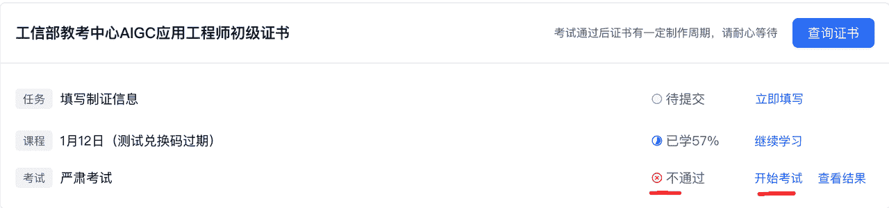
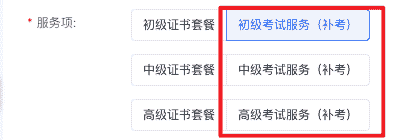
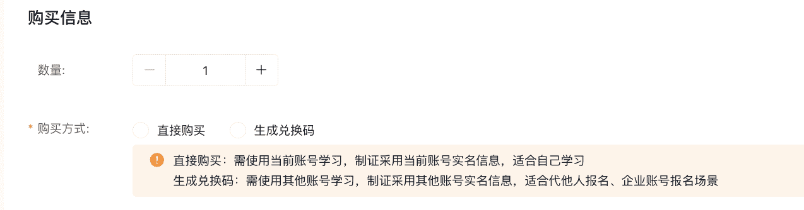

# FAQ

> 来源：[https://gotoaiworld.feishu.cn/docx/NCzfdXB1boRvDHx3A5HcRGD4nhe](https://gotoaiworld.feishu.cn/docx/NCzfdXB1boRvDHx3A5HcRGD4nhe)

**工信部认证**交付运营模式变更通知 背景：为更标准化、系统化提供交付服务，5月12日起工信部教考中心课程交付由【开班制】变更为【随学制】

主要变更点：

（1）客户支付成功后，即可自行进行线上学习，无需等待开班时间，长期班分别是生成式人工智能应用工程师（初级）、生成式人工智能应用工程师（中级）、生成式人工智能应用工程师（高级）

（2）客户学习有效期为6个月，在学习有效期内，学时达到参考标准，随时可参加考试

（3）对于C端线上客户将不再提供学员群服务，如果企业团报客户有学员群服务需求，可单独支持

（4）学习进度提醒、考试提醒、制证信息提交提醒、证书发放提醒将由系统通知完成，包括系统弹窗提醒、短信提醒等（增加兑换课程通知）

（5）客户学习过程中遇到的相关问题可咨询学习页面的【智能助手】，自助获取问题答案，如智能助手未能解答或与智能助手多轮交互未解决问题，智能助手将提供人工入口

（6）订单验收时间为支付时间T+1，验收后不支持退款

（7）首次考试未通过，公布正考成绩时，通过的即可进入制证环节，未通过直接显示"考试入口"参加补考，补考有效期至学习有效期结束

# 报名相关

## 是否可以直接报中级或高级？

+   可以，3个级别之间无递进关系。

## 是否可以直接下单考试服务（补考）？

工信部要求初级、中级考试前需要学满64学时（48小时），高级考试前需要学满80学时（60小时），不可以直接购买补考。如之前已经购买过证书套餐学完学时了，但正考和补考都未通过，则可以购买补考。

## 报高级送中级吗，报中级送初级吗？

不送，3个级别分别收费。

## 此证书各地政府是否有补贴或者是否可以抵扣个税？

+   此证书尚未列入《国家职业资格目录》，但我们陆续收到多位学员反馈在获得工信部教考中心颁发的《生成式人工智能应用工程师》认证后，成功通过个人所得税APP的"专项附加扣除\继续教育\职业资格继续教育"实现了个税抵扣。

## 工信部认证培训和考试是否有政府补贴

+   目前工信部的认证没有补贴，一般人社的证根据[需要看地方政策。
工信教考官网公示的 各地职业技能提升政策](https://www.miiteec.org.cn/plus/view.php?aid=1337)要点一览表（具体以各地政府公示结果为准）：https://www.miiteec.org.cn/plus/view.php?aid=1337

## 是否有工信部比较官方的参考材料？

+   工业和信息化部教育与考试中心联合百度发[布首个《生成式人工智能工程师》培训标准：https://w](https://www.miiteec.org.cn/news_details?code=2359)ww.miiteec.org.cn/news_details?code=2359

+   生成式人工智能应用工程师：[h](https://www.miiteec.org.cn/topics_news_details?code=17194171C98ZQ2V4)ttps://www.miiteec.org.cn/topics_news_details?code=17194171C98ZQ2V4

## 是否能用于职称认定？

+   不能

+   根据人力资源社会保障部、工业和信息化部《关于深化工程技术人才职称制度改革的指导意见》，各省（自治区、直辖市）、国务院有关部门、中央企业可按规定成立工程系列高级职称评审委员会开展正高级工程师评审工作，相关事宜请咨询当地人社部门或单位人力资源部门

## 与计算机等级考试、软考等有什么区别？

+   [该](https://www.ruankao.org.cn/article/content/100000180627085846483380%E3%80%82)[认](https://www.ruankao.org.cn/article/content/100000180627085846483380%E3%80%82)证为职业技能认证，非职业资格认证 ，国家职业资格目录https://www.ruankao.org.cn/article/content/100000180627085846483380。

+   职业资格认证一般为相关部委和人社部共同批准后对外发布，例如"软考"《计算机技术与软件专业技术资格（水平）考试》为工信部和人社部共同批准发布，每年人社部公布考试时间 一般为两次。

+   而职业技能证书由工信部考试中心（后文简称"中心"）安排组织，百度提交开班申请给中心，中心批复后提供学习平台账号给学员。学员通过考试后中心盖章、发布证书，提供证书查询入口

## 考试是否有课时要求？

有，初级、中级考试前需要学满64学时（48小时），高级考试前需要学满80学时（60小时）

## 三个级别的班有啥区别，对ai基础了解，了解不是特别深入，应该报什么班？

初级，不需要有python基础，中级需要对python有一定了解，高级最好有一定基础。

## 用户已经报名缴费成功，后续需要做什么？

+   客户报名支付成功后，即开始6个月有效期的学习

+   在学习有效期内，所学学时达到标准后，随时可参加考试（系统自动通知学员可参加考试）

## 客户反馈目前开班/考试频率太高，质疑证书含金量？

每个月开班主要是为了方便已报名学员可以更快的投入学习，减少大家的等待时间。开班/考试频率与证书含金量并无直接关系。此证书属于《职业技术证书》是培训类证书，是对学员参加培训学习过程和取得学习成果的有效证明。相关课程及考试严格按照工信部的培养目标和课程大纲执行。开班/考试的频率高并不意味着证书的含金量会下降，而是为了更高效服务学员。

# 课程内容及考试

## 培训课程上课形式及考试形式？

+   线下现场面授

+   线上录播课程，支持回放，开班后课程自动生效，在考试前可自行安排学习时间。

+   考试为线上闭卷考试，有电脑及网络可参加考试，不支持切屏，不支持切换浏览器

## 每节课多长时间？

30分钟-90分钟不等

## 学习过程中遇到问题如何解答？

+   🛰️群老师辅导

+   在学习页面咨询「智能助手」如智能助手无法解答或交互多轮未解决客户问题，助手将推出人工入口

## 课程内容是否包含大模型训练相关专题？

相关课程内容为应用类课程，不含大模型训练相关专题内容

## 认证课程名称

生成式人工智能应用工程师认证

## 考试分数和及格分？

+   选择题100+实操题100，两部分分别"都"需要80分以上才算通过。

+   举例：如果选择题考了90分 但实操题考了75分，总成绩也算考试未通过

## 考试时长有多久？

初、中、高 均是120分钟时长。

## 考试题型分布？

一般是50道选择（包括单选30和多选20）， 6道左右实操。 每期考试可能有调整，数量分配以最终考试为准

## 账号未登录可以观看的课程？

没有登录可以看的是试听课，不会记录学时

## 课件是不能下载的吗？只能在线看吗？

课件不支持下载，只能在线观看

## 课程在培训结束后可以继续反复观看吗？

课程培训结束后有录播，开始学习后有效期6个月内随时可以观看（开始学习为兑换码兑换，或直接购买的支付时间6个月）。

## 学习时间

6个月有效期内，下单账号自己学习以支付时间开始6个月有效，兑换码有效期为30天，以兑换时间开始6月内可观看线上课程

## 考试题实操部分是只有提示词编写?还是有代码编写？

不涉及写代码

## 是否有模拟试卷（测验题、练习题）

考前会有选择题练习题库，每个级别题目数量为100道左右，包括单选和多选。实操题可以在学习课程中实训练习，没有单独的实操练习题。

## 考试的实操题属于提示词，是否可以多次提交？多次提交提示词以哪个为准最终得分？

提示词生成内容没有次数限制，但以最后卷面保留的提示词 以及最后显示的生成答案为准

## 考试是否当场出成绩？

实操题需要人工判卷，考试结束后不会自动出成绩，需等待2-3个工作日人工判卷后查看考试结果。

## 实操题评分标准

+   选择题系统自动判分，实操题人工评审，评分标准

+   核心要求：prompt能执行出预期结果 & prompt完全覆盖题目要求
评价因素：
（1）prompt执行结果完全覆盖题目的全部要求 且 执行结果与预期结果一致
（2）prompt书写结构清晰，语言简洁，无语病
（3）prompt 中有few shot示例
（4）prompt 中有体现了明确的"输出格式 或 输出要求"
（5）prompt执行结果多次运行稳定输出，无大模型漂移或幻觉问题

## 客户对成绩有疑问的，想看哪些题错了，为什么扣分

可以在考试页面提申诉，接电话不要引导让客户提工单了

# 证书相关

## 证书发放时间？

+   2025年7月1日考试通过并且提交制证信息审核通过后，自动生成证书

+   [考](https://www.miiteec.org.cn/certificate_search?type=1)试通过切学员信息收集完成后，工信教考电子信息1个半月左右可在网站（ https://www.miiteec.org.cn/certificate_search?type=1 ）查询，纸质证书3个月颁发

## 考试通过 并下证后，如何查询电子证书信息？

+   百度证书只有电子版，可进入：[https://abcxueyuan.baidu.com](https://abcxueyuan.baidu.com/#/query_certificate)/[#/query_certificate 输入提交制证信息的证件](https://cloud.baidu.com/edu/edu_home/my_certificate)号码和手机号查询。【2025年7月1日考试通过并且提交制证信息审核通过后，自动生成百度证书，在我的认证页页面查看： https://cloud.baidu.com/edu/edu_home/my_certificate 】

+   工信部电子信息查询 进入：[https://www.miiteec.o](https://www.miiteec.org.cn/my_certificate)rg.cn/my_certificate 注册账号并完成实名后，在右上角点击个人中心——【我的证书】页面，查看已经关联出来的下发证书号的证书电子信息，如果为空 就是还没下发证书号。

工信部电子证书查询 证件类型支持：护照、港澳台、身份证（包含外国人永久居留身份证）

## 纸质证书是否收取工本费，如何给到客户？

纸质证书不收取工本费，邮寄给客户，无需客户付快递费

## 证书的有效期是多久？

+   工信部证书：无到期时间，永久有效

+   百度智能云证书：5年有效期

# 开班/考试时间

## 支付订单后什么时间可以开始学习？

支付完成后可随时开始学习

## 第一次考试未通过，什么时间可以进行补考？

+   第一次考试未通过，一周后参加补考（待更新规则）

+   每次考试只有1次补考机会，如果补考也没通过，客户还希望继续考工信部证书 ，则需要客户重新下单1个"考试服务（补考）"的订单（包含1次考试机会），点击【下单链接 】，费用分别为：

+   初级认证-考试认证服务 300元/次

+   中级认证-考试认证服务 500元/次

+   高级认证-考试认证服务 750元/次

**单独补考流程**： 当前学习平台：

+   与学员沟通补考意愿，确定历史报考的等级、补考费用等内容学员无异议，学员可在页面下补考订单，下单后需人工审核（班主任自行审核），审核通过后，学员支付订单。

+   支付成功后，与学员沟通期望补考时间，并登记学员补考信息补考学员信息登记 - 数据表 - 表格，至少提前一周登记补考信息。

## 考试时间？考试后多久出结果？

+   开班制学员学时达到参考标准后，随时可以参加考试

+   完成考试后，固定每周一会进行人工判卷，周三左右会在学习平台中更新考试结果，更新考试结果的第二天会通过短信通知学员。例如：学员在周一完成考试，需要在下一个周三查看成绩，间隔约8个工作日

# 支付/发票/退款相关

假如是公司客户，是每个员工用自己账号下单，还是使用公司账号统一下单，后期对学员账号是否有影响？

+   公司账号统一下单和员工用自己账号下单均支持，对学员账号没有影响

+   下单页面自由选择购买方式：【直接购买】、【生成兑换码】

+   单账号单次下多数≥2，仅支持选择【生成兑换码】，下单人下载兑换码给对应的学员兑换课程即可。

+   单账号单次下多数=1，且选择【直接购买】，支付成功后系统会直接解锁课程，无需兑换。

+   如单一账号需每单都生成兑换码，可在下单时选择购买方式为【生成兑换码】。

## 如何进行发票开具，开票项目名称是否可以修改？

联系我们的课程专员

## 是否支持退款？

+   订单支付当天申请退款，与客户核实退款原因，反馈课程专员评估是否支持退款。

+   订单支付次日及以后，不支持退款。