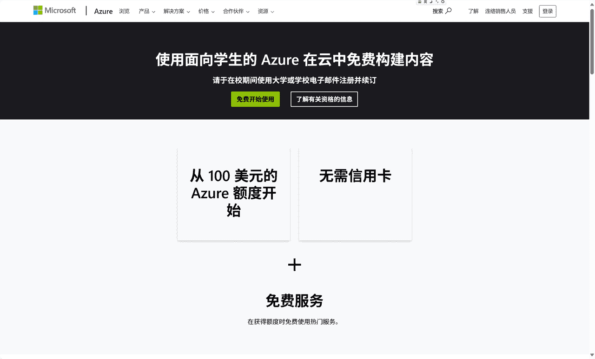
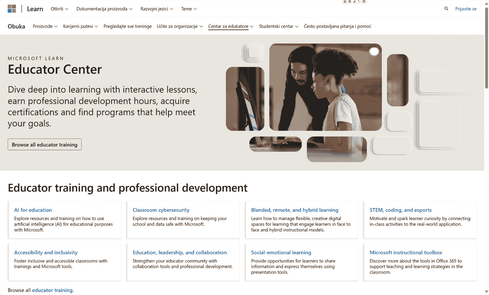

# Micrsoft AI考试券领取

> 来源：[https://gotoaiworld.feishu.cn/docx/K5kSdjVZwooG9lxQJdWcJhgOntw](https://gotoaiworld.feishu.cn/docx/K5kSdjVZwooG9lxQJdWcJhgOntw)

学生获取 Azure 免费考试券的核心途径需结合微软官方政策、教育合作项目及限时活动，以下是 2025 年最新的系统性解决方案：

### 一、微软官方教育计划与认证福利

#### 1. Azure for Students 计划叠加认证折扣

+   基础权益：通过教育邮箱认证后，学生可获100 美元 Azure 额度（有效期 12 个月），同时在微软认证考试中享受30% 基础认证折扣（如 AZ-900）和45% 角色认证折扣（如 AZ-204）。

https://azure.microsoft.com/en-us/free/students/

https://learn.microsoft.com/zh-cn/azure/education-hub/about-azure-for-students

+   进阶策略：

+   学生身份验证：在 Microsoft Learn 个人资料中选择 “学生” 角色，上传学生证或通过.edu 邮箱验证，即可在考试结算时自动抵扣折扣。

+   叠加活动：参与微软官方技能挑战（如 AI Skills Fest），完成学习路径后有机会抽取100% 免费考试券（适用于 AZ-900、AI-900 等热门科目）。

#### 2. Microsoft Learn for Educators 计划

+   教师申请通道：教师可通过该计划为学生申请免费 / 折扣考试券，尤其是与课程直接相关的认证（如 Azure AI 工程师认证）。
https://learn.microsoft.com/en-us/training/educator-center/?source=mec

+   操作流程：

1.  教师登录 Microsoft Learn Educator Center 提交课程申请。

1.  审核通过后，学生可通过学校统一发放的考试券代码预约考试。

### 二、高校合作与批量许可项目

#### 1. 学术批量许可计划

+   适用场景：高校与微软签订批量许可协议（如 EES、OVS-ES）后，学生可通过学校申请考试课堂包（含 30 张考试券），覆盖 Azure、AI、数据等核心认证。

+   申请步骤：

1.  联系学校 IT 部门或学术合作负责人。

1.  提交课程大纲或项目需求，由学校统一采购考试券并分配给学生。

#### 2. 微软创新杯（Imagine Cup）

+   竞赛奖励：全球决赛团队可获10 万美元奖金 + 免费 Azure 资源，优胜者还能获得专属考试券额度（适用于 AZ-305、AI-102 等高级认证）Microsoft。

+   资源支持：参赛团队可申请15 万美元 Azure 信用额度，用于开发过程中的模型训练与认证考试费用Microsoft。

### 三、限时活动与合作项目

#### 1. 微软全球技能挑战赛

+   活动机制：参与 AI Skills Fest、Azure AI 奥德赛等活动，完成学习模块并通过技能测试后，有机会获得免费考试券（如 DP-600、AI-102）。

+   操作指南：

1.  登录[微软认证活动页面](https://www.microsoft.com/zh-cn/aiskillsfest/)注册。

1.  选择与 Azure 相关的挑战（如 “Azure 云架构设计”），完成后提交抽奖表单。

#### 2. GitHub Student Developer Pack

+   关联权益：通过 GitHub 学生认证后，可获100 美元 Azure 额度，同时在微软认证考试中享受额外10% 折扣叠加（需在认证页面绑定 GitHub 账号）。

+   隐藏福利：部分高校与 GitHub 合作推出联合认证计划，学生可通过学校技术社团申请专属考试券配额。

### 四、中国区专属路径与合规性

#### 1. Azure China 本地化支持

+   认证流程：中国学生需通过 Azure China（世纪互联运营）进行考试预约，考试券需通过教育部学信网认证或高校合作项目获取Microsoft Azure。

+   合规建议：

+   处理敏感数据时，优先选择通过DJCP 认证的 Azure China 实例，确保符合《个人信息保护法》。

+   参与阿里云协同育人项目等本地合作，获取联合考试券额度（如 AZ-900 免费券）。

#### 2. 高校技术社团与竞赛

+   校内资源：加入微软学生俱乐部或高校云技术社团，可参与校园认证日活动，直接申领免费考试券（如 AZ-204）。

+   竞赛奖励：

+   华为云 AI 大赛、腾讯云高校开发者大赛等赛事，获奖者可获Azure 考试券 + 云资源包（价值约 2000 元）。

+   参与微软 Reactor 中国区活动，完成 AI 应用开发挑战后，有机会获得DP-300 免费券。

### 五、关键操作流程与注意事项

#### 1. 考试券获取与使用步骤

+   通用流程：

1.  身份验证：通过 Microsoft Learn 或高校系统完成学生身份认证。

1.  活动参与：在微软认证页面筛选 “学生专属” 活动，完成学习路径后提交申请。

1.  券码兑换：收到券码后，登录Pearson VUE 考试平台，在结算时输入券码即可免单learn.microsoft.com。

#### 2. 常见问题解决方案

+   配额限制：Azure 考试券通常需提前 30 天预约，热门科目（如 AZ-305）可能需排队，建议通过高校合作项目批量锁定考位。

+   过期风险：考试券有效期通常为 3 个月，建议搭配微软认证学习路径（如 Azure AI 工程师路径）同步备考，避免资源浪费。

+   技术适配：部分考试需使用 Azure China 特定环境，建议在考前通过Azure Sandbox进行模拟调试Microsoft Azure。

### 六、成本优化与长期策略

#### 1. 混合资源利用

+   初级阶段：用 Azure 学生机（B1s 实例免费）完成入门实验，叠加 Google Colab 免费 GPU（每日 12 小时）进行模型训练，节省基础学习成本。

+   进阶阶段：申请华为云昇腾实例（免费）训练国产模型，用 AutoDL 抢占式实例（RTX 3090 约 1.76 元 / 小时）处理大规模数据，将 Azure 考试券聚焦于高级认证（如 AI-102）。

#### 2. 学术研究支持

+   论文发表奖励：在顶级会议（如 NeurIPS、ICML）发表 Azure 相关研究成果，可通过微软 Research 部门申请专属考试券额度（价值约 500 美元）Microsoft。

+   开源贡献计划：为 Azure 开源项目（如 Azure ML SDK）提交有效代码，可获认证考试豁免资格（如 AZ-204）。

### 七、总结与推荐路径

+   全球化资源首选：通过 Azure for Students 计划叠加微软认证折扣，适合需跨环境开发的学生。

+   国产化研究优先：参与高校与阿里云、华为云的联合项目，获取本地化考试券与云资源。

+   低成本弹性方案：关注微软 AI Skills Fest 等限时活动，利用抽奖机制获取免费券，同时通过 GitHub Student Pack 降低基础学习成本。

建议学生定期查看[微软认证官方博客](https://techcommunity.microsoft.com/t5/microsoft-certification-blog/bg-p/MicrosoftCertificationBlog)和高校技术社团通知，及时捕捉考试券发放动态。对于需 GPU 密集型任务的用户，可叠加 Azure China 与国际版资源，平衡合规性与成本。