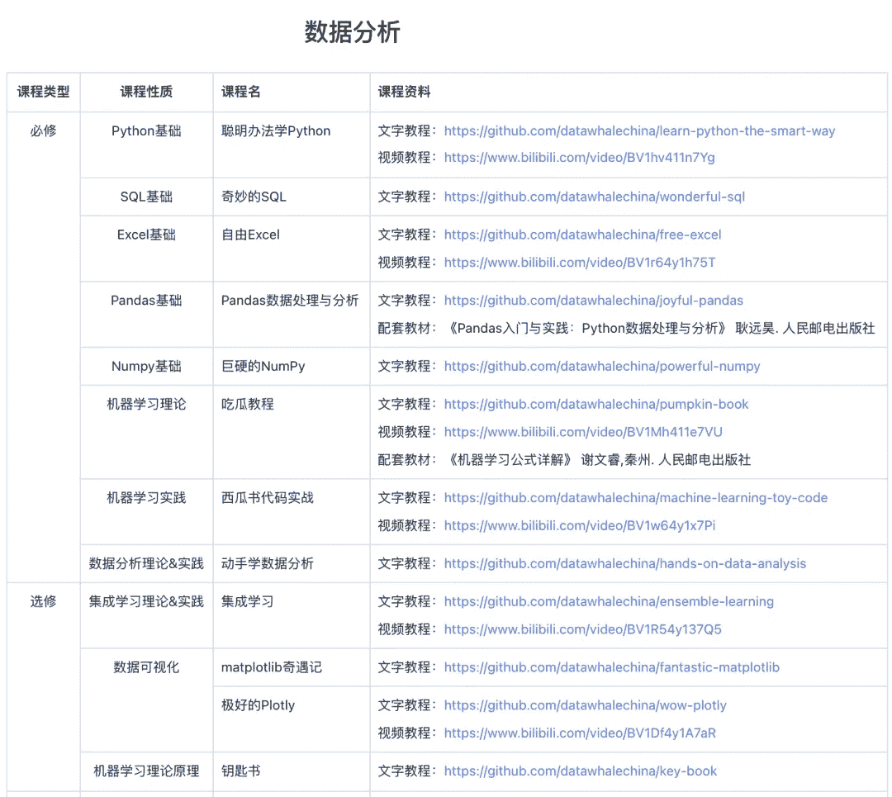
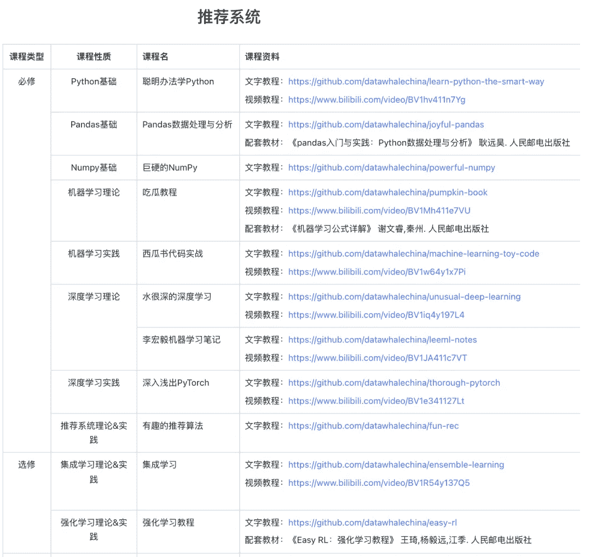
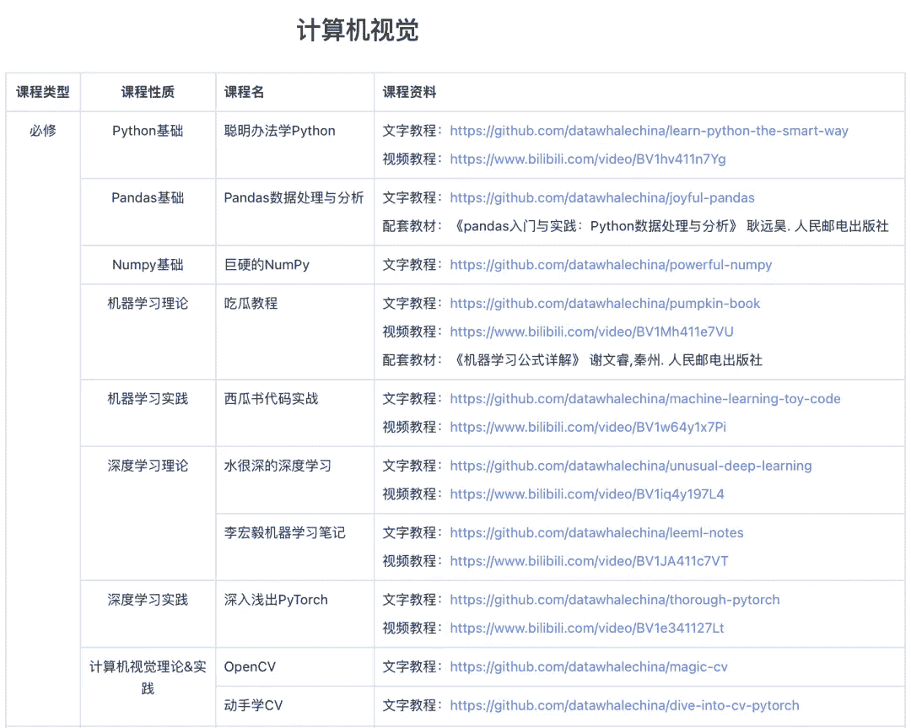
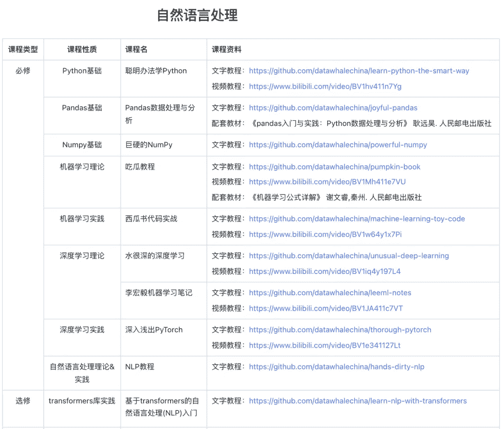
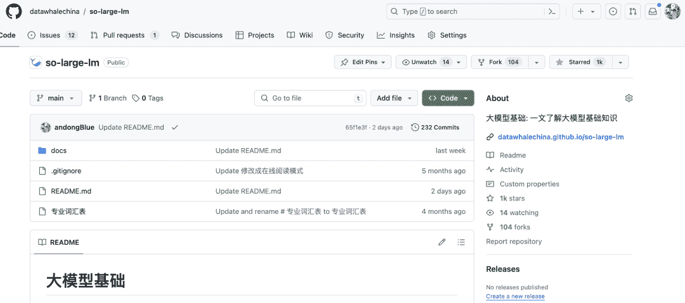
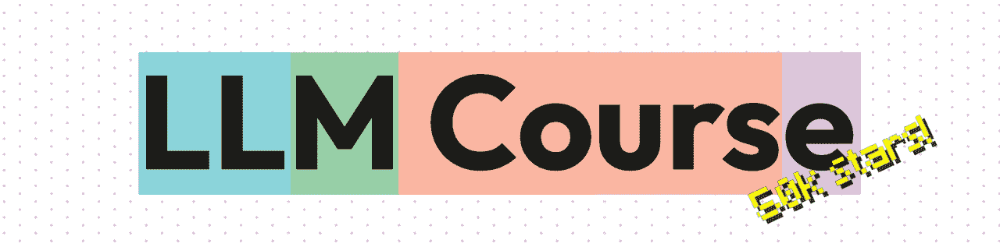
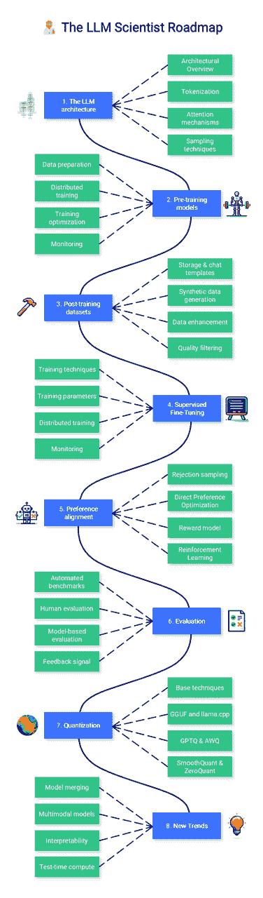
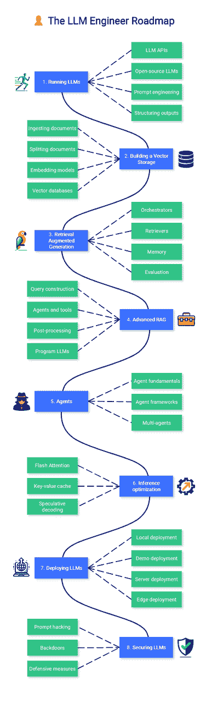

# 大模型学习热身项目

> 来源：[https://gotoaiworld.feishu.cn/docx/UtIAd9IqOohGlpxxUJ9cD9vJnLd](https://gotoaiworld.feishu.cn/docx/UtIAd9IqOohGlpxxUJ9cD9vJnLd)

# 1.必修课









**《动手学大模型应用开发》**是一个**面向小白开发者的教程**，旨在结合个人知识库助手项目，通过一个课程完成大模型开发的重点入门。我们想要帮助每一位想要迈入大模型世界的学习者和开发者，用最少的时间和精力完成最必要的大模型开发入门。项目英文名为 LLM Universe，意味着我们并不囿守在大模型本身，我们想要基于通用大模型的强大能力，搭建起一个丰富多彩、熠熠生辉的大模型宇宙，在通用人工智能的协助下，我们必将领航星辰大海，扬帆浩瀚未来。

**开源地址**：

https://github.com/datawhalechina/llm-universe



开源的大模型基础项目(https://github.com/datawhalechina/so-large-lm)

RAG全栈、AI自动化神器n8n领衔

https://mp.weixin.qq.com/s/S3cQyjivrpYAsKVX6Aamrw

# 2.选修课

```
知乎知学堂：https://www.zhihu.com/education/learning
51CTO学堂：https://edu.51cto.com/courselist/195.html
慕课网：https://coding.imooc.com/?c=AI
网易云课堂：https://study.163.com/category/480000004203006
自动驾驶之心：https://www.zdjszx.com/page/5485485?navIndex=1
极客时间：https://u.geekbang.org/subject/finetuning
B站付费课程：https://www.bilibili.com/cheese/play/ss34028
黑马程序员：https://www.itheima.com/
黑马博学谷：https://www.boxuegu.com/
尚硅谷：https://www.atguigu.com/
达内教育：https://www.tedu.cn/sem/pc/kf/python2101/
马士兵教育：https://www.mashibing.com/subject/169
咕泡科技：https://ai.gupaoedu.cn/course/list/2?is_un_scroll_top=1
智泊AI：https://www.zhipoai.com/agidev.html
聚客AI学院：https://edu.guangjuke.com/
深蓝学院：https://www.shenlanxueyuan.com/
百战程序员：https://www.itbaizhan.com/stages/id/31
深度之眼：https://www.deepshare.net/
图灵课堂：https://vip.tulingxueyuan.cn/page/1636680?navIndex=0
卢菁博士：https://app4tvrkyjd6910.xet.citv.cn/p/decorate/homepage
七月在线：https://www.julyedu.com/category/index
小滴课堂：https://xdclass.net/videoListPage?id=8&amp;cid=152
路飞学城：https://www.luffycity.com/
```

从大模型**训练到微调**，从**AI应用开发**到**AI Agent**开发，从**AIGC****()****到RAG**，到**通用AGI**，到**多模态大模型**。技术方面从机器学习、深度学习、强化学习，到计算机视觉CV，自然语言处理NLP()。课程涉及多种场景下的项目实战，有实战营，训练营，全栈实践班。从底层技术到应用场景，到AI商业变现。从设计到部署深度实践大模型应用开发落地全流程。

# 3.大模型入门到精通



https://github.com/mlabonne/llm-course

## 📝 Notebooks

A list of notebooks and articles I wrote about LLMs.

### Tools

### Fine-tuning

### Quantization

### Other



