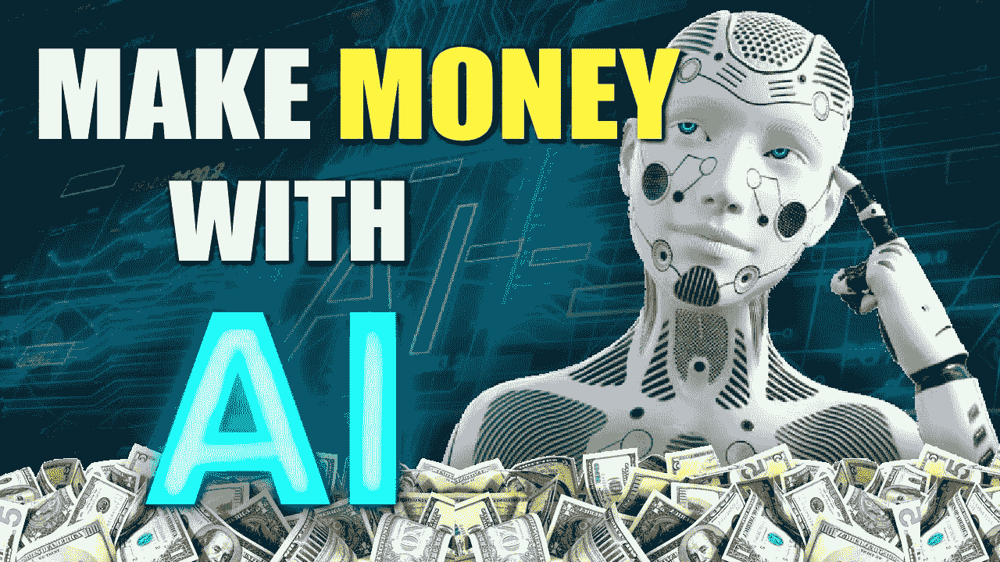
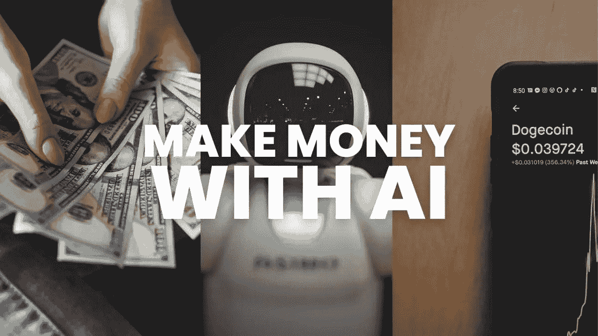

# 普通人利用AI赚钱，创业，商业变现的路径

> 来源：[https://gotoaiworld.feishu.cn/docx/U3PWd2Y9yo9UwAxi1TSc4RIqnKe](https://gotoaiworld.feishu.cn/docx/U3PWd2Y9yo9UwAxi1TSc4RIqnKe)

### 一、低门槛入门：零技术 / 碎片时间可启动（适合兼职、宝妈、学生）

1.  数据标注：AI 训练的 “基础燃料”

+   **核心逻辑**：为 AI 模型标注图像、文本、语音等数据（如自动驾驶图像中的车辆 / 行人框选、语音识别中的文字匹配），属于 AI 产业链的基础刚需环节。

+   **工具与平台**：百度众测、京东微工、云测数据、LabelImg（开源标注工具）。

+   **变现模式**：按任务量计费（单张图片标注 0.01-0.5 元，语音标注 0.1-2 元 / 分钟），日均投入 3-4 小时，月收入 3000-6000 元。

+   **案例**：武汉宝妈通过标注监控视频中的人物行为，利用带娃间隙接单，月稳定收入 4000 元；大学生团队用 Python 脚本批量处理标注任务，效率提升 3 倍，月入 8000 元。

1.  AI 内容代工：高效承接 “轻创作” 需求

+   **核心逻辑**：用 AI 工具批量生成文案、设计、短视频等内容，为中小企业、自媒体人、电商卖家提供 “低成本内容解决方案”，赚取服务费。

+   **细分方向与工具**：

+   文案类：ChatGPT（📕种草文、抖音脚本）、Jasper（营销文案），接单平台：豆瓣稿费银行（单篇 200-1000 元）、星图（带货文案单条佣金 500-1500 元）。

+   设计类：Midjourney（宠物头像、海报）、Canva AI（PPT 模板、电商主图），接单平台：淘宝（99 元 / 个头像，月销 200 单）、千图网（模板销售 5-50 元 / 份，被动收入）。

+   短视频类：Pictory（文字转视频）、HeyGen（数字人解说），接单平台：抖音服务商平台（200 元 / 条带货视频，月接 30 单）。

+   **案例**：宝妈用 Midjourney 生成儿童绘本插画，淘宝卖电子版 29.9 元 / 本，同时私域接定制绘本 199 元 / 本，月收入 1.2 万元；自由职业者用 AI 批量生成奶茶店促销文案，按单收费 50-200 元，月接单 50+。

1.  AI 知识付费：卖 “工具使用方法” 而非技术

+   **核心逻辑**：将 AI 工具的实操技巧（如 “Midjourney 出图秘籍”“ChatGPT 写周报模板”）整理成课程或社群，面向零基础人群变现，核心是 “降低学习门槛”。

+   **变现模式**：

+   低价课程：网易云课堂、腾讯课堂上架 99-199 元课程（如《AI 简历优化课》月销破万）。

+   社群运营：知识星球 299 元 / 年社群（每日分享提示词、工具测评，2000 人社群年营收 60 万元）。

+   直播教学：📕 “AI 绘画训练营”，直播 + 私域答疑，单期收费 199 元，每期招生 500 人。

+   **案例**：前产品经理转型 AI 顾问，在 “在行” 提供 AI 工作流定制咨询，时薪 500 元，同时开发《中小电商 AI 运营课》，月收入超 5 万元。

### 二、中等进阶：搭建 “半自动化” 系统（适合全职、自由职业者）

1.  垂直领域 AI 工具代运营：做 “小老板的 AI 助手”

+   **核心逻辑**：针对细分行业的小商家（如餐馆、宠物店、外卖店），提供 “AI 工具 + 人工优化” 的代运营服务，解决商家 “不会用 AI 但需要效率提升” 的痛点。

+   **细分方向**：

+   餐饮行业：用 AI 生成短视频脚本（如 “火锅食材新鲜度展示”）、设计促销海报，代运营抖音账号，按季度收费 3000-8000 元。

+   电商行业：用 Jungle Scout 选品、AI 生成产品描述和 A + 页面，帮卖家优化广告关键词，按 “销售额提成 3%-5%” 或固定服务费 5000 元 / 月。

+   服务行业：帮理发店、宠物店做 “AI 客户维护”（自动发送节日祝福、优惠提醒），收费 200-500 元 / 店 / 月。

+   **案例**：大学生团队为 “宠物智能喂食器” 卖家做 AI 运营，用 AI 剪辑开箱视频投 TikTok，3 个月帮卖家销售额破 10 万元，赚取提成 3 万元；个人帮小区周边 15 家餐馆做 AI 海报设计，月收入 1.2 万元。

1.  AI 自动化分销：靠 “系统被动赚钱”

+   **核心逻辑**：搭建 “AI 生成内容 + 多平台分发 + affiliate 分销” 的自动化流程，通过流量分成、商品佣金实现被动收入，核心是 “用工具降低运营成本”。

+   **实操路径**：

1.  内容生成：用 ChatGPT+Midjourney 生成 “育儿知识图文”“家居好物测评” 等垂直内容。

1.  自动分发：用 Buffer（多平台定时发布）、Zapier（流程自动化），同步到📕、抖音、亚马逊博客。

1.  变现方式：挂载淘宝联盟商品链接（佣金 5%-20%）、亚马逊 Kindle 电子书（AI 生成育儿指南，售价 19.9 元，被动分成）、AI 工具分销（如推广 Canva 会员，每单提成 20 元）。

+   **案例**：职场人用 AI 生成 “职场效率工具测评” 内容，自动分发到 10 个平台，通过推荐 Notion AI、ChatGPT Plus 赚取佣金，月被动收入 5000+；宝妈用 AI 生成儿童故事电子书，在亚马逊 Kindle 上架，每月稳定分成 3000 元。

1.  AI 数据服务：帮小商家 “看懂数据”

+   **核心逻辑**：小商家（如外卖店、便利店）有数据但不会分析，用 AI 工具将订单数据、客户数据转化为 “可执行的经营建议”，按项目收费。

+   **工具与服务**：

+   数据分析：Excel AI 功能、腾讯云 AI 分析、Tableau AI（生成可视化报表）。

+   服务内容：外卖店 “热销菜品 TOP5 + 备货建议”（150 元 / 次）、便利店 “临期商品预警表”（100 元 / 月）、奶茶店 “选址分析报告”（3000 元 / 份）。

+   **案例**：大学生帮奶茶店分析美团订单数据，用 AI 生成 “周末销量高峰备货方案”，收费 3000 元；自由职业者为 10 家便利店做临期商品管理，月收入 1000 元，同时对接临期商品回收渠道赚取佣金。

### 三、长期创业：打造 “AI + 行业” 解决方案（适合团队、有行业经验者）

1.  垂直行业 AI 智能体（Agent）开发：做 “企业的数字员工”

+   **核心逻辑**：基于低代码平台开发针对特定行业的 AI 智能体，替代企业重复劳动（如客服、财务、HR），按 “订阅制” 或 “定制费” 赚钱，市场规模预计 2030 年达 471 亿美元。

+   **细分方向与平台**：

+   客服智能体：用 Coze、Dify 搭建电商客服机器人（自动回复售后问题、推荐商品），收费 5000-2 万元 / 套，年服务 30 家客户收入超 60 万元。

+   财务智能体：自动对账、核票、生成报表，为中小商家提供服务，订阅费 500 元 / 月 / 家，100 家客户年营收 60 万元。

+   教育智能体：开发 “AI 作业批改助手”，为培训机构提供服务，按学生数收费 10 元 / 人 / 月，1000 人机构年营收 12 万元。

+   **案例**：浙江 00 后大学生用 Coze 开发 “外贸多语言客服插件”，按年订阅 2999 元 / 家，服务 50 家外贸企业，单月收入 8 万元；深圳宝妈将 10 年育儿经验注入智能体，做 “AI 育儿顾问”，99 元 / 年订阅制，半年积累 3000 + 付费用户。

1.  AI + 实体行业：用技术优化传统生意

+   **核心逻辑**：不做纯技术公司，而是将 AI 作为 “效率工具” 融入实体行业，解决传统生意的痛点（如库存损耗、获客难、人力成本高），赚取 “差价” 或 “服务费”。

+   **细分方向**：

+   零售行业：帮水果店用 AI 选品（分析周边消费数据，减少损耗 30%），按 “损耗降低比例” 分成；帮服装店用 AI 虚拟模特（替代真人拍摄，节省 80% 成本），收费 2000 元 / 季度 / 店。

+   服务行业：帮健身房用 AI 生成 “个性化健身计划”（根据用户体测数据），吸引会员续费，按会员数提成 50 元 / 人；帮打印店用 AI 设计海报（提升客单价从 20 元到 80 元），分润 30%。

+   **案例**：楼下水果店老板用 AI 分析销售数据，优化进货量，损耗从 15% 降至 5%，月利润提升 2 万元；创业者为 10 家连锁理发店做 “AI 客户画像系统”（推荐适合发型），单店月营收提升 30%，按利润分成 10%。

1.  AI 创意产业：做 “高附加值艺术变现”

+   **核心逻辑**：用 AI 生成差异化的艺术作品（如数字藏品、定制插画、游戏素材），面向高端客户或 B 端企业，赚取 “创意溢价”。

+   **细分方向**：

+   数字艺术：用 Midjourney+Stable Diffusion 生成 “赛博朋克风格插画”，在 OpenSea（数字藏品平台）售价 0.1-10 ETH（约 1500-15 万元）；为品牌做 “AI 艺术联名周边”（如潮牌 T 恤图案），收费 5-20 万元 / 次。

+   游戏素材：用 AI 生成游戏场景、NPC 对话、道具描述，卖给游戏工作室，单套素材收费 1-5 万元；开发 “AI 游戏关卡生成工具”，订阅费 1999 元 / 月 / 工作室。

+   **案例**：设计师用 AI 生成 “萌宠守护神” 系列写真，单张售价 399-799 元，累计收入超 5 万元；团队用 Runway 生成景区 AI 宣传片，收费 1-3 万元 / 分钟，年承接文旅项目超 10 个，净利润率 60%。

### 四、通用变现工具与避坑指南

1.  必备工具链（降低成本，提升效率）

+   内容生成：ChatGPT（文本）、Midjourney（图像）、Pictory（视频）、HeyGen（数字人）。

+   接单与分销：淘宝（定制服务）、知识星球（社群）、亚马逊 Kindle（电子书）、联盟营销（淘宝联盟、京东联盟）。

+   自动化：Zapier（流程串联，如 “AI 生成文案→自动发布到📕”）、Buffer（多平台定时发布）。

1.  避坑红线（避免法律与合规风险）

+   **版权风险**：AI 生成内容需人工修改 30% 以上（如添加原创元素），合同明确 “人类实质性参与”；避免直接商用未授权素材（如明星肖像、影视片段）。

+   **数据安全**：不向未认证工具上传敏感信息（身份证、企业机密），优先用本地部署工具（如 Stable Diffusion）；海外平台账号用 NordVPN 保护。

+   **伦理边界**：不生成虚假信息（伪造简历、假新闻），内容中标注 “AI 辅助创作”，避免平台违规处罚。

### 总结：普通人 AI 变现的 3 个核心原则

1.  **从 “解决身边小需求” 切入**：不贪大求全，先做 “小区餐馆 AI 海报”“宝妈 AI 育儿计划” 等具体场景，验证需求后再扩大。

1.  “人机协作” 而非 “依赖 AI”：AI 做重复劳动（生成初稿、基础标注），人类做高价值环节（优化内容、对接客户、解决复杂问题），这是普通人的核心竞争力。

1.  **短期试错，长期深耕**：先用免费工具（ChatGPT 免费版、Canva 免费版）验证 1-2 个方向，3 个月内看到收益再全职投入；长期聚焦 1 个垂直领域（如 “电商 AI 运营”“宠物 AI 设计”），形成壁垒。