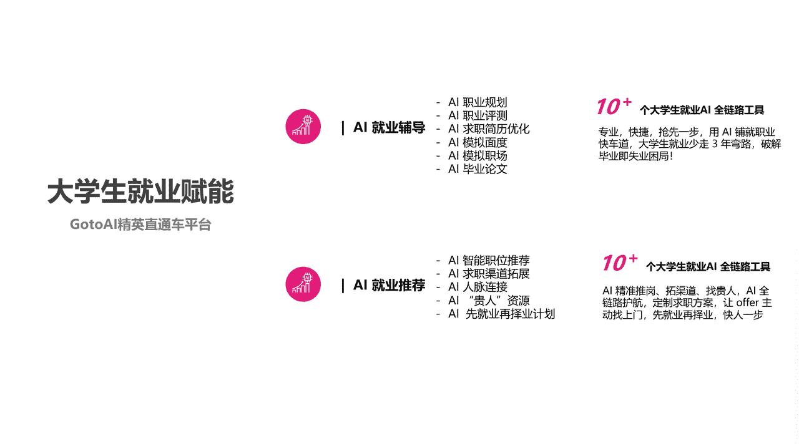
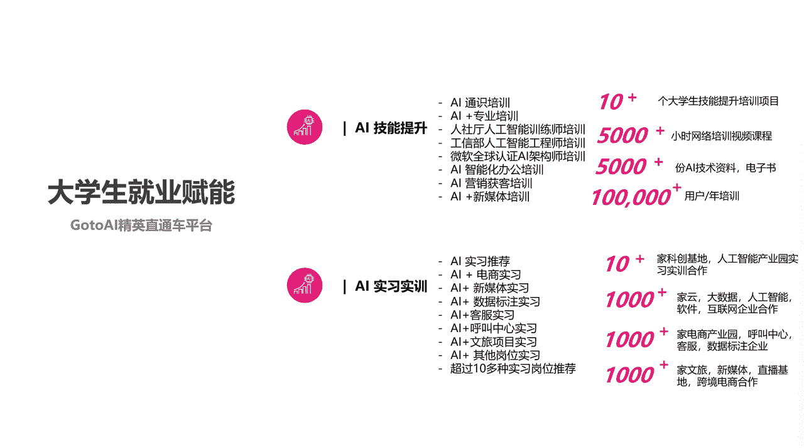
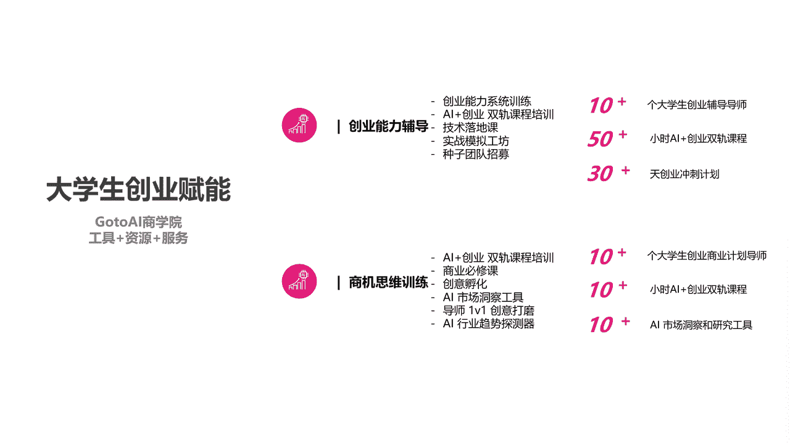
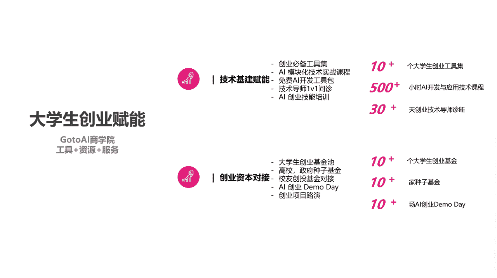
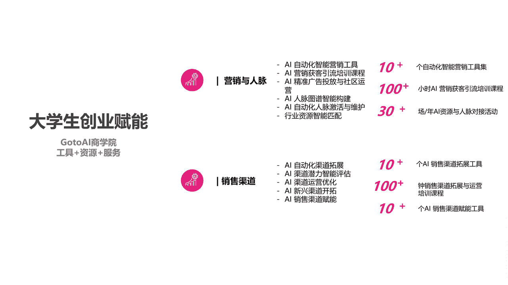
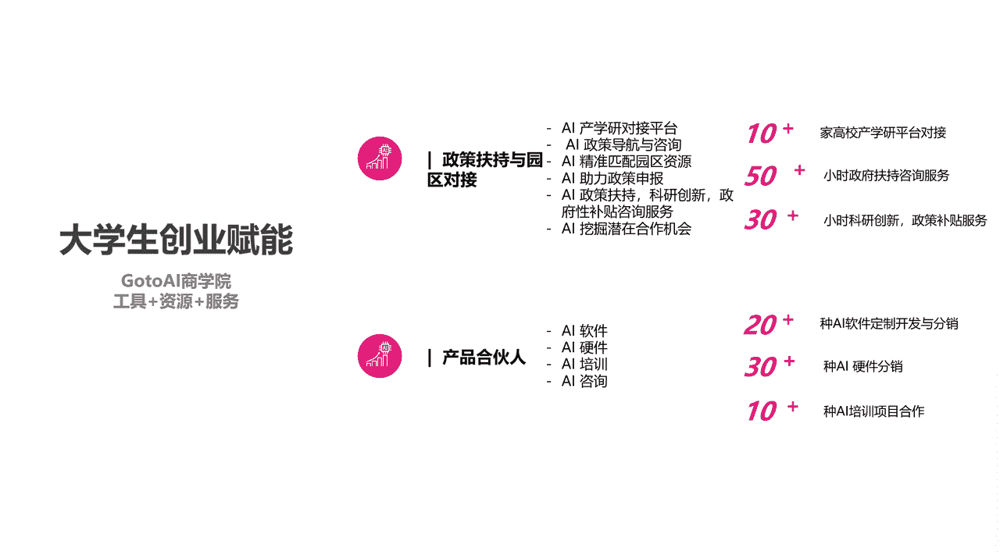

# 大学生AI学习，实习，就业与创业路线图

> 来源：[https://gotoaiworld.feishu.cn/docx/Xeg7dq9nmoAUTaxJOLtco7Jnncf](https://gotoaiworld.feishu.cn/docx/Xeg7dq9nmoAUTaxJOLtco7Jnncf)

专业类型

| **专业类型** | **目标岗位集群** | **核心技能补强方向** | **推荐培训项目** | **短期冲刺重点** |
| --- | --- | --- | --- | --- |
| 计算机 / 软件 | 大模型训练、AI 芯片设计 | 分布式训练、芯片架构 | 大模型开发工程师微专业 | 复现顶会论文、参与开源项目 |
| 商科 / 经管 | AI 产品经理、商业技术工程师 | 产品设计、AI 技术边界认知 | AI 产品经理集训营 | 用 Axure 做 AIGC 产品原型 |
| 医学 / 生物 | 医疗 AI 应用、AI + 生物科技 | 影像标注、生物信息学工具 | 医疗 AI 应用专家班 | 开发基因数据分析小工具 |
| 文科 / 艺术类 | AIGC 创意、技术文档工程师 | Stable Diffusion、技术写作 | AIGC 创意开发营 | 生成影视级特效作品 |
| 法学 / 社会学 | 数据隐私合规、AI 伦理评估 | 隐私法规、公平性评估工具 | AI 伦理合规专项课 | 撰写 AI 合规分析报告 |

# 一、大学生AI学习路线图

# 二、大学生AI实习路线图

GotoAI 自营人工智能产业园

[GotoAI 人工智能与数字经济示范产业园计划](https://gotoaiworld.feishu.cn/wiki/EkEowH7Qei5KITk55XgcNeCFn6d)

# 三、大学生AI就业路线图

# 四、大学生AI创业路线图

# 五、十万大学生AI精英会员陪跑计划

# 六、十万大学生AI精英职通车计划

# 七、GotoAI 校园行

[GotoAI校园行](https://gotoaiworld.feishu.cn/wiki/CP5CwzzJ0iRpMjkW4CwcsPYPn9g)