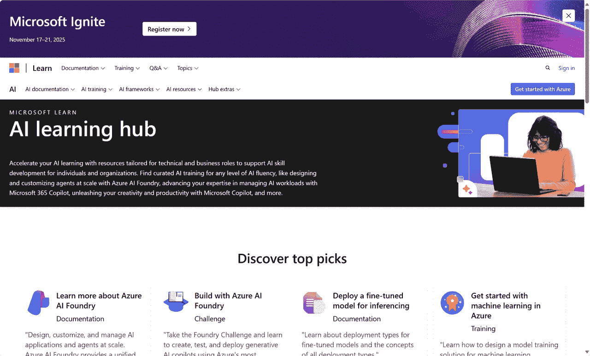
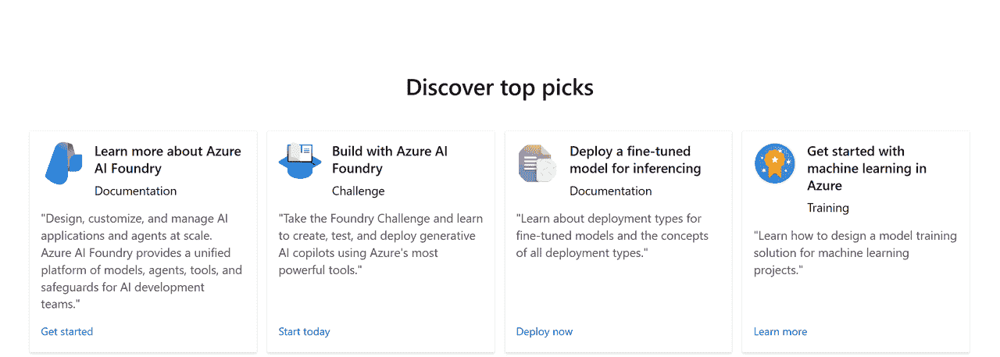
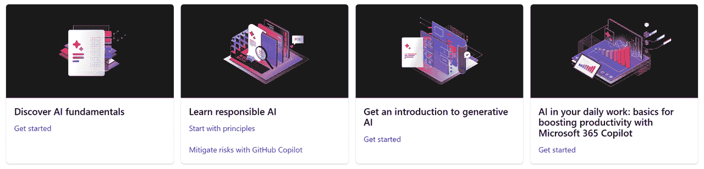
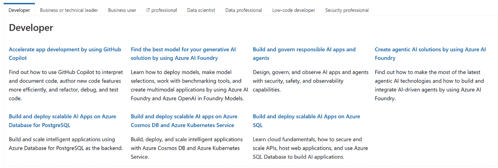

# Microsoft AI Learning Hub

> 来源：[https://gotoaiworld.feishu.cn/docx/H5ujdmFDOo90J3xtM1YcMRZenrh](https://gotoaiworld.feishu.cn/docx/H5ujdmFDOo90J3xtM1YcMRZenrh)

# AI learning hub

Accelerate your AI learning with resources tailored for technical and business roles to support AI skill development for individuals and organizations. Find curated AI training for any level of AI fluency, like designing and customizing agents at scale with Azure AI Foundry, advancing your expertise in managing AI workloads with Microsoft 365 Copilot, unleashing your creativity and productivity with Microsoft Copilot, and more.

https://learn.microsoft.com/en-us/ai/?tabs=developer

## Discover top picks

+   Learn more about Azure AI Foundry

+   Documentation

+   "Design, customize, and manage AI applications and agents at scale. Azure AI Foundry provides a unified platform of models, agents, tools, and safeguards for AI development teams."

+   [Get started](https://learn.microsoft.com/en-us/azure/ai-foundry?wt.mc_id=aihub_FoundryHub_webpage_cnl)

+   Build with Azure AI Foundry

+   Challenge

+   "Take the Foundry Challenge and learn to create, test, and deploy generative AI copilots using Azure's most powerful tools."

+   [Start today](https://learn.microsoft.com/en-us/challenges/77j7c8trq1r462?wt.mc_id=aihub_aifspotlight_learnhub_learnchallenge)

+   Deploy a fine-tuned model for inferencing

+   Documentation

+   "Learn about deployment types for fine-tuned models and the concepts of all deployment types."

+   [Deploy now](https://learn.microsoft.com/en-us/azure/ai-foundry/openai/how-to/fine-tuning-deploy?context=%2Fazure%2Fai-foundry%2Fcontext%2Fcontext&tabs=portal)

+   Get started with machine learning in Azure

+   Training

+   "Learn how to design a model training solution for machine learning projects."

+   [Learn more](https://learn.microsoft.com/en-us/training/courses/ai-900t00?wt.mc_id=aihub_AI900machinelearning_webpage_wwl)

## Start with strong foundations

Build your AI fluency - learn what AI is, the services and technologies it includes, responsible AI, how you and your organization can put AI to work, and more.

## Expand your AI skills based on your role

Get ready to use Copilot and build AI apps. Discover the transformational experiences you can implement by using Microsoft's AI apps and services. Select a role to explore focused skilling resources.

