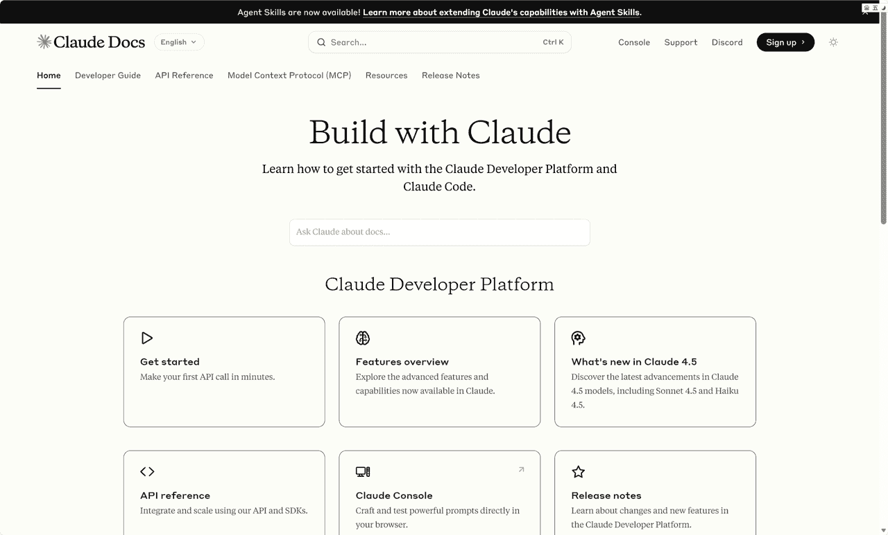
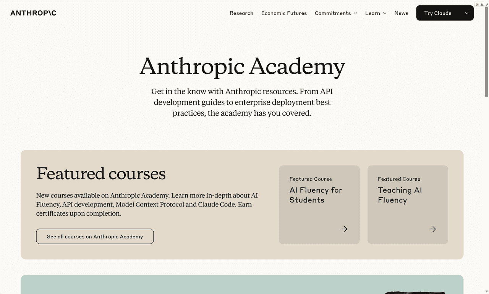
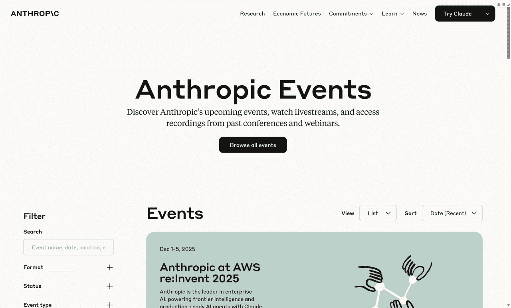
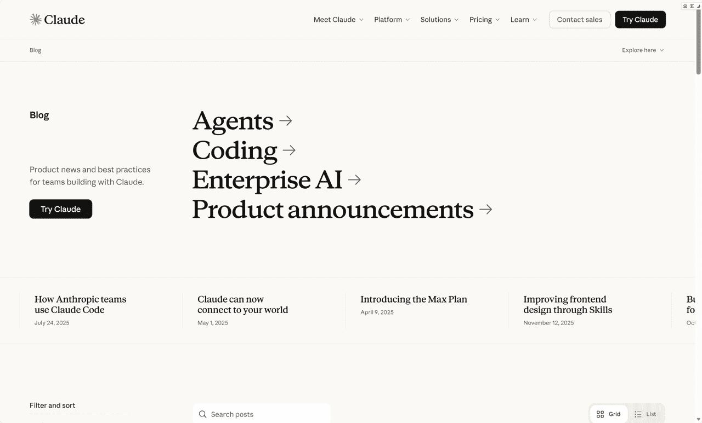

# Anthropic-Claude Learning Hub

> 来源：[https://gotoaiworld.feishu.cn/docx/LGewd8p0fom45Ox36KbcwbYhnDe](https://gotoaiworld.feishu.cn/docx/LGewd8p0fom45Ox36KbcwbYhnDe)

Get in the know with Anthropic resources. From API development guides to enterprise deployment best practices, the academy has you covered.

# Claude Docs Center

https://docs.claude.com/en/home

# Anthropic Academy

https://www.anthropic.com/learn

# Anthropic Events

https://www.anthropic.com/events

# Anthropic Blog

https://claude.com/blog

+   [Blog](https://claude.com/blog)

+   [Courses](https://www.anthropic.com/learn)

+   [Use cases](https://claude.com/resources/use-cases)

+   [Connectors](https://claude.com/partners/mcp)

+   Customer stories

+   Engineering at Anthropic

+   [Events](https://www.anthropic.com/events)

+   Powered by Claude

+   Service partners

+   Startups program