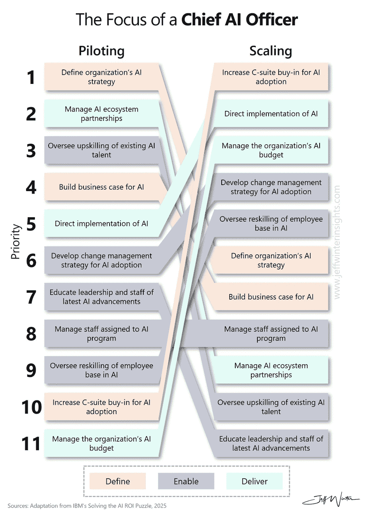
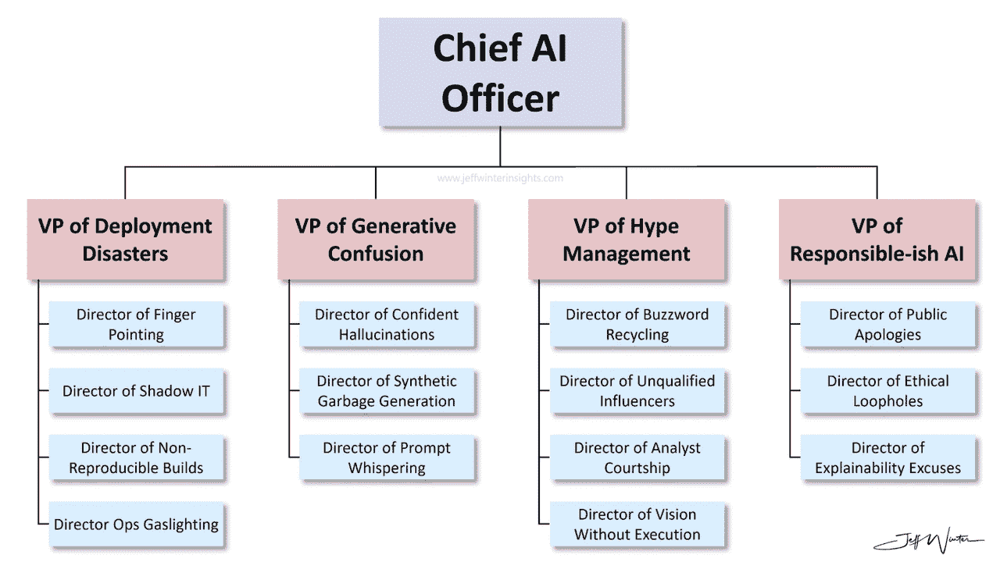

# The Rise of the CAIO (Chief AI Officer)

> 来源：[https://gotoaiworld.feishu.cn/docx/U5ucdP0y5ohEvoxD4qGckjM5n1e](https://gotoaiworld.feishu.cn/docx/U5ucdP0y5ohEvoxD4qGckjM5n1e)

[Read](https://www.jeffwinterinsights.com/insights/category/Read)

September 3, 2025

## If AI Is Everyone’s Job, It’s No One’s Job

Artificial Intelligence isn’t sneaking in the back door, it’s marching straight through the front lobby. Unlike other waves of technology that began in narrow domains before spreading, AI feels different. It’s pervasive. It touches every process, every function, every industry. Finance uses it to detect fraud, HR to screen candidates, manufacturing to predict machine failures, marketing to personalize campaigns, product teams to reinvent offerings. In short, AI doesn’t live in one silo, it’s everywhere at once.

That’s precisely the problem… as funny as this org chart looks, this isn’t far from reality. When a technology is this ubiquitous, the risk is that ownership gets diluted. If “AI is everyone’s job,” then in practice it becomes no one’s job. Projects pop up in pockets, pilots sprout without oversight, and governance is an afterthought. Many companies have already seen the cost of this approach: duplicated effort, wasted budgets, inconsistent tools, and in some cases, reputational harm when an unsupervised AI project goes sideways.

We’ve seen this movie before. The Chief Digital Officer (CDO) role was born in the 2010s to accelerate “going digital.” But digital was, by definition, finite, once an organization transitioned websites, channels, and customer touchpoints to digital-first, the need for a stand-alone CDO diminished. The role was transitional, dissolving into marketing, IT, or operations once digital became business-as-usual.

AI, however, is different. It doesn’t just touch a channel; it rewires the entire operating model. It doesn’t just digitize; it augments cognition, decisions, and creativity. That ubiquity means AI will always need a focal point, someone to orchestrate the chaos, manage the risks, and translate hype into outcomes.

Enter the Chief AI Officer (CAIO).

## So What Exactly is a CAIO?

A CAIO is the executive charged with ensuring that AI doesn’t just exist in the enterprise, it thrives. This role defines how the company uses AI to compete, how AI projects align with strategic goals, and how risks like bias, compliance, and security are managed.

Think of the CAIO as the connective tissue between cutting-edge technology and business value. They sit at the intersection of vision (where should AI take the business?), execution (what projects do we prioritize and scale?), and governance (how do we keep it ethical, secure, and compliant?). In practice, the CAIO directs AI strategy, manages the AI portfolio, aligns with IT and product teams, oversees governance, and tracks ROI.

It’s part strategist, part technologist, part educator, and part risk officer. Without someone in this seat, AI initiatives risk being scattered experiments. With the role in place, AI has a clear owner, a unifying voice, and most importantly, a mandate tied to the company’s future.

## A Short but Important Origin Story

The idea of a “Chief AI Officer” isn’t as brand new as it seems.

After a little digging (thanks ChatGPT Deep Research), the earliest recorded mention I could find of the term appeared back in 2013, in a forecast predicting the CIO would evolve into a Chief AI Officer. At the time, it felt more like science fiction than organizational design. Fast forward just a few years, and the conversation took shape in earnest when Andrew Ng wrote in Harvard Business Review (2016) that companies should consider hiring their first Chief AI Officer. Early adopters quickly followed. In 2017, hedge fund Citadel appointed Li Deng as its first CAIO, underscoring AI’s importance in algorithmic trading. What once sounded speculative was suddenly real.

The turning point, though, may have been 2024, when the U.S. federal government mandated that every federal agency appoint a Chief AI Officer. This wasn’t just a corporate experiment anymore, AI leadership had been codified as a requirement for public institutions. When NASA announced its first CAIO later that year, it sent a message to the private sector: accountability for AI is not optional, it’s expected.

From obscure tech forecasts in 2013 to government mandates in 2024, the CAIO role has moved from idea, to experiment, to institution. The question now isn’t if companies will have a CAIO, it’s how soon.

## Where We Are Now: The Seat Is Filling Fast

Today, the CAIO role is no longer a rarity, it’s a rising norm. Surveys in 2025 show the numbers climbing rapidly. IBM’s 2025 global study of 2,300 organizations found 26% now have a Chief AI Officer, up from just 11% two years earlier, and those with one report ~10% higher ROI on AI investments. A separate 2025 executive benchmark by DataIQ put the figure even higher, with 33.1% of companies reporting a CAIO in place and nearly 44% saying one should be appointed.

Large enterprises are moving quickest. According to UKTN, nearly half of the FTSE 100 now have a CAIO or equivalent AI leader, with most of those hires made in just the last two years. And forward-looking studies, like one cited by Foundry, show roughly 60% of firms either already have a CAIO or are actively hiring one.

What explains the surge? Companies are realizing AI isn’t a back-office tool or a one-off project, it’s a horizontal capability, shaping everything from product development to customer service to compliance. And the more AI infiltrates every corner of the business, the more it needs a central steward to make sense of it all.

In other words, the CAIO role has graduated from curiosity to competitive necessity. And while the Chief Digital Officer of the 2010s was often seen as temporary, the CAIO is emerging as a signpost: this is the decade when AI became inseparable from business strategy.

## How Important Is It to Create One?

The question of whether to appoint a Chief AI Officer really comes down to how your company intends to play in the AI economy. There are three guiding questions that help clarify the answer:

### Do you want to be an AI company?

Wanting to be an AI company does not mean you need to be the next OpenAI or Microsoft. It means that AI is embedded in the very core of what you offer. It shows up in your products and services, it differentiates you in the market, and it is central to your future growth. A company that positions itself this way almost certainly requires a CAIO because the stakes are too high to leave AI leadership fragmented.

### Do you want to enable AI companies?

Enabling AI companies is a different path. Here, the business is not necessarily building foundational models, but it is creating the platforms, tools, or services that allow other organizations to adopt AI effectively. This can also include customer experience, sales strategies, and go-to-market motions that are AI-infused. In this case, a CAIO may be temporary but critical, serving as the architect of a new ecosystem and ensuring the company is credible and trusted in its AI leadership.

### Do you plan to use AI in your product/solution?

If AI is embedded in your product or solution, you are making a promise to the market that AI is not just an internal efficiency tool, but a value driver your customers depend on. That requires strategic oversight, governance, and leadership to ensure the AI embedded in your offerings is reliable, ethical, and continuously improving. This is where the CAIO role becomes less of an optional experiment and more of a business imperative.

## Or are you primarily going to be a user of AI?

The third option is being a user of AI. In this scenario, the company is leveraging AI to improve productivity, reduce costs, or streamline operations. AI shows up in workflows, decision-making, and back-office functions rather than as the core product. Even here, appointing a CAIO may be valuable if the organization is heavily investing in automation or transformation. But for smaller ambitions, it may be sufficient to assign accountability to an existing executive rather than create a new C-title.

Ultimately, how important it is to create the CAIO role is not about trend chasing but about matching your leadership structure to your AI ambition. The more AI is tied to your growth, value proposition, and customer trust, the harder it is to justify leaving it without clear executive ownership.

## Where Should the CAIO Report?

Appointing a Chief AI Officer is only part of the equation. The real test of whether the role matters is where it reports. A CAIO who sits three layers down in the hierarchy is not really a chief. They are simply another function head with an inflated title.

The placement of the role should mirror its mission. When AI is a core differentiator driving new products, revenue, or competitive edge, the CAIO should report directly to the CEO. This signals that AI is not just a technical initiative but a strategic priority at the highest level of the business. IBM’s 2025 study found that more than half of CAIOs already report to the CEO or board, underscoring how organizations are treating AI as boardroom business rather than back-office experimentation.

When AI is primarily about enablement, such as optimizing operations or integrating AI into IT systems, the CAIO can report to the COO, CTO, or CIO. In those contexts, the role is about alignment with operational and technology functions rather than redefining the strategy of the entire company. For companies still early in their AI journey, some take a phased approach. The CAIO begins under a technology leader such as the CIO and then transitions to reporting to the CEO once the role proves central to competitive strategy.

The principle is simple. Match the reporting line to the mission. If AI is central to strategy, the CAIO must sit with the strategist. If it is about enablement, embed the role with the enablers. But never make the mistake of granting a title without granting the authority that makes it meaningful.

## What the CAIO Actually Owns

Once you have created the position and established where it reports, the question becomes what exactly the CAIO is responsible for. This is where the role truly differentiates itself from other C-titles. The Chief AI Officer is not just a sponsor of experiments or a cheerleader for technology. They own the full arc of how AI creates value in the business.

The CAIO defines and executes the AI strategy, identifying where the technology aligns with revenue growth, margin expansion, or customer experience improvement. They manage the portfolio of AI initiatives, scaling the ones that deliver value and decisively shutting down those that do not. They oversee the technical underpinnings, from MLOps to platforms to data pipelines, ensuring AI systems are sustainable and scalable. They are accountable for data governance, ensuring quality, privacy, and compliance are built into every AI initiative. They lead the creation of ethical frameworks and risk management processes, guarding against bias, regulatory breaches, or security flaws. They build teams, attract talent, and foster an AI-aware culture across the company. Finally, they measure and track return on investment, holding AI initiatives accountable to hard business outcomes rather than hype.

A useful metaphor is to think of the CAIO as the city planner of AI. They do not drive every vehicle themselves, but they decide where the roads are built, how the traffic lights are timed, which bridges connect the right districts, and how rules are enforced to keep the city safe and productive. Without a planner, the city becomes chaotic, disjointed, and ultimately unlivable. With one, the system works as a whole.

When organizations are piloting AI, the focus is on exploration and foundation-building. Leaders concentrate on defining the strategy, creating business cases, nurturing ecosystem partnerships, and upskilling small groups of talent to test what works. It’s a phase centered on learning, experimentation, and proving AI’s potential impact.

As companies move into scaling, the emphasis shifts toward execution, governance, and organizational transformation. The focus broadens to securing executive buy-in, managing budgets, implementing change management at scale, and reskilling the wider workforce. Instead of testing AI in isolated pockets, leaders are charged with embedding it across the enterprise to ensure sustainable, measurable business value.

## Advice on Setting Up a CAIO Role

Creating a Chief AI Officer role is not just about picking the right person and giving them a lofty title. It is about building the conditions for the role to succeed. Four pieces of advice stand out for companies considering this step.

1. **Give the CAIO a mandate,** not just a mission. Too many executives are hired to “figure out AI” without clarity on scope, authority, or resources. The CAIO must have an explicit mandate to shape strategy, make investment decisions, and enforce governance. That means budget control, staffing authority, and a direct line into the executive decision-making process. Without that, the role risks becoming a figurehead who attends meetings but cannot steer the ship.

1. **Anchor the role in the business,** not just the lab. A CAIO who only spends time with data scientists is doomed to irrelevance. The role must be tightly connected to product teams, marketing, finance, HR, and operations. Embedding the CAIO in business conversations ensures AI projects are judged on outcomes like revenue, efficiency, or customer satisfaction—not technical novelty. This also helps demystify AI for non-technical leaders and makes it part of everyday decision-making.

1. Design the operating model early. One of the fastest ways a CAIO can fail is by inheriting chaos. Decide upfront whether AI will be centralized in a center of excellence, decentralized across business units, or organized in a hub-and-spoke hybrid. Each model has trade-offs, but clarity matters more than perfection. The CAIO needs to know which levers they control, which sit with business units, and how accountability flows. A thoughtful structure signals seriousness and prevents turf wars before they begin.

1. **Set expectations for culture,** not just capability. AI transformation is as much about mindset as it is about models. A successful CAIO must be empowered to influence culture: running training programs, evangelizing responsible use, and shaping how the workforce perceives AI. Companies that ignore this dimension risk pushback, fear, or apathy. Companies that invest in it see faster adoption and more trust in the systems being deployed.

What often gets overlooked is that setting up a CAIO is as much about signaling as it is about structure. The appointment tells employees, investors, partners, and even regulators that the company is serious about AI. Not dabbling, not experimenting, but treating it as a core capability that demands accountability at the highest level. That kind of signal matters. It attracts better talent, reassures customers who worry about ethical use, and forces the rest of the C-suite to sharpen their own AI literacy. In other words, the act of creating the role is itself a cultural intervention. It reframes AI from “just another IT initiative” to a leadership agenda, and that shift can be as transformative as any algorithm the CAIO will eventually deploy.

## References

+ [Automic - Real-time data and execution will drive enterprise strategy in 2014; Automic forecasts 2014 technology predictions, December 2013](https://www.jeffwinterinsights.com/s/M2-PressWIRE-2014-Technology-Predicitons.pdf)
https://www.aamlai.com/wp-content/uploads/2020/05/AutomicPredictions.pdf

+ [Harvard Business Review - Andrew Ng - Hiring Your First Chief AI Officer, November, 2016](https://hbr.org/2016/11/hiring-your-first-chief-ai-officer)

+ [eFinancialCareers - Paul Clarke - Citadel's quant buildout continues with this big new hire, August 2017](https://www.efinancialcareers.com/news/2017/08/citadel-quants)

+ [EXECUTIVE OFFICE OF THE PRESIDENT OFFICE OF MANAGEMENT AND BUDGET - MEMORANDUM FOR THE HEADS OF EXECUTIVE DEPARTMENTS AND AGENCIES, March 2024](https://www.jeffwinterinsights.com/s/M-24-10-Advancing-Governance-Innovation-and-Risk-Management-for-Agency-Use-of-Artificial-Intelligenc.pdf)
https://www.whitehouse.gov/wp-content/uploads/2024/03/M-24-10-Advancing-Governance-Innovation-and-Risk-Management-for-Agency-Use-of-Artificial-Intelligence.pdf

+ [IBM - Solving the AI ROI Puzzle, 2025](https://www.jeffwinterinsights.com/s/IBM-2025-Solving-the-AI-ROI-Puzzle.pdf)
https://www.ibm.com/thought-leadership/institute-business-value/en-us/report/chief-ai-officer

+ [DataIQ - 2025 Data & AI Leadership Executive Benchmark Survey - 2025](https://www.jeffwinterinsights.com/s/DataIQ-2025-AI-Data-Leadership-Executive-Benchmark-Survey.pdf)
https://www.dataiq.global/articles/2025-ai-and-data-leadership/

+ [UKTN - Jessica Nangle - FTSE 100 companies target AI talent, April, 2025](https://www.uktech.news/ai/ftse-100-companies-targeting-ai-talent-20250423)

+ [Foundry - AI Priorities Study 2025](https://foundryco.com/tools-for-marketers/research-ai-priorities/#h-view-the-sample-slides-below-and-download-the-2023-ai-priorities-executive-summary-for-additional-insight-on-the-ai-landscape)

https://www.jeffwinterinsights.com/insights/the-chief-ai-officer-role
