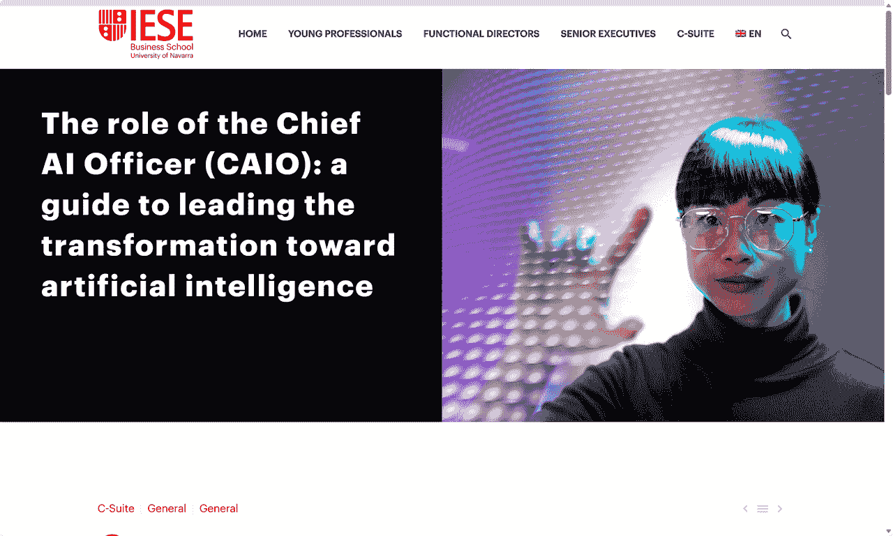

# The role of the Chief AI Officer (CAIO): a guide to leading the transformation toward artificial intelligence

> 来源：[https://gotoaiworld.feishu.cn/docx/YHjidCg4TogRDexvz4qcyr0antd](https://gotoaiworld.feishu.cn/docx/YHjidCg4TogRDexvz4qcyr0antd)

https://www.iese.edu/standout/role-chief-ai-officer-caio/

https://www.iese.edu/standout/role-chief-ai-officer-caio/

A decade ago, artificial intelligence (AI) seemed like a futuristic concept reserved for science fiction books. Today, AI is a transformative reality that not only optimizes processes but also redefines how businesses operate. In this new paradigm, a key figure has emerged: the Chief AI Officer (CAIO). But what exactly does this new leader do? And more importantly, why is their role essential to an organization’s success?

To answer these questions, we spoke with Javier Zamora, a professor at IESE and an expert in digital transformation. Zamora provides a clear vision of the responsibilities, challenges, and opportunities of the CAIO (or similarly named roles like Chief Data Officer, with overlapping responsibilities) in a world increasingly driven by AI.

## Why is a Chief AI Officer necessary?

“AI is the new electricity,” says Zamora. Just as electricity revolutionized industries at the beginning of the 20th century, artificial intelligence is positioning itself as a general-purpose technology that impacts all sectors and functions within an organization.

Until recently, data served to generate dashboards and monitor operations. Today, it has become the raw material for innovation. But to harness this potential, organizations need more than just technology—they need leadership. This is where the CAIO comes in.

“The CAIO not only drives AI adoption but also orchestrates the cultural shift necessary for this technology to be integrated across the organization,” Zamora explains.

## Key functions of the CAIO: more than just data and algorithms

The Chief AI Officer’s role extends far beyond overseeing technological projects. According to Zamora, the CAIO must fulfill three critical functions:

### 1. **Defining the organi**zation’s AI ambition

Much like digital transformation, adopting AI must align with the company’s mission and strategy. Zamora summarizes it this way: “It’s essential to define a portfolio of AI initiatives, some more exploratory and others focused on scaling organizational capabilities.” This involves identifying pilot projects, prioritizing resources, and deciding which technological and organizational capabilities need to be developed to industrialize AI use.

### 2. **Driving cultural chang**e and skill-building

Implementing AI requires more than technology; it demands new ways of working and specific professional profiles. However, the necessary cultural shift doesn’t happen overnight. “Organizational culture doesn’t change at the exponential pace of technology. We need to introduce new work practices that gradually reshape the organization’s beliefs and habits,” Zamora explains. Moreover, the CAIO must democratize AI access within the company, training employees and fostering “data literacy.”

### 3. **Acting as a bridge between tec**hnology and business

AI should not be seen as an isolated tool but as an integrated solution addressing the organization’s real problems. Here, the CAIO plays a mediating role between functional areas and business units. “It’s crucial to involve teams in designing AI solutions. When projects are perceived as imposed by a central committee, resistance to adoption increases significantly.”

## Challenges for the chief AI officer: ethics and responsibility

AI implementation also raises ethical challenges that cannot be ignored. According to Zamora, there are four major risks grouped under the acronym FATE:

+   **F: Fairness.** AI models can perpetuate biases present in the data they were trained on.

+   A: Accountability. Who is responsible if an AI model fails in a medical diagnosis or financial decision?

+   T: Transparency. The opacity of certain algorithms makes it difficult to explain how conclusions are reached.

+   **E: Ethics.** AI can face ethical dilemmas, such as those encountered by autonomous vehicles in critical situations.

“It’s essential for organizations to have an ethical governance framework to ensure AI is used responsibly and aligns with their values,” Zamora emphasizes.

## Are organizations ready for AI?

Despite the enthusiasm surrounding AI, many companies are still in the early stages of adoption. As Zamora notes, there is a mismatch in pacing: technology advances exponentially, but organizational culture evolves linearly.

“The only way to address this gap is for top management to prioritize AI adoption as a strategic element, providing resources and fostering a culture open to change,” Zamora concludes.

The CAIO must also lead an evangelization effort within the company, training teams and promoting AI adoption as a common language throughout the organization.

## The future of the chief AI officer

The role of the Chief AI Officer is here to stay. This position will be key not only to integrating AI into companies but also to building more agile, innovative, and responsible organizations.

However, as Zamora points out, we are in the early stages of this transformation. Current AI still requires human oversight, but the evolutionary horizon presents challenges as exciting as they are daunting.

“We’re facing a technological wave we don’t fully understand yet. As leaders, our mission is to guide this transition responsibly, ensuring AI has a positive impact on organizations and society.”

**Ho****w are you pre****paring your organization for the age of artif**icial intelligence? Discover how IESE’s executive programs, especially this program focused on AI, can help you lead this transformation and acquire the skills needed for the future.