# 火爆！GotoAI中国技术社区AI职业讲师招募中

> 来源：[https://gotoaiworld.feishu.cn/docx/BWFpd9odooBtioxcBEYchGNjnHe](https://gotoaiworld.feishu.cn/docx/BWFpd9odooBtioxcBEYchGNjnHe)

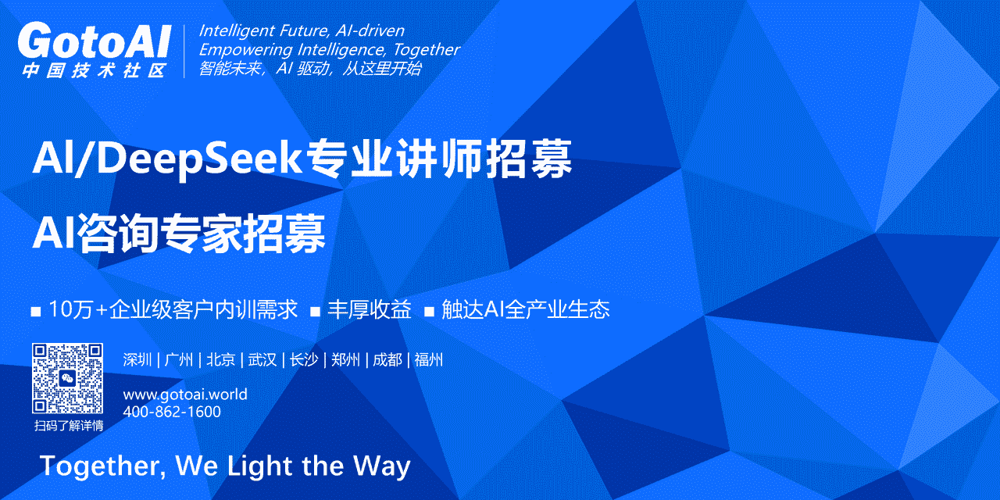

# 一、英雄贴-加入GotoAI，开启AI教育创富新征程！冲刺百万年收入！

> 在AI浪潮席卷全球的当下，AI大模型培训需求呈爆发式增长，专业的AI职业培训讲师成为极度稀缺的宝贵资源！GotoAI中国技术社区敏锐捕捉到这一时代机遇，现面向各界广纳贤才，诚邀有志之士加入AI职业讲师培养计划，携手共创AI教育培训的辉煌未来！GotoAI 建设成为国内最具影响力的AI培训黄埔军校。

## （一） 市场机遇，AI 教育黄金赛道，诚邀你来 “会师” 财富巅峰！

你是否渴望突破职业瓶颈，斩获百万年薪，成为众人仰望的行业精英？是否梦想在前沿领域，以专业知识为笔，书写属于自己的传奇篇章？现在，机会就摆在你面前！未来三十年时代的红利期。

AI 大模型正掀起全球科技变革狂潮，AI 培训市场迎来前所未有的爆发式增长！据权威机构预测，未来几年，这一市场规模将突破千亿元。在这场财富盛宴中，专业 AI 职业讲师极度稀缺，已然成为市场上的 “香饽饽”。GotoAI 中国技术社区重磅推出 AI 职业讲师培养计划，现面向全国广纳英才，诚邀你加入这场改变人生的创富之旅！

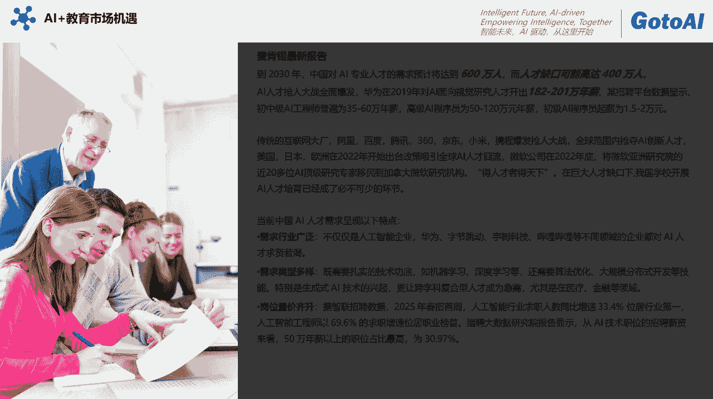

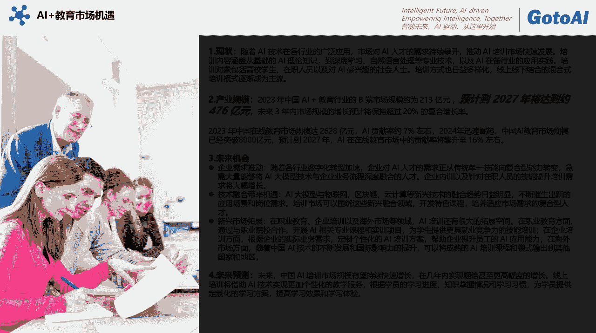

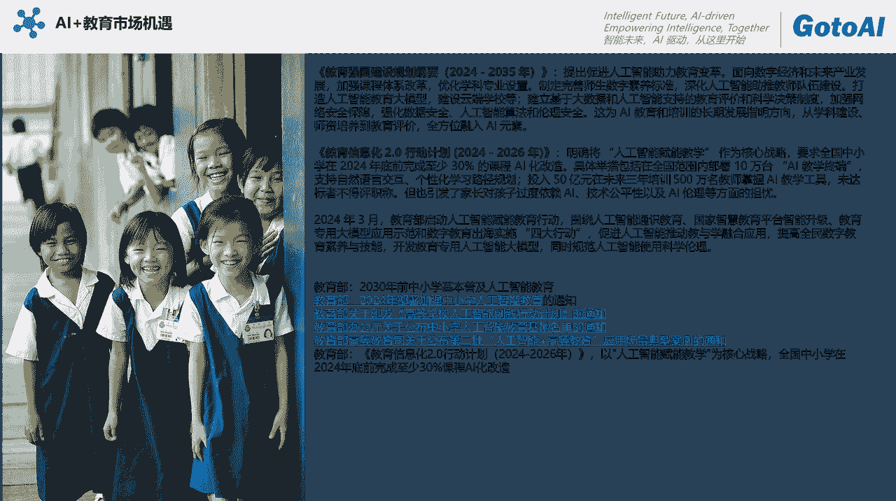

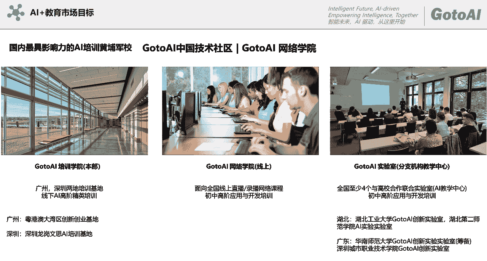

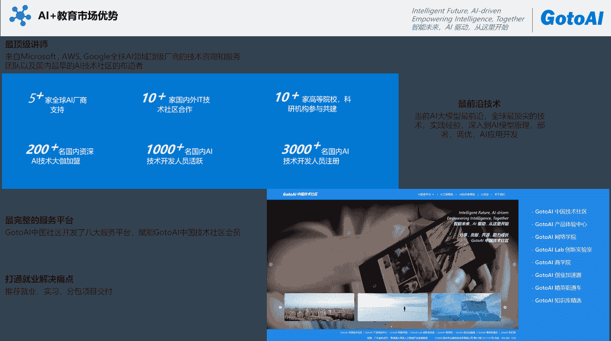

##  (二) 全国40多个城市，300多家合作伙伴源源不断的培训项目

> 目前GotoAI 全国合作伙伴超过300家，其中培训合作伙伴超过100家，AI培训项目订单遍布全国40多个城市，源源不断，主要培训基地包括：深圳，广州，武汉，长沙，郑州，成都，沈阳，南宁，福州。

> 预期2025年AI教育培训收入超过2400万元；

> 2026年达到4800万元，2027年超过8000万元。

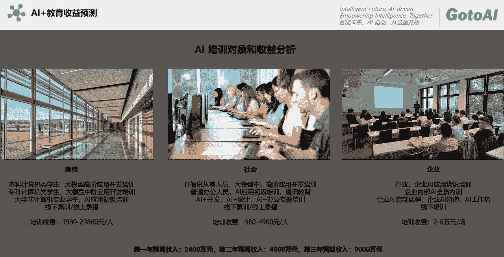

## （三）丰厚收益，坐享行业红利

1.  **高额提成，上不封顶**：一旦成为我们的AI职业讲师，你将拥有按培训项目收入分区间抽成的诱人收益模式。随着AI培训市场的持续火热，培训项目源源不断，你的收入也将水涨船高，上不封顶，真正实现付出与回报成正比，用实力收获财富自由。

1.  **全职保障，多元收入**：对于选择全职加入的伙伴，不仅有稳定的基础工资作为生活保障，还有根据授课表现和学员反馈发放的绩效奖金，再加上丰厚的项目提成，形成多元化的收入体系，让你在追求事业梦想的同时，无后顾之忧。

> 全职AI培训讲师年综合收入不低于40万元；

> 高阶大模型应用开发培训讲师年综合收入不低于100万元；

> AI+行业大伽年综合收入不低于150万元

> 兼职AI培训讲师年综合收入不低于20万元。

>

## （四）深度赋能，提升个人价值

1.  **大咖亲授，快速成长**：我们邀请到微软、AWS、字节跳动、腾讯等大厂的LLM模型技术专家亲自授课，手把手传授前沿的AI大模型知识与应用技巧，分享他们丰富的实战经验。在专家的指导下，你将快速掌握行业核心技能，实现专业能力的跨越式提升。

1.  **系统培训，全面发展**：培养计划涵盖专业知识、教育技能等全方位的培训内容，通过线上学习、线下集中培训、实践教学指导相结合的方式，助你构建完善的知识体系，掌握高效的教学方法，成长为精通AI、善于教学的复合型人才。

1.  **权威认证，实力背书**：完成培训并通过严格的过程考核与结业考核后，你将获得结业证书。此外，我们还与微软，英伟达，人力资源和社会保障部、工信部等权威机构合作，助力你获取相关专业证书，为你的职业发展增添有力背书，提升个人在职场上的竞争力。

## （五）广阔机遇，把握时代脉搏

1.  **庞大市场，潜力无限**：AI已渗透到各个行业，对AI人才的需求与日俱增。AI大模型培训作为培养专业AI人才的关键环节，市场前景极为广阔。加入我们，你将站在时代的风口浪尖，投身于这个充满无限可能的朝阳产业，共享行业发展的巨大红利。

1.  **全国布局，拓展版图**：作为GotoAI中国技术社区最核心的培训合伙人，你将肩负起在全国范围内交付培训任务的重任。这不仅能让你积累丰富的教学经验，还能拓展你的人脉资源，提升个人影响力，为你的职业生涯开拓更广阔的发展空间。

如果你拥有相关专业本科及以上学历或同等能力，具备1年以上AI领域工作经验，渴望在AI教育培训市场中一展身手，那么不要犹豫，立即报名加入我们！与行业大咖并肩作战，在AI教育的舞台上绽放光芒，收获财富、成长与荣耀！

> **报**名方式：steven.li@gotoai.world, 400-862-1600, 13510708175

让我们携手共进，在AI教育培训的蓝海中乘风破浪，共创辉煌事业，迎接属于我们的璀璨未来！

# 二、GotoAI中国技术社区AI职业讲师培养计划

## 计划背景

随着 AI 大模型培训需求的爆发式增长，专业的 AI 职业培训讲师成为市场稀缺资源。为满足自身培训业务的扩张需求，同时为行业输送高质量的 AI 培训人才，特制定本 AI 职业培训讲师培养计划。

GotoAI中国技术社区及GotoAI网络学院108位AI职业讲师培养计划持续招募，微软，AWS，字节跳动，腾讯LLM模型技术专家手把手传授，共创AI教育培训事业，最近AI线下课程排期比较满，需要大量助教和讲师，欢迎愿意与GotoAI中国技术社区同行同创的小伙伴报名，共创AI教育培训辉煌事业。

火爆！GotoAI大模型精英人才培训计划

## 培养目标

通过系统、全面的培养流程，打造一支精通 AI 大模型知识与应用，熟悉教育培训技巧，认同本机构价值愿景的专业 AI 职业培训讲师团队，为机构在全国范围内开展 AI 大模型培训课程提供坚实的师资保障。

## 筛选机制

1.  **报名条件**

+   具备计算机科学、数学、统计学、人工智能等相关专业本科及以上学历，或有同等专业能力证明。

+   拥有至少 2 年在 AI 领域的工作经验，参与过 AI 项目的开发、研究或应用。

+   对教育培训行业有浓厚兴趣，具备良好的沟通表达能力和团队协作精神。

1.  **筛选流程**

+   **简历初筛**：收集报名者的个人简历，重点审核学历背景、工作经验、项目经历等信息，筛选出符合基本条件的候选人进入下一环节。

+   **笔试考核**：组织候选人参加 AI 大模型知识与应用的笔试，内容涵盖 AI 基础理论、大模型架构、算法应用、行业案例分析等，检验其专业知识水平。

+   **试讲面试**：邀请通过笔试的候选人进行现场试讲，模拟 AI 培训课堂场景，考察其教学方法、课程设计、语言表达、互动能力等。同时进行面试，深入了解其对教育培训行业的认知、职业规划以及是否认同本机构的价值愿景。

+   **背景调查**：对拟录取的候选人进行背景调查，核实其学历、工作经历的真实性，以及过往工作表现和职业道德情况。

## 培训内容与方式

1.  **培训内容**

+   **AI 大模型专业知识强化**：深入讲解 AI 大模型的原理、架构、训练方法、优化策略等核心知识，以及大模型在自然语言处理、计算机视觉、语音识别等领域的应用案例分析。

+   **教育培训技能提升**：开展教学方法与技巧培训，包括课程设计、教学设计、课堂管理、教学评价等方面的内容；同时进行沟通技巧、演讲技巧的专项训练，提升讲师的表达能力和感染力。

+   **机构培训课程与教义解读**：详细介绍本机构的 AI 大模型培训课程体系、教学大纲、教学目标、教学方法以及教义要求，确保讲师能够准确、规范地按照机构标准授课。

+   **知识产权与知识安全培训**：强调知识产权保护的重要性，明确课件的使用规范和限制，严禁讲师窃取、传播课件内容或与第三方机构合作；讲解违规行为的法律后果和责任追究方式。

1.  **培训方式**

+   **线上课程学习**：搭建在线学习平台，提供丰富的 AI 大模型专业知识和教育培训技能的视频课程，供学员自主学习。同时设置在线答疑环节，由专业导师为学员解答学习过程中遇到的问题。

+   **线下集中培训**：定期组织线下集中培训，邀请行业专家、资深讲师进行面对面授课和指导。通过课堂讲授、案例分析、小组讨论、模拟演练等形式，加深学员对培训内容的理解和掌握。

+   **实践教学指导**：安排学员在真实的培训场景中进行实践教学，由导师进行现场观摩和指导，及时给予反馈和建议，帮助学员不断改进教学方法和提升教学质量。

## 考核与认证

1.  **过程考核**：在培训过程中，通过在线作业、课堂表现、小组项目等方式对学员进行过程考核，及时了解学员的学习进度和掌握情况，对表现不佳的学员进行针对性辅导和督促。

1.  **结业考核**：培训结束后，组织学员参加结业考核，包括理论知识考试和现场试讲两部分。理论知识考试主要考察学员对 AI 大模型专业知识、教育培训技能以及机构培训课程与教义的掌握程度；现场试讲则重点评估学员的教学能力和综合素质。

1.  **认证颁发**：对通过结业考核的学员，颁发本机构认可的 AI 职业培训讲师结业证书。获得证书的学员将正式加盟本机构，成为 AI 职业培训讲师团队的一员。

## 讲师权益与责任

1.  **权益保障**

+   与 AI 职业讲师签署协议，承诺每年的培训综合收入不低于 20W，AI大模型应用开发培训讲师年收入不低于50万元，优秀培训讲师年收入可达100万元。根据其授课量和教学质量按照一定比例支付收益。

+   为讲师提供完善的培训支持和教学资源，包括定期的专业培训、教学课件更新、教学设备支持等。

+   为讲师搭建广阔的职业发展平台，提供参与各类培训项目、行业交流活动的机会，助力讲师提升个人知名度和行业影响力。

1.  **责任义务**

+   严格按照本机构的培训课程、教义进行授课，确保教学质量和教学效果符合机构要求。

+   只能在本机构授权的范围内使用课件，不得私自下载、窃取、传播课件内容，不得与第三方机构合作开展与本机构业务有竞争关系的培训活动。

+   遵守机构的各项规章制度，积极配合机构的教学管理工作，按时完成教学任务和相关工作要求。

+   不断提升自身的专业知识和教学能力，参加机构组织的定期培训和考核，持续提高教学水平。

## 违规处理

对于违反知识产权保护规定、教学质量不达标的讲师，将采取以下处理措施：

1.  **警告与整改**：发现讲师存在违规行为或教学质量问题后，及时发出警告通知，要求其限期整改，并对整改情况进行跟踪监督。

1.  **解除合同**：对于情节严重、多次违规或整改不力的讲师，将解除与其签署的合作合同，终止合作关系。

1.  **责任追究**：对于因讲师违规行为给机构造成经济损失或声誉损害的，将依法追究其法律责任，要求其赔偿相应的经济损失。

## 计划实施与评估

1.  **计划实施**

+   成立专门的项目组负责本培养计划的组织实施，明确项目组成员的职责分工，确保各项工作有序推进。

+   制定详细的培训计划时间表，合理安排培训课程、考核环节、实践教学等各项活动的时间节点，确保培训进度和质量。

1.  **计划评估**

+   建立完善的评估机制，定期对培养计划的实施效果进行评估。通过学员反馈、教学质量评估、市场反馈等多维度数据，分析培养计划的优点和不足之处，及时调整和优化培训内容、培训方式和教学管理措施。

+   每年度对 AI 职业培训讲师团队的整体表现进行评估，包括教学质量、学员满意度、培训收益等方面，总结经验教训，为下一年度的培养计划和团队管理提供参考依据。

## 加盟学员收费与收益分成

### （一）学员收费

1.  **培训费**：为参与 AI 职业培训讲师培养计划的学员提供全面且专业的培训服务，收取培训费 10,000 元 / 人(AI大模型基础课程，3周脱产Onsite培训),培训费20,000元/人(AI大模型应用开发中级课程以及AI+行业专题课程，4-6周全天脱产Onsite培训)，培训费35,000元(AI大模型应用开发高级课程以及AI培训导师，2个月全天脱产Onsite培训)。

1.  该费用涵盖线上课程学习、线下集中培训以及实践教学指导等多环节的教学资源投入，包括专业导师授课费用、课程研发成本、在线学习平台维护等相关支出。

1.  **教育培训项目加盟费**：学员若期望正式加盟本机构，借助机构平台开展教学工作，需缴纳 50,000 元 / 人的教育培训项目加盟费。此费用用于保障学员在加盟后能够获得机构品牌授权、市场推广支持、教学课件使用权限以及后续的业务对接与管理服务等。加盟费 50,000 元可在学员成功试讲并获得一定数量学员好评（如试讲后获得 80% 以上学员好评）后，分阶段在后续收益中扣除，比如从每次项目收益中按 10% 扣除，直至扣满 50,000 元为止。

### （二）加盟讲师收益分成

本机构与加盟的 AI 职业培训讲师采用灵活且合理的收益分成模式，基于培训项目的实际收入进行抽成。

1.  当培训项目收入在 10 万元以下时：按照 10% 的比例进行抽成。为保障讲师的基本收益，在此区间设置最低抽成金额为 5000 元。例如，若某培训项目收入为 6 万元，抽成金额为 6 万元 ×10% = 6000 元；若项目收入为 4 万元，抽成金额则按最低 5000 元计算。

1.  当培训项目收入处于 10 - 50 万元区间时：抽成比例设定为 8%。同样，为确保讲师收益的合理性，设置最低抽成金额为 10000 元。比如，培训项目收入为 20 万元，抽成金额为 20 万元 ×8% = 16000 元；若项目收入为 12 万元，抽成金额按最低 10000 元执行。

1.  当培训项目收入达到 50 - 100 万元时：抽成比例调整为 5%，最低抽成金额为 30000 元。若某培训项目收入为 70 万元，抽成金额为 70 万元 ×5% = 35000 元；若项目收入为 55 万元，抽成金额按 30000 元计算。通过这样的收益分成机制，既激励讲师积极拓展业务、提升教学质量以增加项目收入，又保障了讲师在不同收入水平下均能获得合理且稳定的收益。

1.  全年培训项目总收入超过 200 万元时：超出部分按3%给予一次性奖励

### （二）全职讲师收益分成

本机构对培训完成并通过考试的学员，录取为公司正式员工后，员工收入分为基础工资+绩效+提成。

1.  **基础工资**：初级AI培训讲师-4000元/月。中级AI培训讲师-6000元/月，高级AI培训讲师10,000元/月

1.  **绩效考核**： 初级AI培训讲师- 3000元/月。中级AI培训讲师- 5,000元/月，高级AI培训讲师8,000元/月

1.  **奖金提成**：抽成比例设定为 5% ，全年培训总收入超过200元，超过部分按2%给予一次性奖励。

# 二、DeepSeek 智能化办公培训课程

### Deepseek + 提示词：办公要求，无往不利

1.  AI 大框架基础

+   了解 AI 的发展历史、现状和未来发展的思考。

+   理解 AI、AIGC、AGI、LLM、RAG、Token 等概念。

+   分析大模型（deepseek、通义、文心、KIMI、豆包、智谱）及建议应用范围。

+   分析和介绍 Deepseek 的横空出世的重要意义及使用场景。

1.  Deepseek 使用揭秘：如何创建提示词和 Deepseek 做好交流

+   理解 Prompt（提示词）的关键作用，阐述其对引导 AIGC 输出的决定性影响。

+   学习提示词撰写的文本语法规则：Markdown。

+   学习提示词撰写的图形语法规则：Mermaid。

+   “公文写作” 提示词案例分析。

+   “英语口语教练” 提示词分析。

+   可以完成多种任务的 “多角色扮演” 提示词分析。

+   AI 智能识别图形的提示词。

+   AI 语音识别的应用、AI 字幕功能、AI 文本誊写功能、AI 会议记录功能、AI 全文翻译。

### Deepseek + 办公效率提升

1.  AI 赋能公文写作 - 一气呵成

+   AI 在商务领域的应用案例介绍（公文、邮件、调研报告等）。

+   AI 辅助文本排版，语法检查。

+   AI 赋能文本扩写、缩写、改写等处理手段。

1.  Deepseek 助力信息图表 - 高效生成

+   使用 Deepseek 生成 mermaid 语法的流程图、甘特图等信息图表。

+   Deepseek 赋能绘制思维导图。

1.  Deepseek 赋能，PPT 制作效率百倍提升

+   Deepseek 生成提示词，完成文档及幻灯片内容制作。

+   结合通义千问快速生成幻灯片。

+   幻灯片布局的 AI 处理手段。

+   幻灯片中的信息图表的 AI 处理手段，充分理解信息图表的的表达形式。

1.  AI 赋能数据分析 - 专业的数据报告

+   数据收集及清洗 - 数据统计及分析 - 可视化呈现三步中 AI 的适用范围。

+   数据库三范式的要求，以及 deepseek 如何理解数据库三范式。

+   使用 Deepseek 生成数据分析的的高效插件，自动安装且一键完成。

+   使用 Deepseek 创建数据清洗的提示词的方法和思路。

+   使用商汤大模型进行数据清洗案例实操。

### Deepseek + 图片视频等多模态应用 + 构建代码

1.  体验多模态应用

+   文字和声音：如利用 Deepseek 生成会议记录摘要，通过输入会议录音或文字记录。

+   调研表：使用 Deepseek 提示词 + 腾讯调研工具，快速生成调研表。

+   图片：利用 Deepseek 的创意提示，生成与工作相关的创意图片，如产品宣传海报。

+   数字人：创建数字人，生成口播视频。

+   视频生成工具：结合 Deepseek 的创意提示利用海螺、即梦等工具生成视频。

1.  Deepseek + 推理 + 代码生成：小白变身程序员大咖，让办公效率原地起飞

+   VSTO office 插件开发：开发工作使用的各种 office 插件，并一键排错、安装、使用。

+   实践 C# 可执行文件创建：从项目的创建、需求分析，到利用 Deepseek 生成代码，再到一键编译生成可执行文件，无需任何编程基础。

+   javascript 脚本创建：从项目的创建、需求分析，到利用 Deepseek 生成代码，再到运行，一条龙实现。

### Deepseek+Coze 智能体：AI 应用工作中的伟大创举

1.  工作流程自动化可以使用智能体实现。

1.  设计工作流

+   熟悉 Coze 界面布局、功能模块和操作方法，熟悉平台的各项功能。

+   讨论工作流程，绘制流程图，讨论可以使用 Deepseek 代替的环节。

+   根据以上第二步，设计智能体的架构，确定输入输出的格式和内容、处理逻辑和决策规则等。

1.  设智能体与工作流的开发与优化

+   根据设计方案，在 Coze 平台上进行参数配置，如设置循环体，设置批处理、定义变量等。

+   讨论在调用智能体过程中可能出现的失败情况，并进行错误修正。

+   对智能体进行测试，模拟各种实际场景，检查智能体的运行效果和准确性。根据测试结果，对智能体进行优化和调整，如改进提示词、优化逻辑等，直到智能体能够稳定高效地运行。

+   真正实现实践中的工作流程自动化。

+   **基础智能化办公课程**

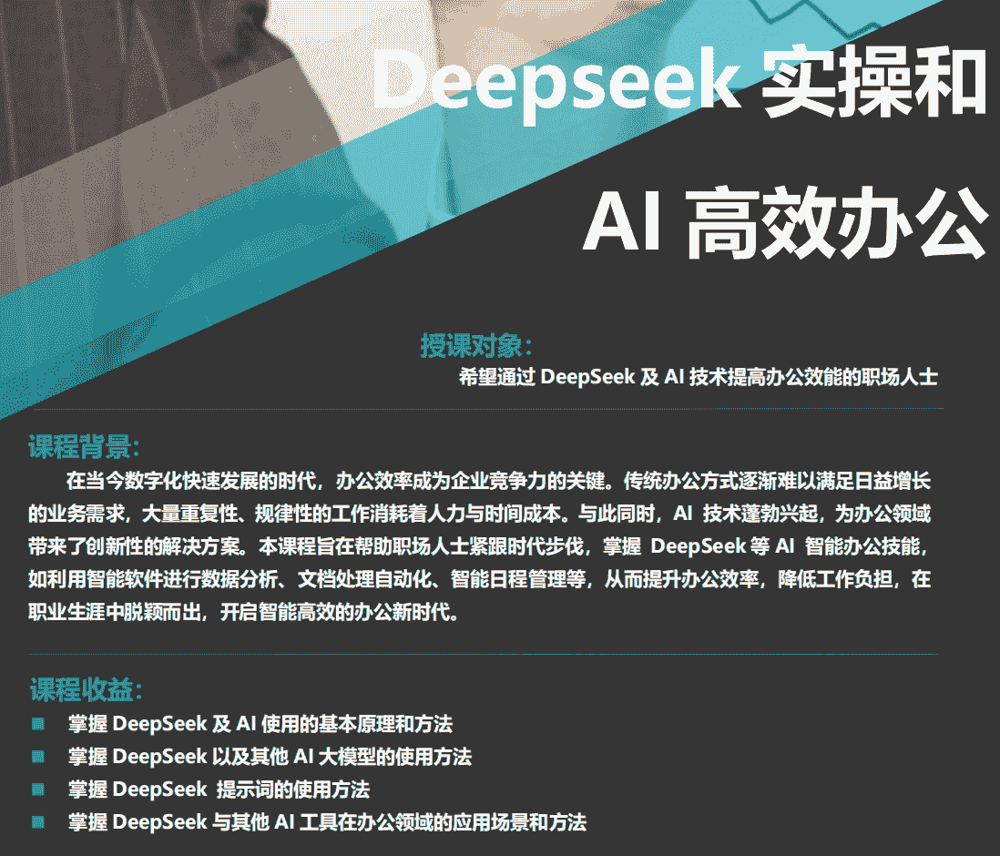

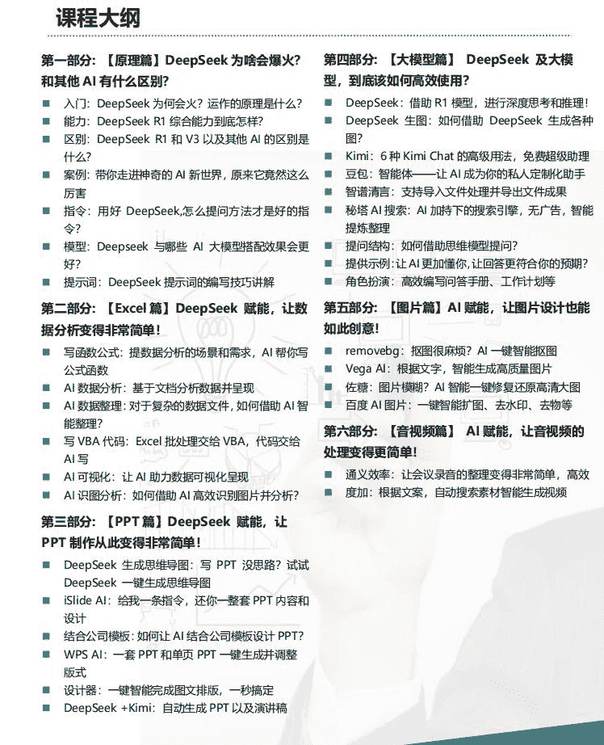

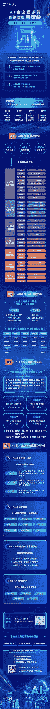

# 三、培训证书

## **人力资源和社会保障部**

https://www.mohrss.gov.cn/

http://www.osta.org.cn/

人力资源社会保障部、中央网信办印发《关于开展技术技能类“山寨证书”网络治理工作的通知》，对技术技能类“山寨证书”进行网络治理。

根据网络巡查和群众举报情况，人力资源社会保障部联合有关部门查实并关停了14个仿冒网站，其网站名称、网址及页面内容与人力资源社会保障部技能类“职业资格证书”“职业技能等级证书”（以下简称技能类评价证书）查询官方网站高度相似，容易误导社会公众。目前，上述14个网站均已被关停。

**人力资源社会保障部将联合有关部**门持续加大对“山寨证书”的打击力度，对发现的仿冒网站等线索，查实一个关停一个，切实维护劳动者的合法权益。人力资源社会保障部认可的技能类评价证书可通过技能人才评价工作网（www.osta.org.cn  和 osta.mohrss.gov.cn）查询。

https://zscx.osta.org.cn/

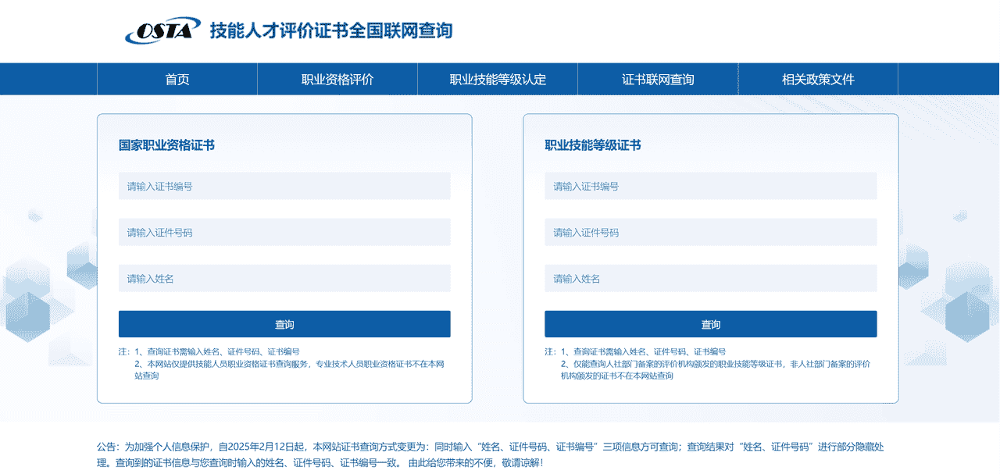

广东省人力资源和社会保障厅 广东省财政厅关于印发《广东省职业技能培训补贴（指导）标准目录（2025年版）》的通知

https://hrss.gd.gov.cn/zwgk/xxgkml/bmwj/qtwj/dwjs/content/post_4677694.html

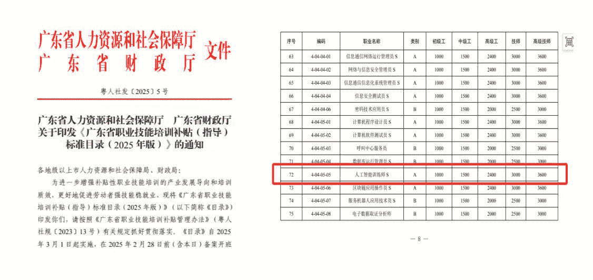

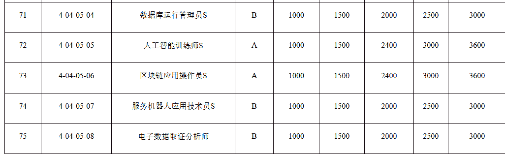

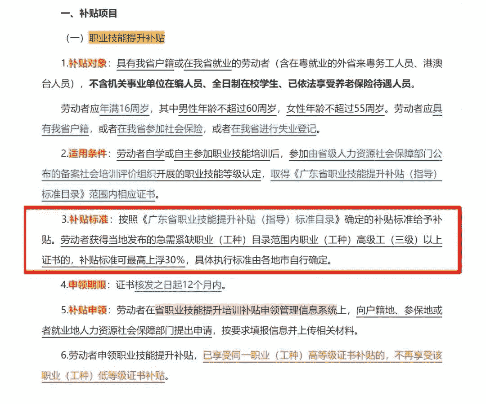

## 工信部(全国通信和信息技术创新人才培养工程) https://www.cnciit.org.cn

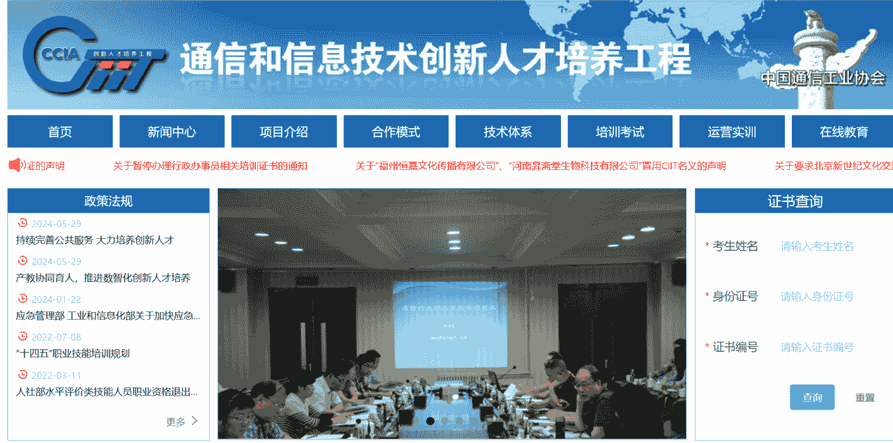

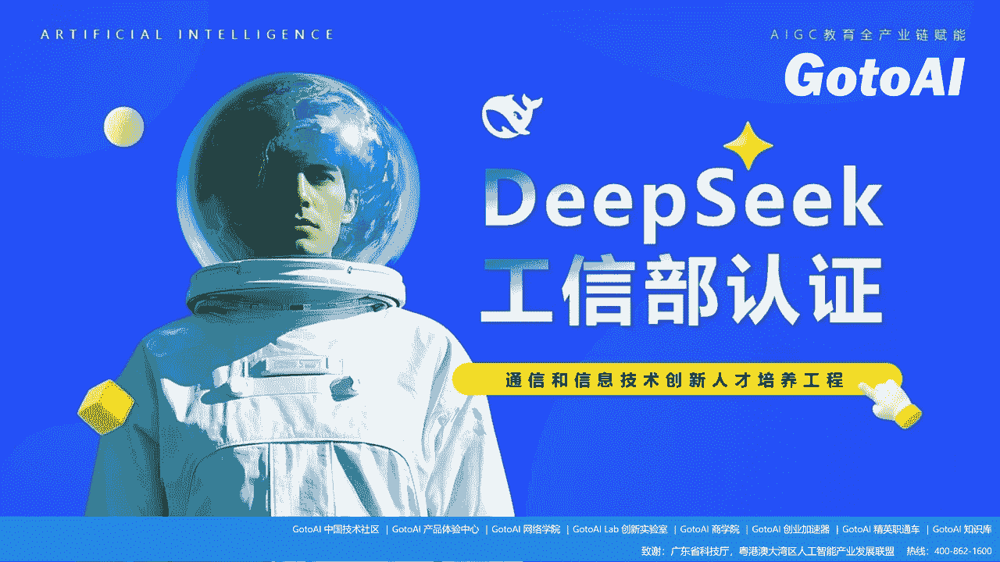

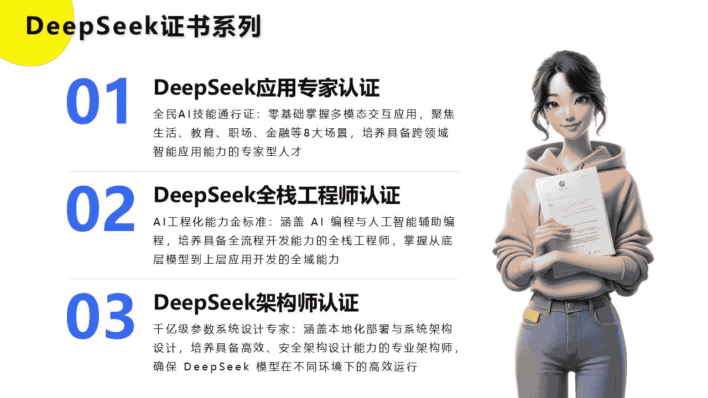

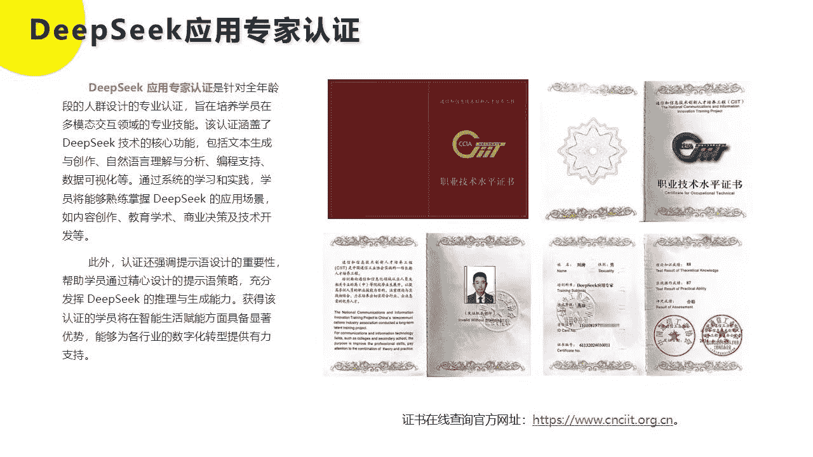

## 3.工信部软考中心

人工智能应用工程师认证课程

（工信部教考中心发证）

发证单位: 工业和信息化部教育与考试中心

**拓宽职业就业生涯**

**助力成为智能时代高端应用型人才**

**由教育与考试中心颁发《职业能力证书》，国家工**信部直属单位认证，工信部教考中心官网可查

在全球科技竞争加剧的背景下，AI技术正广泛应用于制造、医疗、金融、教育、物流等多个领域，成为推动产业升级和创新发展的核心动力。我国政府高度重视人工智能技术的发展，通过《新一代人工智能发展规划》《智能制造发展规划（2021-2025年）》等政策，大力推动AI技术应用和人才培养，助力实现智能化转型与产业升级。

面对人工智能领域巨大的就业缺口，企业亟需既掌握技术又能推动实际应用的专业人才，个人也希望通过权威证书增强就业竞争力，拓宽职业发展路径。这样不仅能够满足企业在智能制造、工业4.0等领域的智能化需求，还能通过优化流程、提升效率，为企业创造价值，成为智能时代不可或缺的高端应用型人才。

现在，我们为您提供了成为人工智能应用专家的机会——人工智能应用工程师证书

01 **权威认证  **

课程结束考试合格者获得由工信部教育考试中心颁发的智能制造工程师认证证书，工信部官方网站可查询。

02 **全国唯一 **

本课程体系是全国唯一一家由工信部教育考试中心授权的委托单位进行开发的人工智能应用工程师认证课程体系。

03 **全国首个 **

本课程体系是全国首个面向社会和个人开放的人工智能应用工程师职业认证体系。

04 **专业课程 **

涵盖体系化教学、实战化训练、行业化聚焦、创新化思维、等核心内容，通过案例分析等方式将人工智能相关的理论和实际结合在一起，让大家能够轻松的学以致用。

05 **专家授课  **

课程标准编制专家组，工信部教考中心备案讲师。

### 1 课程内容

人工智能应用工程师（初级）

1 个人要求：

1.就业方向（职能、财务、人事、法务、市场营销、行政和运营等）

2.具备基础电脑操作能力，无需AI背景

2 课程培养的能力目标：

(1) 认知层面：

系统理解人工智能（AI）的核心概念和发展脉络，及其对社会带来的变革性影响；掌握机器学习、深度学习等关键技术的基本原理及其在AI应用中的作用；辨别AI炒作与实际能力，建立理性的AI认知；理解Prompt Engineering的核心原则和技巧，能编写高质量的Prompt；了解AI伦理、安全和合规性，能安全、合规地使用AI工具。

(2) 技能层面：

熟练掌握市场上主流AI工具（文本、图像、代码等）的基本操作和高级功能；掌握Prompt Engineering技巧，能编写高质量的Prompt；能够根据实际工作场景选择合适的AI工具，解决具体问题；掌握搭建AI个人知识库，并熟练应用在日常生活和工作中；掌握使用AI进行数据分析、生成报告、制作PPT、生成创意文案等技能。

(3) 应用层面：

了解不同行业（财务、人事、法务、市场营销等）AI应用的典型案例和最佳实践；能够结合自身工作，提出有价值的AI应用方案，并进行初步实践；培养利用AI思维分析问题和解决问题的能力，能够安全、合规地使用AI工具，防范潜在风险。

3  课程大纲：

3天：每天8个学时，一共25学时（其中1学时随堂考试）

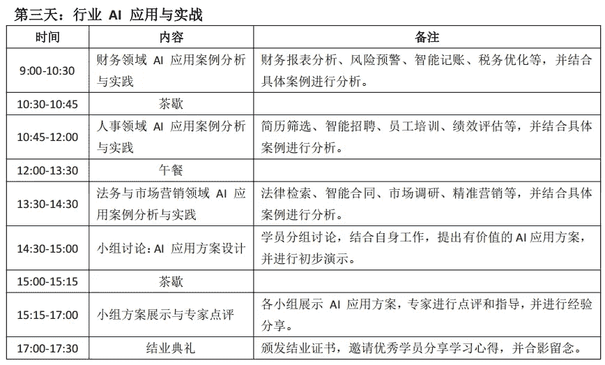

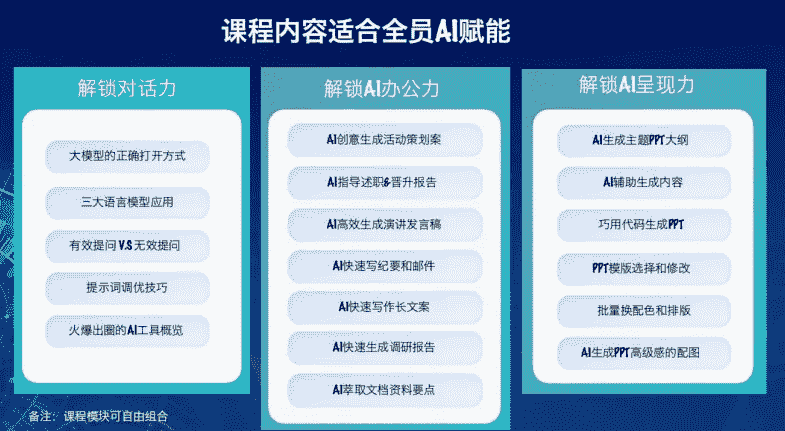

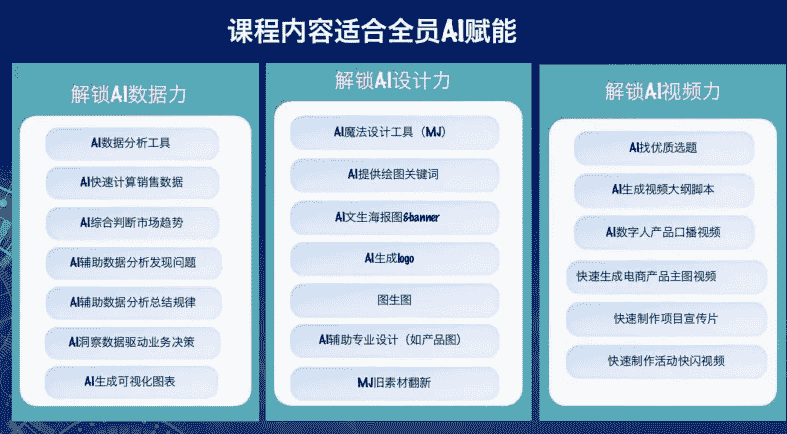

### 2 教学方式：

1.案例教学：以实际案例为切入点，深入分析AI应用价值。

2.互动式教学：鼓励学员提问、讨论和分享经验，营造积极的学习氛围。

3.项目式学习：通过小组讨论和案例实践，让学员将所学知识应用于实际工作。

4.定制化教学：针对不同职能部门的需求，提供个性化的AI应用方案。

5.反馈式学习：及时收集学员反馈，持续优化课程内容。

6.实战演练：鼓励学员动手实践，并在讲师指导下完成任务，提升技能掌握程度。

7.小组讨论：鼓励学员分享经验、互相学习，提升团队合作能力。

### 3 课程特点：

1.理论与实践相结合：课程既包含AI理论知识，又包含大量实战案例和演练，让学员学以致用。

2.行业应用案例丰富：课程涵盖财务、人事、法务、市场营销等多个行业的AI应用案例，让学员了解AI在不同行业的应用价值。

3.AI工具选择多样：课程介绍多种AI工具，包括文本生成、图像生成、知识库管理等工具，让学员根据自身需求选择合适的工具。

4.Prompt Engineering技巧：课程重点讲解Prompt Engineering的技巧，让学员编写高质量的Prompt，提高AI工具的使用效果。

5.安全合规意识：课程强调AI安全和合规，让学员安全、合规地使用AI工具，防范潜在风险。

### 4 证书

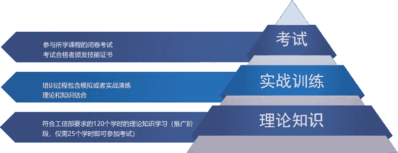

**证书认证过程：**

包括理论学习、模拟实战课程、结业等环节。

**证书颁发单位：**

由教育与考试中心向参加培训并考试合格的学员颁发《职业能力证书》，国家工信部直属单位认证，企业和学员可随时登录中心官网（www.miiteec.org.cn）查询证书信息。

**证书样本：**

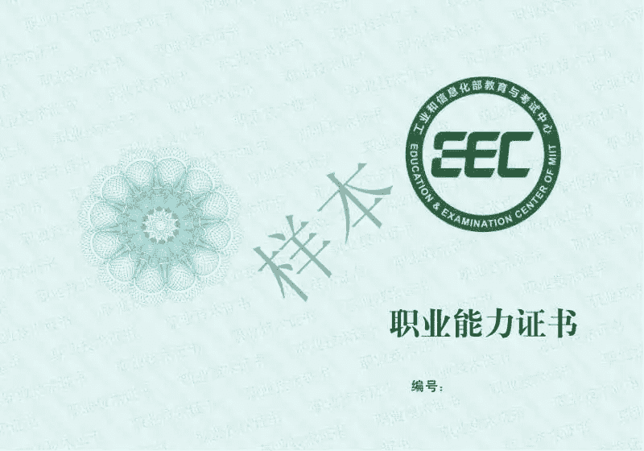

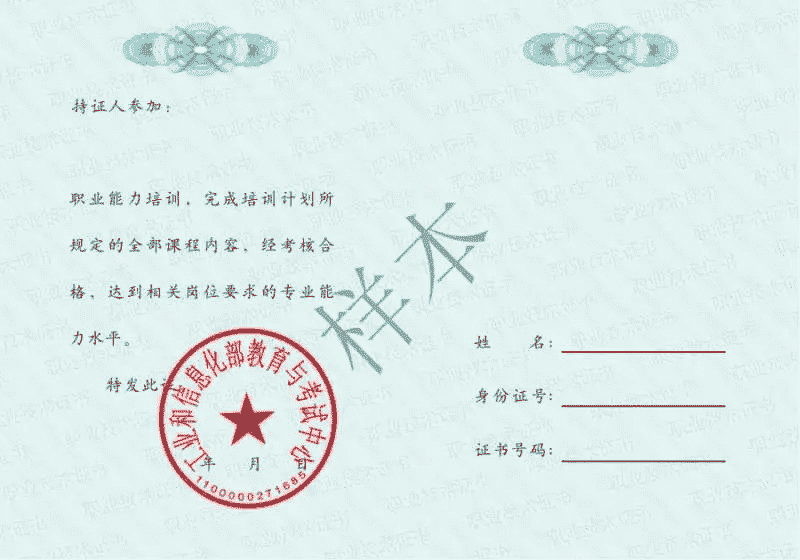

### 5 报名方式

人工智能应用工程师（初级）课程费用：¥3000

（含培训+结业+工信部教考中心制证费用，内训或团体报名可以有优惠）

**开课时间**：2025年4月11-13日（3天）

**上课形式**：**3天（线上/线下同步）**

每班满30人开课（提前招满则提前开课）

**线下上课地址**：

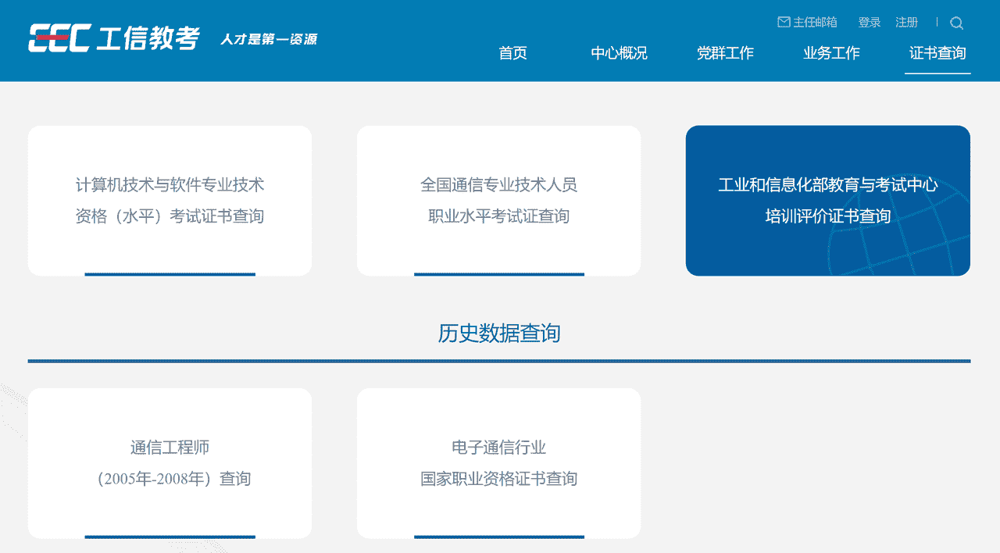

https://www.miiteec.org.cn/certificate

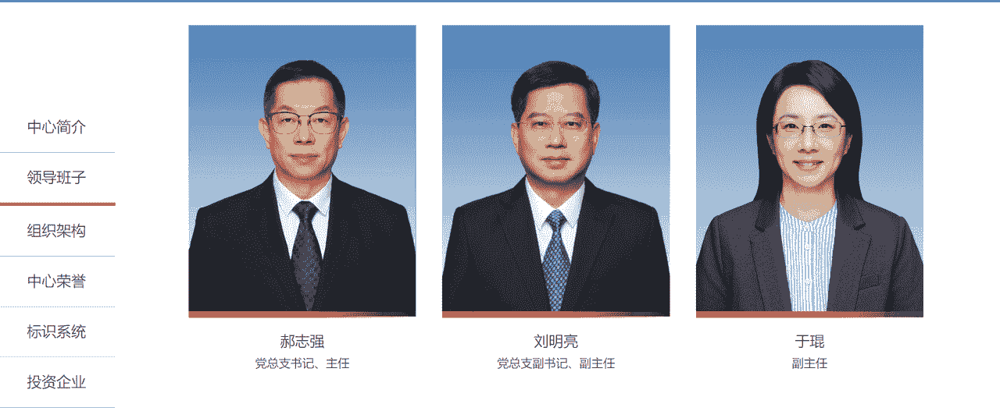

工业和信息化部教育与考试中心（工业和信息化部电子通信行业职业技能鉴定指导中心）始建于1993年，由原电子部教育中心、电子行业职业技能鉴定指导中心和原邮电部通信行业职业技能鉴定指导中心3个单位先后合并组建，是工业和信息化部直属事业单位。中心是部人才工作领导小组成员单位、信创工委会考试评价组组长单位、国家中小企业公共服务示范平台、国家专业技术人员继续教育基地，承担部职业技能提升行动办公室、全国工业和信息化技术技能大赛办公室、全国工业和信息化职业教育教学指导委员会秘书处办公室工作职责。中心投资企业为北京新奥时代科技有限责任公司