# GotoAI 大学生AI赋能加速器计划

> 来源：[https://gotoaiworld.feishu.cn/docx/GI99dhRzSoFtAFxVRpGc43vinhh](https://gotoaiworld.feishu.cn/docx/GI99dhRzSoFtAFxVRpGc43vinhh)

# 一、毕业即失业，最严峻毕业季来临，然而，没有最差，只有更差

> 2025 届高校毕业生预计达到 1222 万人，同比增加 43 万，叠加往届未就业群体，实际求职竞争更为激烈。

1.  惊人规模与激烈竞争：“难绷！1222 万‘牛马’出栏即失业 取利 考公变成‘唯一出路’的真相”——2025 届高校毕业生预计达 1222 万人，如此庞大的求职群体涌入就业市场，竞争之激烈超乎想象，考公成为众多毕业生的 “救命稻草” ，侧面反映出就业机会的稀缺。

1.  极端就业困境描述：“2025 大学生就业更难！北大毕业送外卖，清华毕业开网约车！”—— 用顶尖学府毕业生从事低门槛工作的反差，突出就业形势严峻到让高学历人才都难以找到 “匹配” 工作，就业市场的残酷可见一斑。

1.  专业与就业的严峻矛盾：“90% 大学专业毕业即失业的根源揭秘”—— 直接点明大部分大学专业面临的就业困境，意味着专业设置与市场需求严重脱节，使得众多毕业生在求职时困难重重。

1.  应届生失业比例预估：“25 年 50% 的应届生，毕业即失业！”—— 明确指出 2025 年应届生可能面临的超高失业比例，这一数据直观地呈现出应届毕业生群体就业前景的不乐观。

毕业即失业，史上最惨一代大学生，研究生月薪2000，本科送外卖

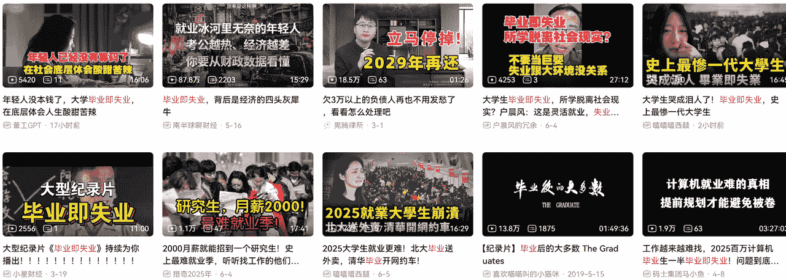

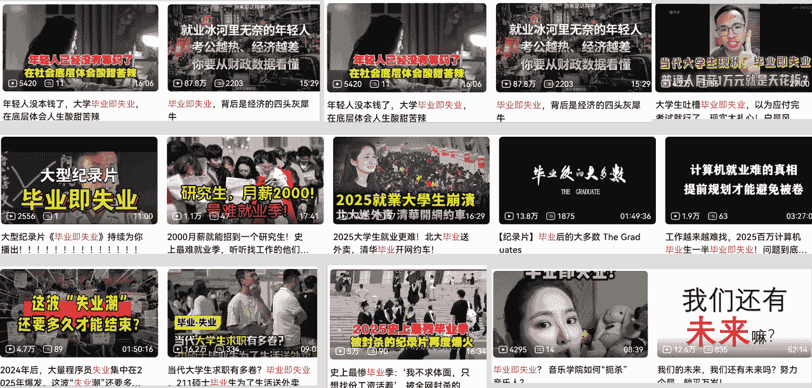

1179W大学生即将毕业！学历贬值远超想象

[27562608148-1-192.mp4](https://internal-api-drive-stream.feishu.cn/space/api/box/stream/download/all/Dd7ibV0nlol4BZxHzPpcVurznSg)

[张](https://www.bilibili.com/video/BV1Yj411o73g/?spm_id_from=333.337.search-card.all.click&vd_source=7d329f314db703bbcb2bc38d5003cd6c)雪峰，2025年失业有多么严重，本科是多么卑微，毕业即失业，为什么会出现失业潮，未来年轻人又该何去何从

当代大学生求职有多卷？毕业即失业，211硕士毕业生为了生活送外卖

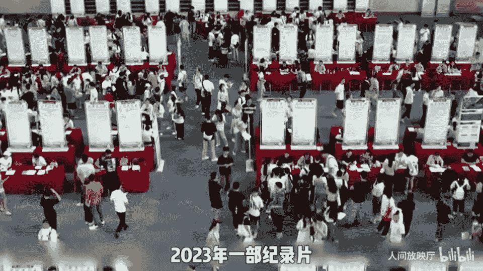

[30057235989-1-16.mp4](https://internal-api-drive-stream.feishu.cn/space/api/box/stream/download/all/GfIdbQ3pUoIDayxwWqmcsoXanJf)

温铁军教授：现在大学生面临毕业即失业的根本原因在哪里？应该如何解决？

[25658262284-1-16.mp4](https://internal-api-drive-stream.feishu.cn/space/api/box/stream/download/all/YlNJb3EZ1oYNv0xl7dUc3K3enNd)

# 二、毕业生出路在哪里？如何熬着这寒冬？

保研？考研？留学？考公？考编？国企？民企？外企？政策性就业，创业？自由职业？

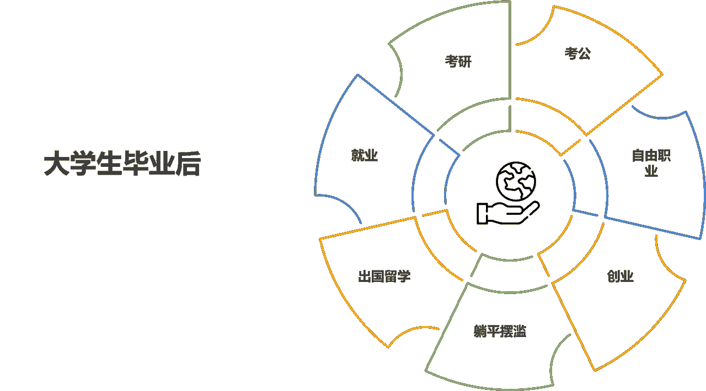

**保研**

问题：得是班里前几名才有资格（卷王专属），选专业可能被限制（比如只能保本校或特定方向），提前过上 “实验室搬砖” 日子，适合真心爱学术的人，不然容易熬不住。

**考研**

挑战：跟高考似的拼一年（甚至更久），每天背书到崩溃，报个 985 可能几百人抢 1 个名额，考不上连调剂机会都少，双非学生复试可能被 “看学历”，心累到怀疑人生。还有人说，您考研的唯一结果，就是养活了学校和老师。

**留学**

现实：家里没矿别硬冲（欧美一年几十万），出国后天天跟英语死磕，上课像听天书，有些 “水硕” 回国找工作可能被嫌弃，疫情后还有签证、安全等幺蛾子。

**考公**

难点：几千人抢一个 “税务局” 岗位是常事，笔试刷题刷到吐，面试还要跟**人拼口才和情商，考上后工资可能**不如打工的，升职靠熬年头，适合能坐得住冷板凳的人。还有，你没有听说过萝卜招聘吗？

**考编**

纠结：教师 / 事业单位考试竞争也不小，考上可能被分到乡下学校或基层单位，天天写材料、搞检查，想往上爬难，适合图安稳、不想折腾的人，但日子可能很 “一眼望到头”。

**国企**

矛盾：校招时挤破头进去（社招机会少），工作环境相对轻松但晋升靠资历，年轻人可能觉得学不到东西，工资中等偏上，适合求稳但担心 “温水煮青蛙” 的人。千军万马过独木桥。

**民企**

风险：小公司可能说倒闭就倒闭（尤其互联网、教培等行业），996 是常态，老板一言不合就裁员，工资可能高但没啥保障，适合能抗压、想拼高薪的人，但得做好 “随时失业” 准备。

**外企**

压力：上班全程说英语（邮件、开会全英文），加班多、KPI 狠，项目一来熬夜是常事，这两年外企裁员潮频繁，看似高大上但可能突然 “毕业”，适合英语好、能扛高压的人。

**政策性就业**

现实：比如去乡村当村官、支农，住的地方偏、条件差，每天处理家长里短，服务期结束后留不下、回城又难找工作，适合真心想扎根基层的人，不然就是 “过渡跳板”。

**创业**

真相：不是有个想法就能干（得找钱、找团队、找客户），90% 的公司前两年就倒闭，每天操心房租、员工工资，赚了钱是老板，亏了钱可能倾家荡产，适合有资源、能抗压的 “狠人”。

**自由职业**

心酸：表面 “躺平” 实则天天焦虑（这个月有没有活？），自己交社保、没公积金，接不到单就喝西北风，适合有一技之长（比如写稿、设计）且自律性强的人，不然容易 “自由 = 没钱”。

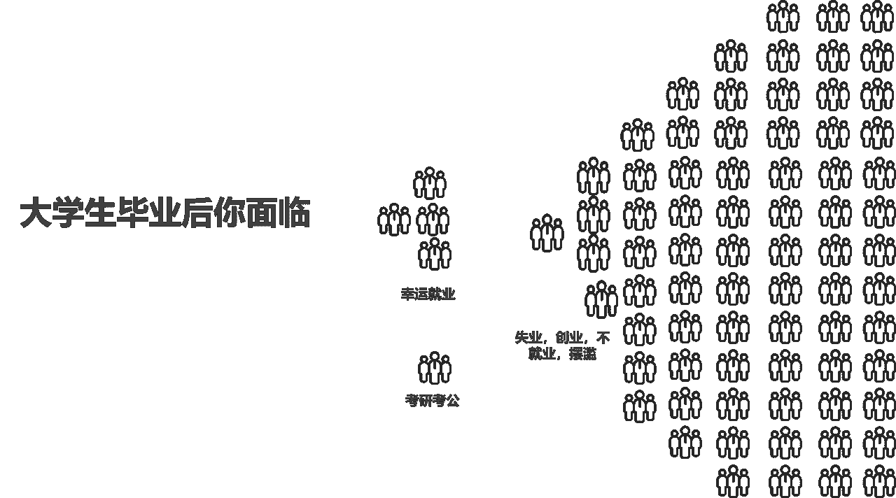

总结：每个选择都有 “坑”，没有完美解，关键看自己能接受啥样的 “累”—— 是愿意吃学习的苦、考试的苦，还是社会毒打的苦？先想清楚自己怕啥、想要啥，再选一条相对能 “熬” 的路。

AI引爆全球失业潮，美国大学生毕业即失业！全球大厂联手裁员上万

# 三、毕业生该如何选择未来的方向

保研？考研？留学？考公？考编？国企？民企？外企？政策性就业，创业？自由职业？每个选择都有 “坑”，没有完美解，关键看自己能接受啥样的 “累”—— 是愿意吃学习的苦、考试的苦，还是社会毒打的苦？先想清楚自己怕啥、想要啥，再选一条相对能 “熬” 的路。

如果选择考研继续深造，选择考公考编，政策性就业，或者选择趟平摆滥，请绕过。

**毕业即失业，未来几十年都是常态，普通人**要树立大学入学那天，就是你创业的第一天。

对于怀揣理想、渴望破局的普通家庭毕业生而言，避开常规 “安全选项” 后，更需要精准的资源对接与破局策略。以下从就业和创业两大方向，提供可落地的指引：

### (一)、就业破局：锁定高增长赛道，用 “技术 + 经验” 突围

1.  瞄准 “冷门高薪” 细分领域

+   案例：某双非院校机械专业学生自学AI人工智能，进入AI应用开发企业年薪 25 万。

+   策略：关注国家 “十四五” 规划中的战略产业（如新能源汽车电池研发、半导体材料、低空经济无人机应用），学习核心技能，考取行业认证（如微软AI人工智能架构师、AWS 云计算证书），主动联系中小型企业争取实习机会。

1.  打造 “跨界复合型” 竞争力

+   模板：文科生 + Python 数据分析→转型互联网运营；理科生 + 短视频剪辑→切入跨境电商营销。

+   资源：加入 “GotoAI中国技术社区” 等行业社群积累项目经验，与在职从业者建立联系获取内推机会。

+   人工智能、大数据、生物技术、新能源等新兴产业发展迅猛，人才缺口巨大。如人工智能领域的算法工程师、数据科学家，新能源汽车产业的电池技术研发工程师等岗位需求旺盛，相关专业毕业生起薪较传统行业高将近 30% 以上，且职业发展前景广阔。

1.  打先就业再择业

### (二)、创业突围：轻资产切入刚需市场，借政策东风起步

1.  挖掘下沉市场真实需求

+   方向：县城社区团购、农村电商代运营、老年智能设备使用培训。

+   实战：利用微信生态低成本试错，例如在乡镇推广 “农产品直播带货” 服务，政府乡村振兴项目可能提供场地和流量扶持。

1.  对接 “零成本” 创业资源

+   渠道：申请大学生创业孵化基地（免租金办公）、参与 “互联网 +” 大学生创新创业大赛（获奖可获百万级投资）、关注地方人社部门创业补贴政策（如长沙对初创企业最高补贴 50 万）。

+   工具：使用 Canva 设计、剪映制作短视频，借助抖音本地生活服务商平台实现冷启动。

### (三)、破局方法论：构建 “贵人圈 + 信息差”

1.  主动链接行业前辈

+   行动指南：在脉脉、行业峰会等渠道向从业者发送定制化求助信息（如 “希望请教您在新能源行业新人如何快速成长”），准备好具体问题提高回复率。

1.  拆解 “隐形就业” 机会

+   洞察：关注行业报告中的 “人才缺口数据”，人工智能、大数据、生物技术、新能源等新兴产业发展迅猛，人才缺口巨大。如人工智能领域的算法工程师、数据科学家，新能源汽车产业的电池技术研发工程师等岗位需求旺盛，相关专业毕业生起薪较传统行业高将近 30% 以上，且职业发展前景广阔。

### (四)、持续赋能：建立长期成长体系

1.  搭建 “成长型朋友圈”

+   方案：组织或加入 “破局者互助小组”，每周进行资源共享（如内推岗位、项目合作）、认知碰撞（分析行业趋势）。

1.  设计 “100 天冲刺计划”

+   模板：前 30 天掌握核心技能（AI大模型精英特训营），中间 40 天通过兼职 / 实习验证能力，最后 30 天集中投递精准岗位或启动创业测试版。

真正的破局不在于盲目努力，而在于精准识别高价值赛道，用最小成本验证可行性，同时借助政策红利和人脉资源放大个人优势。普通家庭的孩子更需要 “以结果为导向” 的行动策略，在动态调整中找到属于自己的那束光。

# 四、大学毕业生AI赋能加速器计划

当前大学生面临着严峻的就业形势，“毕业即失业” 现象困扰着众多学子。而 AI 技术的迅猛发展，为解决这一难题提供了新的途径与可能。作为一家专注于 AI 大模型应用和培训的机构，我们有能力整合 AI 资源，从多个维度为大学生赋能，助力他们在职场中脱颖而出或成功开启创业之路。

AI 的核心价值 —— 用数据和效率，降低 “试错成本”

**对大学生而言，就业最大的挑战是 “**选择迷茫 + 能力错配 + 资源不足”。AI 通过 数据驱动的精准匹配、个性化能力提升、全流程工具赋能，让学生更清晰地认识自己和市场，用更少的时间试错，把精力聚焦在 “可积累、有价值” 的方向上。

关键提醒：AI 是工具，不是 “万能解药”—— 最终能否突围，仍需学生主动利用资源、持续行动。

## (一).AI赋能大学生就业

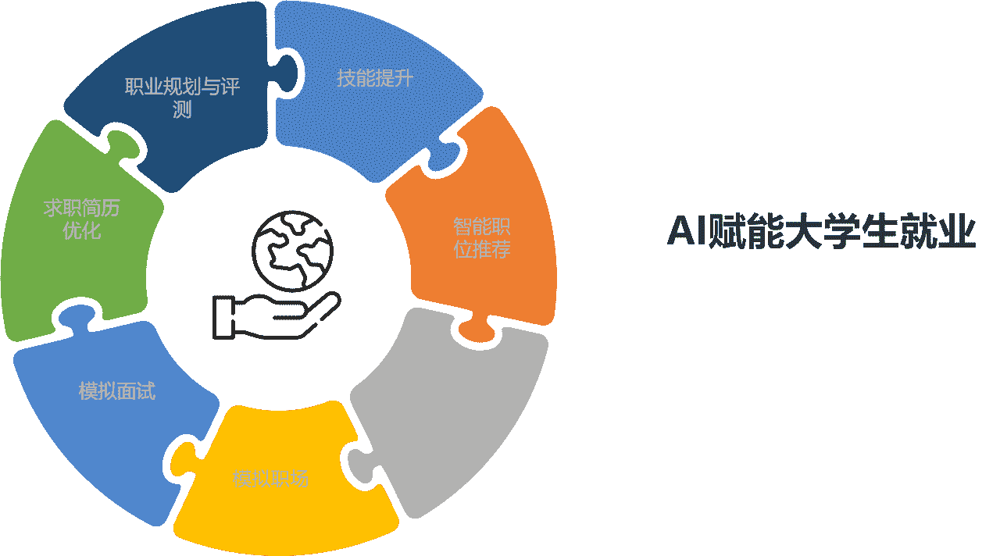

+   职业规划：AI 可通过分析个人技能、兴趣和价值观，生成个性化职业发展建议，还能实时抓取招聘市场数据，识别高增长领域和技能需求，为大学生提供精准职业定位。可使用 GotoAI 精英职通车平台等工具，基于 AI 进行职位匹配和技能分析，帮助大学生明确职业方向。

+   技能提升：上传简历后，AI 能自动对比目标岗位要求，指出需强化的技能点，并根据用户需求推送精准学习资源，还可提供 7×24 小时学习问题解答。GotoAI 网络学院平台等工具可用于定制化课程生成、学习进度跟踪以及一对一专业辅导和答疑解惑。

+   简历与求职材料优化：AI 能根据输入的基本信息，自动生成符合 ATS 系统的专业简历，并根据不同岗位自动调整简历重点和关键词。此外，还可利用 AI 绘图工具制作高质量作品展示。

+   面试准备：AI 可通过语音识别和情感分析，提供实时反馈和改进建议，还能基于目标公司文化生成可能的面试问题及高分回答，模拟各种意外面试场景。

+   求职渠道拓展：GotoAI 精英职通车平台可学习用户偏好，主动推送匹配度高的未公开岗位，还能分析校友和行业人士的职业路径，推荐最佳连接点，通过企业动态预测未来招聘需求。

+   薪资谈判：AI 可根据学生学历、技能、实习经历及行业薪资水平，提供谈判策略和个性化薪资建议。如GotoAI 精英职通车平台可基于 AI 分析提供个性化薪资建议，Paysa 能进行基于技能的精准市场价值评估。

+   职场适应：入职后，AI 可分析公司内部文档，提炼关键文化要素和潜规则，生成首个 90 天工作计划和学习路线，解答新人常见问题。GotoAI 精英职通车平台可作为企业知识库 AI 助手，充当新员工入职培训机器人，帮助大学生更快适应职场。

+   提前实习。GotoAI 精英职通车平台对接了全国2000家成员单位，为大学生提供实习实训机会，提前具备职业技能和经验。

## (一).AI赋能大学生创业

GotoAI 中国技术社区的AI创业加速器，汇聚AI业界最优质的创业资源，提供行业领先的 AI 服务、专家指导和打造面向即将毕业计划创业的大学生，提供所需的基本技术，帮助学生初创公司从根本上加速创新，为当地创业团队提供技术支持、资本对接、创业指导、产业扶持、品牌背书等优质创业生态资源，助力创业团队快速成长，目前与全国10多家高校创新创业学院构建了大学生AI创业加速器。

针对大学生创新创业需求，GotoAI中国技术社区围绕 项目全生命周期 提供 “工具 + 资源 + 服务” 的立体化支持，结合 AI 技术与实战经验，解决从创意到落地的核心痛点。

“用 AI 技术 + 产业资源，让大学生创业少走 3 年弯路”。

1.  技术基建赋能：降低创业技术门槛

1.  资本与资源对接：解决 “钱荒 + 人脉荒”

1.  创业能力系统训练：从 0 到 1 构建商业思维

# 五、GotoAI大学生赋能加速器平台

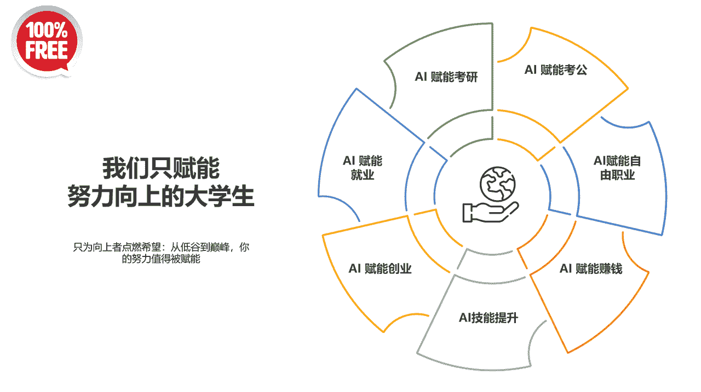

## GotoAI 大学生精英直通车

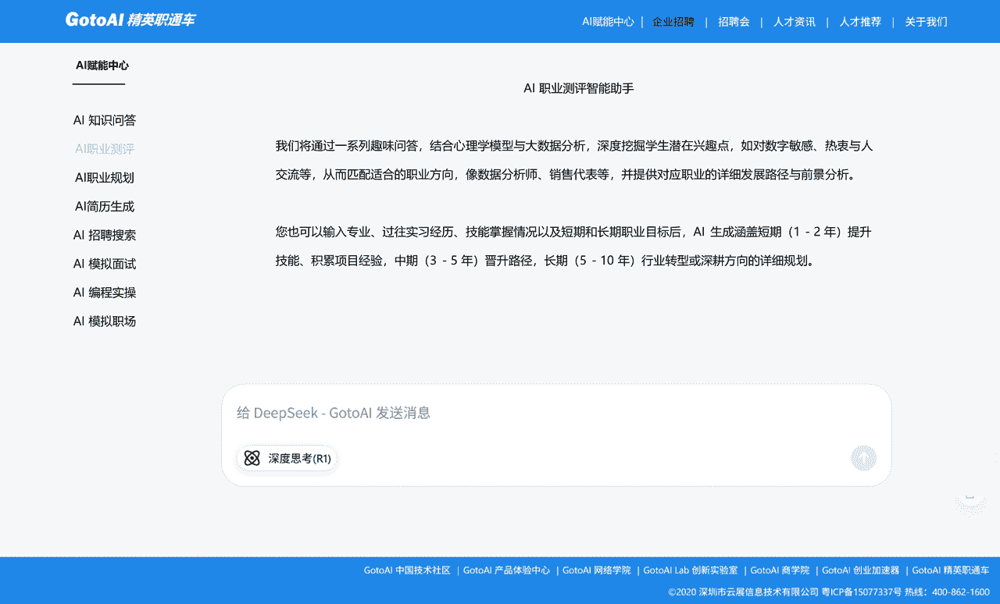

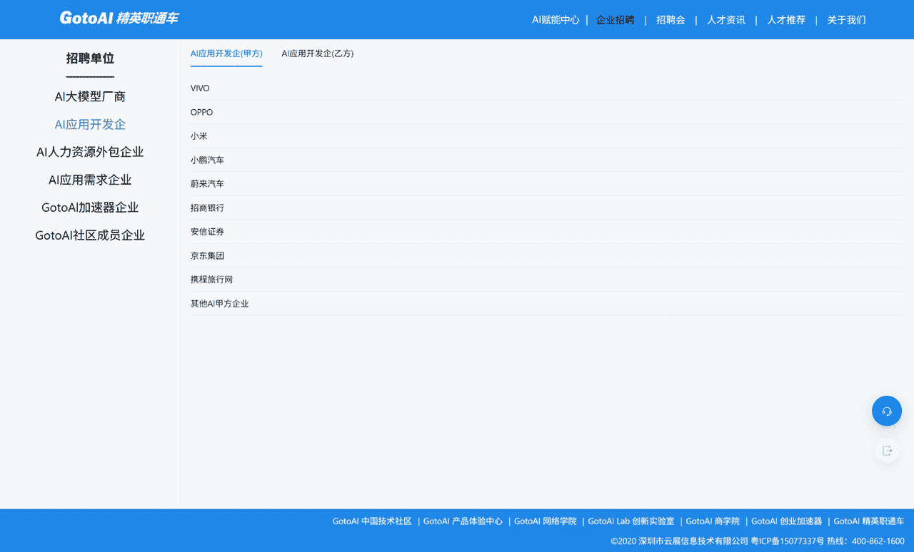

## GotoAI大学生创业加速器

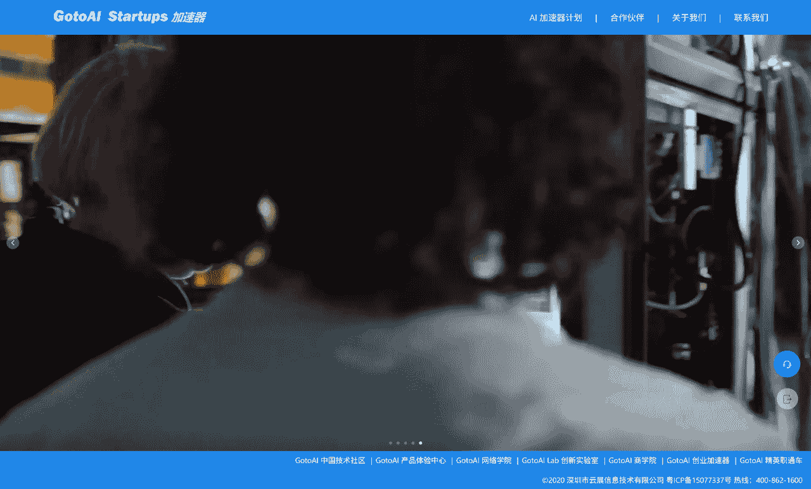

## GotoAI 大学生网络学院

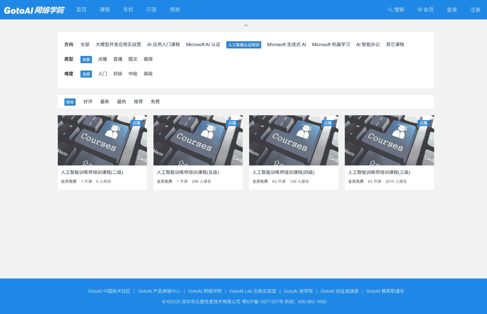

## GotoAI 大学生商学院

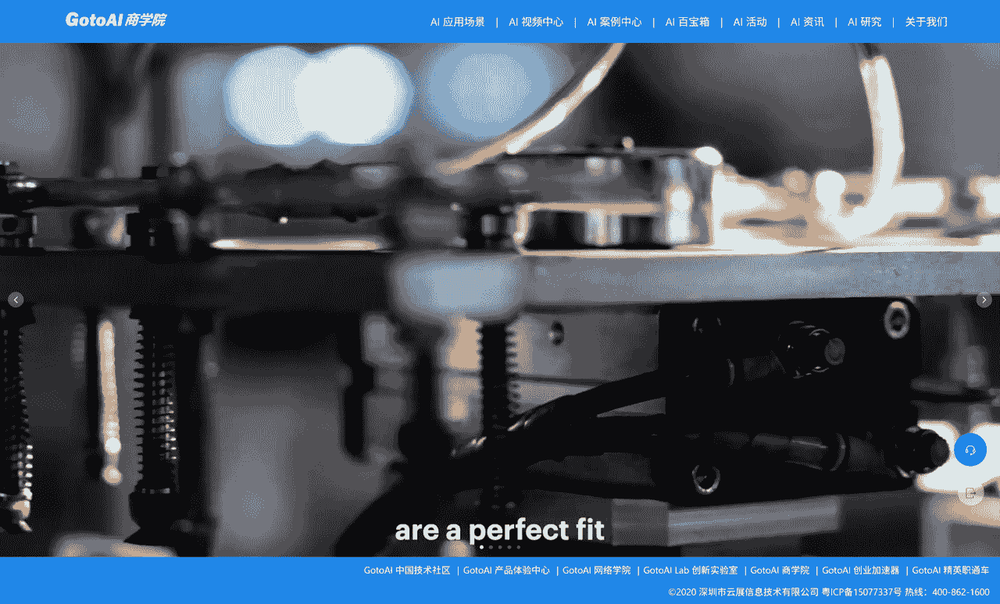

## GotoAI 大学生创新实验室

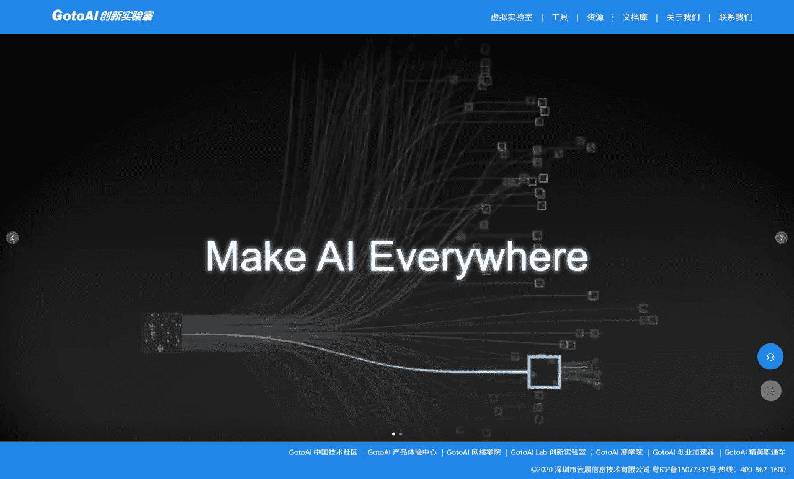

## GotoAI 创业产品体验中心

**AI 软件产品**

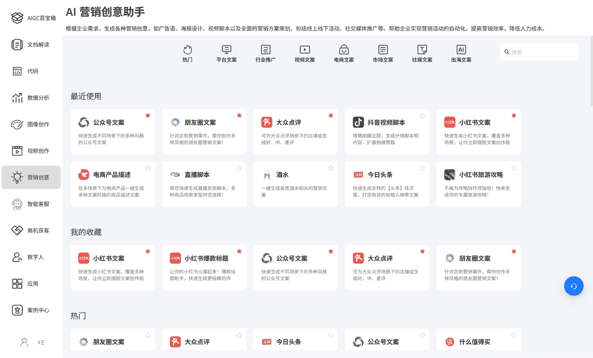

**AI 硬件产品**

AI硬件革命爆发，2025年这五大领域正在重塑万亿级市场。

AI眼镜，AI手机，AI PC，AI耳机，AI智能音箱，AI陪伴机器人，AI戒指，AI挂件，AI智能穿戴，AI益智玩具

**AI 教育培训**

## GotoAI 实习实训中心

联合百度，京东，高德，华为，阿里，腾讯，中国软件，软通动力，海康，大华，优必选等互联网和AI大模型厂商共建的人工智能产业园，大数据园区，电商产业园，数据标注基地，每年组织实习实训超过3.5万人。

**GotoAI 广州实习基地**

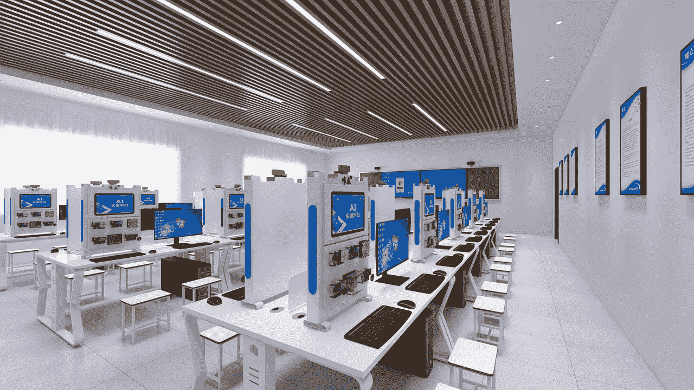

**GotoAI武汉实习基地**

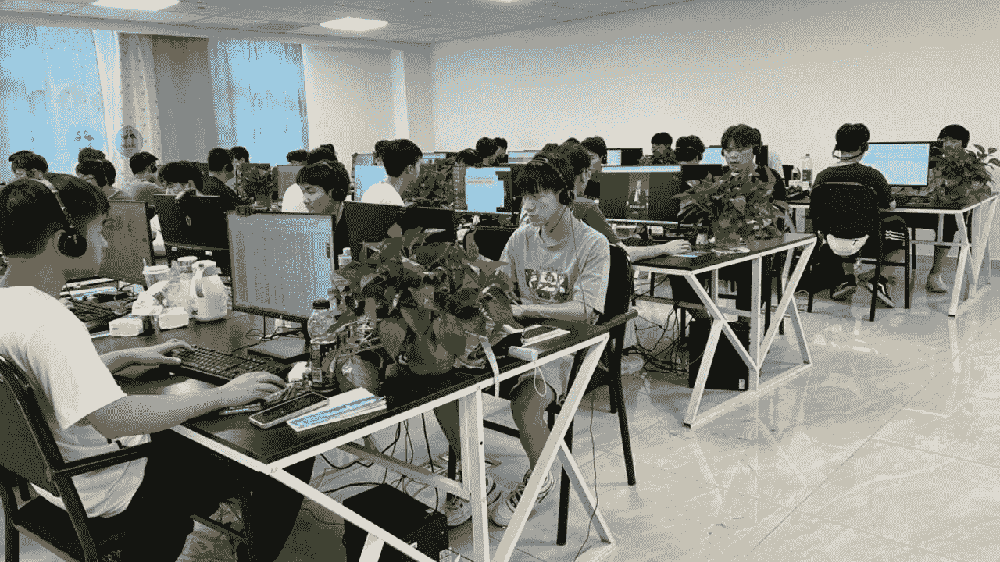

## GotoAI 人工智能产业园

面向AI人工智能，计算机科学，大数据，软件工程，互联网，电商相关毕业生实习，承接就业和创业。目前已对接全国20多个人工智能产业园、软件园、高新园，预计每年提供实习岗位超过5.5万人，对接就业超过3万人，对接大学生创业项目进驻500多家。

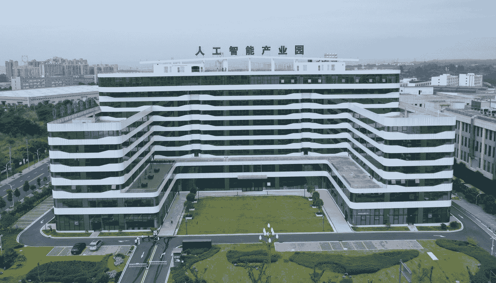

# 六、立即加入GotoAI大学生城市合伙人计划

## 成为GotoAI大学生城市合伙人

如果您是校园人脉广、本地资源熟、销售执行力强的 “资源 + 执行型” 学生优秀学生，欢迎加入我们的GotoAI大学生城市合伙人计划。

1.  校园渠道掌控者：学生会 / 社团负责人、校园活跃分子，有人脉基础（覆盖超 200 人）和活动招商经验，可快速通过社群、讲座等校园场景推广产品，如组织 “AI 工具体验周” 实现学生用户裂变。

1.  本地生活连接器：本地人或熟稔目标城市商业圈，有校企合作、地推兼职经历，能对接高校采购、本地企业定制需求（如 AI 教学平台、中小企业智能客服），并利用地缘优势获取政策支持。

1.  销售实战型选手：有校园代理、电商销售等经验，业绩亮眼（如月销超 1 万），擅长将产品卖点转化为用户语言，可直接承担销售指标，如推广 “AI 课程订阅” 获取佣金分成。

1.  AI技术实战派。能够经过快速培训后，能够支持到当地的企业级AI产品的部署，应用，开发，主要面向政企客户，AI项目的交付任务。

## 获取AI十年黄金期高额回报

“基础佣金 + 阶梯奖励 + 年终分红” 体系，最低20%，最高40%的收益，年综合收入30-90万元。

收入轻松超越99.99%的同门师兄弟。

优秀合伙人将优先吸引为GotoAI中国技术社区在当地组建企业，或者孵化企业高级管理人员或者负责人。

# 七、免费加入GotoAI大学生赋能加速器平台

## GotoAI大学生就业赋能会员

免费注册成为GotoAI大学生就业赋能会员，享有GotoAI中国技术社区九大网络服务平台以及其他权益。

1.  **技能提升：****GotoAI网络学院AI大模**型应用与开发培训，AI智能化办公课程，超过10多种AI课程，1500分钟学习视频。
人社厅人工智能训练师免费培训
工信部DeepSeek人工智能工程师免费培训
微软AI 全球认证架构师免费培训

1.  **就业辅导**：免费使用GotoAI大学生精英直通车平台，使用AI 职业规划与评测，求职简历优化，模拟面试，模拟职场，智能职位推荐功能

1.  **就业推荐：**免费使用GotoAI大学生精英直通车平台，使用AI 智能职位推荐，求职渠道拓展功能

1.  **实习实训：**通过全国2000多家会员企业，免费对接大学生实习实训基地

## GotoAI大学生创业赋能会员

免费注册成为GotoAI大学生就业赋能会员，享有GotoAI中国技术社区九大网络服务平台以及其他权益。

1.  创业辅导与商业思维训练

1.  技术基建赋能

1.  创业资本对接

1.  产业资源和销售渠道

1.  政策扶持园区对接

1.  营销与人脉拓展

1.  GotoAI 项目合伙人

## 如何注册GotoAI大学生会员

免费注册成为GotoAI大学生就业赋能会员。

# 七、免费获取GotoAI大学生赋能加速器计划详细资料

## 大学生AI赋能加速器计划

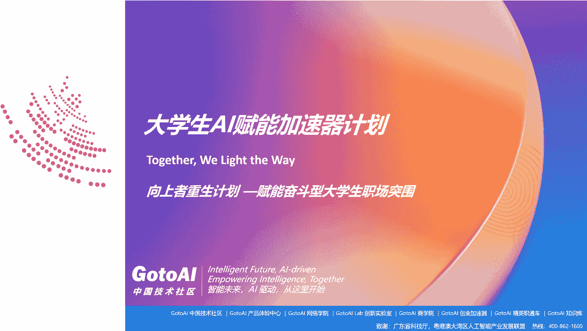

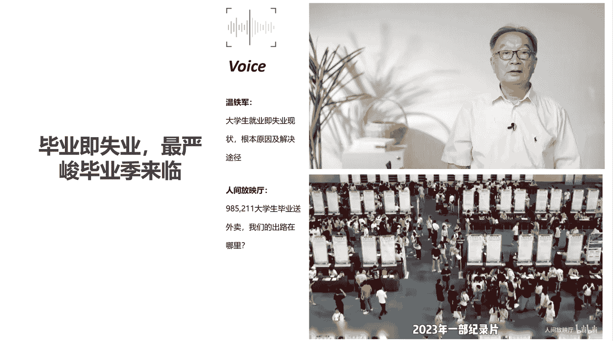

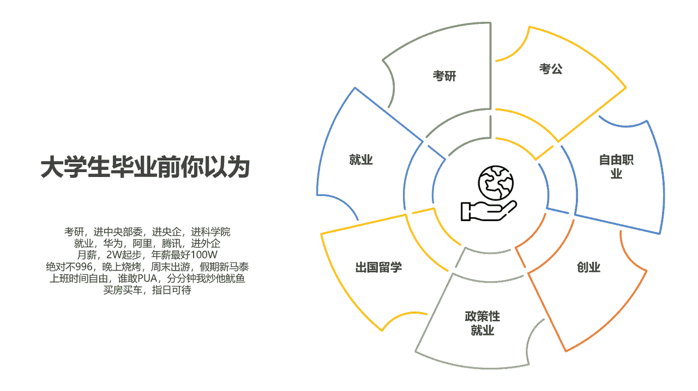

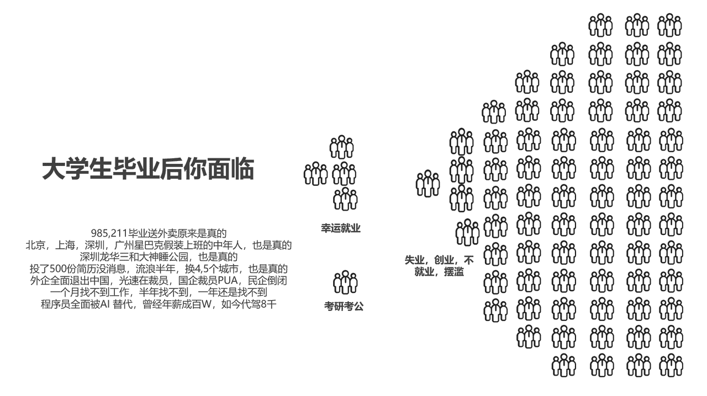

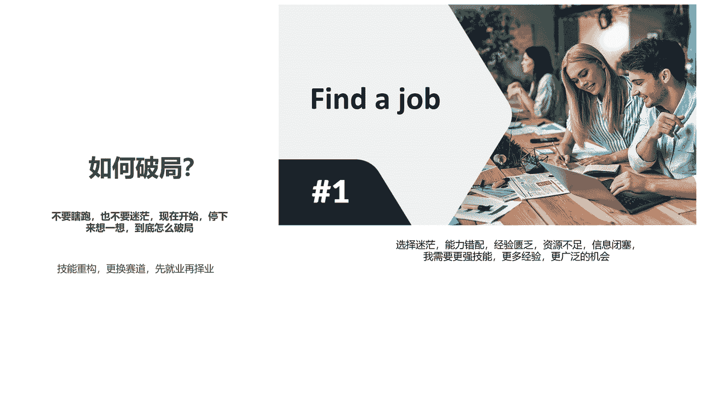

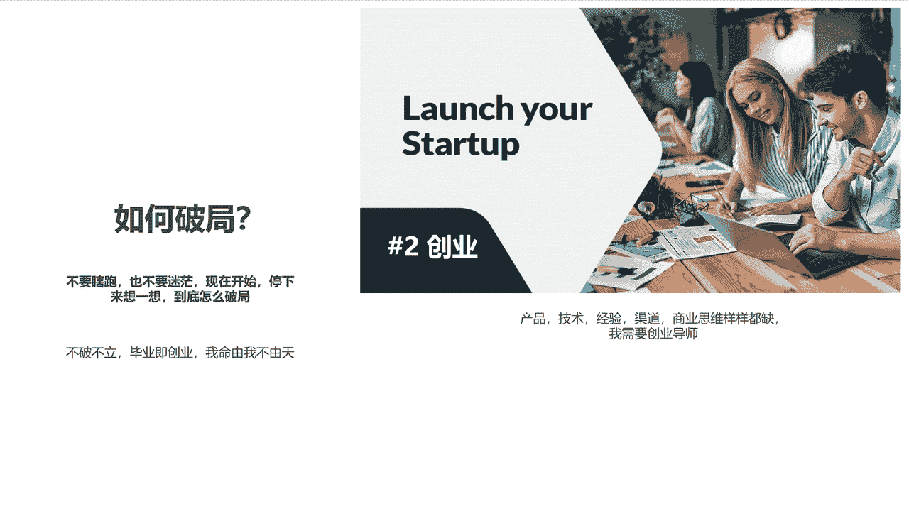

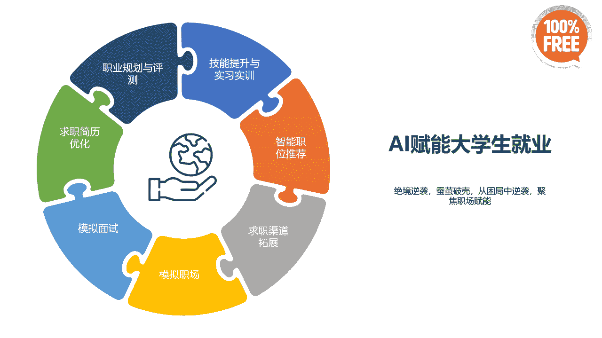

## 立刻联系我们

网站：www.gotoai.world

邮件：steven.li@gotoai.world

电话：19328738175

或者扫码

