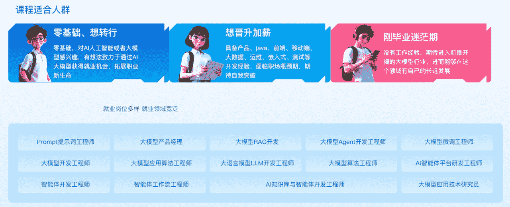

# 2025程序员转行AI大模型全攻略：后端开发轻松转型大模型应用开发，零基础突围路线图

> 来源：[https://gotoaiworld.feishu.cn/docx/ZXbgd9FJJo9ny6xUea7cPwdPnge](https://gotoaiworld.feishu.cn/docx/ZXbgd9FJJo9ny6xUea7cPwdPnge)

2025年，全球大模型产业规模已突破5000亿美元，核心岗位缺口超百万级，资深算法工程师年薪直逼200万6。当传统开发岗位内卷加剧，大模型领域却以470%的岗位增速和3.2万平均月薪成为程序员转型的“诺亚方舟”。本文将结合2025年最新行业趋势，为你拆解职业前景、热门岗位选择策略与零基础转行路径，助你精准卡位AI时代！

# 一、为什么2025年是程序员转行大模型的最佳时机？

1.  市场需求爆发式增长

岗位缺口巨大：2030年全球AI人才缺口预计达500万，中国占比超40%2。2024年大模型岗位招聘量同比激增317%，全栈工程师需求增速达470%51。

薪资碾压传统岗位：大模型算法岗平均月薪6.8万，全栈工程师平均月薪3.2万，远超Java/Python开发岗2倍以上85。

行业渗透全覆盖：金融、医疗、教育、制造等领域全面应用大模型，80% 企业计划部署私有化LLM系统。

1.  政策与资本双重驱动

国家战略支持：科技部将大模型列为“新一代AI重大专项”，北京、上海等地推出专项扶持基金。

认证体系完善：工信部推出“大模型应用工程师”认证（初级/中级/高级），持证者享受企业优先录用与职级认定

1.  技术民主化降低门槛

工具链成熟：Ollama实现本地大模型一键部署，LLaMA-Factory支持低代码微调，零基础可快速上手。

开源生态爆发：Hugging Face模型库超50万预训练模型，LangChain、AutoGen等框架简化应用开发。

# 二、程序员必看的四大黄金岗位与适配策略

根据2025年企业招聘需求与技术趋势，以下岗位成转型首选：

💻 1. AI大模型全栈工程师（转行友好度：★★★★★）

核心职责：端到端开发大模型应用，涵盖前端交互、后端推理API、向量数据库集成、Prompt工程全链路5。

薪资水平：平均月薪3.2万，资深者年薪百万+。

适配程序员：Web全栈/后端开发

🧠 2. 大模型算法工程师（转行友好度：★★★☆☆）

核心职责：模型架构设计、微调优化（LoRA/QLoRA）、分布式训练加速27。

薪资水平：年薪50-200万（智能制造/金融领域最高）。

适配程序员：算法工程师/数据科学家

关键突破点：

精通Transformer架构与Attention机制推导

掌握DPO/PPO对齐技术7

熟悉DeepSpeed/FSDP分布式训练框架

⚙️ 3. 大模型应用开发工程师（转行友好度：★★★★☆）

核心职责：基于LangChain/AutoGen构建企业级智能体系统，实现RAG问答、任务自动化流程7。

薪资水平：月薪25-50K（互联网大厂涨幅30%）。

适配程序员：Python后端/云计算工程师

实战聚焦：

医疗场景：病历分析+诊断报告生成智能体

金融场景：财报解析+投资建议自动化系统7

🎯 4. AI产品经理（技术转产品首选）

核心职责：设计AI产品交互逻辑，制定Prompt策略，管理模型评估指标。

薪资水平：平均月薪4.9万（领跑非技术岗）

适配程序员：3年以上开发经验者

能力转型：技术能力 → 需求洞察+场景设计+商业闭环3

# 三、程序员转型三大核心策略：如何低成本高效突围？

🔥 策略1：基于现有技术栈的“技能嫁接法”

🚀 策略2：选择高回报技术栈组合（2025版）

+   基础层：Python + PyTorch + Hugging Face Transformers

+   应用层：LangChain（智能体） + Chroma（向量库） + FastAPI（部署）

+   进阶层：AutoGen（多智能体） + vLLM（推理加速） + MLFlow（实验追踪）

💡 策略3：用“微项目”快速积累经验

+   入门试炼：用Ollama本地部署DeepSeek模型，实现PDF问答机器人

+   进阶挑战：基于LLaMA3+LoRA微调行业术语模型（如法律/医疗）

+   求职砝码：开发多智能体协作系统（如AutoGen实现电商客服+订单追踪联动）

# 四、避开致命陷阱：程序员转行必知的3大真相

⚠️ 陷阱1：盲目死磕数学推导

真相：企业级开发更重工程落地！优先掌握：

+   Hugging Face模型调用（90%应用无需从头训练）

+   Prompt设计原则（CoT思维链>TOT树状思考）

+   RAG检索优化技巧（BM25重排序>HyDE抗幻觉）

⚠️ 陷阱2：忽视垂直领域知识

破局点：技术+行业=不可替代性！例如：

+   金融程序员：深耕FinGPT+监管合规知识

+   医疗IT人员：掌握Meditron+病历术语体系6

⚠️ 陷阱3：低估工程化能力价值

企业刚需：模型部署（Docker/K8s）、推理优化（量化/剪枝）、监控日志（Prometheus/Grafana）

# 五、转型路线图：从学习到offer的六个月计划

🔹《2025大模型技术栈学习图谱》

🔹《RAG系统开发实战代码模板》

🔹《工信部认证考点精要》

# 六、未来已来：你的代码将重新定义AI时代

当传统CRUD开发逐渐被AI代码生成取代，大模型全栈工程师正成为新一代技术话语权的掌控者。腾讯混元实验室负责人直言：_“未来三年，不懂LLM的程序员将面临降维打击”_2。

转型不是选择题，而是生存战。无论你是：

苦于内卷的Java老手 → 用LangChain重铸后端价值

迷茫的前端开发者 → 成为AI交互设计先锋

数据管道工程师 → 转型向量索引架构师

# 七、如何系统学习大模型？

AI大模型作为人工智能领域的重要技术突破，正成为推动各行各业创新和转型的关键力量。抓住AI大模型的风口，掌握AI大模型的知识和技能将变得越来越重要。

学习AI大模型是一个系统的过程，需要从基础开始，逐步深入到更高级的技术。

所有的视频由GotoAI老师录制，且资料与GotoAI共享，相互补充。

资料内容涵盖了从入门到进阶的各类视频教程和实战项目，无论你是小白还是有些技术基础的，这份资料都绝对能帮助你提升薪资待遇，转行大模型岗位。

