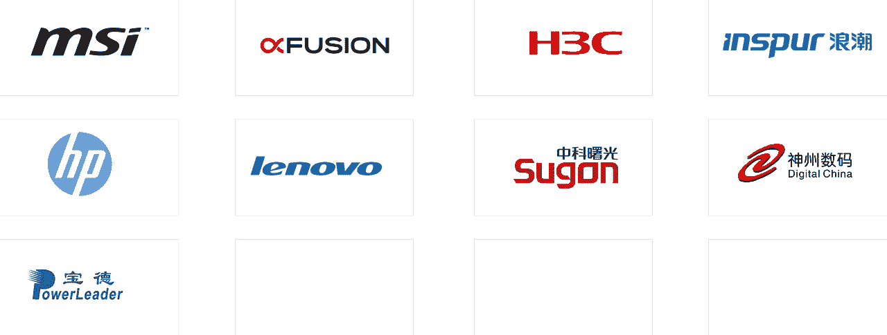
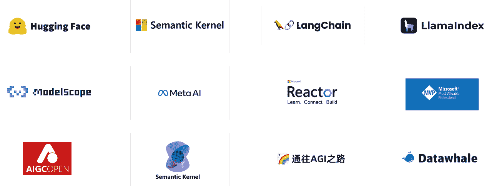

# 向您致谢

> 来源：[https://gotoaiworld.feishu.cn/docx/KrXcdEXhaoQRhAxQJ4Nc7uOinG9](https://gotoaiworld.feishu.cn/docx/KrXcdEXhaoQRhAxQJ4Nc7uOinG9)

# 一、行业领导

> GotoAI 中国技术社区是一个开源AI社区，我们坚信人工智能不仅仅是提升效率的手段，而且将重新塑造我们的思考和学习方式，为每个人带来前所未有的强大力量，正是这种信念激发了我们创建这个知识库的决心。

> 在搭建知识库的过程中，我们都收获了很多，**特别感谢一路上支持和推荐知识库的伙伴们！正是你们**的肯定与支持，使我们得以有信心持续地为知识库添砖加瓦，探索 AGI 的无限可能！

> 因此，特别开辟一个目录，深表感激。

**(排名不分先后)**

1.  [工业和信息化部人才交流中心](https://www.miitec.cn/)

1.  [工业和信息化部教育与考试中心](https://www.miiteec.org.cn/)

1.  [工业和信息化部产业发展促进中心](https://www.idpc.org.cn/)

1.  中国中小企业发展促进中心

1.  [中国信息通信研究院](https://www.caict.ac.cn/)

1.  [中国工业互联网研究院](https://www.china-aii.com/)

1.  中国电子信息产业发展研究院

1.  中国互联网络信息中心

1.  中国通信学会

1.  深圳清华大学研究院

1.  广东省科技厅

1.  广东省云计算应用协会

1.  广东省高新技术企业协会

1.  广东省数字政务协会

1.  中国电信集团有限公司广东分公司

1.  中国移动通信集团广东有限公司广州分公司

1.  联通(广东)产业互联网有限公司

1.  广东省通信产业服务有限公司

1.  中国信息通信研究院广州分院

1.  广东省电信规划设计院有限公司

1.  中国科学院广东分院

1.  广东省云计算数据协会、

1.  广东省智慧城市产业联盟

1.  广东智慧城市产业联盟

# 二、科研院校

1.  华南理工大学

1.  深圳清华大学研究院

1.  华南师范大学

1.  广东工业大学

1.  广东技术师范大学

1.  湖北工业大学

1.  湖北第二师范学院

1.  武汉职业技术学院

1.  长江大学

1.  荆楚理工学院

1.  武汉软件职业技术学院

1.  湖北邮电规划设计院

1.  湖南工业大学

1.  长沙理工大学

1.  长沙环保职业技术学院

1.  湘潭大学

# 三、AI大模型厂商

# 四、云平台厂商

# 五、AI算力厂商

# 六、AI智库合作伙伴

# 七、大模型社区合作伙伴

# 八、个人

岳浩先生

刘寿强先生

刘冲冲先生

喻坤先生

石勇先生

马新国先生

孙晓先生