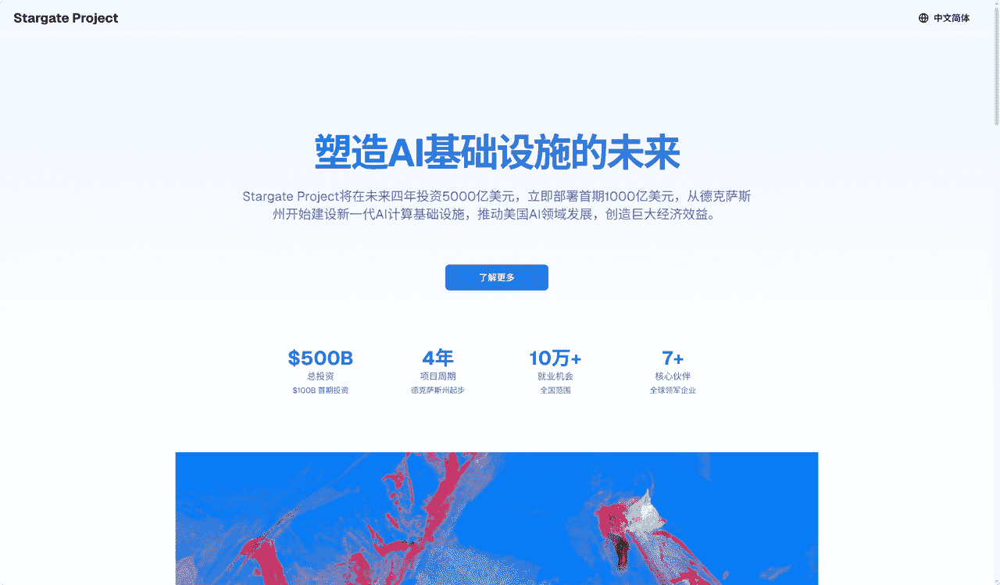

# Stargate Project 星际门项目

> 来源：[https://gotoaiworld.feishu.cn/docx/KJfMdHUSVor6cBxUUnIcXD54nff](https://gotoaiworld.feishu.cn/docx/KJfMdHUSVor6cBxUUnIcXD54nff)

## Stargate 星际门项目（2026 正式启动）

+   **总投资**：5000 亿美元，首期 1000 亿美元

+   **牵头方**：OpenAI + 软银 + 英伟达 + 甲骨文 + 微软 + ARM

+   **规模**：7–10GW 算力集群，约 40 万–70 万块 Blackwell GPU

+   **地点**：美国德州起步

+   **意义**：**人类史上最大 AI 基建**，为 AGI 打造专属底座

星际之门

星际门 5000 亿开工，AGI 算力底座落地

# 塑造AI基础设施的未来

Stargate Project将在未来四年投资5000亿美元，立即部署首期1000亿美元，从德克萨斯州开始建设新一代AI计算基础设施，推动美国AI领域发展，创造巨大经济效益。

https://www.stargateprojects.net/zh