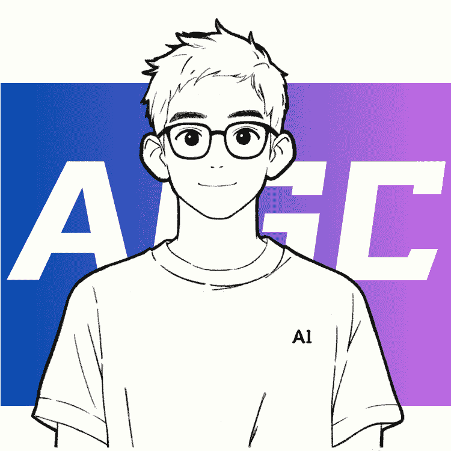
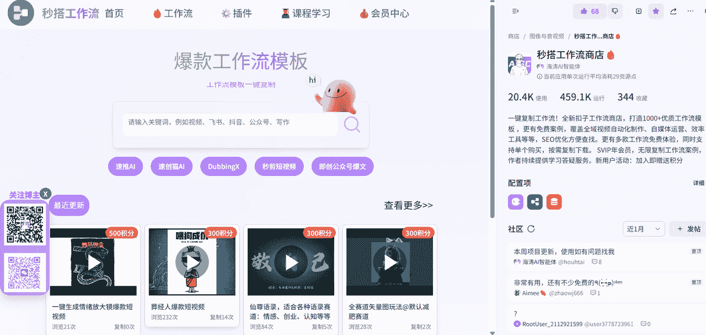
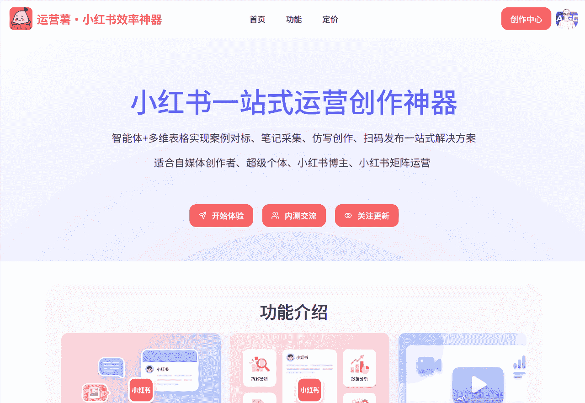
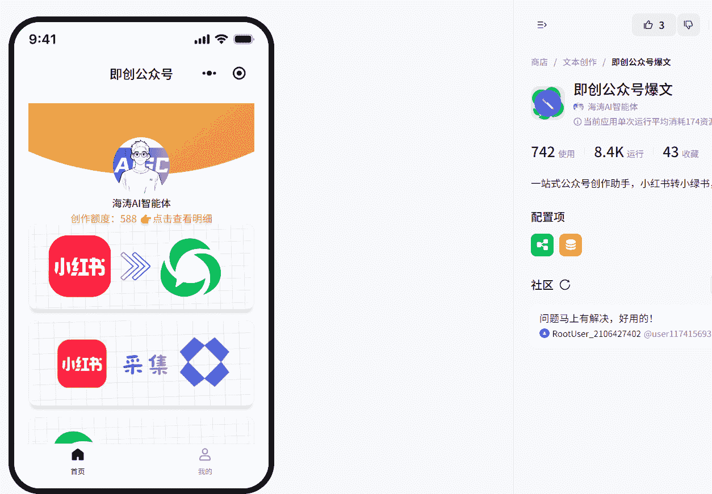
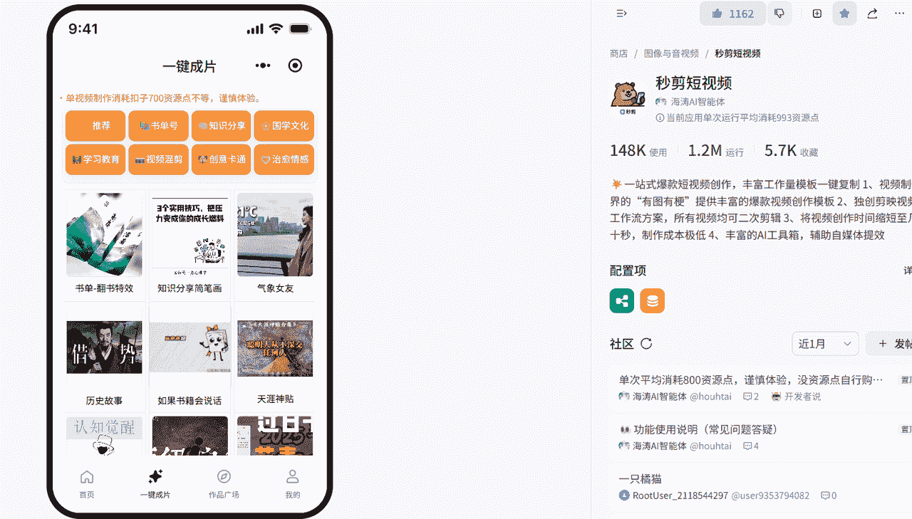
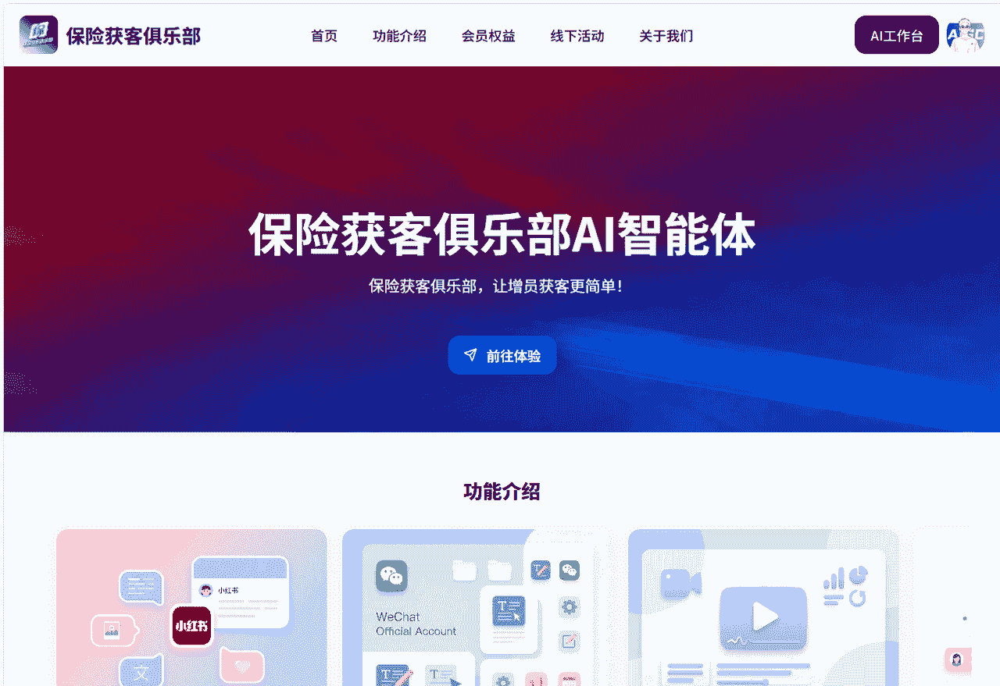
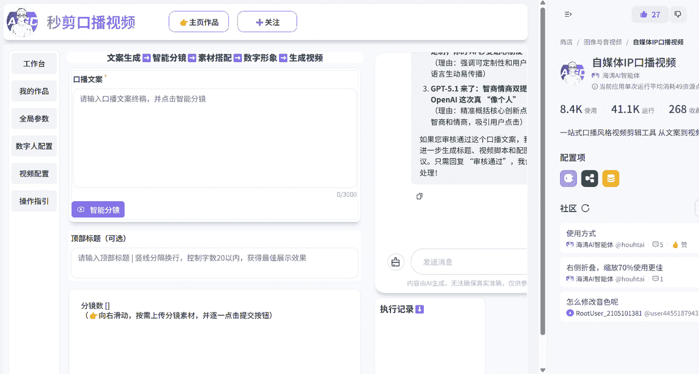
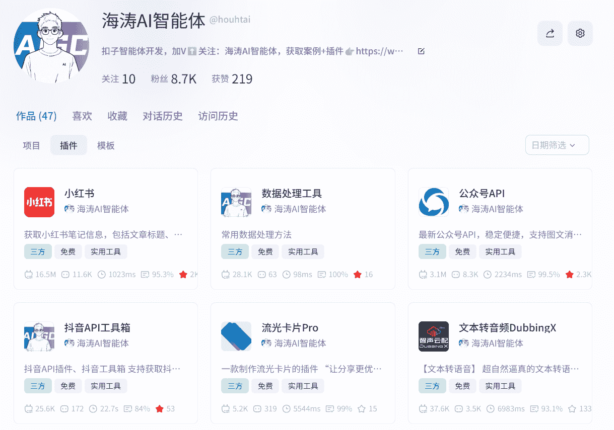

# 海涛的个人说明书

> 来源：[https://zinxkclpk97.feishu.cn/docx/T5LldGU6cojMZsx6PAlcgvBpnZq](https://zinxkclpk97.feishu.cn/docx/T5LldGU6cojMZsx6PAlcgvBpnZq)

## 我的介绍

> 朋友，感恩遇见。“AI已来，未来10年就是AI的时代，你我正身处AI的台风口......”

> **认知我**

> 侯海涛  |📍南京 | 职场10年 | 互联网

> “拥抱AI，重塑工作与生活”

> 聚焦AI领域，专注AI智能体+AI编程，自媒体提效

> 努力打造AI超级个体

> **目前在做的**

> 👸号&视频号 “海涛AI智能体”   万粉博主

> Coze昵称：“海涛AI智能体”，官方合作开发者

> AI付费陪伴群：AAI知识分享、AI前沿技术、AI智能体、副业交流聚焦分享AI+智能体应用

> 其它：AI项目定制开发、AI企业培训服务

> 我的产品

> 扣子工作流模板商店：https://www.coze.cn/s/pKlV_Tn0tqg/

> 📕运营智能体：https://www.coze.cn/s/9ERLz5G-H40/

> 视频工作流应用：https://www.coze.cn/s/eRBDmXPDIKM/

> 更多关注我的主页：https://www.coze.cn/user/3019721865441131?access_entrance=share_my_link&bid=6iqtgc90c401j

>

下面是我运营的部分服务和产品介绍，有需求的可以加我咨询。

## 我的2026年度付费陪伴群

在做自媒体的同时遇到了很多同行的小伙伴，我做了自己的第一个付费社群，把大家聚在一起。

+   目前加入价格，69元/年

**陪伴群介绍：**

1.  日常分享AI智能体、AI产品、副业变现相关内容

1.  群内开放互动交流，不定期直播分享

1.  智能体、AI等相关问题答疑

1.  多个优质群付费群内信息差互通

1.  个人相关产品与服务内测及优惠通道

---

## 我的智能体产品

作为开发者，这一年我也做了一些智能体产品，下面是产品介绍

