# Coze+剪映打造认知觉醒视频工作流-剪映草稿版

> 来源：[https://zinxkclpk97.feishu.cn/docx/EM0Gdo81qokHtQxagI9cOfzinEd](https://zinxkclpk97.feishu.cn/docx/EM0Gdo81qokHtQxagI9cOfzinEd)

> 在此之前我们已经完成了认知觉醒类视频-云渲染生视频的版本，先说下剪映草稿版本与之前云渲染版本的区别：

> 云渲染版本，由云端直接渲染视频，生成视频的mp4地址给到我们，制作时间比较长。

> 剪映草稿，则是由工作流执行后，生成剪映素材草稿链接给到我们，我们通过工具下载到本地后，再使用剪映打开后编辑导出视频。这种方式更灵活，可以加更多的剪映特性内容，但难度更大。


我们搭建这套Coze工作流，来完成此类视频的制作过程。

自己只需要做好选题、内容文案部分工作。

**工作流总体流程如下**

涉及核心节点及插件：

+   大模型节点：生成文案

+   画板节点：制作封面、背景图

+   语音合成：火山的语音合成插件，用来转换字幕对应的音频

+   获取音频时长：用来获取每段音频的时间长度，为了计算剪映草稿的时间线。

+   剪映小助手：插件，用来拼接剪映素材，生成剪映草稿文件链接。

另涉及的其它软件获取方式放到文末了。

下面重点介绍流程中涉及到的细节内容：

此类视频思路，重点是将文本拆分后处理为图片和音频，再将背景图、音频、文本重组为剪映所需的数据结构，最终生成剪映草稿。

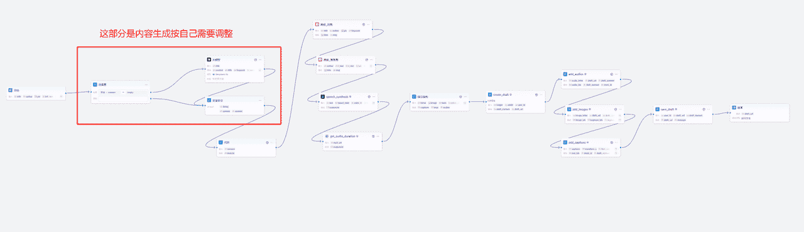

输入参数，可根据自己的视频中包含的元素进行灵活调整。

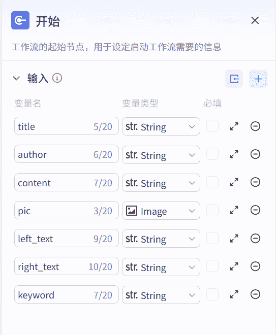

大模型节点用于对用户输入的文案进一步调整。

大模型节点，则可以根据自己需要咨询调整处理方式，不局限模型类型、串接方式、文案风格等。

这里我们使用的是DeepSeek R1模型，我在火山引擎搭建的专用版本。在文案创作方面效果非常不错，根据标题直出文案，而且质量非常高。感兴趣的可以关注后续，会分享搭建教程。

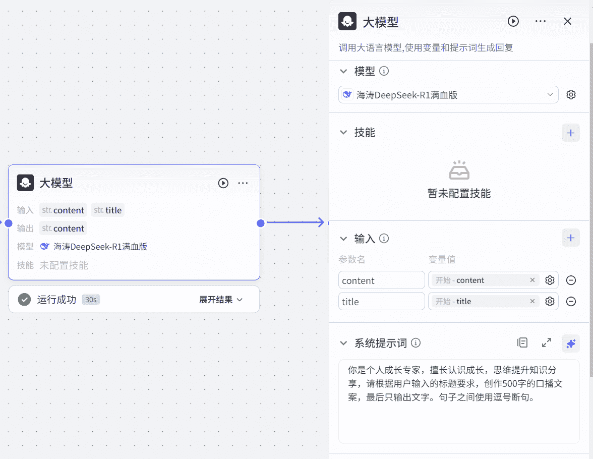

代码节点，将文案内容进行拆分为短句，后续会在短句转为音频和图片配文时使用到

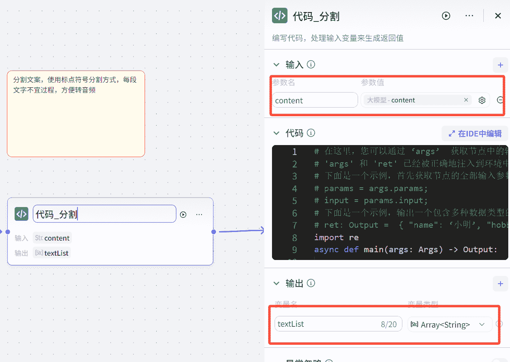

```
import re
async def main(args: Args) -&gt; Output:
    params = args.params
    content = params[&#x27;content&#x27;]
    pattern = r&#x27;[，。！？；]\s*&#x27;

    # 使用re.split()函数根据正则表达式切割文本
    # re.split()会将匹配到的分隔符从结果中移除
    texts = re.split(pattern, content)

    # 移除数组中可能存在的空字符串元素
    texts = [t for t in texts if t]
    # 构建输出对象
    ret: Output = {
        &quot;textList&quot;: texts
    }
    return ret
```

接下来画板节点，用于制作视频的封面图，我们以📕的图片比例制作。

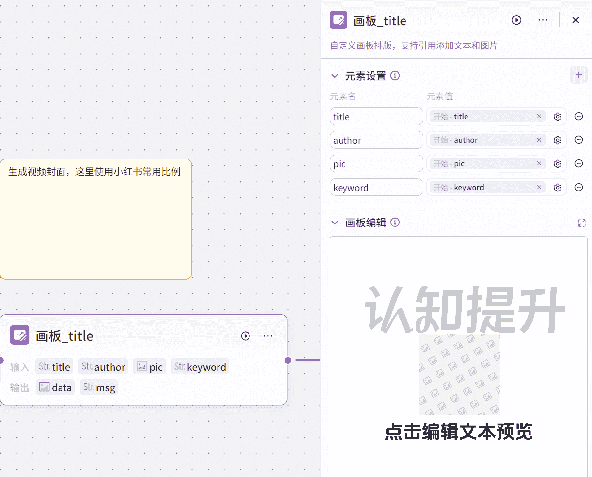

封面画板具体参数如下

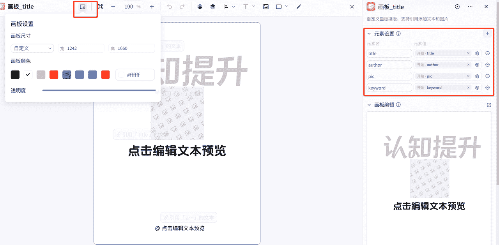

这里我们区别于之前的云渲染，只需生成一次视频背景即可，预留好字幕位置空间。


下一环节是将分段的短句转换为音频文件mp3格式。

我们借助coze官方的文本转语音的插件，对文本进行批量转换。输入参数为前面的分割后的文本数组textList，

输出结果为批处理后的音频文件数组。

注意这个节点的批处理并行参数也设置小于2，避免并发高导致报错。

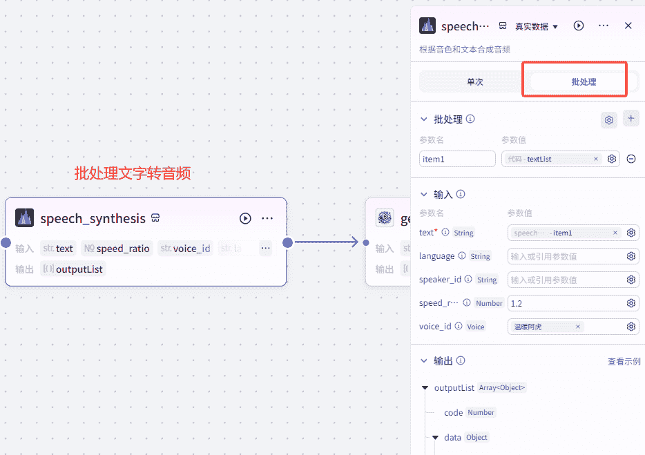

代码节点做一次数据格式转换，然后接插件批量获取音频的时长。

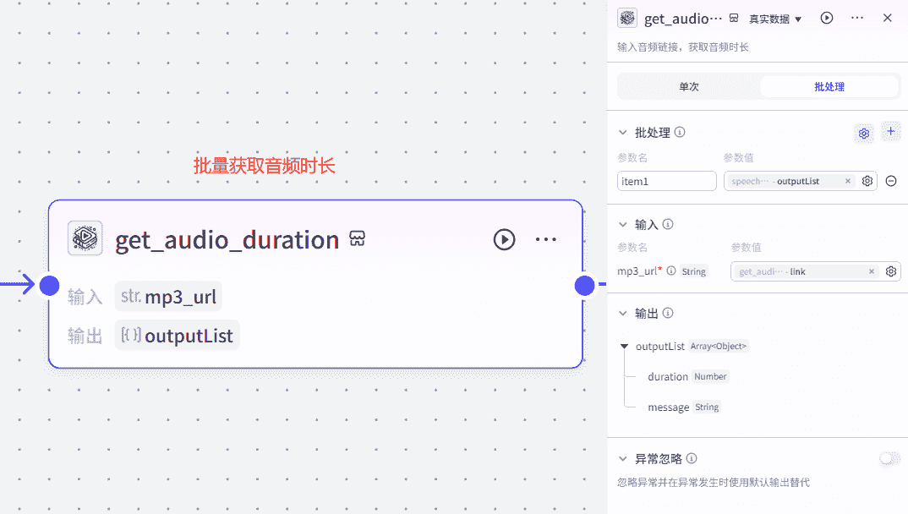

接下来这一环节就是剪映草稿的关键，我们需要将前置准备好的文本、图片、音频等素材，进行重组，再使用剪映插件进行逐一合并（类似剪映里面的添加视频素材轨道的动作，有先后层级次序）

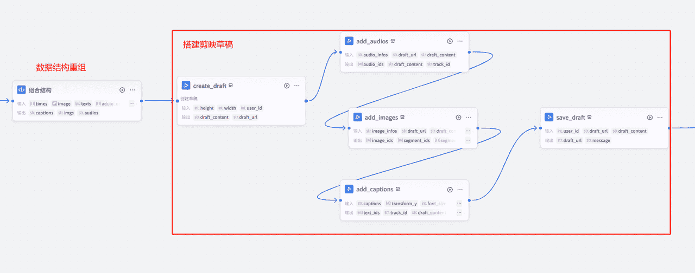

重新修改结构的代码，附代码详细，可直接复制使用。

代码将我们的素材进行重组输出为剪映插件所需的入参数据。

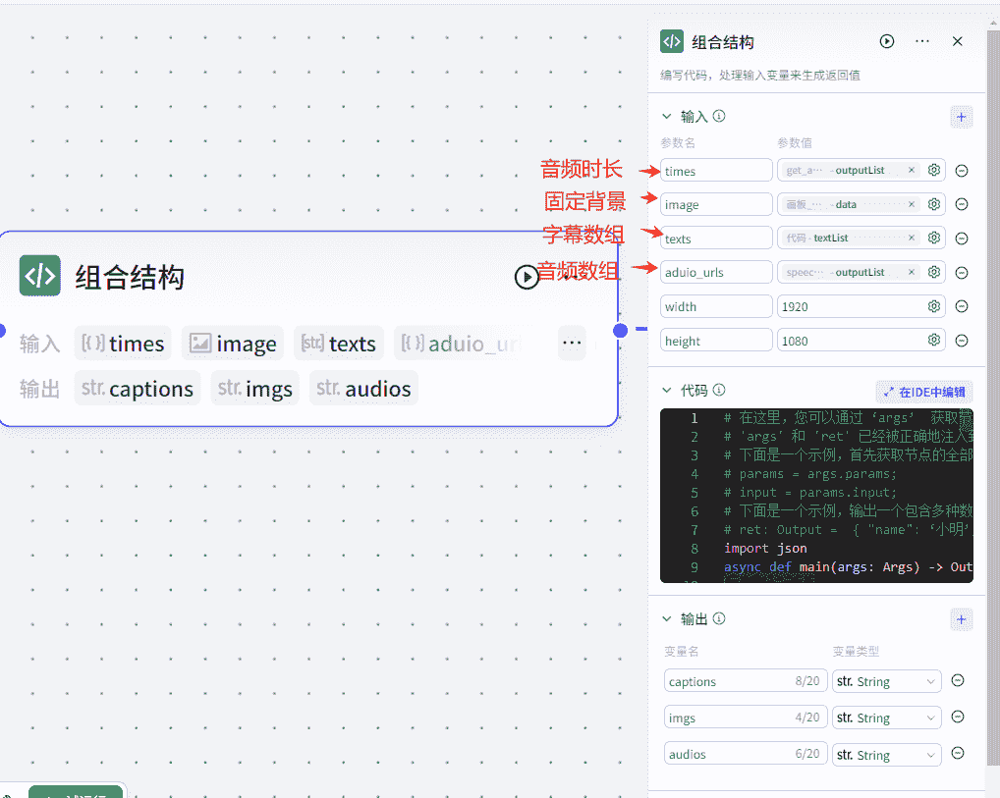

```
import json
async def main(args: Args) -&gt; Output:
    params = args.params
    times = params[&#x27;times&#x27;]
    image = params[&#x27;image&#x27;]
    texts = params[&#x27;texts&#x27;]
    aduio_urls = params[&#x27;aduio_urls&#x27;]
    width = params[&#x27;width&#x27;]
    height = params[&#x27;height&#x27;]

    captions = []
    imgs = []
    audios = []

    # 处理图片的缝隙
    img_start = 0
    draft_end = 0
    for index, element in enumerate(texts):
        start = img_start
        end = int(img_start + int(times[index][&#x27;duration&#x27;] * 1000000))

        audios.append({
            &quot;audio_url&quot;: aduio_urls[index][&#x27;data&#x27;][&#x27;link&#x27;],  #音频
            &quot;duration&quot;: int(times[index][&#x27;duration&#x27;] * 1000000),
            &quot;start&quot;: start,
            &quot;end&quot;: end
        })

        captions.append({
            &#x27;text&#x27;: element,
            &#x27;start&#x27;: start,
            &#x27;end&#x27;: end,
            &quot;in_animation&quot;:&quot;渐显&quot;
        })
        if start &gt; img_start:
            start = img_start
        img_start = end
        draft_end = end
    #固定背景图
    imgs.append({
            &quot;image_url&quot;: image,
            &quot;width&quot;: width,
            &quot;height&quot;: height,
            &quot;start&quot;: 0,
            &quot;end&quot;: draft_end
        })
    # 构建输出对象
    ret = {
        &quot;captions&quot;: json.dumps(captions),
        &quot;imgs&quot;: json.dumps(imgs),
        &quot;audios&quot;: json.dumps(audios)
    }

    return ret
```

下面使用到的是“剪映小助手”插件，可在插件商城搜索获取，由速推AIGC大佬开发。

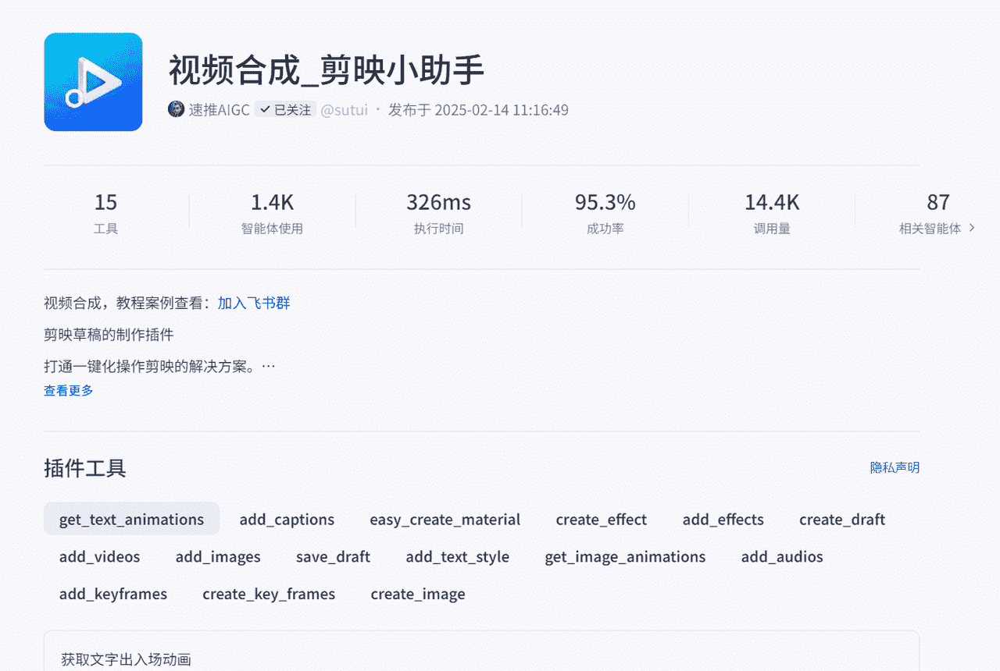

接下来，创建剪映草稿、添加音频、图片、字幕、保存草稿

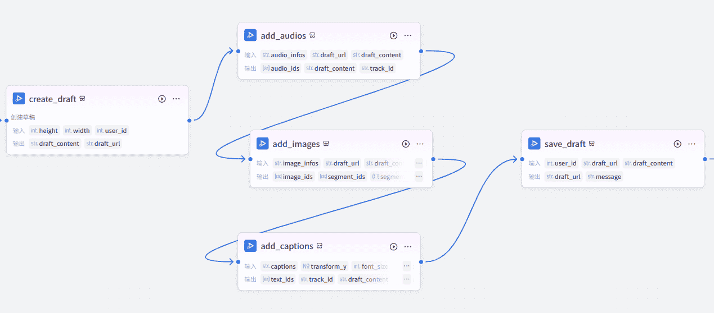

先说创建草稿的节点，添加尺寸即可，user_id可不填

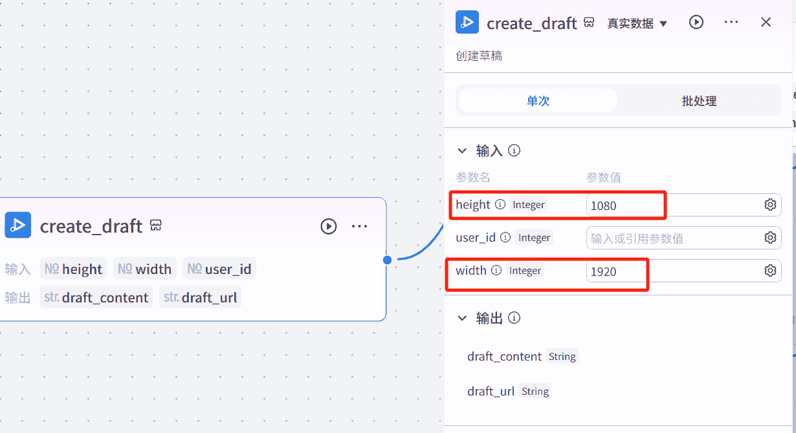

剪映素材拼接部分整体示意，这里节点的先后顺序决定了剪映素材在轨道上的先后顺序。

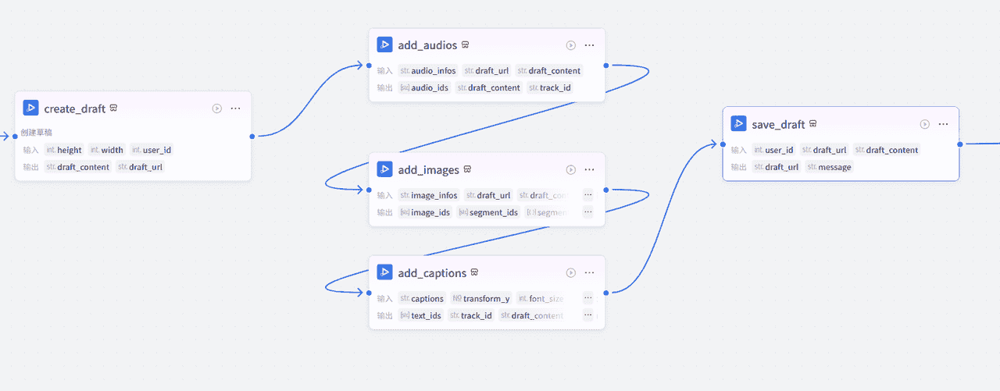

然后是串联添加音频的节点，这里的draft_url为create_draft的输出参

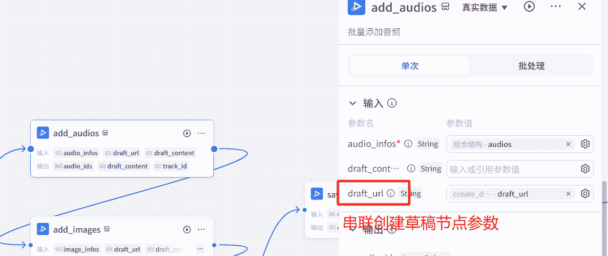

然后是链接添加图片的节点，同样draft_url为create_draft节点的输出参数。图片参数为前置代码处理后的输出结果。

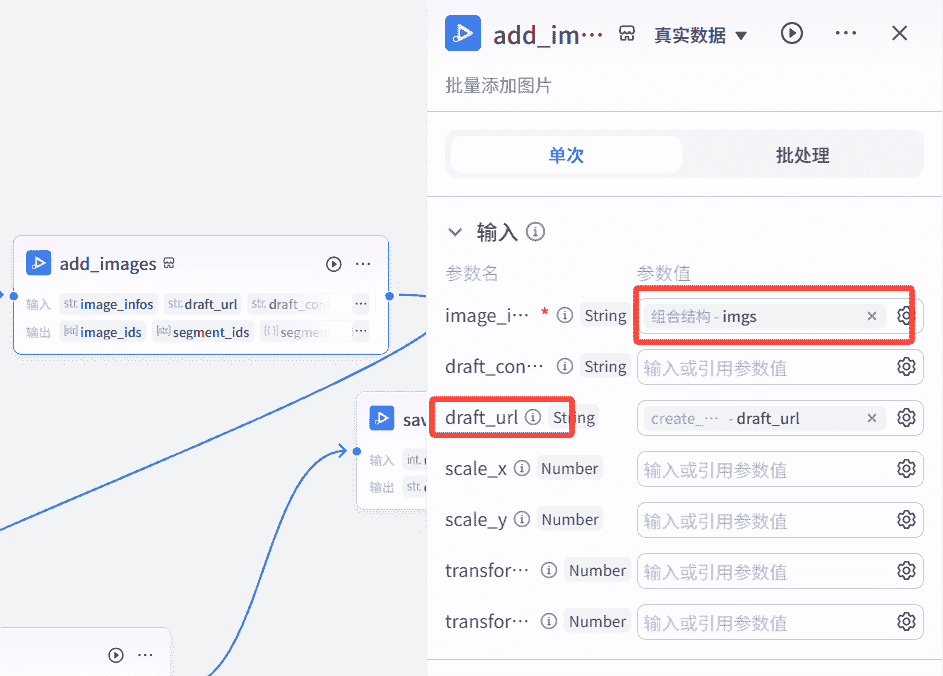

后是字幕设置，具体字幕的大小、缩放的数值，可先生成导出一版草稿后在剪映中二次调整后获取。

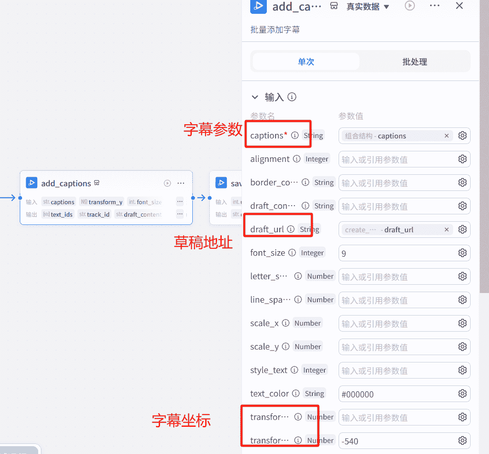

最后是保存草稿，返回参数有草稿的draft_url，最终我们使用的也是draft_url，记得保存下来

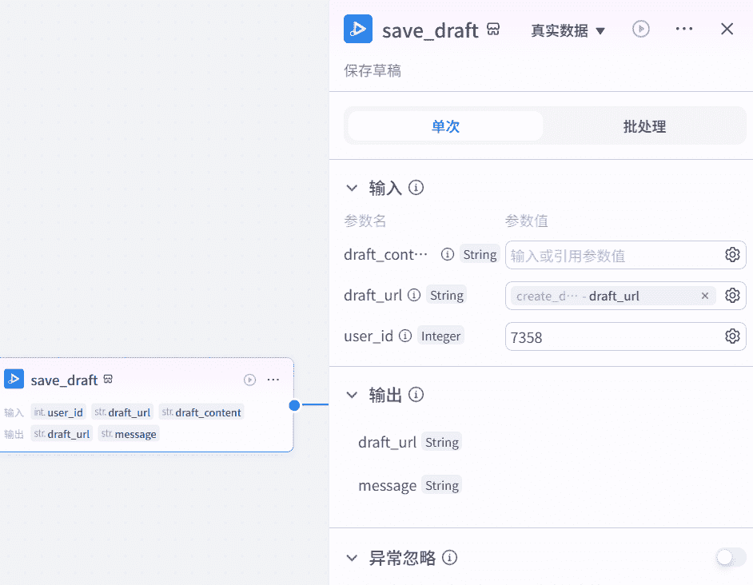

结束节点，可以输出草稿地址draft_url和其它所需信息。

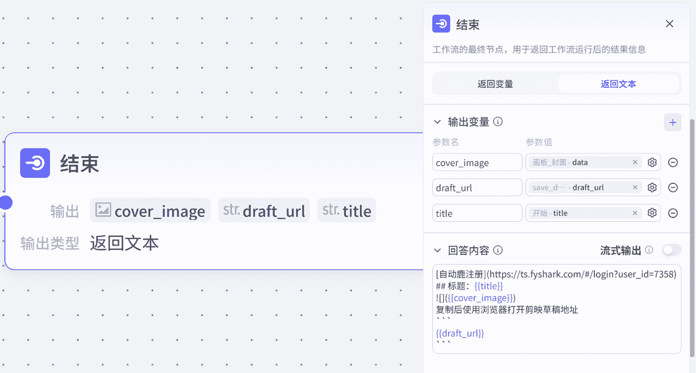

以上是我们剪映草稿工作流的完成搭建过程与细节说明。

试运行完成之后我们会获得draft_url，剪映草稿链接地址，复制下来即可。

文章用到的剪映小助手下载地址：[剪映小助手](https://ts.fyshark.com/#/login?user_id=7358)

安装完成后，在个人中心中，设置你本地剪映的草稿路径。

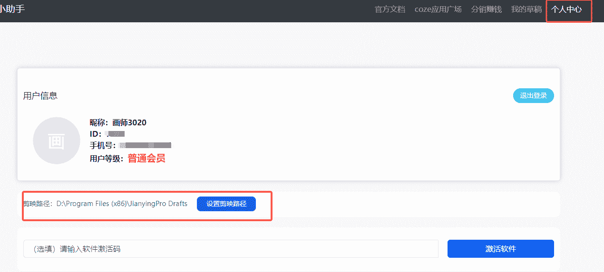

然后打开剪映小助手，点击创建剪映草稿。这样最终下载的文件会默认保存到剪映草稿下。

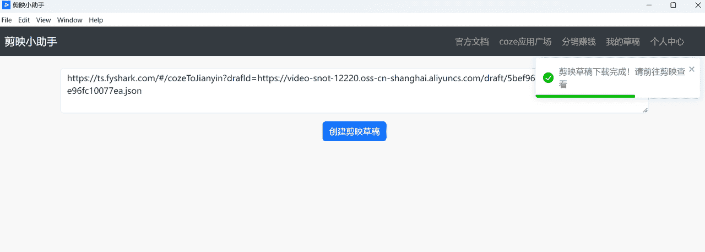

耐心等待资源下载完成

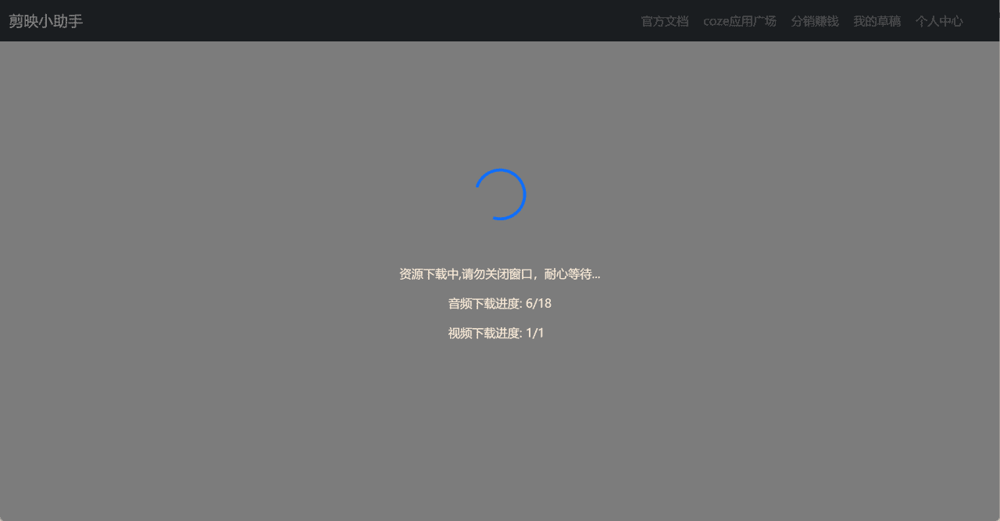

下载完成后我们会看到资源文件已经下载到了本地剪映草稿目录下。

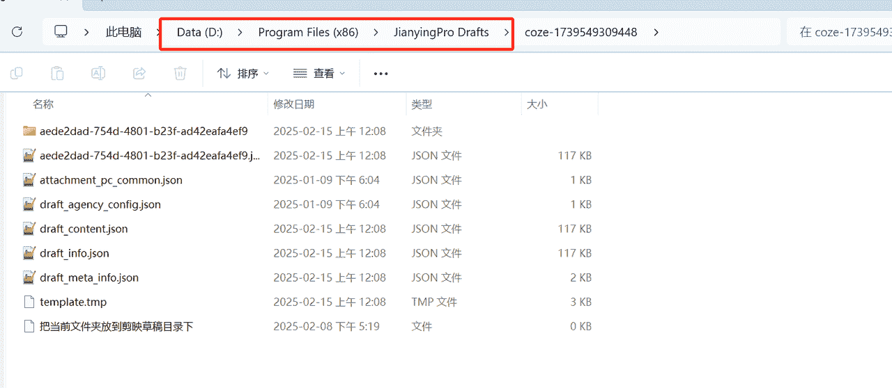

接下来，打开本地剪映软件，可以在草稿栏目中看到刚下载的记录，点击之后即可预览编辑。

如果没有看到这个黑色的草稿，可以关闭剪映后重新打开一次。

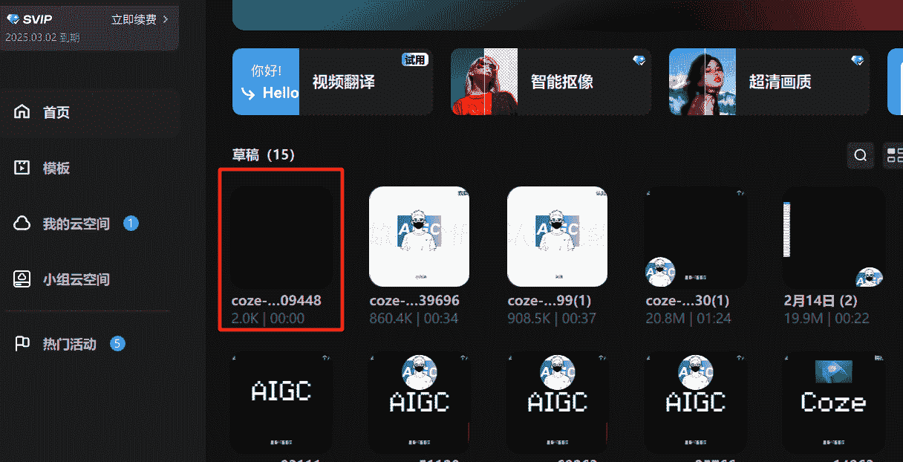

看下效果，素材轨道中可以看到音频、图片、字幕，可二次编辑调整。

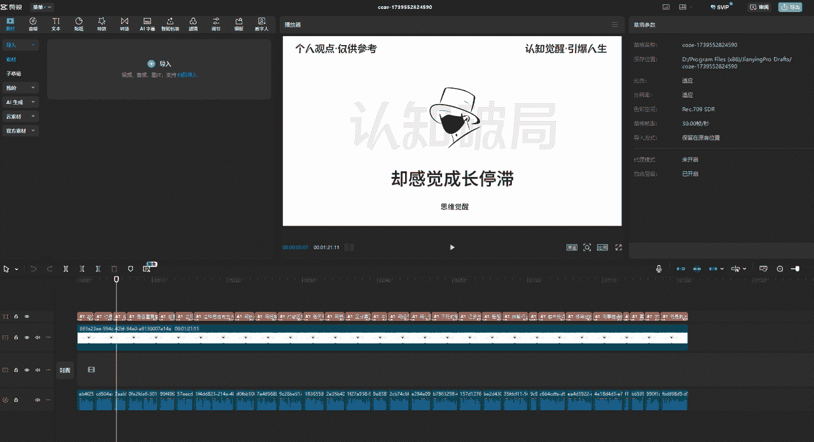

最后，点击剪映的导出视频，即完成最终的制作，来看下导出后的效果。


[coze-1739553279407.mp4](https://internal-api-drive-stream.feishu.cn/space/api/box/stream/download/all/SfzibWfPjorwIzxURHrc3uUTnUe)

**你如果对这套视频制作的方案感兴趣、有意向学习了解，也可关注**👸号“海涛AI智能体”。👏欢迎交流。

附：

自动鹿注册地址：https://ts.fyshark.com/#/login?user_id=7358

[剪映小助手下载](https://krxc4izye0.feishu.cn/wiki/SPgzwSCYyicTu8kw86hcgwaNnpg)册完成后下载剪映小助手客户端：

> 作者👸号：海涛AI智能体