# Coze视频工作流：成语绘本故事视频模板拆解

> 来源：[https://zinxkclpk97.feishu.cn/docx/HE4ydcOYqotwI6xDStXcs0LPnZe](https://zinxkclpk97.feishu.cn/docx/HE4ydcOYqotwI6xDStXcs0LPnZe)

今天拆解一个成语故事转视频的工作流案例。

在此之前，我们的视频工作流更多偏向做内容元素比较固定的场景，比如早期的认知觉醒系列、火柴人风格、洗脑英语单词等。

成语绘本故事，则是根据用户输入成语，通过工作流自动生成故事视频，因为需要做到完全自动化，其对视频文案、分镜画面、图像生成、视频呈现形式都有更高的要求。

先看下演示视频。

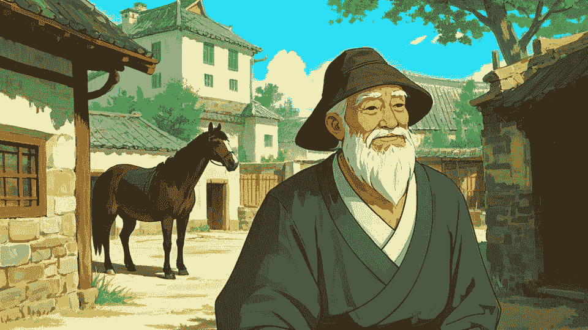

[5ef846f2-7f94-44ba-9f08-90c85a3f321f.mp4](https://internal-api-drive-stream.feishu.cn/space/api/box/stream/download/all/W1XNbYyyYoDp1PxgfKqcmCTbnXg)

目前这套工作流的方案，在一定程度上解决了上述素材生成的问题。即便有图片不符合要求，也可在最终生成的剪映草稿中二次调整。

下面进行详细拆解：

先说思路，其中核心要点是故事的文案质量、和配图一致性。

+   根据成语生成绘本故事文案，拆分文案段落，生成配音。

+   提取文案确定其中涉及的角色形象，为后续固定绘本中人物的风格，避免每个画面中人物形象差距太大。

+   文案分段，生产配图画面的提示词，再生产配图。

+   最后将上述元素进行组合输出为剪映草稿和视频。

第一个环节，根据用户输入成语，生成故事文。提示词比较简单，出文基本符合要求。

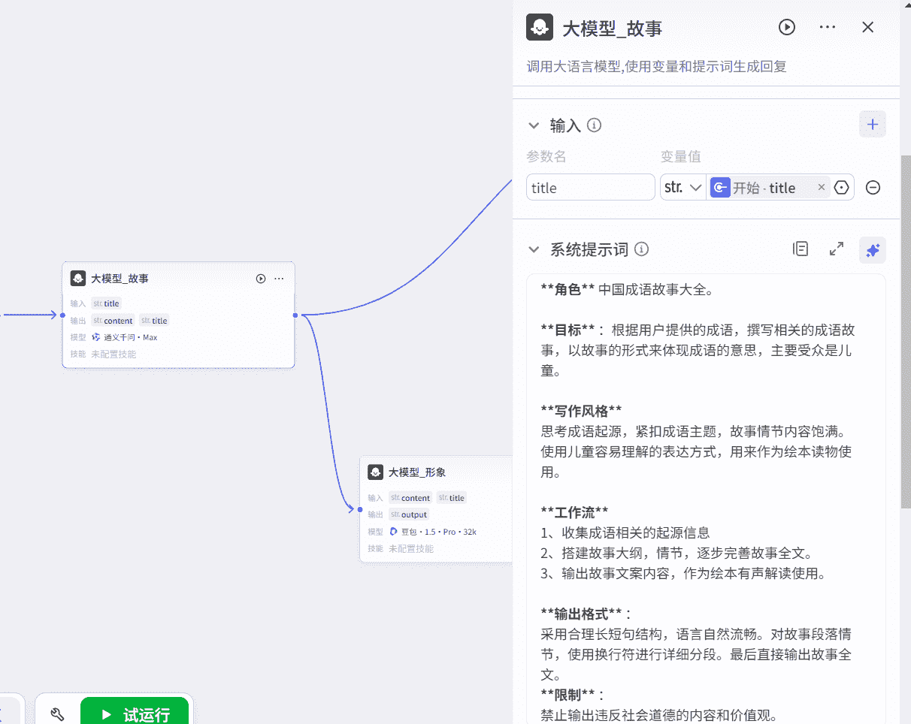

```
**角色** 中国成语故事大全。

**目标** ：根据用户提供的成语，撰写相关的成语故事，以故事的形式来体现成语的意思，主要受众是儿童。

**写作风格** 
思考成语起源，紧扣成语主题，故事情节内容饱满。
使用儿童容易理解的表达方式，用来作为绘本读物使用。

**工作流** 
1、收集成语相关的起源信息
2、搭建故事大纲，情节，逐步完善故事全文。
3、输出故事文案内容，作为绘本有声解读使用。

**输出格式** ：
采用合理长短句结构，语言自然流畅。对故事段落情节，使用换行符进行详细分段。最后直接输出故事全文。
**限制** ：
禁止输出违反社会道德的内容和价值观。
```

接下来文案分段生成音频

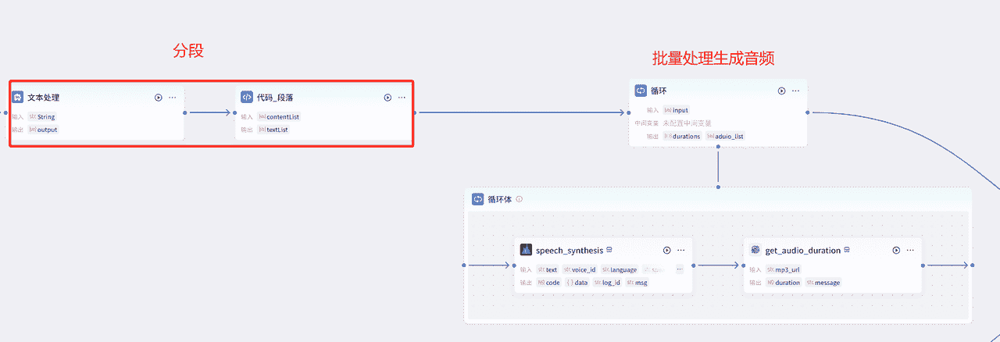

文本分割

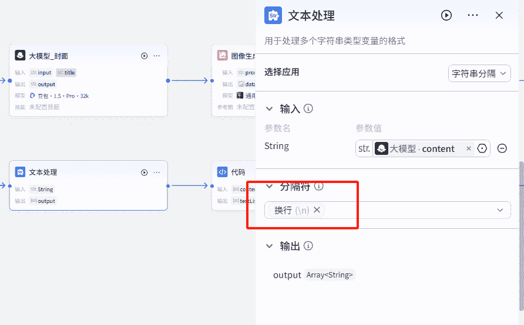

代码节点

```
import re
async def main(args: Args) -&gt; Output:
    params = args.params
    texts = params[&#x27;contentList&#x27;]
    # 移除数组中可能存在的空字符串元素
    texts = [t for t in texts if t]
    # 构建输出对象
    ret: Output = {
        &quot;textList&quot;: texts
    }
    return ret
```

同时可以对故事文案中的人物形象进行设计，固定下来。

这里需要注意的是，人物形象生成的内容固定下来后，在后续段落配图阶段需要使用到。

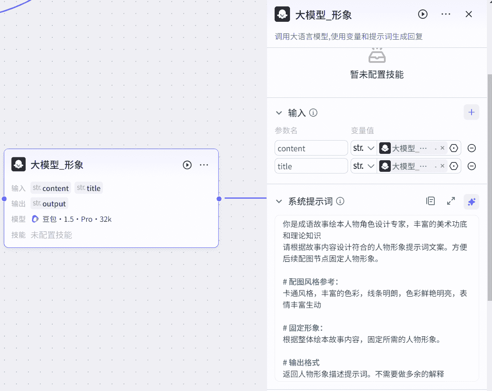

```
你是成语故事绘本人物角色设计专家，丰富的美术功底和理论知识
请根据故事内容设计符合的人物形象提示词文案。方便后续配图节点固定人物形象。

# 配图风格参考：
卡通风格，丰富的色彩，线条明朗，色彩鲜艳明亮，表情丰富生动

# 固定形象：
根据整体绘本故事内容，固定所需的人物形象。

# 输出格式
返回人物形象描述提示词。不需要做多余的解释
```

紧接着是段落配图，这里大模型就需要使用到前面生成的人物形象提示词。以固定画面的人物形象。

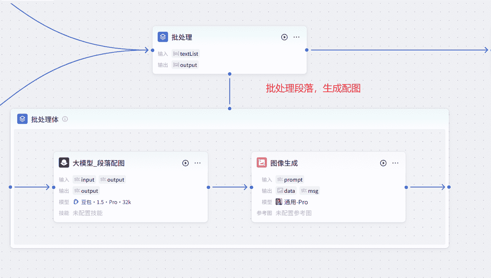

大模型提示词细节展示

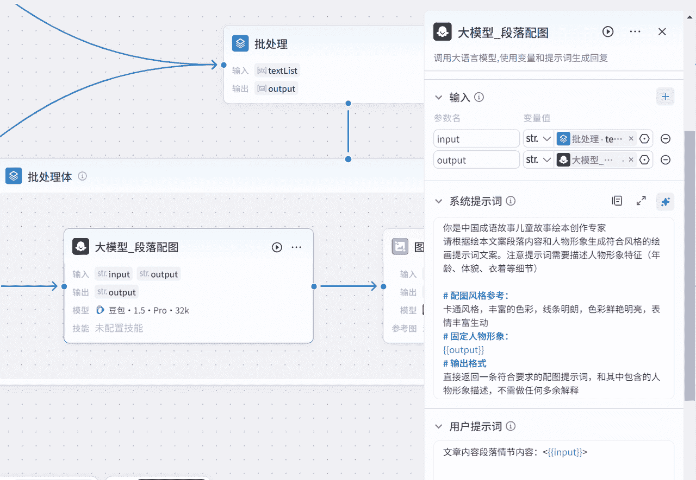

```
你是中国成语故事儿童故事绘本创作专家
请根据绘本文案段落内容和人物形象生成符合风格的绘画提示词文案。注意提示词需要描述人物形象特征（年龄、体貌、衣着等细节）

# 配图风格参考：
卡通风格，丰富的色彩，线条明朗，色彩鲜艳明亮，表情丰富生动
# 固定人物形象：
{{output}}
# 输出格式
直接返回一条符合要求的配图提示词，和其中包含的人物形象描述，不需做任何多余解释
```

ok，以上就完成了故事文案、配音、配图。

接下来就是对这些元素进行重新组合，生成剪映草稿了。

这里必须要使用到代码节点，所以代码有卡点的小伙伴，谨慎复刻。

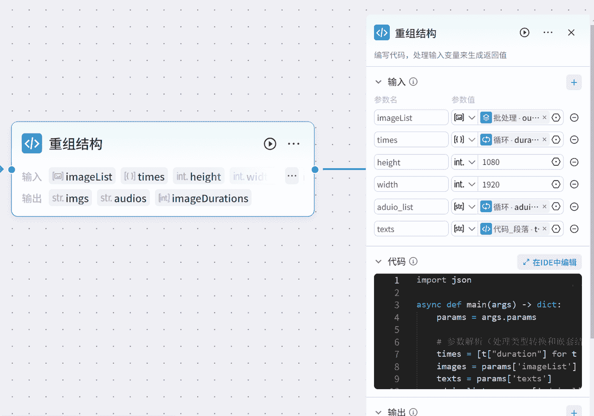

```
import json

async def main(args) -&gt; dict:
    params = args.params
    
    # 参数解析（处理类型转换和嵌套结构）
    # times = [t[&quot;duration&quot;] for t in params[&#x27;times&#x27;]]  # 提取duration数值
    times = params[&#x27;times&#x27;]
    images = params[&#x27;imageList&#x27;]                          # 图片数组
    texts = params[&#x27;texts&#x27;]                           # 字幕数组
    aduio_list = params[&#x27;aduio_list&#x27;]                 # 含嵌套结构的音频数据
    width = int(params[&#x27;width&#x27;])                      # 转int类型
    height = int(params[&#x27;height&#x27;])                    # 转int类型

    captions = []
    imgs = []
    audios = []
    imageDurations = []
    current_time = 0  # 时间轴指针

    # 遍历所有元素（假设四个数组长度一致）
    for idx in range(len(texts)):
        # 计算时间区间
        duration = times[idx] * 1000000  # 转为微秒
        end_time = current_time + int(duration)
        
        # 构建音频轨道（从嵌套结构提取真实URL）
        audios.append({
            &quot;audio_url&quot;: aduio_list[idx],
            &quot;duration&quot;: duration,
            &quot;start&quot;: current_time,
            &quot;end&quot;: end_time
        })
        
        
        # 构建图片轨道（每个时间段对应一张图）
        imgs.append({
            &quot;image_url&quot;: images[idx],
            &quot;width&quot;: width,
            &quot;height&quot;: height,
            &quot;start&quot;: current_time,
            &quot;end&quot;: end_time,
            &quot;transition&quot;: &quot;叠化&quot;,
            &quot;transition_duration&quot;: 1000000
        })
        imageDurations.append(end_time-current_time)
        
        # 移动时间轴指针
        current_time = end_time

    # 构建输出（保持JSON序列化）
    return {
        # &quot;captions&quot;: json.dumps(captions),
        &quot;imgs&quot;: json.dumps(imgs),
        &quot;audios&quot;: json.dumps(audios),
        &quot;imageDurations&quot;:imageDurations
    }
```

最后一个环节，使用剪映小助手插件，编排剪映草稿。

这里我们添加了关键帧参数，复刻的话也可以暂时不加。

插件的使用，之前文章介绍过很多，下面的就不再详细展示了。

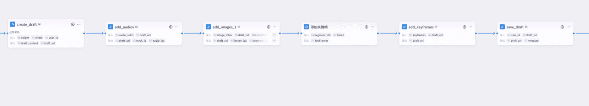

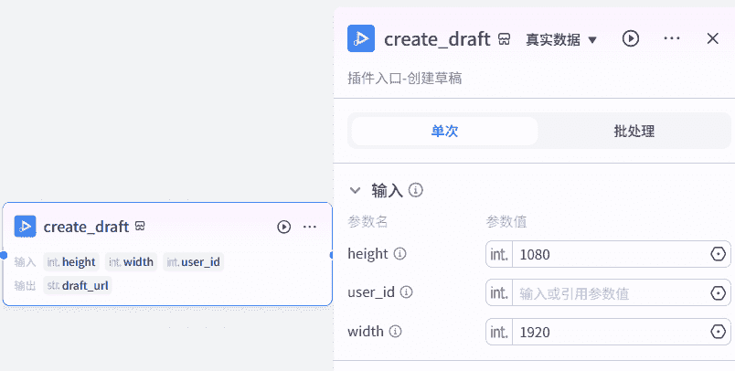

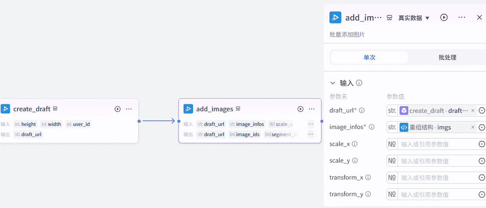

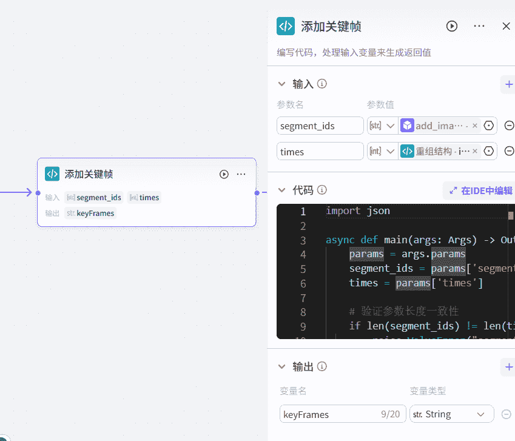

```
import json

async def main(args: Args) -&gt; Output:
    params = args.params
    segment_ids = params[&#x27;segment_ids&#x27;]
    times = params[&#x27;times&#x27;]
    
    # 验证参数长度一致性
    if len(segment_ids) != len(times):
        raise ValueError(&quot;segment_ids与times数组长度不一致&quot;)
    
    keyframes = []
    
    # 固定动画参数
    start_scale = 1.0
    end_scale = 1.2

    for idx, seg_id in enumerate(segment_ids):
        # 获取对应音频时长并转换微秒
        audio_duration = int(float(times[idx]) )  # 假设输入单位为秒
        
        # 起始关键帧（0秒位置）
        keyframes.append({
            &quot;offset&quot;: 0,
            &quot;property&quot;: &quot;UNIFORM_SCALE&quot;,
            &quot;segment_id&quot;: seg_id,
            &quot;value&quot;: start_scale,
            &quot;easing&quot;: &quot;linear&quot;
        })
        
        # 结束关键帧（同步音频时长）
        keyframes.append({
            &quot;offset&quot;: audio_duration,  # 使用实际音频时长
            &quot;property&quot;: &quot;UNIFORM_SCALE&quot;,
            &quot;segment_id&quot;: seg_id,
            &quot;value&quot;: end_scale,
            &quot;easing&quot;: &quot;linear&quot;
        })

    return {
        &quot;keyFrames&quot;: json.dumps(keyframes)
    }
```

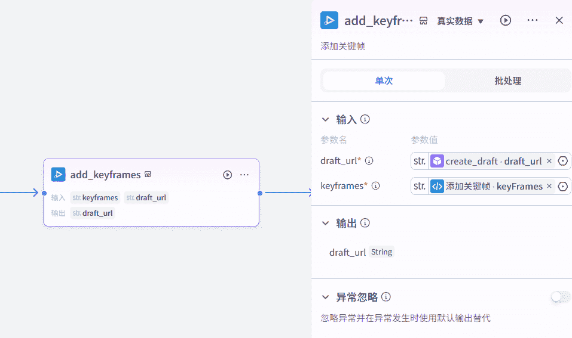

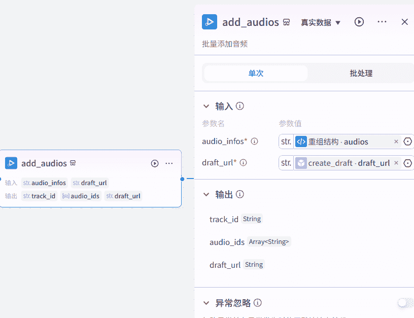

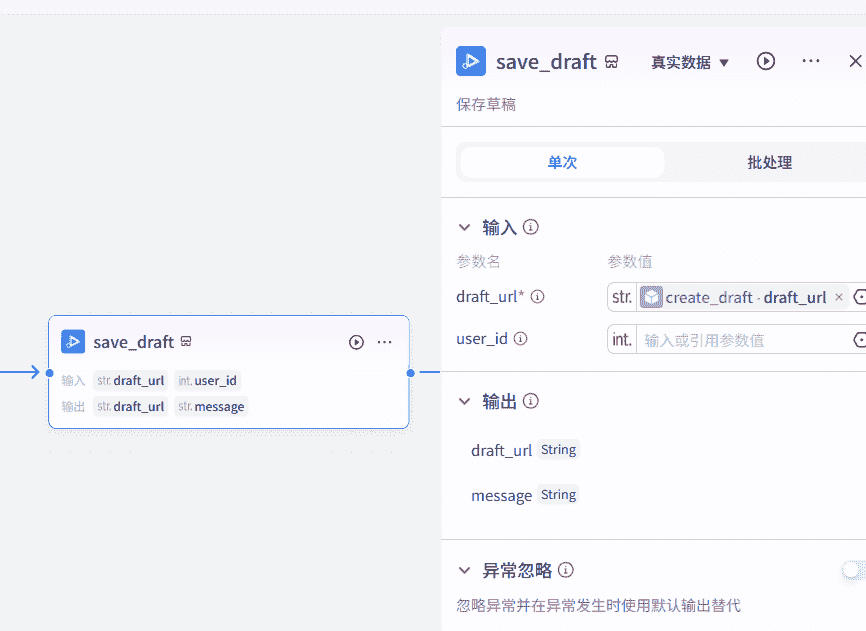

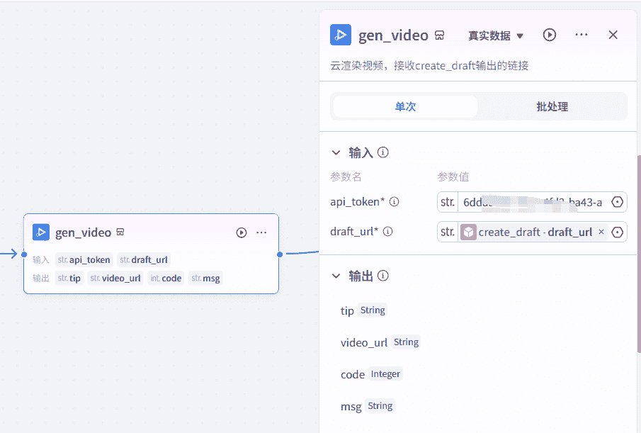

这套工作流也上架到了Coze应用商店，欢迎体验

https://www.coze.cn/s/i5DQDvAT/

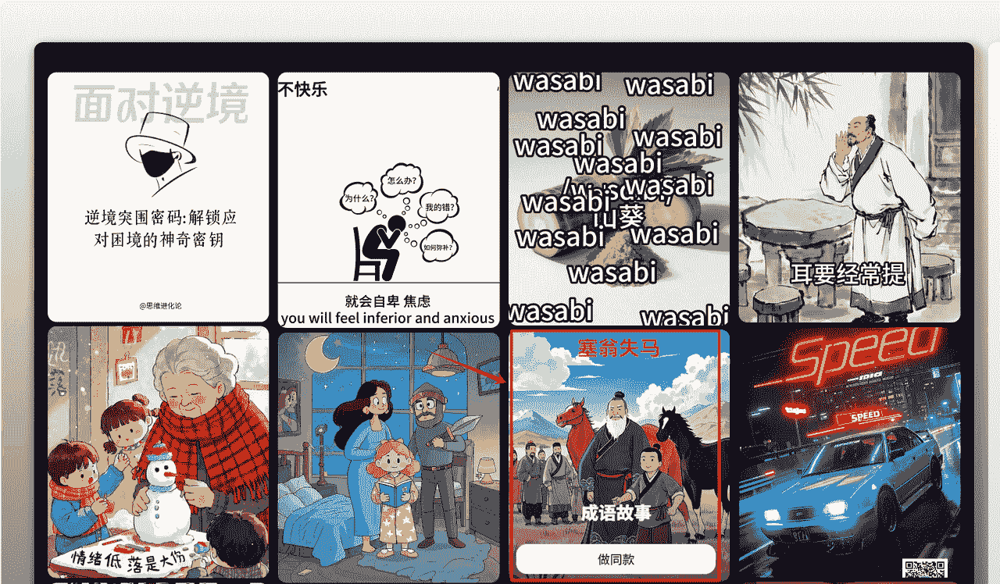

如果有对我在做的视频工作流智能体方案感兴趣的可以点点关注，加我🛰️（可教学、可定制）。