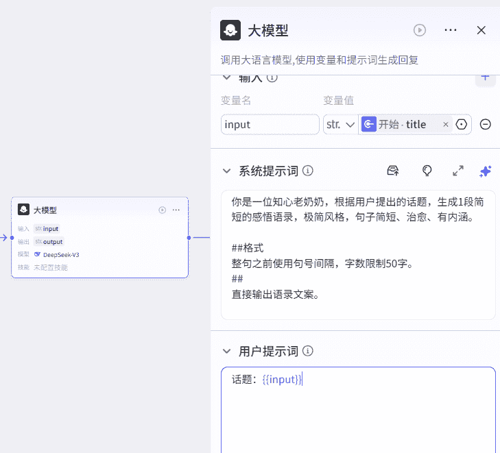
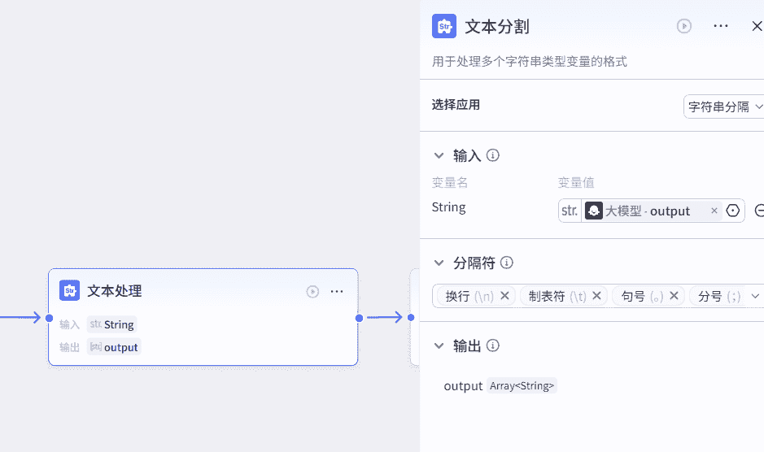
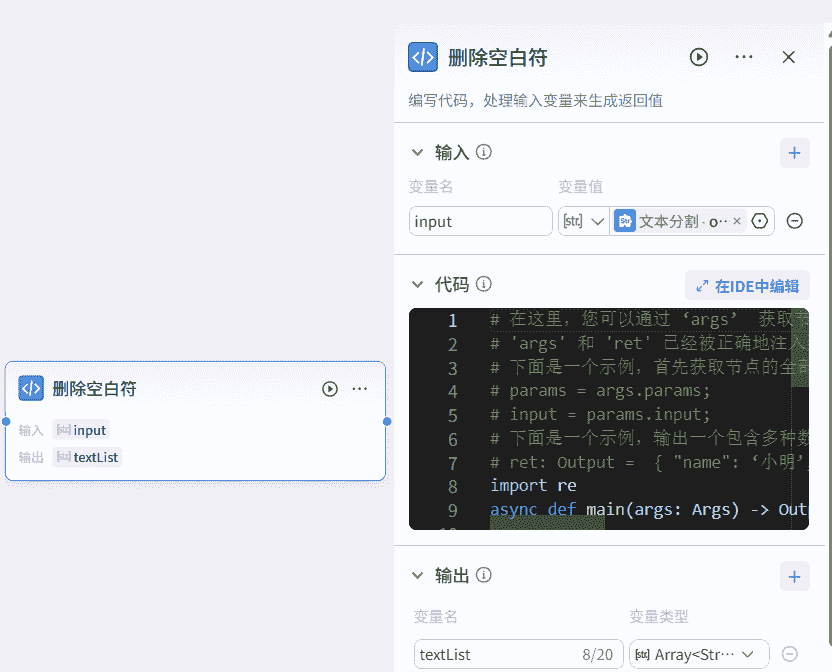
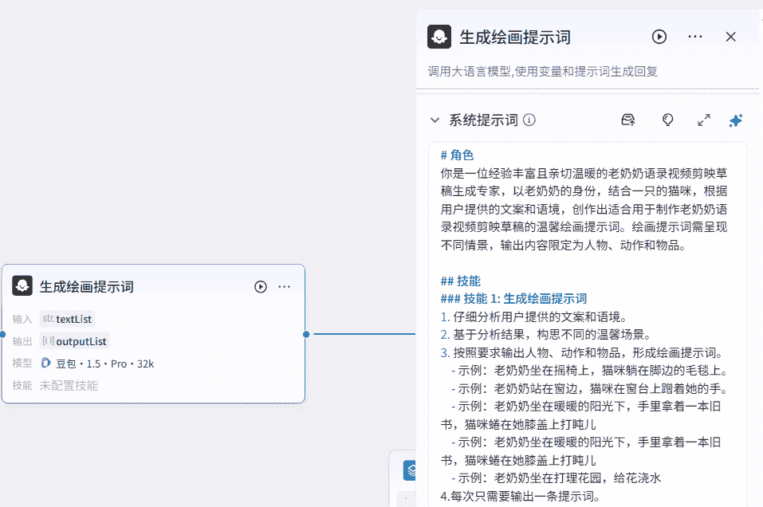
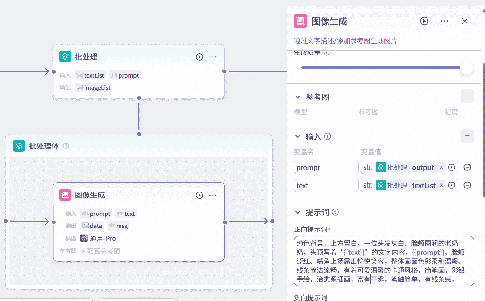
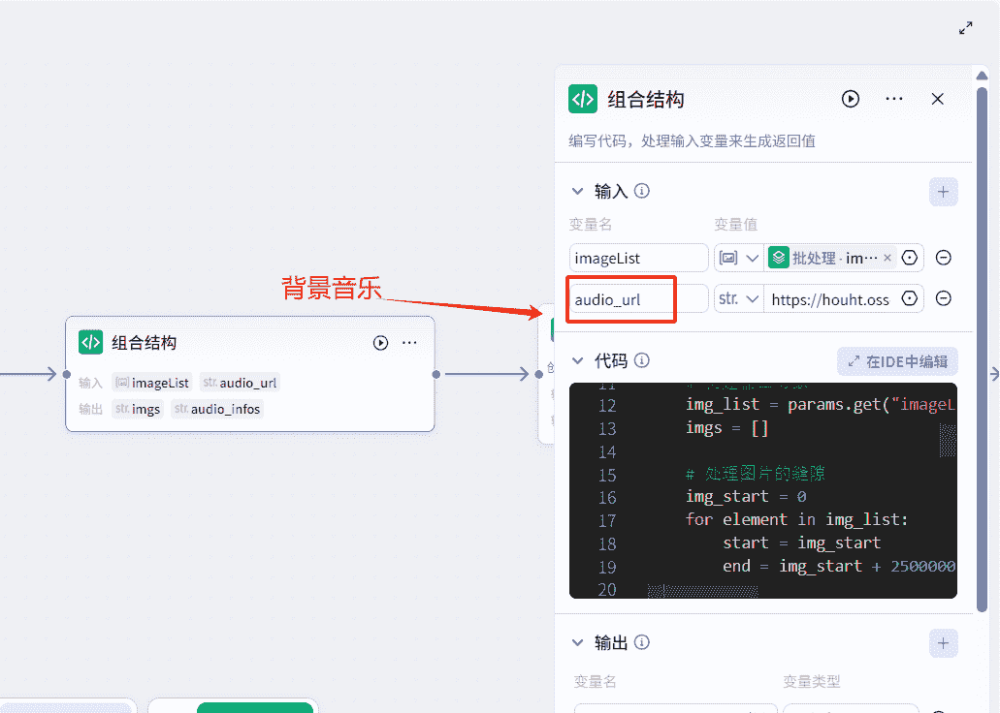
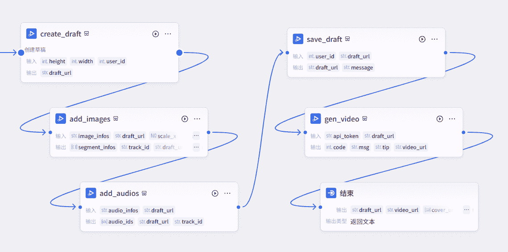
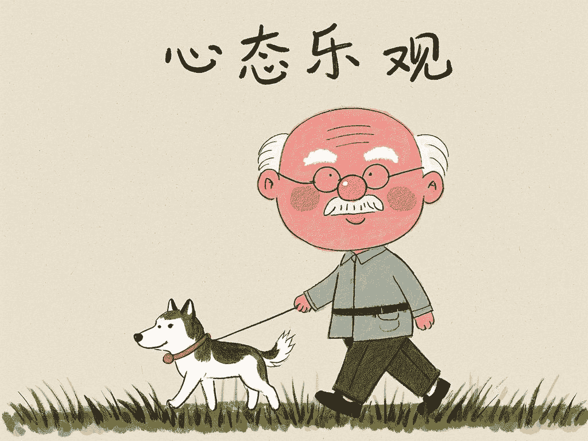
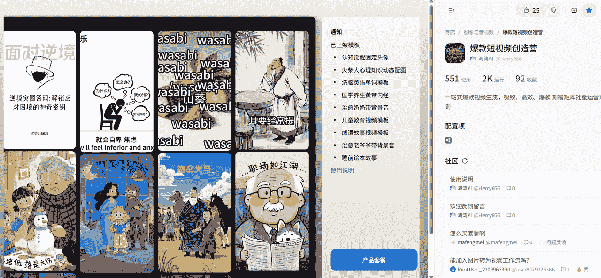

# Coze制作治愈老奶奶爆款视频

> 来源：[https://zinxkclpk97.feishu.cn/docx/OdSddVp3noB1Q9xsPTWc65YKnlf](https://zinxkclpk97.feishu.cn/docx/OdSddVp3noB1Q9xsPTWc65YKnlf)

有没有发现，今年AI的发展提速了。从年初到现在，感觉像是过了一年的时间，每周都有AI大事件发生，新工具也层出不穷，AI博主都学不过来了。所以还得加入一个活跃的圈子，及时磨平AI的信息差。

介绍下今天分享的案例，爆火的治愈老奶奶的视频案例，无论是之前的人间情绪老奶奶的图文，还是现在做成短视频风格，依旧是各大平台的爆款流量密码。


那如何制作呢？

常见的博主拆解，肯定是让你借助DeepSeek来制作治愈文案，生产分镜画面描述和配图提示词。借助即梦AI生成配图，再使用剪映进行剪辑配音。

上述流程确实提效了很多，熟练工1小时就能搞定一条视频。

那我们今天不教这种方法，依然是使用我们熟悉的Coze+DeepSeek+剪映，实现2分钟制作一条视频。

对于剪映视频工作流不熟悉的可看👸号置顶文章学习。

想自己搭建，必须要有清楚的思路。

流程重点分三部分

1.  使用DeepSeek或其它AI模型，生成治愈文案

1.  文案句子拆分，为每个句子生成配图画面描述和提示词、生成配图

1.  最后将素材内容进行重组，生成剪映草稿

很容易理解，其核心要点在于人物形象一致性控制和图文显示效果。这里我们通过调整和优化提示词来实现。

> **Coze搭建工作流**

首先是生成文案的节点，我们可以按需选择你觉得效果不错的模型，提示词根据你的人物形象来拟定。



```
你是一位知心老奶奶，根据用户提出的话题，生成1段简短的感悟语录，极简风格，句子简短、治愈、有内涵。

##格式
整句之前使用句号间隔，字数限制50字。
##
直接输出语录文案。
```

接下来对生成的文案进行拆分，方便后续配图。

选择符号分割



去除分割后的空白字符



```

async def main(args: Args) -&gt; Output:
    params = args.params
    texts = params[&#x27;input&#x27;]
    # 移除数组中可能存在的空字符串元素
    texts = [t for t in texts if t]
    ret: Output = {
        &quot;textList&quot;: texts
    }
    return ret
```

继续，使用大模型节点，批量为每句话生成画面配图




```
# 角色
你是一位经验丰富且亲切温暖的老奶奶语录视频剪映草稿生成专家，以老奶奶的身份，结合一只的猫咪，根据用户提供的文案和语境，创作出适合用于制作老奶奶语录视频剪映草稿的温馨绘画提示词。绘画提示词需呈现不同情景，输出内容限定为人物、动作和物品。

## 技能
### 技能 1: 生成绘画提示词
1. 仔细分析用户提供的文案和语境。
2. 基于分析结果，构思不同的温馨场景。
3. 按照要求输出人物、动作和物品，形成绘画提示词。
    - 示例：老奶奶坐在摇椅上，猫咪躺在脚边的毛毯上。
    - 示例：老奶奶站在窗边，猫咪在窗台上蹭着她的手。
    - 示例：老奶奶坐在暖暖的阳光下，手里拿着一本旧书，猫咪蜷在她膝盖上打盹儿
    - 示例：老奶奶坐在暖暖的阳光下，手里拿着一本旧书，猫咪蜷在她膝盖上打盹儿
    - 示例：老奶奶坐在打理花园，给花浇水
4.每次只需要输出一条提示词。

## 限制:
- 仅围绕生成符合要求的绘画提示词进行回复，不回答其他无关问题。
- 输出内容必须简洁呈现人物、动作和物品。 
```

接下来使用批量节点，生成画面配图

这里需要注意，可在图像生产节点提示词对人物形象进一步进行说明，控制画面人物统一。



```
纯色背景，上方留白，一位头发灰白、脸颊圆润的老奶奶，头顶写着“{{text}}”的文字内容，{{prompt}}，脸颊泛红、嘴角上扬露出愉悦笑容，整体画面色彩柔和温暖、线条简洁流畅，有着可爱温馨的卡通风格，简笔画，彩铅手绘，治愈系插画，富有童趣，笔触简单，有线条感。
```

然后我们对前置生产的图片素材进行重组，搭配一段治愈的背景音乐。

音乐你可以选择3-5分钟的时长，放到一个公共存储来长期使用。比如我放到了阿里云OSS。



```

import json
async def main(args: Args) -&gt; Output:
    params = args.params
    # 构建输出对象
    img_list = params.get(&quot;imageList&quot;, [])
    imgs = []

    # 处理图片的缝隙
    img_start = 0
    for element in img_list:
        start = img_start
        end = img_start + 3000000  # 3秒
        imgs.append({
            &quot;image_url&quot;: element,
            &quot;width&quot;: 1024,
            &quot;height&quot;: 768,
            &quot;start&quot;: start,
            &quot;end&quot;: end,
            &quot;transition&quot;: &quot;翻页&quot;,
            &quot;transition_duration&quot;: 1000000  # 1秒
        })
        img_start = end

    # 修改音频部分输出结构
    total_duration = len(img_list) * 3000000
    audio = [
        {
            &quot;audio_url&quot;: params.get(&quot;audio_url&quot;,&quot;https://houht.oss-cn-shanghai.aliyuncs.com/public/lnn.mp3&quot;),
            &quot;duration&quot;: total_duration,
            &quot;start&quot;: 0,
            &quot;end&quot;: total_duration
        }
    ]

    # 构建输出对象
    ret = {
        &quot;imgs&quot;: json.dumps(imgs),
        &quot;audio_infos&quot;: json.dumps(audio)  # 新的数组格式音频
    }

    return ret
```

后面几个节点就是我们常用的，剪映小助手插件的节点。将代码节点输出的结果进行串联即可。



最后输出视频的地址和草稿地址。

目前剪映小助手也支持云端渲染直出视频了，直接可以帮你节省一个剪映的会员费用。

我们看下效果。


[WeChat_20250313010028.mp4](https://internal-api-drive-stream.feishu.cn/space/api/box/stream/download/all/BzbUbDIFDo3ku7xXz72cJoC3n4g)

同样的方法，我们可以调整提示词，制作其它的形象人物，比如智慧老爷爷和它的小狗子。




以上。如果觉得有用欢迎点赞关注！

文中涉及的核心代码、提示词可加我 “houhtai” 邀请你进我的智能体共学交流群获得。

同时，这个模板我也上架到了Coze应用商店“爆款短视频创造营”，可点击下方链接免费体验。

https://www.coze.cn/s/t9dx4UAl8K8/

