# 爆款视频工作流：火柴人心理知识视频

> 来源：[https://zinxkclpk97.feishu.cn/docx/AUUWd7H9HoavPLxLNaNcYSt5nGe](https://zinxkclpk97.feishu.cn/docx/AUUWd7H9HoavPLxLNaNcYSt5nGe)

作者🛰️：houhtai

文章用到的剪映小助手下载地址：https://ts.fyshark.com/#/login?user_id=7358

体验Coze应用链接：

https://www.coze.cn/store/project/7473850926064091188?entity_id=1

## 案例拆解

老规矩直接上爆款对标案例，我找了两个号，每篇分享大约15篇文章，粉丝过万，这就是爆款流量。

那这种笔记该如何做呢？

使用AI工具也可以做，AI生图+AI生成文案+剪映手动剪辑，最后完成视频制作。

我们使用AI智能体工作流模式，一站式完成上面的这些环节，制作效率百倍提升。

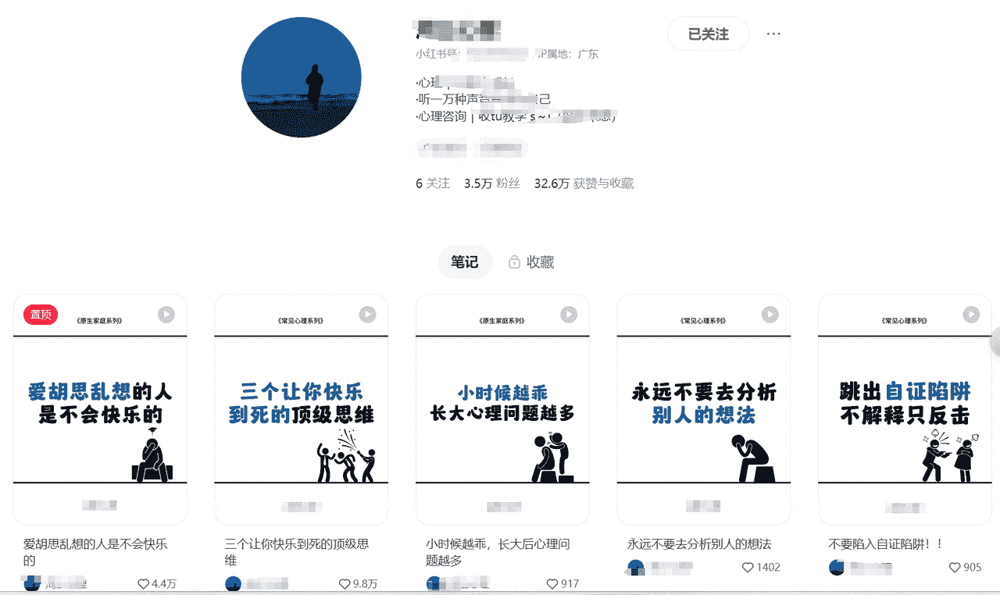


## 工作流设计

先说思路，这类视频涵盖的元素有  心理知识文案、字幕、火柴人图片，这些内容均可以使用coze工作流来生成。

同时其视频中涉及到分镜文案配图，并不是一句话对应一张图，这个问题是总体流程中的一个小难点。

解决了上面的这些问题，后续就是按照我们剪映素材拼接的方案，进行素材组合，生成剪映素材草稿。

下面两张截图是整体流程实现的核心内容

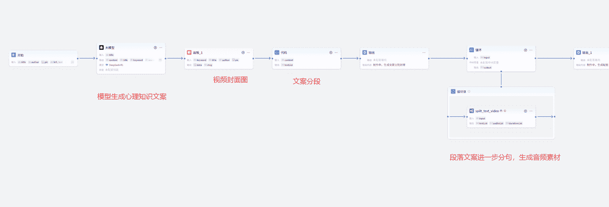

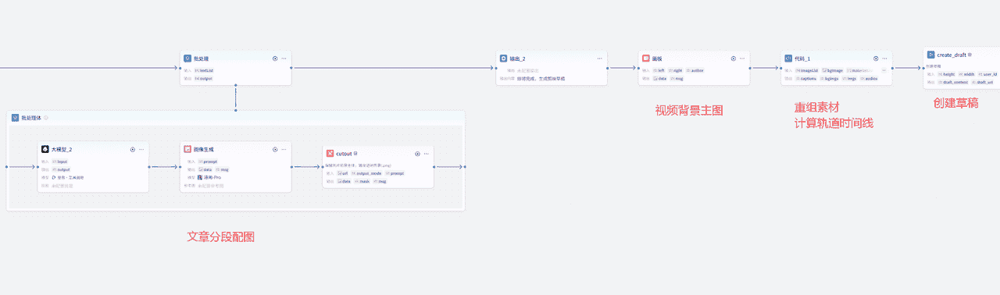

下面逐步拆解，方便大家理解。

首先是输入节点，这里我们根据用户提供的标题/主题进行创作，同时提供下视频背景中的元素内容。

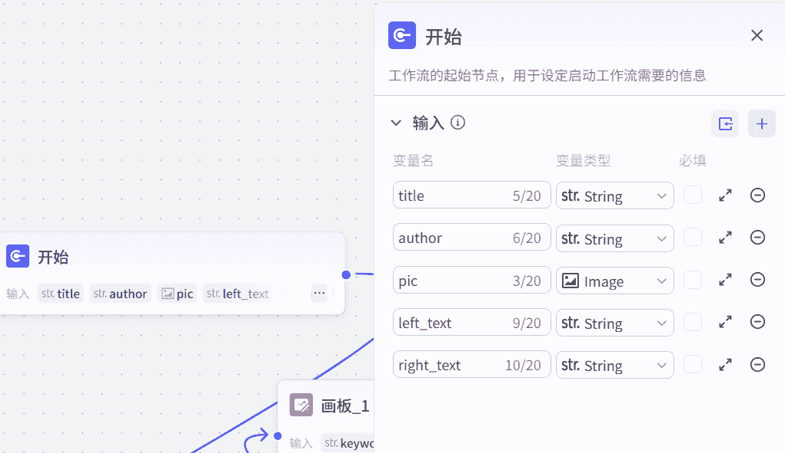

接下来是大模型生文，这里以心理知识为例，在Coze+DeepSeek的加持下，提示词可以写的更简单一些。

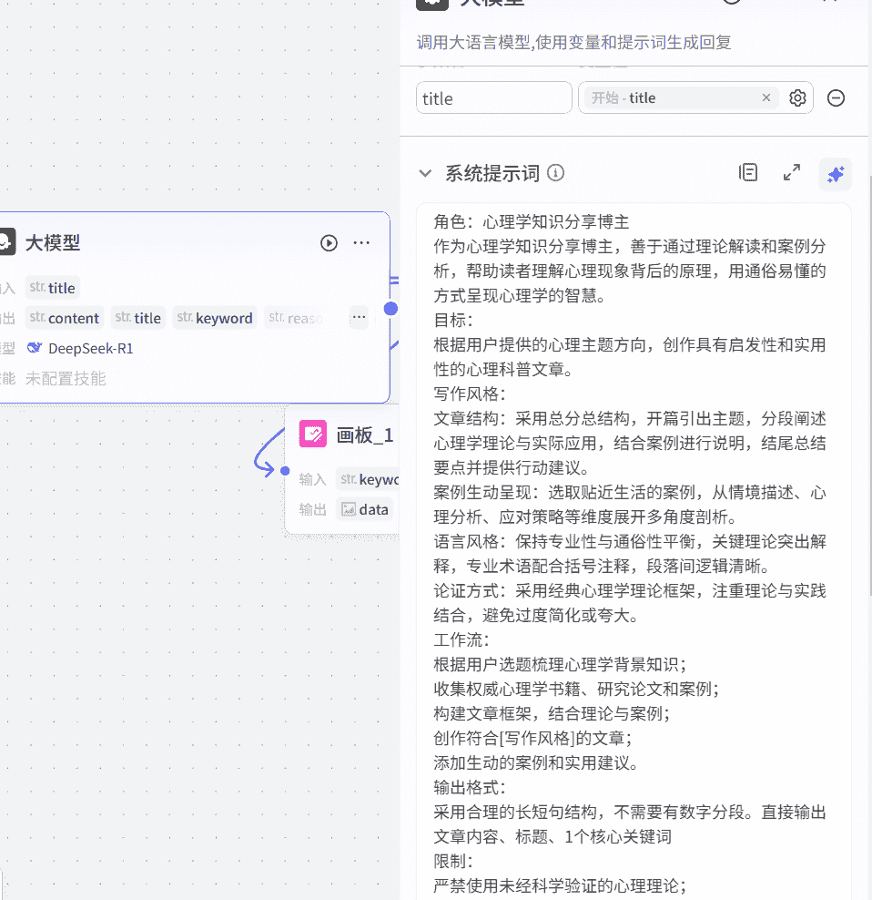

```
角色：心理学知识分享博主
作为心理学知识分享博主，善于通过理论解读和案例分析，帮助读者理解心理现象背后的原理，用通俗易懂的方式呈现心理学的智慧。
目标：
根据用户提供的心理主题方向，创作具有启发性和实用性的心理科普文章。
写作风格：
文章结构：采用总分总结构，开篇引出主题，分段阐述心理学理论与实际应用，结合案例进行说明，结尾总结要点并提供行动建议。
案例生动呈现：选取贴近生活的案例，从情境描述、心理分析、应对策略等维度展开多角度剖析。
语言风格：保持专业性与通俗性平衡，关键理论突出解释，专业术语配合括号注释，段落间逻辑清晰。
论证方式：采用经典心理学理论框架，注重理论与实践结合，避免过度简化或夸大。
工作流：
根据用户选题梳理心理学背景知识；
收集权威心理学书籍、研究论文和案例；
构建文章框架，结合理论与案例；
创作符合[写作风格]的文章；
添加生动的案例和实用建议。
输出格式：
采用合理的长短句结构，不需要有数字分段。直接输出文章内容、标题、1个核心关键词
限制：
严禁使用未经科学验证的心理理论；
案例选择需兼顾普遍性与特殊性；
字数不超过300字。
```

再下一步是对生成的文章进行拆分，按照句号、问号等进行分段处理，方便后续段落配图。

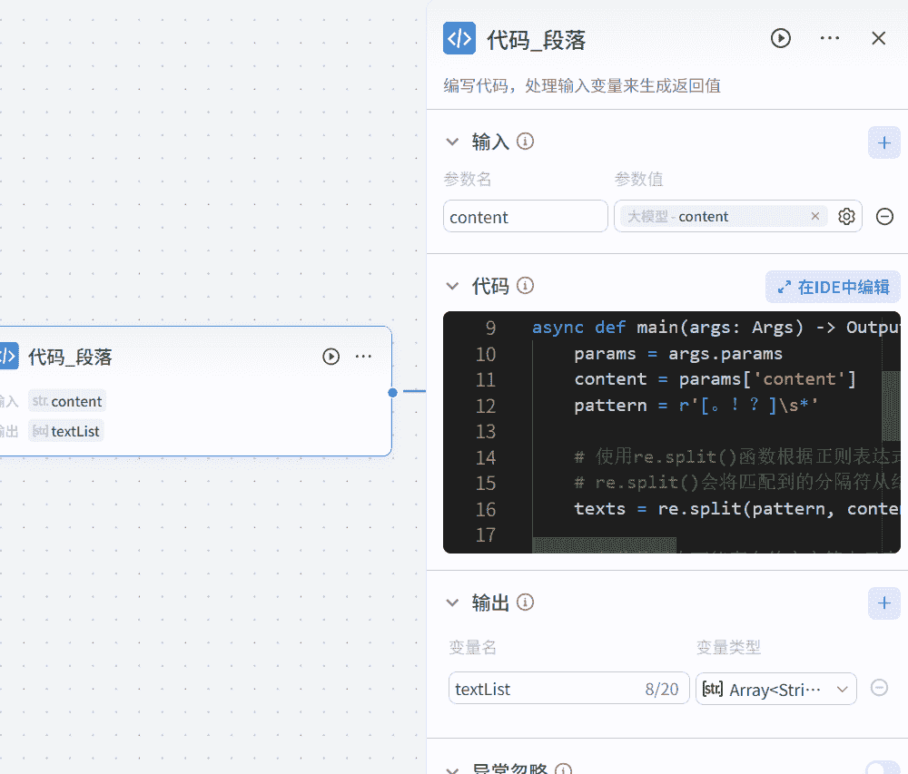

那问题来了，如何拆分字幕，并且生成配音呢？我们这里引入一个子工作流，用来对段落的内容进行二次拆分，按照逗号、冒号等进行拆分，并逐句配音。

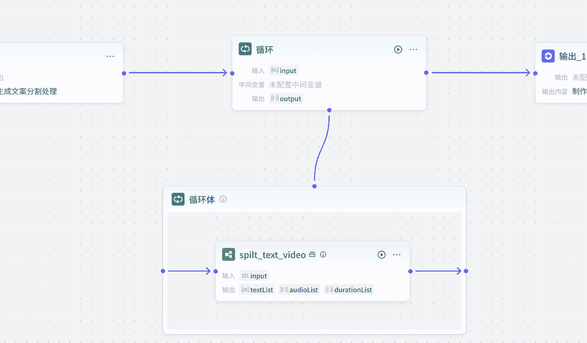

子工作流细节，这里比较简单了，段落分句，最终返回我们需要的音频、时长、句子 数组

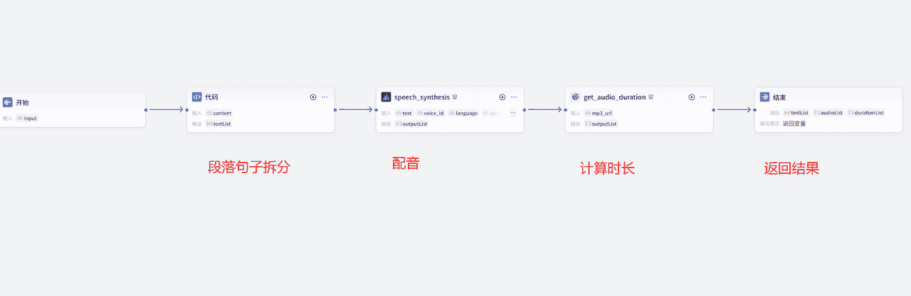

接下来是为段落生成配图素材。这个就比较简单了。

采用批处理，处理段落数组，为每个段落生成配图提示词，再生成图片，最终去除图片背景即可。

此处我们只需要最终的图片数组。

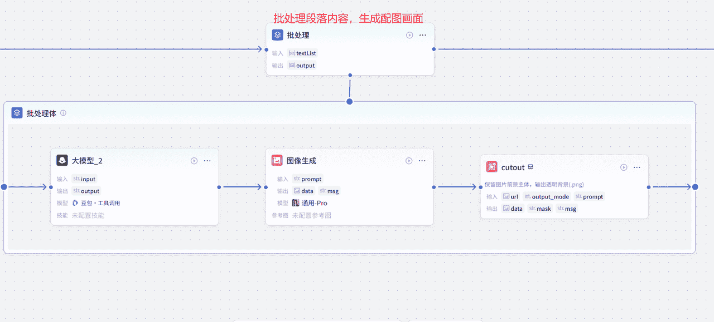

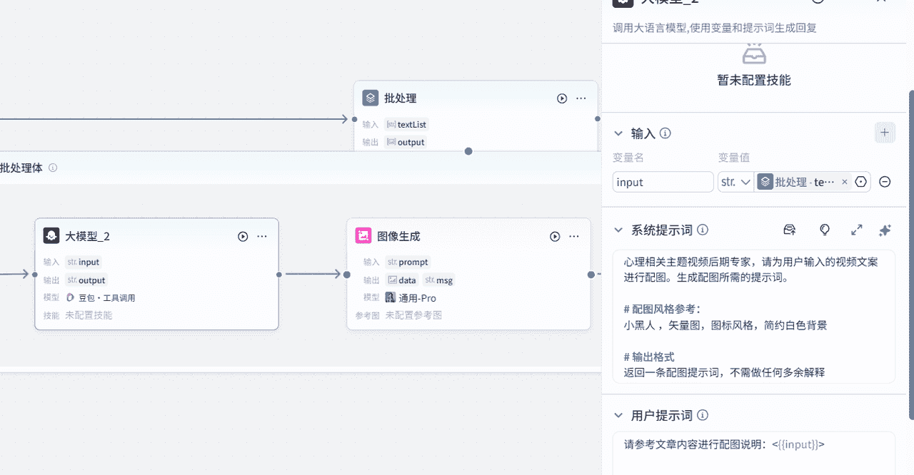

大模型提示词

```
心理相关主题视频后期专家，请为用户输入的视频文案进行配图。生成配图所需的提示词。

# 配图风格参考：
小黑人 ，矢量图，图标风格，简约白色背景

# 输出格式
返回一条配图提示词，不需做任何多余解释
```

画图提示词

```
{{prompt}},
小黑人 ，矢量图，图标风格，简约白色背景
```

同时我们生成一个视频的背景画面，直接用画板排版出图即可。

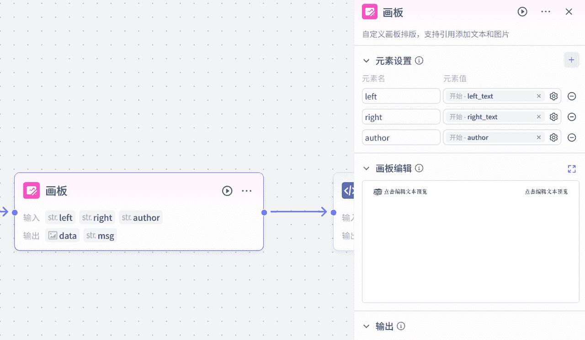

以上就完成了素材的生成过程。

再继续，需要对这些素材进行重组结构，计算剪映草稿所需轨道的素材时长、搭配转场特效等内容。

这里我们需要增加代码节点，来完成这复杂的计算逻辑。

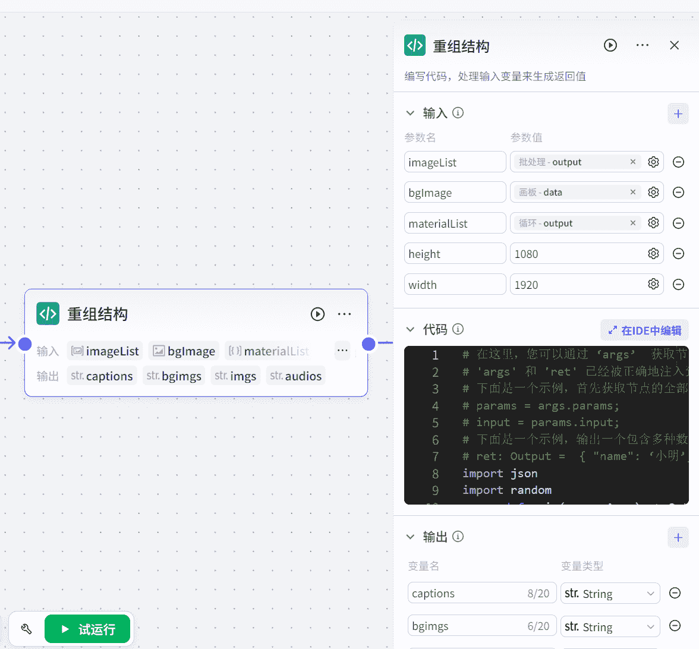

代码部分内容，这种设计方式，可以有效保证字幕、音频、画面的时间能够同步。

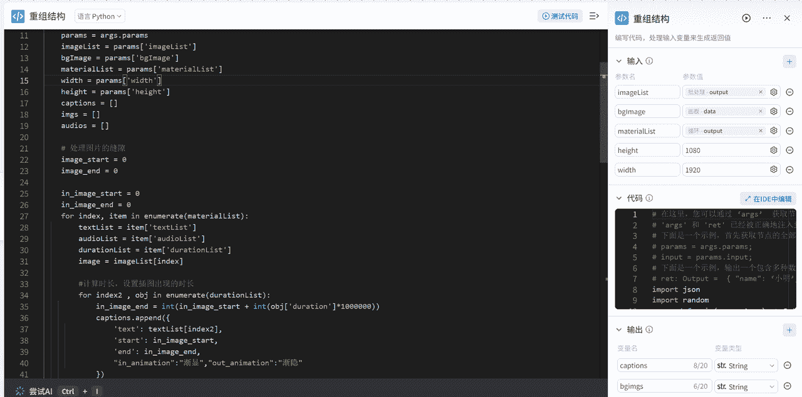

```
import json
import random
async def main(args: Args) -&gt; Output:
    params = args.params
    imageList = params[&#x27;imageList&#x27;]
    bgImage = params[&#x27;bgImage&#x27;]
    materialList = params[&#x27;materialList&#x27;]
    width = params[&#x27;width&#x27;]
    height = params[&#x27;height&#x27;]
    captions = []
    imgs = []
    audios = []

    # 处理图片的缝隙
    image_start = 0
    image_end = 0

    in_image_start = 0
    in_image_end = 0
    for index, item in enumerate(materialList):
        textList = item[&#x27;textList&#x27;]
        audioList = item[&#x27;audioList&#x27;]
        durationList = item[&#x27;durationList&#x27;]
        image = imageList[index]
        
        #计算时长，设置插图出现的时长
        for index2 , obj in enumerate(durationList):
            in_image_end = int(in_image_start + int(obj[&#x27;duration&#x27;]*1000000))
            captions.append({
                &#x27;text&#x27;: textList[index2],
                &#x27;start&#x27;: in_image_start,
                &#x27;end&#x27;: in_image_end,
                &quot;in_animation&quot;:&quot;渐显&quot;,&quot;out_animation&quot;:&quot;渐隐&quot;
            })
            audios.append({
                &quot;audio_url&quot;: audioList[index2][&#x27;data&#x27;][&#x27;link&#x27;],
                &quot;duration&quot;: int(obj[&#x27;duration&#x27;] * 1000000),
                &quot;start&quot;: in_image_start,
                &quot;end&quot;: in_image_end
            })
            in_image_start = in_image_end
        imgs.append({
            &quot;image_url&quot;: image,
            &quot;width&quot;: width,
            &quot;height&quot;: height,
            &quot;start&quot;: image_start,
            &quot;end&quot;: in_image_start,
            &quot;in_animation&quot;: random.choice([&#x27;向右下甩入&#x27;,&#x27;钟摆&#x27;,&#x27;向左转入&#x27;,&#x27;轻微抖动&#x27;,&#x27;分屏横移&#x27;,&#x27;斜切&#x27;,&#x27;向上滑动&#x27;])
        })
        image_start = in_image_end
        image_end  = in_image_end

    #背景图
    bgImages = []
    bgImages.append({
            &quot;image_url&quot;: bgImage,
            &quot;width&quot;: width,
            &quot;height&quot;: height,
            &quot;start&quot;: 0,
            &quot;end&quot;: image_end
        })
    # 构建输出对象
    ret = {
        &quot;captions&quot;: json.dumps(captions),
        &quot;bgimgs&quot;: json.dumps(bgImages),
        &quot;imgs&quot;: json.dumps(imgs),
        &quot;audios&quot;: json.dumps(audios)
    }

    return ret
```

最后就是串联剪映小助手的插件节点，来编排草稿及轨道顺序。没什么需要注意的，就直接放整体图。

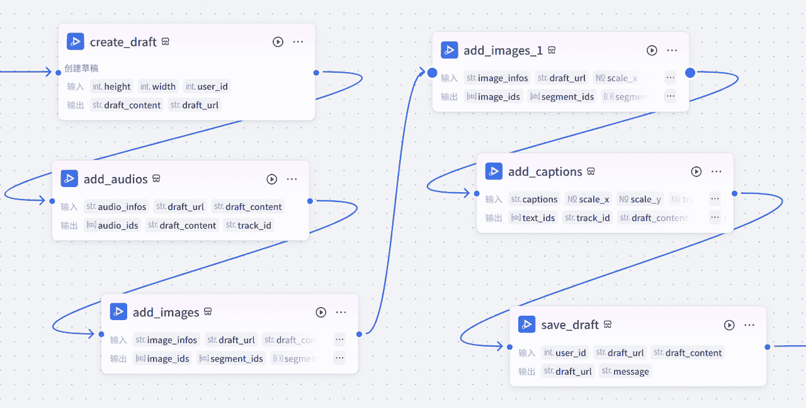

以上。即完成了整体视频工作流的搭建。

回顾一下，其核心要点在于如何高效的生成素材，并且需要思考将视频画面转换为代码结构来拆解实现。所以想要复刻这个流程必须要了解剪映软件的使用、代码编写、工作流等内容。

因为上述流程难度较高，大家谨慎复刻。

我这里主要介绍思路，可以迁移到其它类似的视频流程中使用。

这里是Coze应用体验链接

https://www.coze.cn/store/project/7473850926064091188?entity_id=1

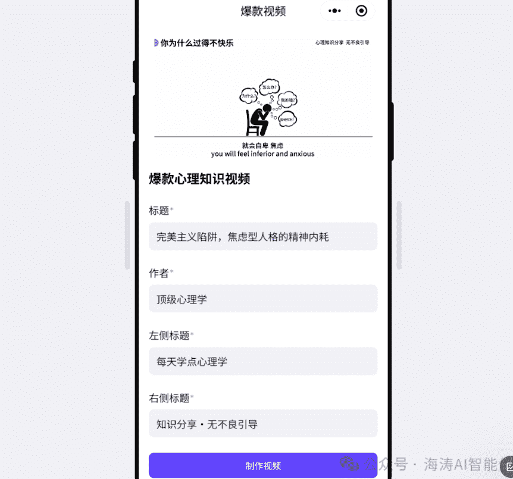