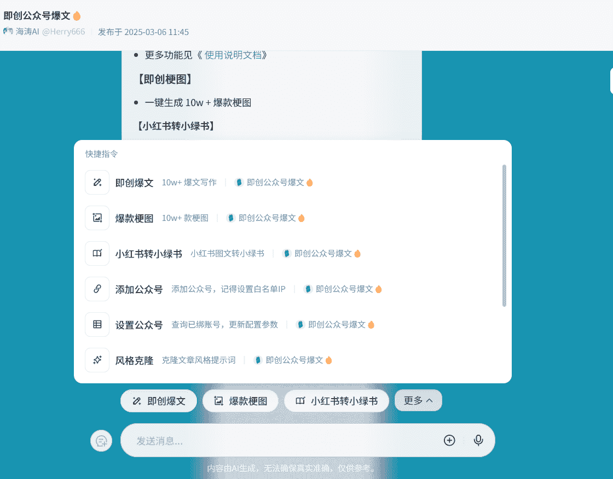
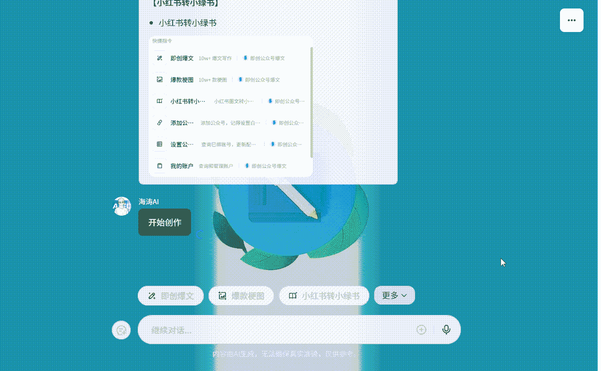
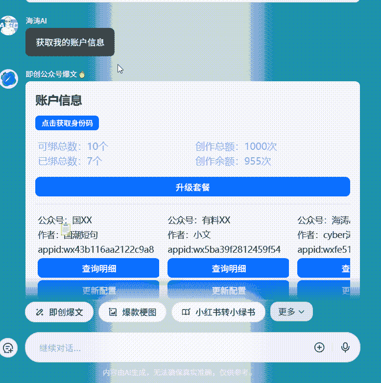
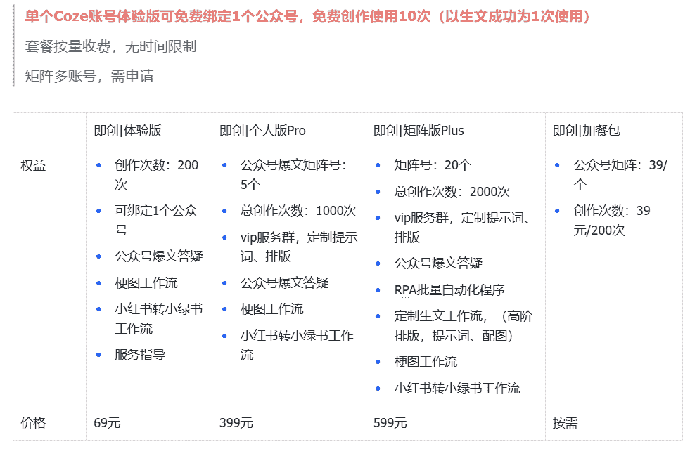

# 用Coze写👸号+梗图+小绿书，用一个智能体就够了

> 来源：[https://zinxkclpk97.feishu.cn/docx/DMhjddclJoLnySxp2eXc02ObnKh](https://zinxkclpk97.feishu.cn/docx/DMhjddclJoLnySxp2eXc02ObnKh)

> 有不少小伙伴对使用Coze搭建👸号写作的工作流感兴趣，搭建方法我在之前的文章中也做了分享。

> 如果你也在为写👸号而烦恼，不知道如何AI提效，那一定仔细阅读下面内容，这是你不可错过的一款写作智能体。

有不少小伙伴在使用我的👸号智能体产品：即创👸号爆文。

今天详细介绍下这款智能体产品的功能，感兴趣的小伙伴可以体验。

先贴一下主页截图，可以看到使用入口是采用快捷指令的方式。目前已经支持了👸号长文、爆款梗图、📕转小绿书等创作形式。

点击即创报文，可以看到创作界面，非常直观简洁。支持多账号矩阵管理，文章仿写二创、观点创作等写作模式。

爆款梗图，主体角色、话题可自行定义，更加灵活。

爆款📕一键转小绿书，想追热点，还得用它。

多账号管理，自定义创作风格，丰富的排版格式，自动化排版，使用非常丝滑。

对标账号风格一键克隆，送给不会写提示词的你。

账户资源额度管理，多账号管理。

同时也提供了多种可选套餐包，满足不同的使用者需求，感兴趣的可以先选购一款基础的套餐，体验下。

更多功能关注👸号后台回复关键词“即创”，获取说明书+视频操作讲解。

体验链接：

https://www.coze.cn/s/i5qRPtTA/

还有不少小伙伴咨询，是否有Coze工作流的分享，如果你想自己复刻学习可后台回复“加群”，进入智能体共学交流群。