# Coze制作AI口播数字人

> 来源：[https://zinxkclpk97.feishu.cn/docx/KCkJdEhufob7W5xDbNVcOa77nhg](https://zinxkclpk97.feishu.cn/docx/KCkJdEhufob7W5xDbNVcOa77nhg)

> 使用Coze工作流，不需要出镜拍摄，输入口播文案，即可生成数字人视频。

> 工作流使用到的数字人插件在文末获取

最近很多小伙伴在问，能否用Coze实现数字人的制作流程。今天我们以个人口播数字人为例，带大家一步步学习。

Coze官方是没有提供数字人插件，我们就要在三方插件中进行选择。今天案例使用的是飞影数字人插件。当然后续我也会继续评测其它插件，横向对比下效果、稳定性、价格等因素。

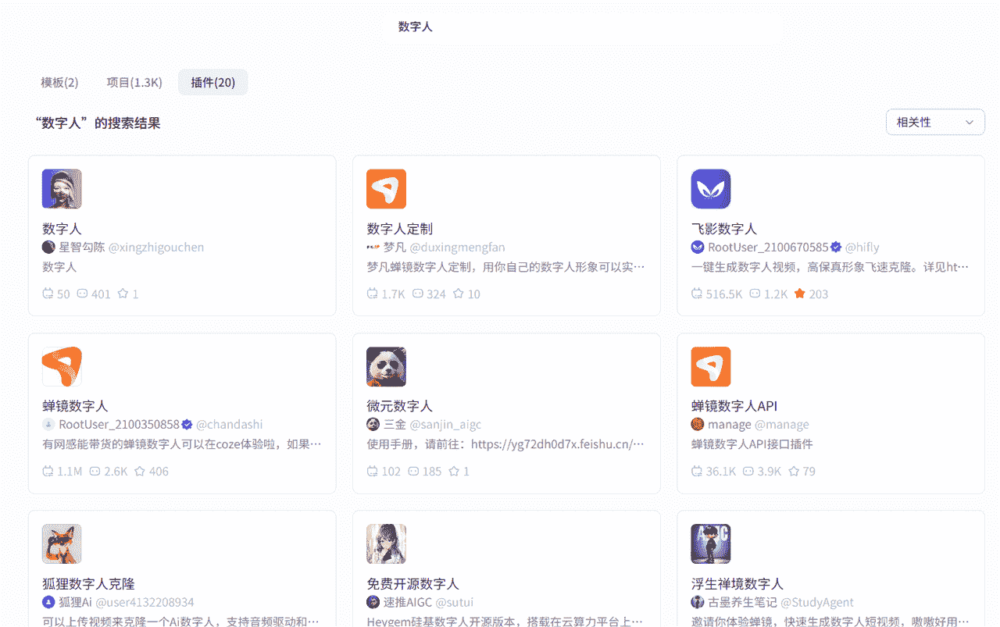

在我们自己选择插件的时候，也可从调用量、成功率、执行时间、发布时间等因素进行初步判断。

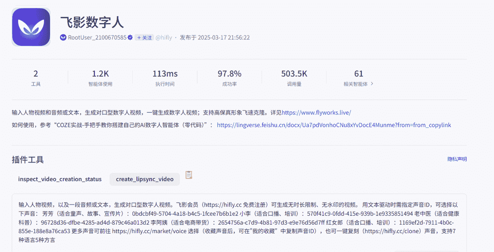

使用前，先熟悉下插件的参数说明，重点关注hifly_id和speaker_id

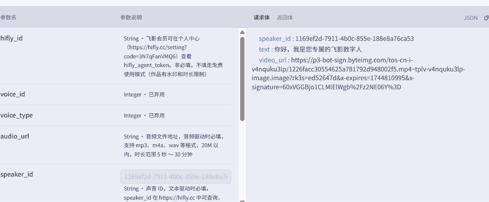

其中hifly_id是注册飞影后，在个人中心查看获得，对于的是hifly_agent_token

speaker_id是在声音克隆中查看获得，这里我们默认使用官方的音色。

如何克隆自己的音色，可以继续往后看。

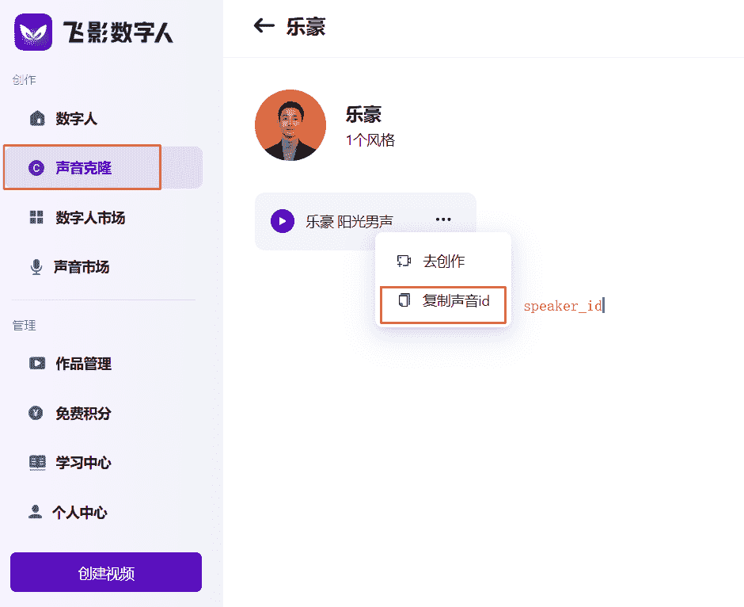

接下来我们还需要准备一小段自己的口播视频。自己提前录制好一段15-20s的视频。

人物正面视频，背景尽量整洁干净，可以适当增加手部动作。

你也可以参考下面的这两段文案进行录制，口齿清晰正确的阅读即可。

> 123，123,1234567，123,1234567，123,1234567

> 亲爱的听众朋友们，早上好呀！此刻，阳光正透过窗帘的缝隙，温柔地洒在你的脸上。新的一天开始了，让我们带着满满的活力，去迎接每一个小确幸吧。无论生活多么忙碌，别忘了给自己一个微笑，因为美好，就在身边。

需要注意视频不要太长，目前coze的视频上传限制是20MB。

补充视频示例

### Coze搭建工作流

先看下整体内容，这里演示了文案驱动和音频驱动两种方式，也是这款数字人插件目前所支持的。

[c3_meta_human - 工作流 -智能体平台.pdf](https://internal-api-drive-stream.feishu.cn/space/api/box/stream/download/all/WFWVboRzNoptx3xQxKKcScpun6c)

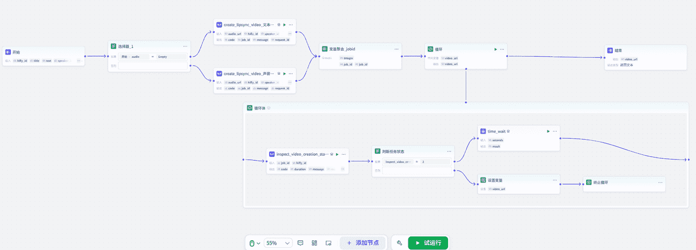

开始节点参数的设定，hifly_id和speaker_id我们前面已经提前准备好了，直接复制使用即可。

text和audio参数，分别代表文本驱动和音频驱动，我们在实际使用时二选一。

video则是我们自己提前录制好的一段口播视频素材

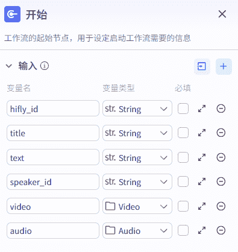

下一步，创建数字人制作的任务。

这里的设计技巧，根据audio参数来判断是使用音频驱动还是文本驱动，最后将插件输出的结果进行变量聚合，二选一。

如果你只使用文本驱动，则可以把选择器和变量聚合阶段省略掉，保留一个数字人插件节点即可。

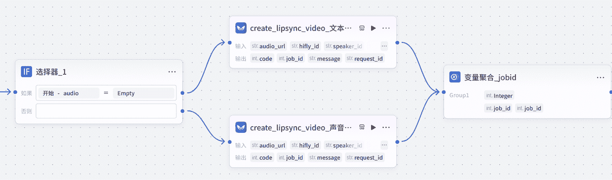

两个分支数字人插件参数设置如下，注意audio_url和text的参数区分。

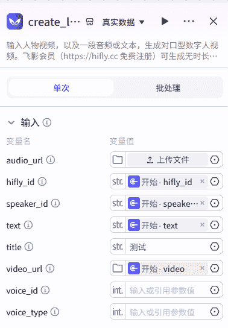

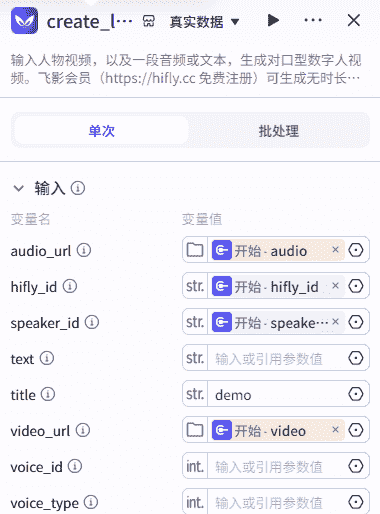

继续，数字人任务创建完成后，我们会拿到一个job_id参数，所以后续对上述两个节点进行了聚合操作。

因为数字人制作时间较长，采用的是云端异步生成，所以我们需要使用任务查询插件，查看任务状态。

引入无限循环节点，将任务查询的动作放到循环内执行，并添加时间延时，直到任务执行完成后，终止此循环。

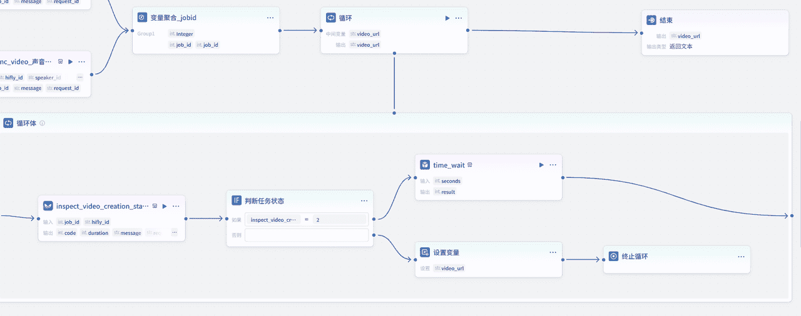

循环节点，添加中间变量video_url，用于接收最后生成的数字人视频。

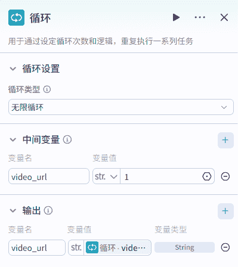

使用任务查询工具，获取任务执行状态。

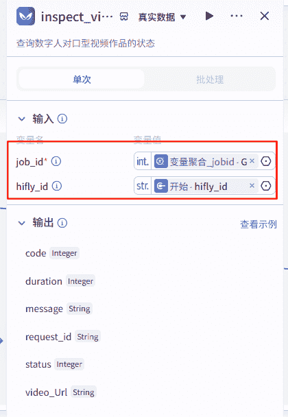

添加判断节点，判断任务状态，任务结束则终止循环，任务未结束则继续等待下次循环。

如果status等于2（2代表进行中、3代表结束）则表示任务尚未结束。

几个节点也比较简单，细节就不展开了。

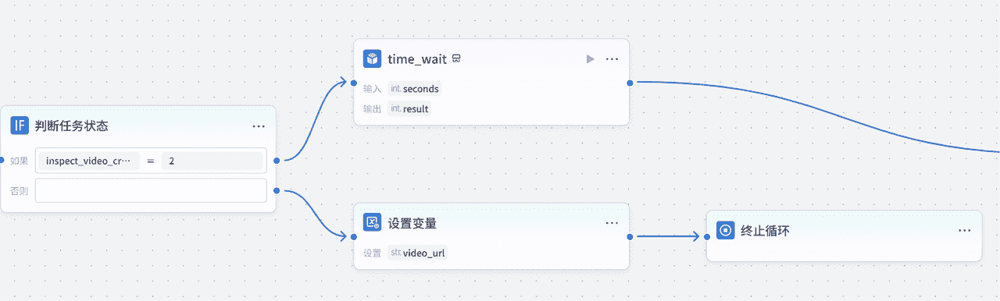

其中用到的等待插件，等待10s进行下一次循环，偷个懒就不要自己写代码了。

以上就是整个工作流的内容。最后我们会获得数字人的视频地址，在浏览器打开下载。

如果你使用了自己的飞影账号，也可以在网站后台看到制作记录、积分消耗情况。

### 克隆自己的声音

点击声音克隆

上传自己的一段录音mp3音频。

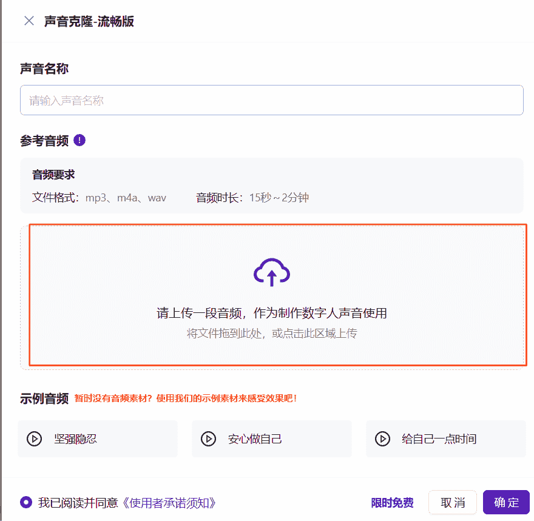

点击确定开始克隆。

克隆完成后即可查看和复制自己的音色speaker_id

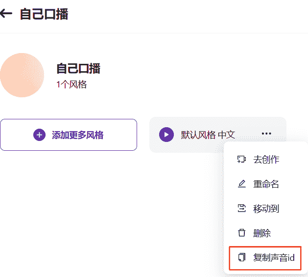

最后再说一下注册方式，点击邀请链接：https://hifly.cc/?code=5gkEi9hp94Q

默认新用户会有1000积分，使用完之后可以选择开通合适的套餐

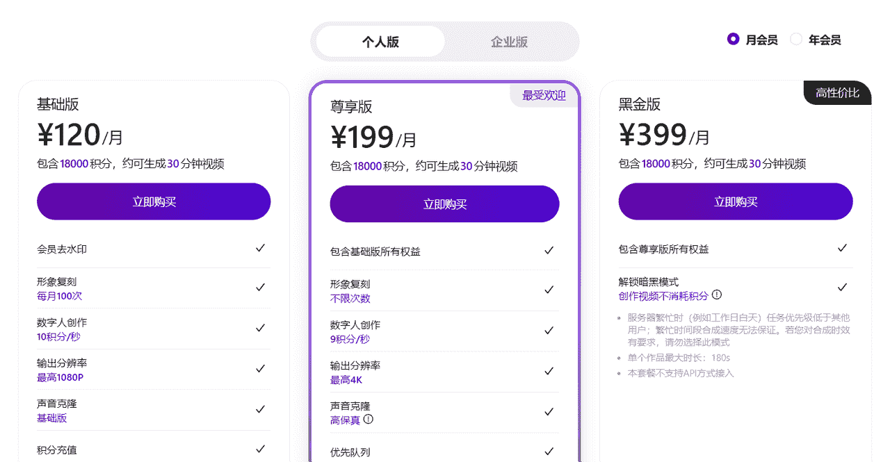

以上。

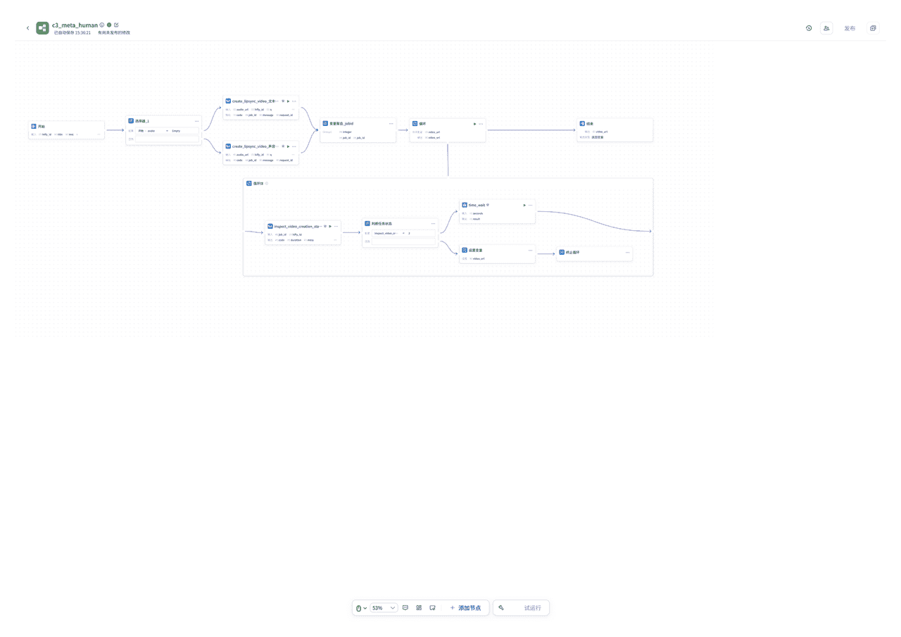

[c3_meta_human - 工作流 -智能体平台.pdf](https://internal-api-drive-stream.feishu.cn/space/api/box/stream/download/all/B5Jjb5HGmoL27pxdoyycxZiBnxb)