# Coze打造感悟视频混剪工作流

> 来源：[https://zinxkclpk97.feishu.cn/docx/JCWOdxZeZoDj0hxaac4cUmtTnNF](https://zinxkclpk97.feishu.cn/docx/JCWOdxZeZoDj0hxaac4cUmtTnNF)

> 最近几天重感冒，没有肝新案例。

> 这次是之前案例的升级，正好有小伙伴在问混剪的工作流怎么搭，借此机会做一次详细拆解。

视频混剪，顾名思义是要先准备你所需风格的视频素材，你可以去某宝或其它渠道搜索，最后也可以留言找我获取打包好的十几种视频素材。

这次对标的是情感类视频混剪案例，这类多为夜晚街景、行人、车流等慢镜头视频，烘托氛围。


工作流整体不算复杂，下面是核心思路

1.  用户输入主题/内容，配合模型生文

1.  文字转音频

1.  字幕音频时间线对齐

1.  随机选择视频

1.  搭配背景音乐

1.  组装剪映草稿

流程拆解

这部分是根据用户输入标题或内容进行创作，这里我们引入逻辑判断，支持用户自定义文案或使用模型生成文案，最后再利用聚合节点，输出文案内容。

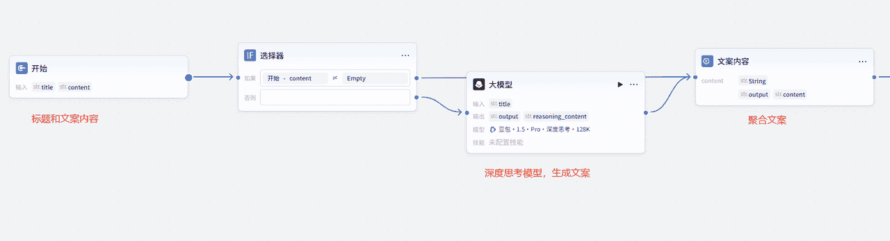

有一个小细节，是聚合节点支持对默认Group参数进行重命名了，也方便我们后续回溯参数避免选错。

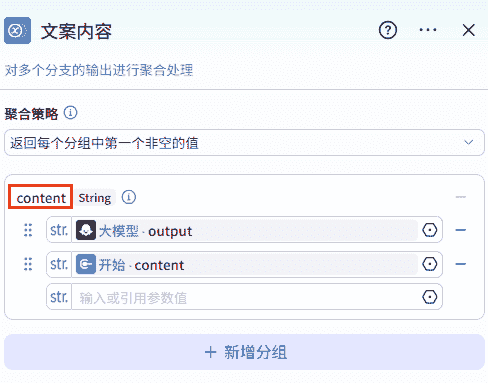

然后利用插件将文案转音频，再进行字幕对齐，看下这两个环节的整体处理

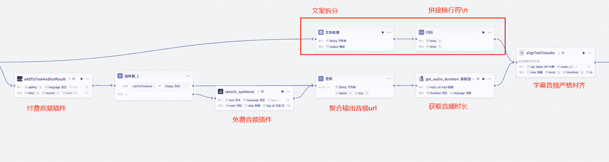

首先是下面这条线，用到了两个音频插件，前一个是付费音频，其音色情感比较爆满，但有限额。后面的是官方插件，用来兜底，我将两个组合起来使用了。

（最终看个人情况，按需选择合适的插件和音色，可适当简化上述流程）


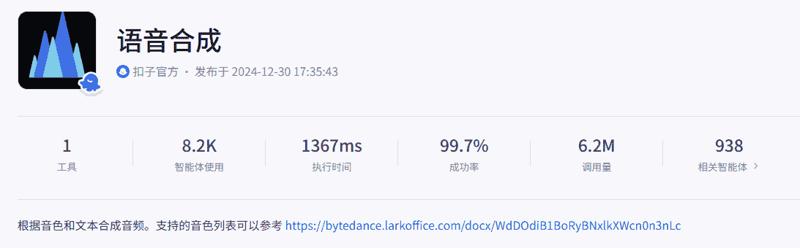

音频转换节点（三方插件）

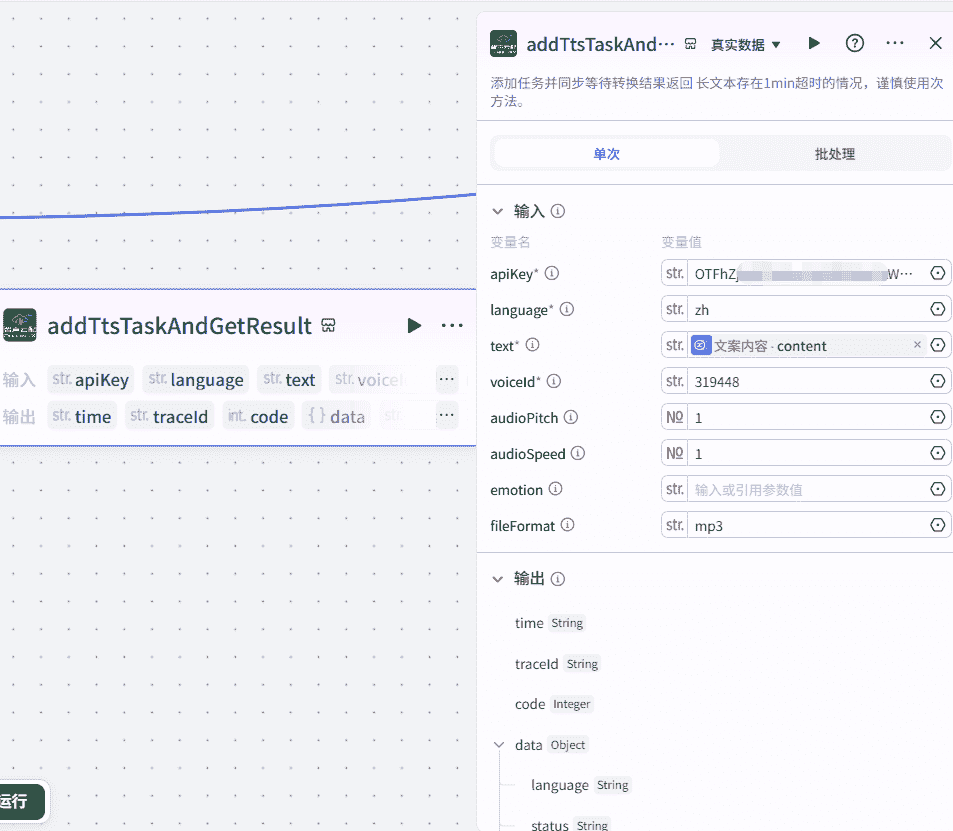

音频转换节点（官方插件）

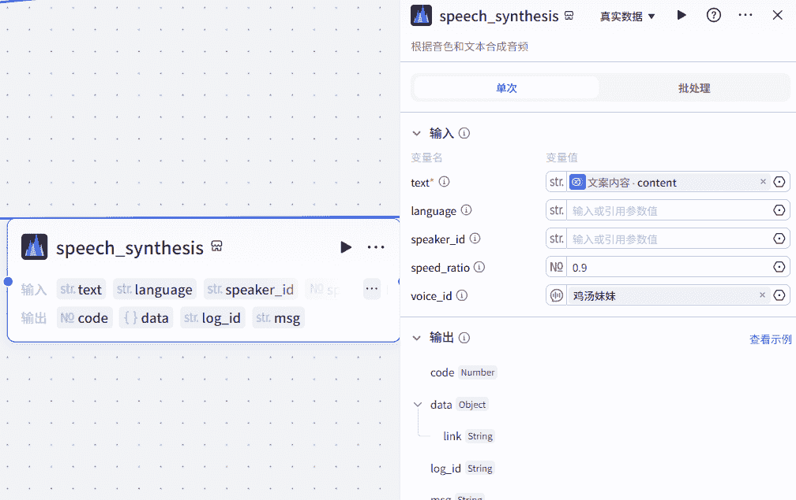

聚合输出音频参数

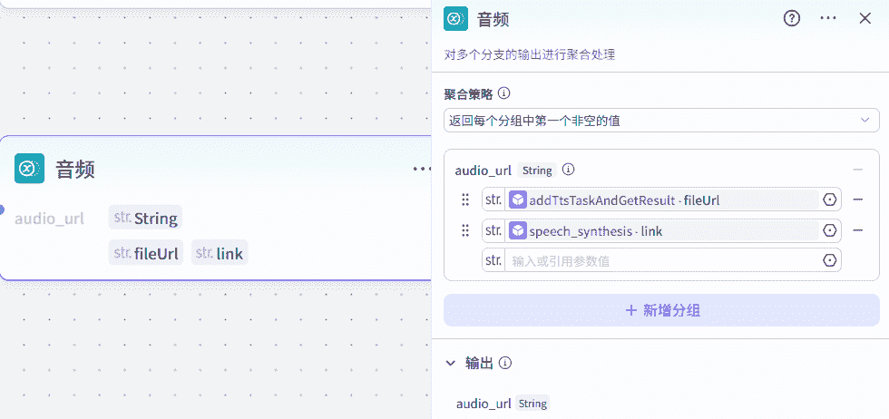

然后需要对文案和生成的音频进行对齐处理，为什么要做这个动作呢，因为我们的音频是一次直接生成，还需要处理音频和字幕的时间线关系，这里就不再使用之前的标点拆分法了，而是直接用插件自动对齐字幕和音频。保证呈现效果。

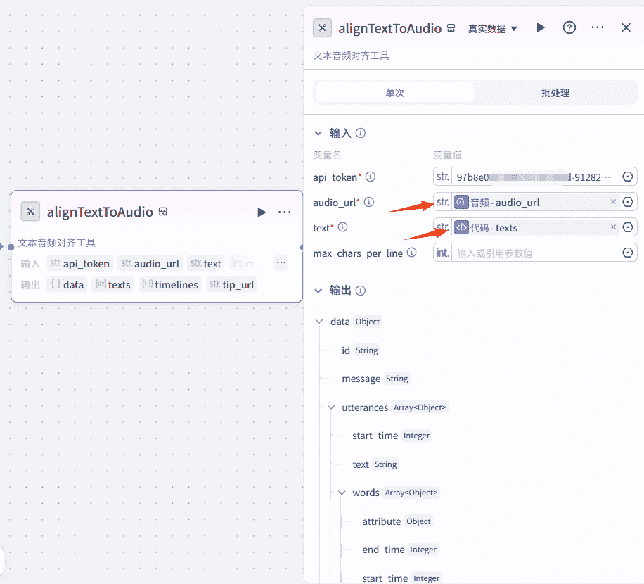

插件采用的速推提供的字幕音频对齐插件，可搜索获取。

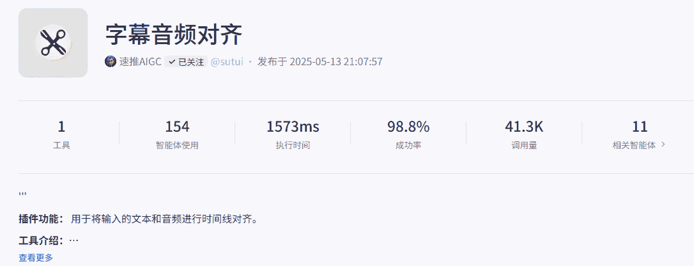

接下来，我们需要根据音频总时长，选择搭配相对时间的视频素材。

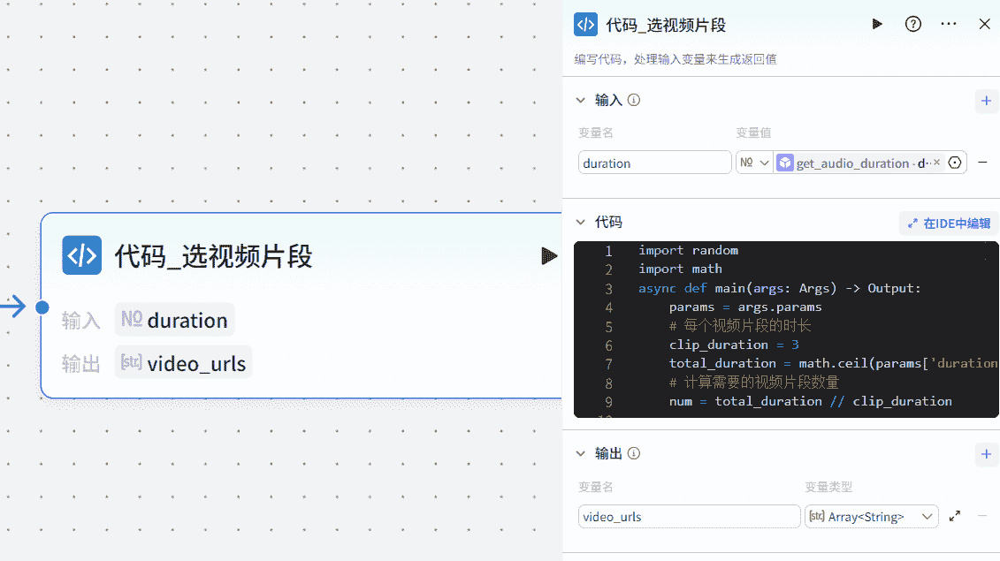

因代码中包含素材较多，精简处理了一下，需要更多素材可留言找我

```
import random
import math
async def main(args: Args) -&gt; Output:
    params = args.params
    # 每个视频片段的时长
    clip_duration = 3
    total_duration = math.ceil(params[&#x27;duration&#x27;])
    # 计算需要的视频片段数量
    num = total_duration // clip_duration

    # 如果总时长不能被片段时长整除，需要额外处理
    if total_duration % clip_duration != 0:
        num += 1
    video_urls = get_random_videos(&quot;&quot;,num)
    
    # 构建输出对象
    ret: Output = {
        &quot;video_urls&quot;: video_urls, 
    }
    return ret

def get_random_videos(style,num):
    #&quot;情感&quot;,&quot;夜景&quot;,&quot;行人&quot;
    video_urls = [
        &quot;https://befun-static.oss-cn-shenzhen.aliyuncs.com/clip/material/46c2177de7307de206fe4ac7ffc43fa72510af28.mp4&quot;,
        &quot;https://befun-static.oss-cn-shenzhen.aliyuncs.com/clip/material/8fd9fcf4947b37b8b4d42dab6a061756d5bc56b1.mp4&quot;,
        &quot;https://befun-static.oss-cn-shenzhen.aliyuncs.com/clip/material/a2e38c05895ccb9d8e8116b77af8277691097663.mp4&quot;,
        &quot;https://befun-static.oss-cn-shenzhen.aliyuncs.com/clip/material/6a5e35c8b095bee0a57a9911d5f8b2d5ec8b686d.mp4&quot;,
        &quot;https://befun-static.oss-cn-shenzhen.aliyuncs.com/clip/material/bd993229ac40d88b607f9e1a4b4e83857915a06f.mp4&quot;,
        &quot;https://befun-static.oss-cn-shenzhen.aliyuncs.com/clip/material/93bbbd5dd0d0f2cd61d22c0877966d38b1df7a2b.mp4&quot;,
        &quot;https://befun-static.oss-cn-shenzhen.aliyuncs.com/clip/material/86a4e6507f036a8dc7c56581888f68d087abdc4a.mp4&quot;,
        &quot;https://befun-static.oss-cn-shenzhen.aliyuncs.com/clip/material/5c84153c21b81c42eb5a1879a3bcce5045398e2b.mp4&quot;,
        &quot;https://befun-static.oss-cn-shenzhen.aliyuncs.com/clip/material/b102f211c5a9b7617a567d6b7d57c9bb3a5dc1ed.mp4&quot;,
        &quot;https://befun-static.oss-cn-shenzhen.aliyuncs.com/clip/material/8da435f114353b1b2e53d9554d05eadd88f88480.mp4&quot;,
        &quot;https://befun-static.oss-cn-shenzhen.aliyuncs.com/clip/material/32fb3cdbaae92d3652a6d4061d27ef4c49d81c59.mp4&quot;,
        &quot;https://befun-static.oss-cn-shenzhen.aliyuncs.com/clip/material/ee085c6785fa4fc01bcb9317bf8cda63ecbf26e2.mp4&quot;,
        &quot;https://befun-static.oss-cn-shenzhen.aliyuncs.com/clip/material/4795c5903cb746c1e950ec9e3c6b590c5a57d8d5.mp4&quot;,
        &quot;https://befun-static.oss-cn-shenzhen.aliyuncs.com/clip/material/b7cbd06a5011199b2d074685a5901c5b417eac71.mp4&quot;,
        &quot;https://befun-static.oss-cn-shenzhen.aliyuncs.com/clip/material/0cbc467c456ca33b3af48526add4535219e1cf9b.mp4&quot;,
        &quot;https://befun-static.oss-cn-shenzhen.aliyuncs.com/clip/material/c51b33546bdf8e09390b5085c12c6cc64050f2b7.mp4&quot;,
        &quot;https://befun-static.oss-cn-shenzhen.aliyuncs.com/clip/material/0d782370cbb0c5e879d6106d71db55d4abb51b70.mp4&quot;,
        &quot;https://befun-static.oss-cn-shenzhen.aliyuncs.com/clip/material/76a4a8bb37c7eb761582e612070eaf6ddf21811e.mp4&quot;,
        &quot;https://befun-static.oss-cn-shenzhen.aliyuncs.com/clip/material/b542654b9c151fa515c0fca36304d3b35b9127c3.mp4&quot;,
        &quot;https://befun-static.oss-cn-shenzhen.aliyuncs.com/clip/material/3d970d2d1df6a302c26df44f27525fd7e4c038c9.mp4&quot;,
        &quot;https://befun-static.oss-cn-shenzhen.aliyuncs.com/clip/material/50a82576bb72a92d88424b4b7ed5f3ddb1a6b567.mp4&quot;,
        &quot;https://befun-static.oss-cn-shenzhen.aliyuncs.com/clip/material/e0b93bf86ed284f06ba2b1ac799f443b0249db7f.mp4&quot;,
        &quot;https://befun-static.oss-cn-shenzhen.aliyuncs.com/clip/material/f0e3a4cd3de0f8e341c503d4212df6274f377b8b.mp4&quot;,
        &quot;https://befun-static.oss-cn-shenzhen.aliyuncs.com/clip/material/ae9fcc18e8bba64a73820a3e8c5ec32cb0e5d9a8.mp4&quot;,
        &quot;https://befun-static.oss-cn-shenzhen.aliyuncs.com/clip/material/be0921849286abfa4ac0865ab1b458d7944e0b80.mp4&quot;,
        &quot;https://befun-static.oss-cn-shenzhen.aliyuncs.com/clip/material/538e40294e80875f08f3a7e63cbc778879c3b5b3.mp4&quot;,]
    # 随机抽取所需的视频片段
    return random.sample(video_urls, num)
```

然后对前置生成好的素材进行重组，生成剪映插件所需要的数据结构。

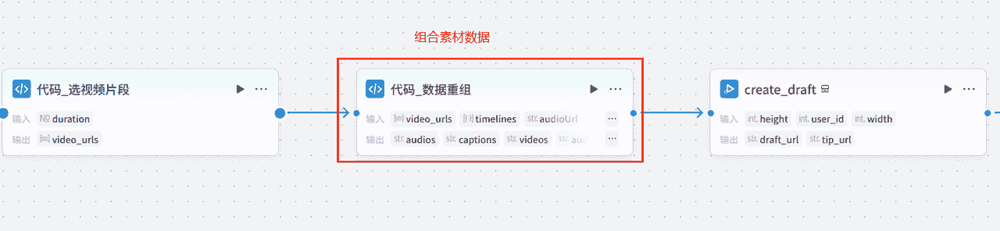

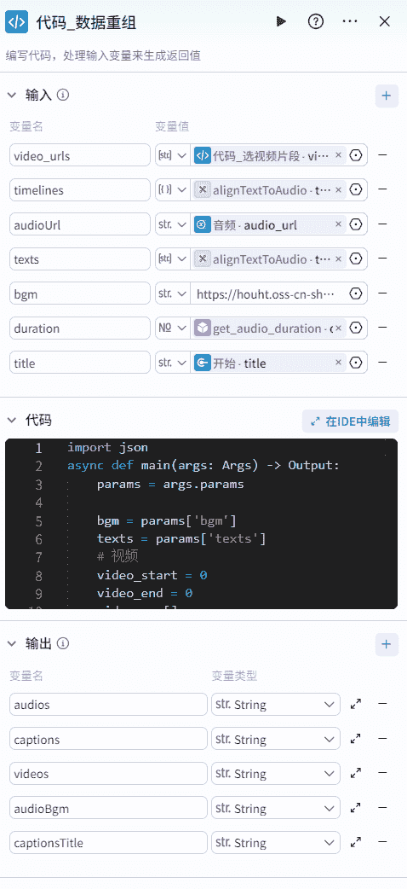

详细代码参考

```
import json
async def main(args: Args) -&gt; Output:
    params = args.params
    
    bgm = params[&#x27;bgm&#x27;]
    texts = params[&#x27;texts&#x27;]
    # 视频
    video_start = 0
    video_end = 0
    videos = []
    for item in params[&#x27;video_urls&#x27;]:
        video_end = video_start + 3*1000000
        videos.append({
                &quot;video_url&quot;: item,
                &quot;duration&quot;: 3*1000000,
                &quot;start&quot;: video_start,
                &quot;end&quot;: video_end,
                &quot;width&quot;:576,
                &quot;height&quot;:1024,
                &quot;transition&quot;: &quot;叠化&quot;,
                &quot;transition_duration&quot;: 1000000
            })
        if video_end &gt;video_start:
            video_start = video_end
    # 背景音乐
    audioBgm = [{
        &quot;audio_url&quot;: bgm,
        &quot;start&quot;: 0,
        &quot;end&quot;: video_end
    }]
    # audioBgm.append()

    #配音、字幕
    
    start = 0
    end = 0
    captions = []
    audios = []
    
    audios.append({
            &quot;audio_url&quot;: params[&#x27;audioUrl&#x27;],
            &quot;duration&quot;: params[&#x27;duration&#x27;]*1000000,
            &quot;start&quot;: 0,
            &quot;end&quot;: params[&#x27;duration&#x27;]*1000000
        })
    timelines = params[&#x27;timelines&#x27;]
    for idx,item in enumerate(timelines):
        start = item[&#x27;start&#x27;]
        end  = item[&#x27;end&#x27;]
        
        text = texts[idx]

        captions.append({
            &#x27;text&#x27;: text,
            &#x27;start&#x27;: start,
            &#x27;end&#x27;: end,
            &quot;in_animation&quot;:&quot;渐显&quot;,&quot;out_animation&quot;:&quot;渐隐&quot;
        })
    
    captionsTitle = [{
            &#x27;text&#x27;: params[&#x27;title&#x27;],
            &#x27;start&#x27;: 0,
            &#x27;end&#x27;: 2000000,
            &quot;in_animation&quot;:&quot;&quot;,&quot;out_animation&quot;:&quot;渐隐&quot;
        }]
        
    # 构建输出对象
    ret = {
        &quot;captions&quot;: json.dumps(captions),
        &quot;audios&quot;: json.dumps(audios),
        &quot;videos&quot;: json.dumps(videos),
        &quot;audioBgm&quot;: json.dumps(audioBgm),
        &quot;captionsTitle&quot;: json.dumps(captionsTitle)
    }
    return ret
```

最后，利用插件将数据进行串联，这里就不展开了，比较简单，大家看截图即可，实在搞不定可私信我。

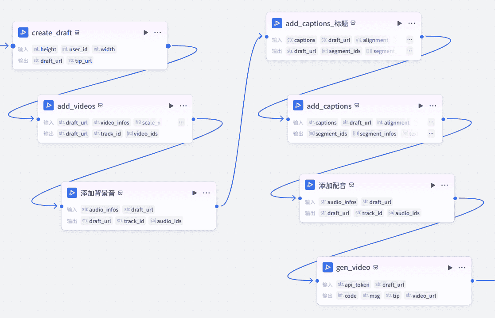

体验链接：

https://www.coze.cn/s/l585W4Qsfz0/

在之前分享了多款视频工作流之后，有很多小伙伴跟着学习和复刻，拿到了不错的结果。

这里也分享几点最近整理的变现的点，详细文档可关注后找我领取。

首先，我们用这套工作流方案，可辅助自媒体创作提效，这个是非常明显的。从最开始的认知提升知识分享类、火柴人心理教育视频类、治愈老奶奶视频、再到最近的书单号视频工作流，只要你有可做的方向和自己的媒体账号，都可以持续去跑去验证。也欢迎分享成功到我们群里，让更多人看到。

另外，有能力开发新案例的小伙伴，可以将智能体发布出来，让更多人看到，一是可以赚取插件的CPS收益，二是可以获得更多曝光，链接到真实需要的用户，就可以为你的智能体付费。

还有，跟着我案例一起学习的应该是最早一批做Coze视频工作流案例的了，有能力就需要多分享，跑出来的粉丝不下10个了，单月至少5位数的收益，之前直播我也对这个视频工作流模式进行了预判（可以回看我视频号最早期分享），全新智能体玩法、视频工作流，意味着很少人知道，你看到了，但动作也要跟上最好你的产品和案例服务，如果提前布局好，随着最近流量放大，就可以很好的承接住。

最后，机会很大，玩法也在增多，及时跟上。

感谢大家支持，希望共同进步。