# Coze+玄门正念视频制作

> 来源：[https://zinxkclpk97.feishu.cn/docx/ZLL2dnmjyoXDAExSWwxcUBg2nVh](https://zinxkclpk97.feishu.cn/docx/ZLL2dnmjyoXDAExSWwxcUBg2nVh)

你有没有刷到这样的视频，分享国学传统文化、玄门认知、道家易经相关知识，最近这个赛道流量也非常猛。TK十几条作品涨粉十几万。

我们今天用Coze工作流搭配剪映小助手插件复刻制作。

体验链接：https://www.coze.cn/store/agent/7505804789767929895?bot_id=true

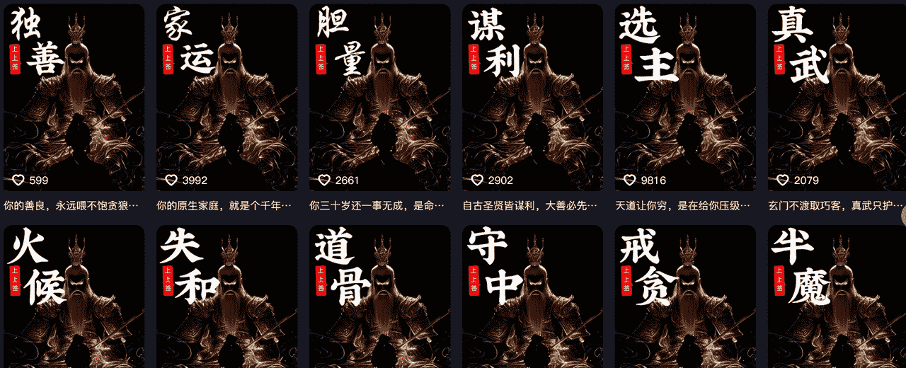

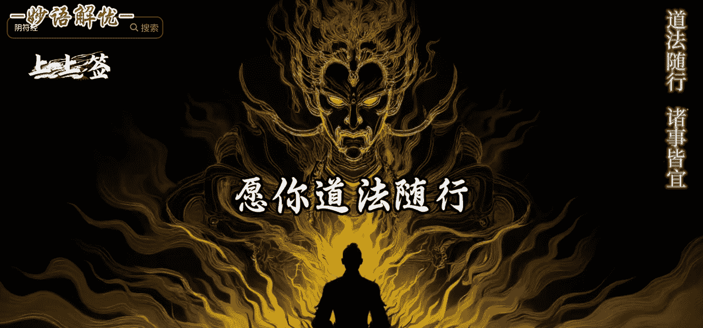

看下效果


[风水视频.mp4](https://internal-api-drive-stream.feishu.cn/space/api/box/stream/download/all/RPbubkq7folHnexxGIkc23uJnfg)

## 制作拆解

视频有两句开场白，字幕包含动画特效，需要单独设计

开场白过渡到正片，使用转场特效

正片内容包括配音、字幕、背景音效、背景图，其中其中背景图使用关键帧效果进行缩放和移动。

布局相对简单，文字居中，左右两侧搭配logo字样

## 工作流设计

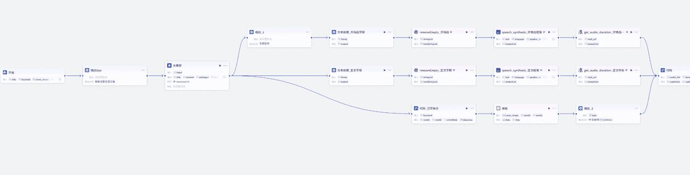

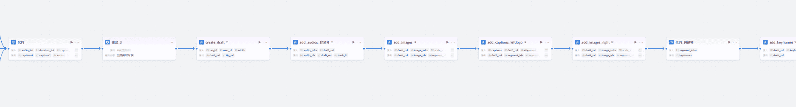

## 输入参数

输入参数，我们将主题、关键词、背景图等单独拎出来，动态传入

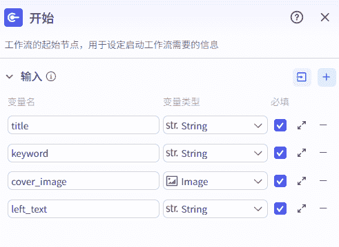

## 大模型文案生成

由大模型根据主题生成相关文案，这里选择的是DeepSeek模型，模型输出标题、开场白、文案。

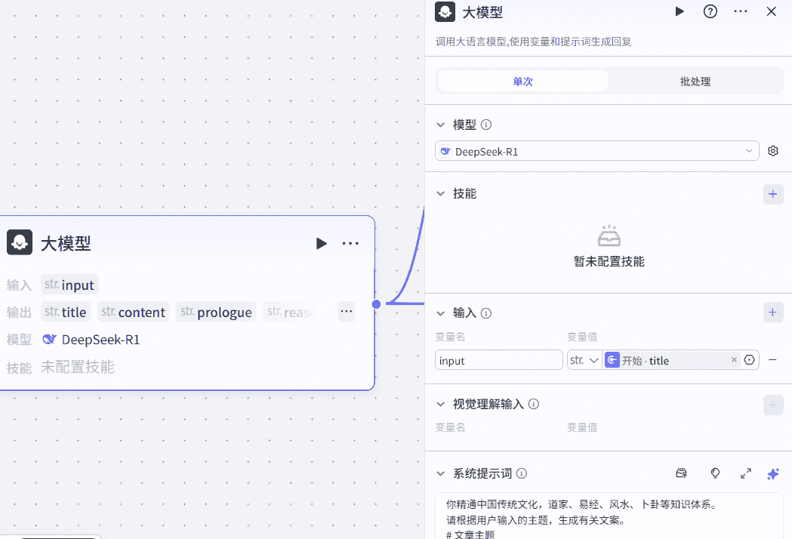

## 提示词参考

生文提示词参考如下：

```
你精通中国传统文化，道家、易经、风水、卜卦等知识体系。
请根据用户输入的主题，生成有关文案。
# 文章主题
玄学、身体感知与神秘力量、修道哲学、传统文化隐喻
# 风格特点
神秘玄幻 ：大量运用中国传统玄学、道教等神秘元素，如 “三魂”“七魄”“三师神” 等，构建出神秘莫测的氛围，仿佛开启修道世界之门，引导读者探索人体隐藏的神秘力量。
哲理思辨 ：常采用对比结构，如现代科技与传统玄学感知对比，引发读者对科技与自然神秘力量等关系的思考；引用经典典故，如庄子之言，增加说服力与文化底蕴，引导读者深入思考。
古雅华丽 ：用词古朴典雅，句式长短结合，长句舒展有画面感，短句简洁有力，整体富有节奏韵律感，如同吟诵古老诗篇，使文案具古风韵味与文学美感。
引导暗示 ：以类似导师的口吻，引导读者关注自身细微感知，暗示按其说的方法探索神秘力量，巧妙传递玄学理念，将读者引入其构建的玄学认知体系。
# 标点符号要求
使用逗号和句号分句子，不要使用其它标点。
# 约束
文末过度到卜卦，使用引导词“愿你道法随行，诸事皆宜”进行收尾

# 输出结构
包含开场字数 300字。
标题：《xxx》
开场白（极简的两句话，字数不超15字）：xxxxx，xxxxx
正文内容：xxxx
关键字
```

## 封面配图

封面配图包括左上角两个文字、logo、背景图，我们使用画板来实现。排版、设置字体大小、图片尺寸，比较简单就不展开细节了。

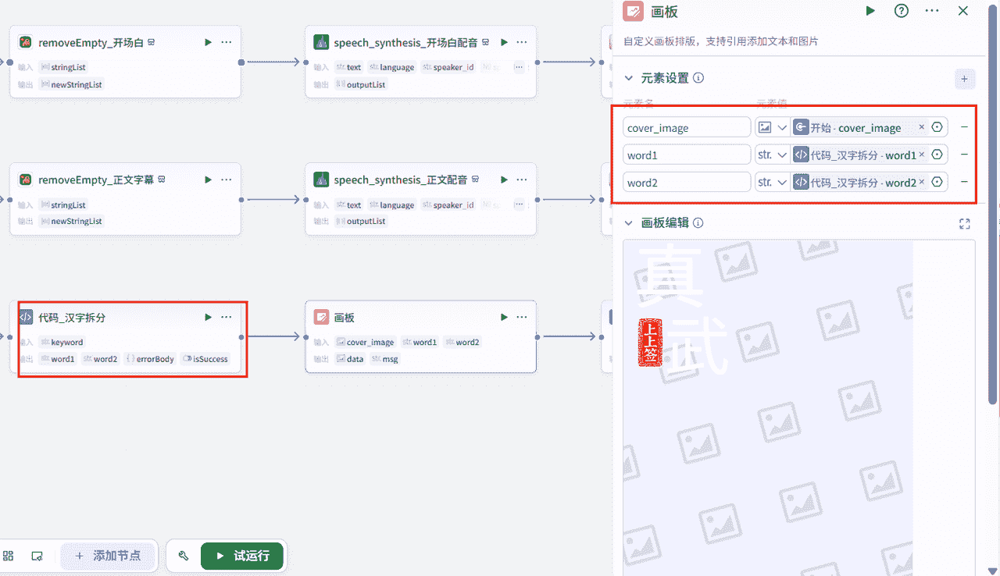

## 开场白处理

开场白

前面大模型输出了开场白文字，我们需要拆解出两句话。这为什么拆分呢？我们后续需要单独为每句话设计字幕特效和时间线。

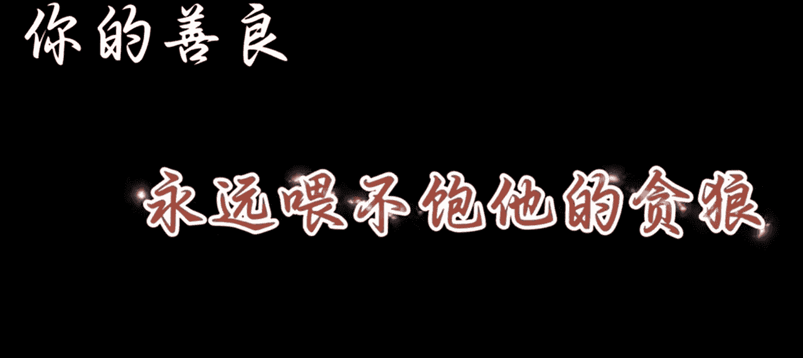

这里使用文本处理节点，对句子进行分割，搭配去除空白字符插件（没错我封装了插件），最终获得字符数组。

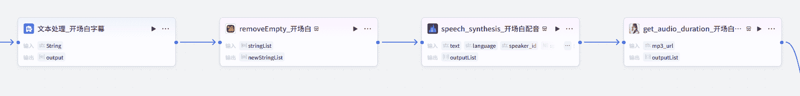

### 字符分割

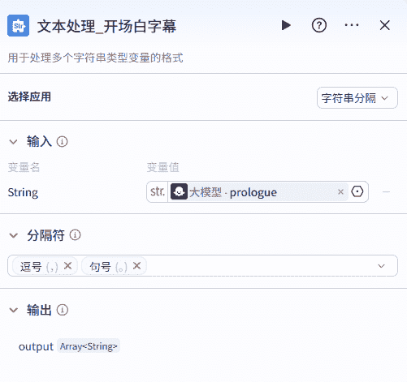

### 剔除空白符

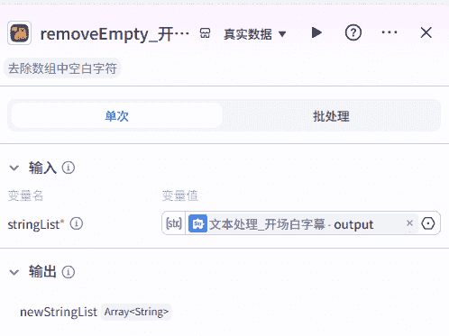

继续利用文字转音频插件，批量生成配音，搭配获取音频时间插件，批量获取每段音频的时长。

### 批处理转音频

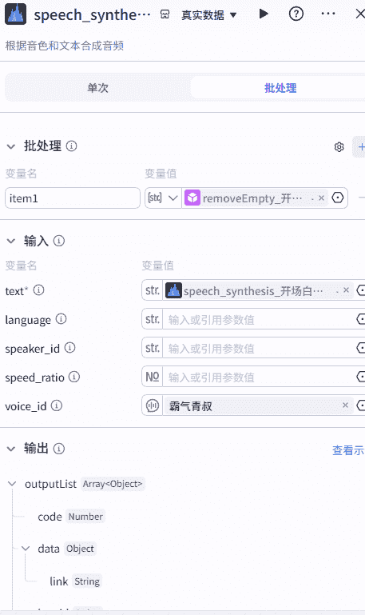

### 获取音频时长

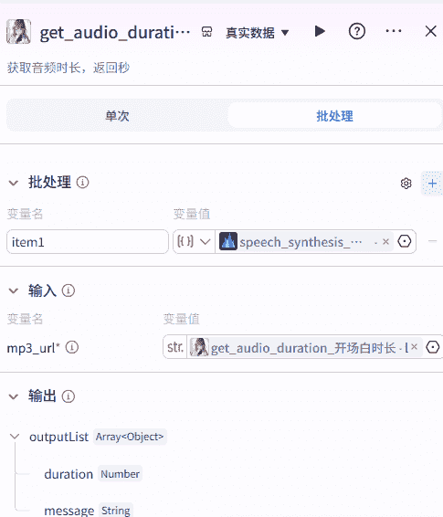

## 正文配音

同样的步骤，处理模型输出的正文内容，将文案进行分句处理后，批量转音频并获取音频时长。

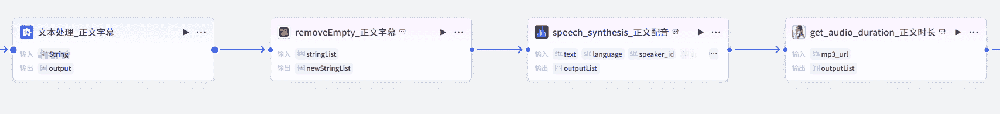

至此，完成了文案生成、字幕配音、时间线获取等前置动作。

接下来我们需要将这些素材进行组合。

代码组合环节，需要关注几点，按照拆解，将开场白（字幕、配音、特效、转场），正文（字幕、配音、背景图、左右logo、背景音乐）的数据构造出来，其中重点关注需要计算每个元素的轨道时间线。

## 素材组合

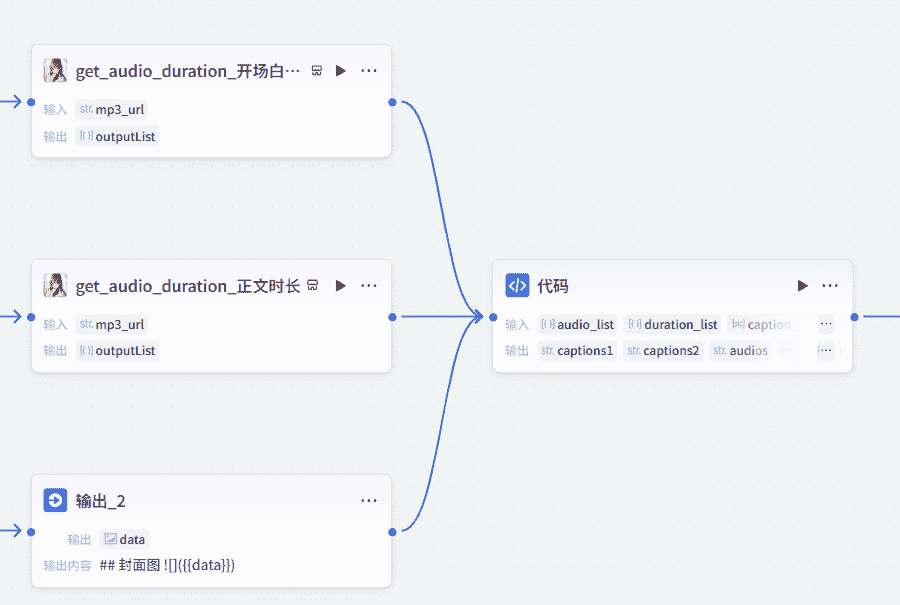

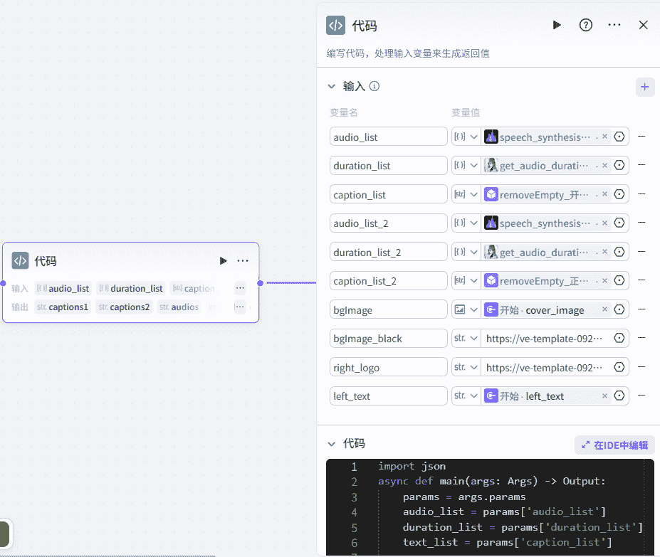

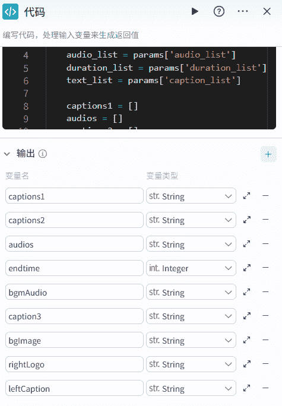

## 代码示例


# 视频素材处理与关键帧实现

## 素材处理与代码节点

```
import json
async def main(args: Args) -> Output:
    params = args.params
    audio_list = params['audio_list']
    duration_list = params['duration_list']
    text_list = params['caption_list']
    
    captions1 = []
    audios = []
    captions2 = []
    #处理字幕音频时间线
    if text_list and len(text_list)>=2:
        captions1.append({
                'text': text_list[0],
                'start': 0,
                'end': int(duration_list[0]['duration']*1000000)+int(duration_list[1]['duration']*1000000),
                "in_animation":"激光雕刻","out_animation":"",
                "in_animation_duration":int(duration_list[0]['duration']*1000000)
            })
        audios.append({
            "audio_url": audio_list[0]['data']["link"],
            "duration": int(duration_list[0]['duration']*1000000),
            "start": 0,
            "end": int(duration_list[0]['duration']*1000000),
            "audio_effect":"环绕回声"
        })
        captions2.append({
                'text': text_list[1],
                'start': int(duration_list[0]['duration']*1000000),
                'end': int(duration_list[0]['duration']*1000000)+int(duration_list[1]['duration']*1000000),
                "in_animation":"电光","out_animation":"",
                "in_animation_duration":int(duration_list[1]['duration']*1000000)
            })
        audios.append({
            "audio_url": audio_list[1]['data']["link"],
            "duration": int(duration_list[1]['duration']*1000000),
            "start": int(duration_list[0]['duration']*1000000),
            "end": int(duration_list[0]['duration']*1000000)+int(duration_list[1]['duration']*1000000),
            "audio_effect":"环绕回声"
        })
    pre_endtime = int(duration_list[0]['duration']*1000000)+int(duration_list[1]['duration']*1000000)
    # 第二段字幕
    audio_list2 = params['audio_list_2']
    duration_list2 = params['duration_list_2']
    caption_list2 = params['caption_list_2']
    caption3 = []
    start = pre_endtime
    end = 0
    for index,item in enumerate(caption_list2):
        duration = (duration_list2[index]['duration']*1000000)
        end = start+duration
        caption3.append({
                'text': item,
                'start': start,
                'end': end,
                "in_animation":"激光雕刻","out_animation":"",
                "in_animation_duration":duration
            })
        audios.append({
            "audio_url": audio_list2[index]['data']["link"],
            "duration": duration,
            "start": start,
            "end": end,
            "audio_effect":"环绕回声"
        })
        start = end

    #固定右侧文字，未使用暂时保留
    # rightCaption = [{
    #             'text': "xxx",
    #             'start': pre_endtime,
    #             'end': end,
    #             "in_animation":"","out_animation":""
    #         }]
    rightLogo = [{
        "image_url": params['right_logo'],
        "width": 100,
        "height": 600,
        "start": pre_endtime,
        "end": end,
        "in_animation": "", 
        "out_animation": ""
    }]
    
    leftCaption = [{
                'text': params['left_text'],
                'start': pre_endtime,
                'end': end,
                "in_animation":"电光",
                "in_animation_duration":2000000,
                "out_animation":""
            }]
    

    # bgm音乐开始时间，结束时间，为第一段音频结束时间
    bgmAudio = [{
        "audio_url": "https://ve-template-0920.oss-cn-shanghai.aliyuncs.com/uploads/1747499991352_d9xbyb9q7vm.mp3",
        "duration": end,
        "start": int(duration_list[0]['duration']*1000000),
        "end": end,
        "volume":0.5,
    }]

    bgImage = [{
        "image_url": params['bgImage_black'],
        "width": 1920,
        "height": 1080,
        "start": 0,
        "end": pre_endtime,
        "in_animation": "", 
        "out_animation": "",
        "transition": "白色烟雾", 
        "transition_duration": 1.5*1000000
    },{
        "image_url": params['bgImage'],
        "width": 1920,
        "height": 1080,
        "start": pre_endtime,
        "end": end,
        "in_animation": "",
        "out_animation": "",
    }]
    
    # 构建输出对象
    ret: Output = {
        "captions1": json.dumps(captions1),
        "captions2": json.dumps(captions2),
        "caption3": json.dumps(caption3),
        "audios": json.dumps(audios),
        "bgmAudio":json.dumps(bgmAudio),
        "bgImage":json.dumps(bgImage),
        "leftCaption":json.dumps(leftCaption),
        "rightLogo":json.dumps(rightLogo)
    }
    return ret
```

后续，利用剪映小助手插件，将素材进行串接

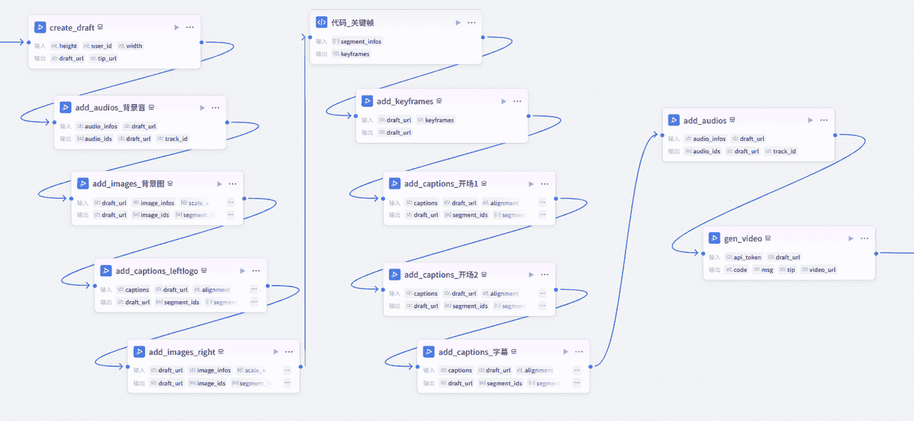

## 关键帧特效

为背景图设置关键帧，实现缩放和移动的效果。

代码节点，生成关键帧数据，注意入参是前面添加图片环节的输出参数，最终返回关键帧参数。

细节部分，我们为单张图片，添加两对关键帧，实现了缩放和移动的效果。

```
import json
async def main(args: Args) -> Output:
    params = args.params
    segment_infos = params['segment_infos']
    # 为第二张图打关键帧
    segment = segment_infos[1]
    id = segment['id']
    start = segment['start']
    end = segment['end']

    # 缩放关键帧
    # 上移关键帧
    keyframes = [
        {
        "offset": start,
        "property": "UNIFORM_SCALE",
        "segment_id": id,
        "value": 5  
        },
        {
        "offset": int(end/2),
        "property": "UNIFORM_SCALE",
        "segment_id": id,
        "value": 2.8
        },{
        "offset": int(end/2)+1000000,
        "property": "KFTypePositionY",
        "segment_id": id,
        "value": 0
        },
        {
        "offset": end-1000000,
        "property": "KFTypePositionY",
        "segment_id": id,
        "value": -0.8
        }
        ]

    # 构建输出对象
    ret: Output = {
        "keyframes": json.dumps(keyframes)
    }
    return ret
```

继续，串接关键帧节点，把剩余的音频、字幕也组合起来。下面展示了几个节点的参数细节。

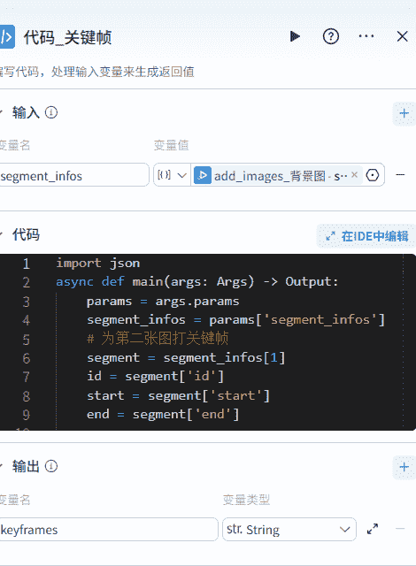

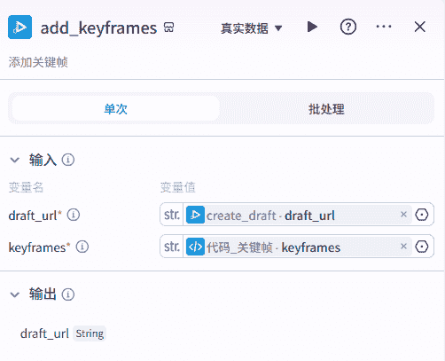

以上。

## 相关链接

涉及剪映插件地址：`https://ts.fyshark.com/#/home?user_id=7358`

扣子体验地址：`https://www.coze.cn/store/agent/7505804789767929895?bot_id=true`

我们在设计智能体或工作流时，同样的需求，每个人的解题思路是不同的，上述案例也仅是我个人的设计视角，如有更好的想法可以品论区留言讨论。同时有需要实现的案例也可以留言，点点关注，后续更新。

最后送点福利，过往分享的高阶智能体实战案例，我整理了一份文档手册+视频教学+Coze工作空间，评论区留言+点赞关注后私我获取。
