# Coze+公众号自动化写作方案拆解（详细版）

> 来源：[https://zinxkclpk97.feishu.cn/docx/YQUFdhQMEoiAW6xsvs8cni4qnlh](https://zinxkclpk97.feishu.cn/docx/YQUFdhQMEoiAW6xsvs8cni4qnlh)

经常有小伙伴咨询，Coze如何自动写公众号，如何搭工作流、如何排版等等，今天这篇文章，我们从插件开发、配置使用，到公众号写作工作流搭建，做一次详细介绍。

同时，我也会将公众号插件的详细代码打包开放，有需要的开发者可以找我获取。

公众号介绍

对于如何注册开通公众号，我们就不过多介绍，这里简单说一下，公众号内容类型有文章类、图片/文字。我们利用Coze也主要是创作这两种类型的内容。插件的使用需要区分不同类型的文章，草稿格式会存在差异。

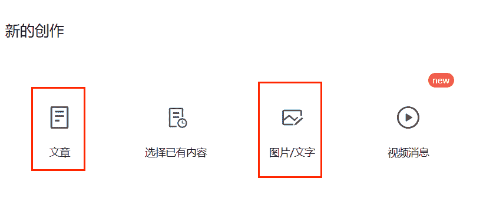

插件开发

我们知道Coze官方并未支持公众号相关的插件，那如何自动发布到公众号草稿呢？这不得不感谢腾讯官方支持了公众号开发者模式，我们可通过其提供的API接口，打通授权、创建草稿、上传素材、查询等功能。我们可以参考接口文档封装公众号插件。当然也有许多三方开发者已经贡献，也可选择合适的直接使用。

有开发能力的可以直接看官方文档。

https://developers.weixin.qq.com/doc/offiaccount/Draft_Box/Add_draft.html

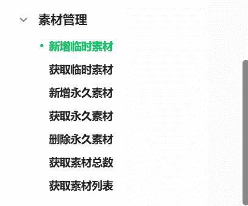

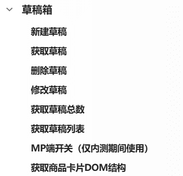

而调用公众号的这些API，还需要完成两个配置

一是开通后台的开发者模式，获取开发者id和密码

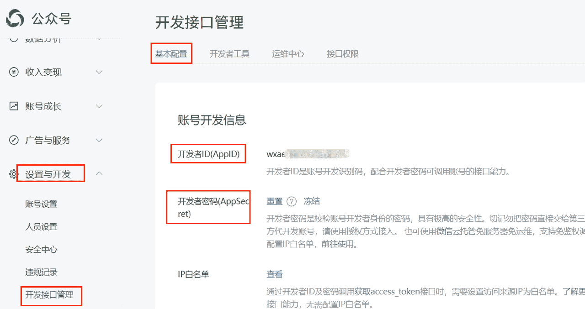

二是设置IP白名单，此IP地址是官方为了安全访问，增加的限制策略。IP即为你调用其开发接口所在服务器的IP，大概理解下。

如果IP配置的不正确，在接口调用时会报错并提示你白名单Ip未配置。

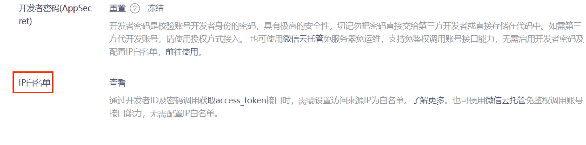

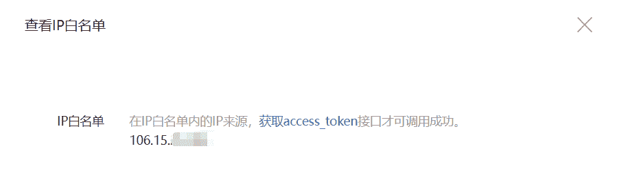

但是在Coze平台去封装公众号插件，那插件所运行的服务器IP肯定不是固定的（每次run的服务器随机分配），所以如果直接Coze封装公众号API接口，就会面临需要将N多个IP加到公众号Ip白名单中，且因Coze官方服务器集群的变更，这些IP面临失效问题。

如何解决上面这个问题呢？我们可以考虑增加一台中间的服务器做转发，而需要授权的白名单IP就是这台中转服务器的IP，以实现固定IP的需求。

接下来就需要进行插件开发，这里也有两项开发工作，一是Coze插件的开发，二是中转服务的开发

Coze插件开发，我截图示意，有需要代码的开发者可找我获取。

下面是插件所封装的方法，包含了授权、素材上传、添加草稿、预览草稿等功能，最终将插件发布到Coze插件商店即可公开使用。

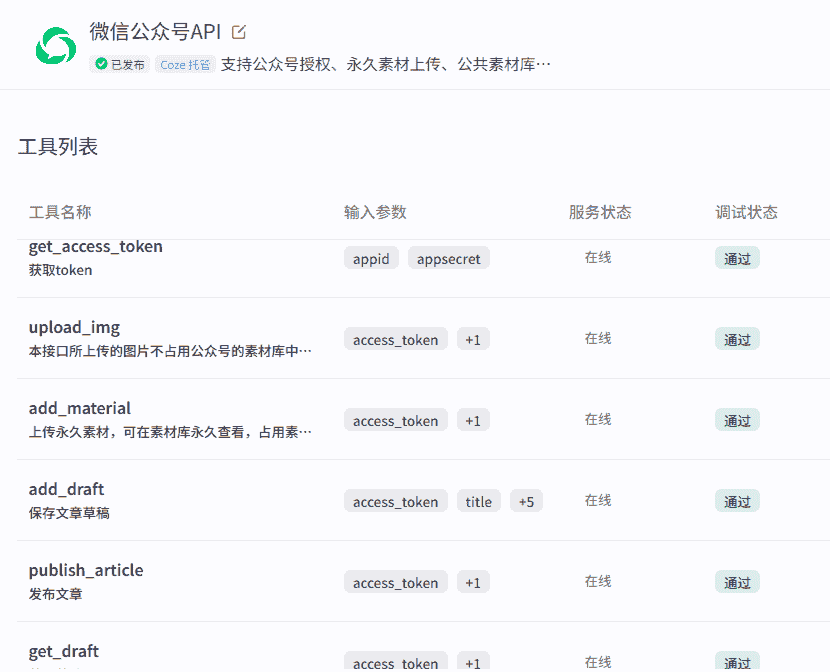

其是代码比较简单，直接调我们搭建的中转服务地址即可，结果也不做二次处理直接返回。

其它方法就不展开细节

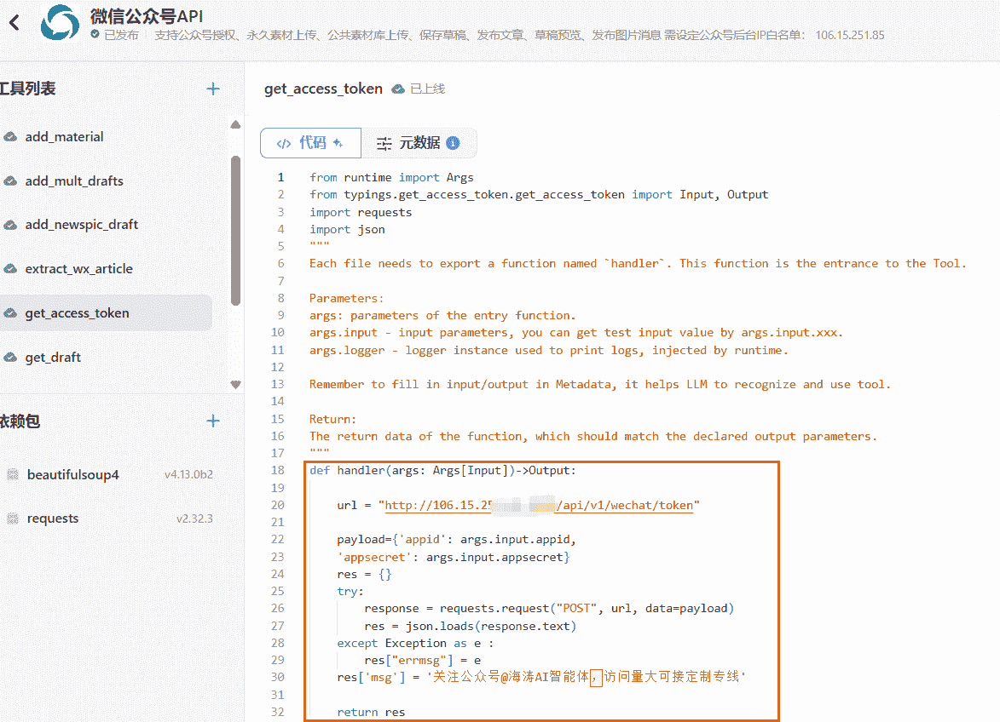

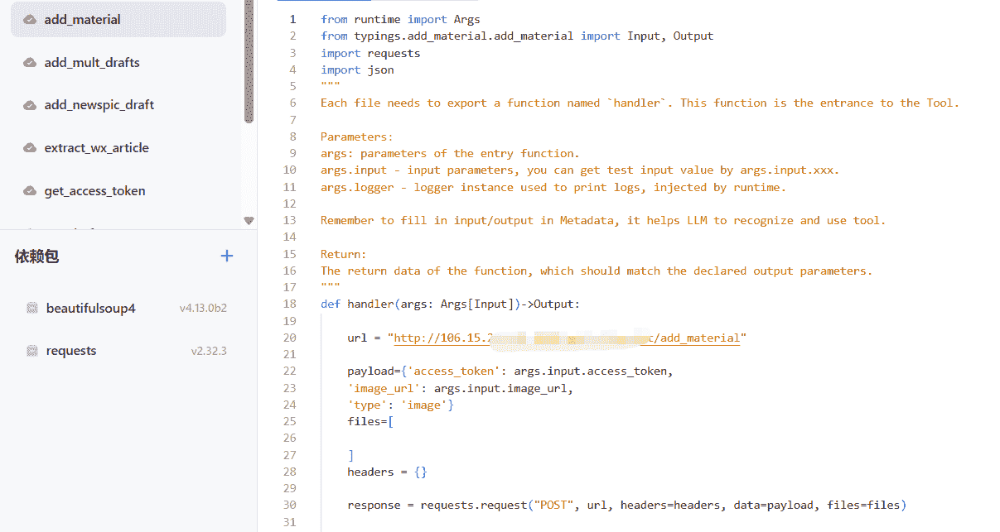

下面这部分是API中转服务的部分代码可参考，很简单，只是对公众号API的封装。

```
import base64
import io
import json
import uuid
from fastapi import FastAPI, HTTPException, Body, Response, UploadFile
from fastapi.params import Form, File, Header
from fastapi.staticfiles import StaticFiles
from pydantic import BaseModel
from requests import RequestException
from requests.adapters import HTTPAdapter
from starlette.responses import FileResponse
import re
import requests
import os
from urllib3 import Retry
from models import DraftAddRequest

app = FastAPI()

@app.get(&quot;/ping&quot;)
def ping():
    return {&quot;msg&quot;: &quot;Hello World&quot;}

@app.post(&quot;/api/v1/wechat/token&quot;)
async def get_wx_token(appid: str = Form(..., description=&quot;公众号的唯一标识符（AppID）&quot;),
                       appsecret: str = Form(..., description=&quot;公众号的密钥（AppSecret）&quot;)):
    if not appid or not appsecret:
        raise HTTPException(status_code=400, detail=&quot;AppID and AppSecret are required.&quot;)

    url = &quot;https://api.weixin.qq.com/cgi-bin/token&quot;
    params = {
        &quot;grant_type&quot;: &quot;client_credential&quot;,
        &quot;appid&quot;: appid,
        &quot;secret&quot;: appsecret
    }
    response = requests.get(url, params=params)

    if response.status_code == 200:
        return response.json()
    else:
        raise HTTPException(status_code=response.status_code, detail=&quot;Failed to retrieve token&quot;)

# 设置请求重试策略
retry_strategy = Retry(
    total=3,
    status_forcelist=[429, 500, 502, 503, 504],
    allowed_methods=[&quot;GET&quot;, &quot;POST&quot;]
)
adapter = HTTPAdapter(max_retries=retry_strategy)
@app.post(&quot;/api/v1/wechat/add_material&quot;)
async def add_material_from_url(
        access_token: str = Form(..., description=&quot;调用接口的凭证（access_token）&quot;),
        image_url: str = Form(..., description=&quot;图片的URL地址&quot;),
        type: str = Form(&quot;thumb&quot;, description=&quot;媒体文件类型&quot;)):
    if not access_token or not image_url:
        raise HTTPException(status_code=400, detail=&quot;Access Token and Image URL are required.&quot;)

    # 下载图片
    try:
        response = requests.get(image_url)
        response.raise_for_status()
    except RequestException as e:
        raise HTTPException(status_code=400, detail=f&quot;Failed to download image: {e}&quot;)

    # 上传图片到微信服务器
    url = &quot;https://api.weixin.qq.com/cgi-bin/material/add_material&quot;
    files=[(&#x27;media&#x27;,(&#x27;mainimage.jpg&#x27;,response.content,&#x27;image/jpeg&#x27;))]
    data = {
        &#x27;access_token&#x27;: access_token,
        &#x27;type&#x27;: type
    }

    response = requests.post(url,files=files,  data=data)

    if response.status_code == 200:
        return response.json()
    else:
        raise HTTPException(status_code=response.status_code, detail=&quot;Failed to add material&quot;)

@app.post(&quot;/api/v1/wechat/upload_img&quot;)
async def upload_img_from_url(
        access_token: str = Form(..., description=&quot;调用接口的凭证（access_token）&quot;),
        image_url: str = Form(..., description=&quot;图片的URL地址&quot;)):
    if not access_token or not image_url:
        raise HTTPException(status_code=400, detail=&quot;Access Token and Image URL are required.&quot;)

    # 下载图片
    try:
        response = requests.get(image_url)
        response.raise_for_status()
    except RequestException as e:
        raise HTTPException(status_code=400, detail=f&quot;Failed to download image: {e}&quot;)

    # 上传图片到微信服务器
    url = &quot;https://api.weixin.qq.com/cgi-bin/media/uploadimg&quot;
    files=[(&#x27;media&#x27;,(&#x27;image.jpg&#x27;,response.content,&#x27;image/jpeg&#x27;))]
    data = {
        &#x27;access_token&#x27;: access_token
    }
    response = requests.post(url, files=files, data=data)

    if response.status_code == 200:
        return response.json()
    else:
        raise HTTPException(status_code=response.status_code, detail=&quot;Failed to upload image&quot;)

@app.post(&quot;/api/v1/wechat/add_draft&quot;)
async def add_draft(body: DraftAddRequest,token: str = Header()):
    if not token:
        raise HTTPException(status_code=400, detail=&quot;Access Token is required.&quot;)
    url = f&quot;https://api.weixin.qq.com/cgi-bin/draft/add?access_token={token}&quot;
    headers = {
        &#x27;Content-Type&#x27;: &#x27;application/json; charset=utf-8&#x27;
    }
    #print(body.dict())
    json_content = json.dumps(body.dict(), ensure_ascii=False)
    response = requests.post(url,headers=headers, data=json_content.encode(&#x27;utf-8&#x27;))

    if response.status_code == 200:
        return response.json()
    else:
        raise HTTPException(status_code=response.status_code, detail=&quot;Failed to add draft&quot;)


@app.post(&quot;/api/v1/wechat/publish&quot;)
async def publish_article(access_token: str = Form(..., description=&quot;调用接口的凭证（access_token）&quot;),
                          media_id: str = Form(..., description=&quot;要发布的草稿的media_id&quot;)):
    &quot;&quot;&quot;
    发布微信公众号文章。

    :param access_token: 调用接口凭证
    :param media_id: 要发布的草稿的media_id
    :return: 发布结果
    &quot;&quot;&quot;
    if not access_token:
        raise HTTPException(status_code=400, detail=&quot;Access Token is required.&quot;)

    url = f&quot;https://api.weixin.qq.com/cgi-bin/freepublish/submit?access_token={access_token}&quot;
    payload = {
        &quot;media_id&quot;: media_id
    }
    headers = {
        &#x27;Content-Type&#x27;: &#x27;application/json&#x27;
    }

    response = requests.post(url, json=payload, headers=headers)
    if response.status_code == 200:
        return response.json()
    else:
        raise HTTPException(status_code=response.status_code, detail=&quot;Failed to add draft&quot;)


@app.post(&quot;/api/v1/wechat/sendall&quot;)
async def sendall(access_token: str = Form(..., description=&quot;调用接口的凭证（access_token）&quot;),
                  media_id: str = Form(..., description=&quot;要发布的草稿的media_id&quot;)):
    &quot;&quot;&quot;
    群发公众号文章。

    :param access_token: 调用接口凭证
    :param media_id: 要发布的草稿的media_id
    :return: 发布结果
    &quot;&quot;&quot;
    url = f&quot;https://api.weixin.qq.com/cgi-bin/message/mass/sendall?access_token={access_token}&quot;
    payload = {
        &quot;filter&quot;: {
            &quot;is_to_all&quot;: True
        },
        &quot;mpnews&quot;: {
            &quot;media_id&quot;: media_id
        },
        &quot;msgtype&quot;: &quot;mpnews&quot;,
        &quot;send_ignore_reprint&quot;: 1
    }
    headers = {
        &#x27;Content-Type&#x27;: &#x27;application/json&#x27;
    }

    response = requests.post(url, json=payload, headers=headers)
    if response.status_code == 200:
        return response.json()
    else:
        raise HTTPException(status_code=response.status_code, detail=&quot;Failed to send all&quot;)


@app.post(&quot;/api/v1/wechat/get_draft&quot;)
async def get_draft(access_token: str = Form(..., description=&quot;调用接口的凭证（access_token）&quot;),
                    media_id: str = Form(..., description=&quot;要发布的草稿的media_id&quot;)):
    &quot;&quot;&quot;
    获取微信公众号草稿箱中的草稿内容。

    :param access_token: 调用接口凭证
    :param media_id: 要获取的草稿的media_id
    :return: 草稿内容的字典或错误信息
    &quot;&quot;&quot;
    # 微信公众号获取草稿的API URL
    url = f&quot;https://api.weixin.qq.com/cgi-bin/draft/get?access_token={access_token}&quot;

    # 请求的JSON数据
    payload = {
        &quot;media_id&quot;: media_id
    }

    # 发送POST请求
    response = requests.post(url, json=payload)

    # 检查响应状态码
    if response.status_code == 200:
        # 解析响应内容
        result = response.json()
        # 检查是否返回了错误信息
        if &#x27;errcode&#x27; in result and result[&#x27;errcode&#x27;] != 0:
            print(f&quot;Error: {result.get(&#x27;errmsg&#x27;, &#x27;Unknown error&#x27;)}&quot;)
            return result
        else:
            # 返回草稿内容
            return result
    else:
        print(f&quot;HTTP Error: {response.status_code}&quot;)
        return None
```

最终这段是发布托管到一台云服务器，这样我们就可以固定云服务器的公网IP作为白名单IP

搭建公众号写作工作流

我们在写公众号时所要做的公众有哪些？比如选题、框架、写作、配图、排版、发布，也差不都这些。

在搭建Coze工作流时，也是需要做同样的动作，只不过我们使用大模型和插件来完成这些事情。

逻辑示意图如下：

我们下面搭建一个实际工作流案例，实现仿写、排版、配图、发布草稿。

首先是输入部分，我们输入需要仿写的文章链接和部分写作要求，另外将公众号的appid和secret也作为参数输入，方便灵活配置多个账号。

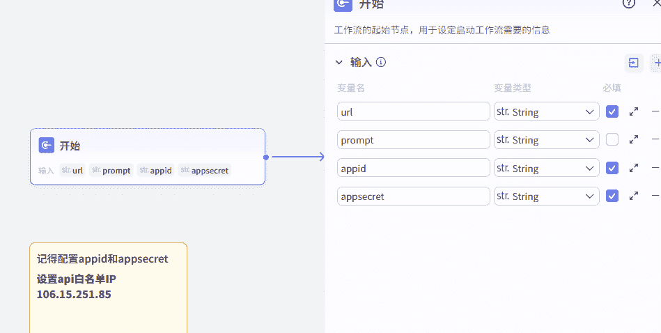

继续，使用链接读取插件，获取文章内容

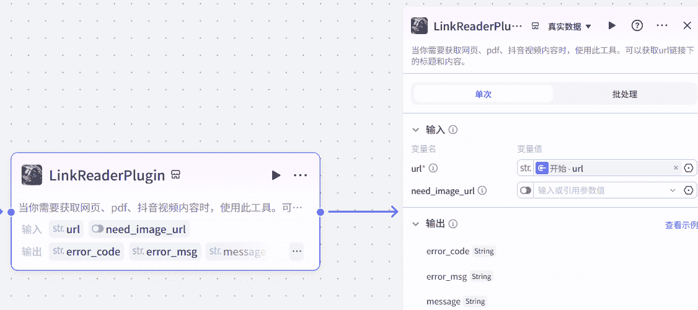

然后，使用大模型节点，提取原文观点和主题

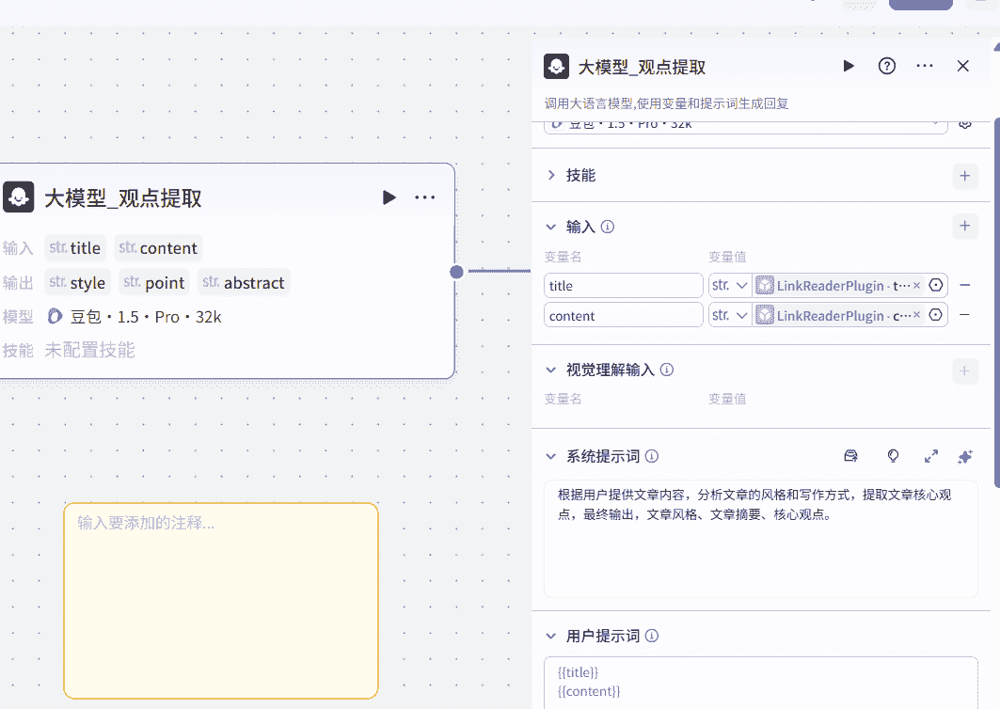

再搭配写作大模型，进行文章二创

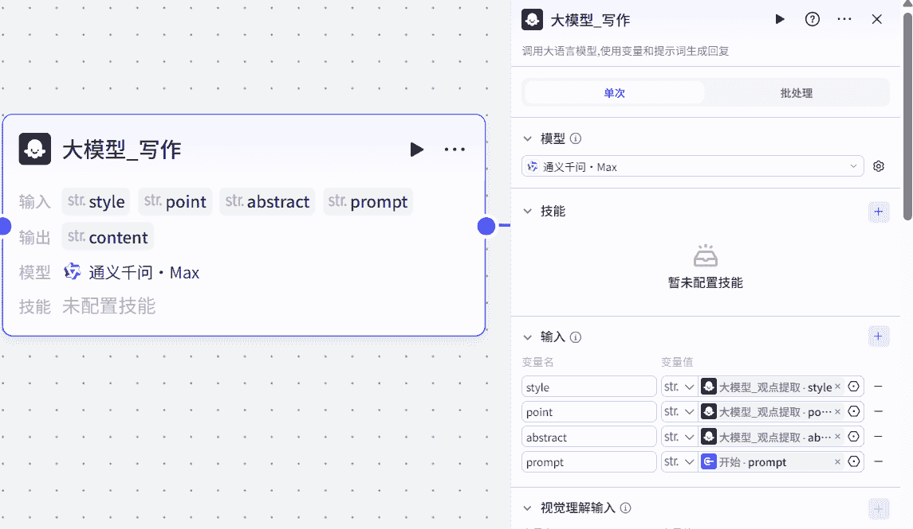

提示词参考如下，可根据自己的赛道进行改写。

大家可以看到，我们在提示词中约束了返回文案的格式，比如重点句子标注、使用markdown格式，这也是为后续排班做准备。

```
##角色：自媒体博主
作为自媒体作者擅长爆款文案写作，把握读者心里，根据用户给定的主题和题目按要求创作文章，创作一篇文章，文章不少于1200字。
##Style:
1.作者日常观点论述文章，注意文章开头技巧（开篇、调动读者情绪、激发引导读者思考），引发读者阅读兴趣。
2.开门见山，提出主题和观点，着重引发读者的情感共鸣，以情动人，让读者在阅读中产生强烈的情感体验;
3.语言风格：个人深度思考风格，简洁的日常表达方式
4.长短句组合，短句使语言简洁、明快，整句散句结合使语言错落有致，丰富文章的层次和可读性;
5.段落转折连接，避免使用：首先、其次、最后、总而言之、总之等逻辑连接词，不要使用“繁杂的世界，快节奏的世界，充满变化的世界里”等虚无的形容词。杜绝AI味道
##Step：
1.根据用户提供的标题和观点信息进行创作，文章不少于1200字
2.深度思考后，构思主题、大纲和内容
3.创作符合风格和要求的文章
4.完成文章后，自行审稿和修改润色
5.最后直接输出文章正文内容，不需要输出标题。

##内容格式：
1、使用Markdown语法风格，区分一级、二级、三级标题使用标签“#、##、###”。
2、文中核心句子使用HTML标签包裹
&lt;span style=&quot;color: rgb(202,88,99); font-weight: bold;&quot; &gt;句子&lt;/span&gt;
3、长短句组合，避免单个句子超过3行。
##注意事项:
1.【禁止使用和出现英文、单词】
2.文章须严格遵循1200字的字数要求,控制篇幅,做到详略得当,避免内容单薄。
3.杜绝任何抄袭、剽窃等侵权行为,文章内容须为原创,切勿照搬照抄他人作品。
4.严禁在文章中出现任何违反国家法律法规、社会公序良俗或影响平台形象的不当言论。
```

公众号排版

因为公众号支持html的文案格式，因此我们可以借助一个插件，实现markdown转html。并且借助html实现文章的排版美化。

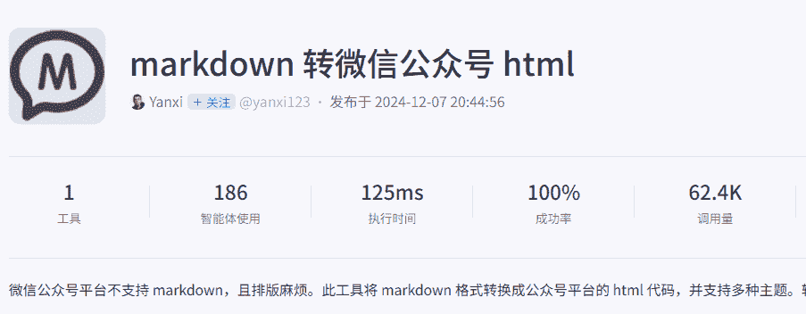

此插件也支持多种风格，可参考说明进行选择即可。

具体呈现效果可对照此网站：https://markdown.com.cn/editor/

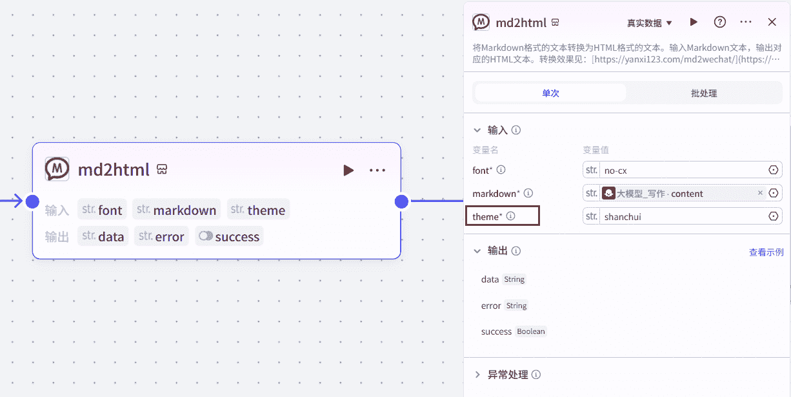

关于封面和文章首图，我们可以借助图像生成节点实现，当然你也可以自己准备合适的配图，这个就比较灵活了。

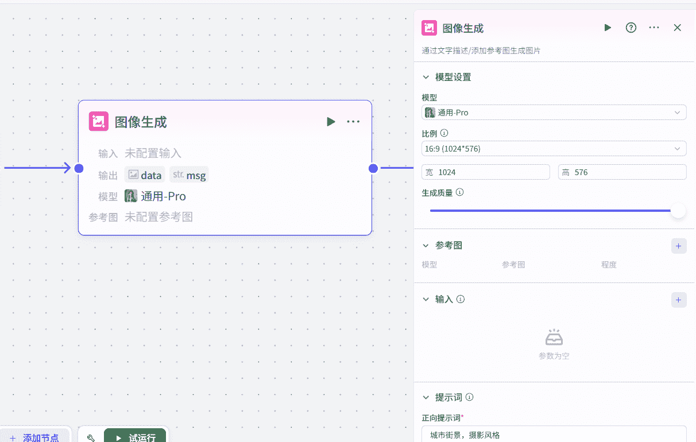

而图片如果想要保存到公众号，不能直接使用原始链接，还需要先将素材上传到公众号后台素材库，使用官方链接。

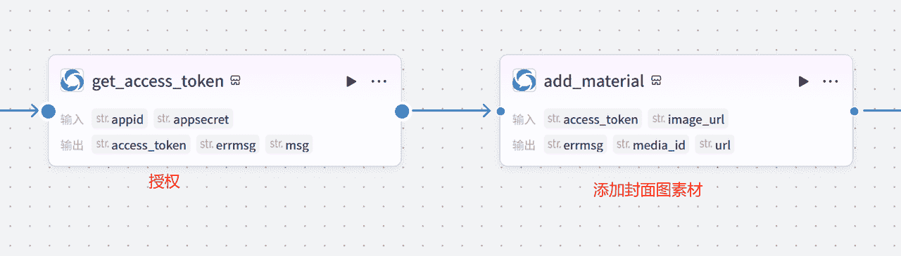

排版

这一步就比较重要了，使用代码节点完成最终排版拼装

这里我们搭配了一个固定头，比如你可以通过固定头实现引导关注等引导语的设定。同理你可以搭配一个固定尾部元素，实现尾部的引导和素材设计。但需要注意的是，此headerHtml内容需要借助135editor进行设计。

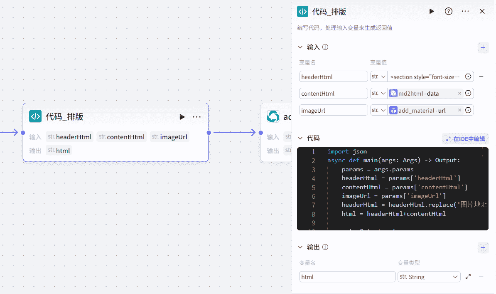

135editor是一个公众号排版网站，因此我们可以借助其先排版，然后再获取排版的源码，组合到我们的工作流代码中使用。

打开135editor网站，点击导入公众号的文章链接，就可以看到原文效果。

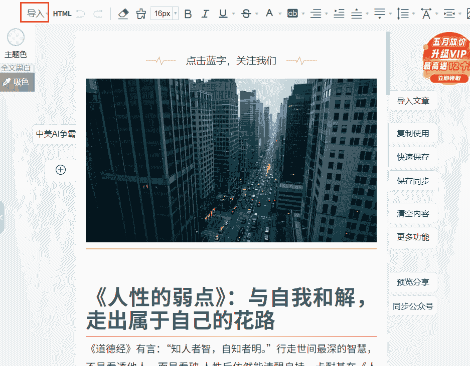

然后点击切换html，可以看到源码信息。

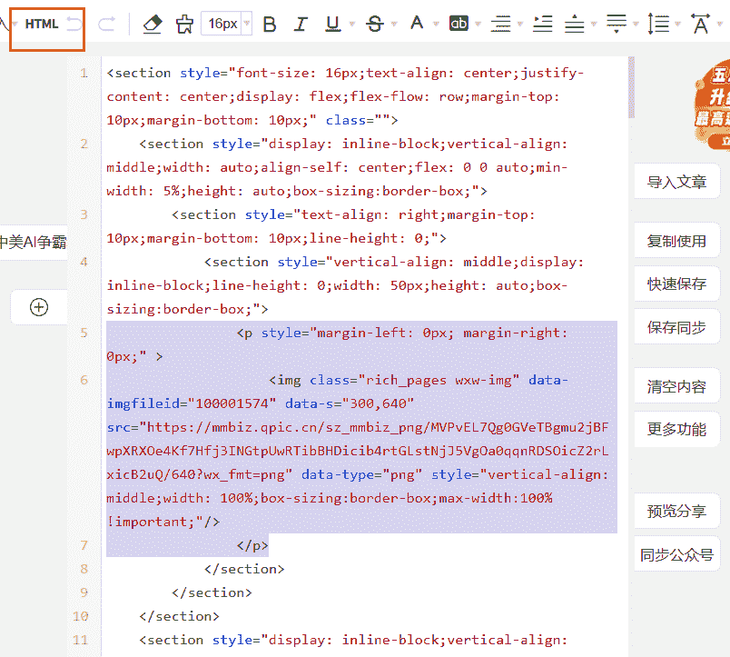

我们需要获取上图中的部分headerHtml固定代码，参考如下。

```
&lt;section style=&quot;font-size: 16px;text-align: center;justify-content: center;display: flex;flex-flow: row;margin-top: 10px;margin-bottom: 10px;&quot;class=&quot;&quot;&gt;&lt;section style=&quot;display: inline-block;vertical-align: middle;width: auto;align-self: center;flex: 0 0 auto;min-width: 5%;height: auto;box-sizing:border-box;&quot;&gt;&lt;section style=&quot;text-align: right;margin-top: 10px;margin-bottom: 10px;line-height: 0;&quot;&gt;&lt;section style=&quot;vertical-align: middle;display: inline-block;line-height: 0;width: 50px;height: auto;box-sizing:border-box;&quot;&gt;&lt;p style=&quot;margin-left: 0px; margin-right: 0px;&quot;&gt;&lt;img class=&quot;rich_pages wxw-img&quot;data-imgfileid=&quot;100001574&quot;data-s=&quot;300,640&quot;src=&quot;https://mmbiz.qpic.cn/sz_mmbiz_png/MVPvEL7Qg0GVeTBgmu2jBFwpXRXOe4Kf7Hfj3INGtpUwRTibBHDicib4rtGLstNjJ5VgOa0qqnRDSOicZ2rLxicB2uQ/640?wx_fmt=png&quot;data-type=&quot;png&quot;style=&quot;vertical-align: middle;width: 100%;box-sizing:border-box;max-width:100% !important;&quot;data-ratio=&quot;0.34869240348692404&quot;data-w=&quot;803&quot;/&gt;&lt;/p&gt;&lt;/section&gt;&lt;/section&gt;&lt;/section&gt;&lt;section style=&quot;display: inline-block;vertical-align: middle;width: auto;align-self: center;flex: 0 0 auto;border-width: 0px;border-style: none;border-color: #3e3e3e;border-radius: 0px 5px 5px 0px;overflow: hidden;min-width: 5%;height: auto;padding: 5px 15px;box-shadow: #d3f3ed 0px 0px 0px;box-sizing:border-box;&quot;class=&quot;&quot;&gt;&lt;section style=&quot;text-align: justify;color: #3e3e3e;&quot;&gt;&lt;p style=&quot;text-wrap: wrap; margin-left: 0px; margin-right: 0px;&quot;&gt;点击蓝字，关注我们&lt;/p&gt;&lt;/section&gt;&lt;/section&gt;&lt;section style=&quot;display: inline-block;vertical-align: top;width: auto;min-width: 5%;flex: 0 0 auto;height: auto;box-sizing:border-box;&quot;&gt;&lt;section style=&quot;text-align: left;margin-top: 10px;margin-bottom: 10px;line-height: 0;&quot;&gt;&lt;section style=&quot;vertical-align: middle;display: inline-block;line-height: 0;width: 50px;height: auto;box-sizing:border-box;&quot;class=&quot;&quot;&gt;&lt;p style=&quot;margin-left: 0px; margin-right: 0px;&quot;&gt;&lt;img class=&quot;rich_pages wxw-img&quot;data-s=&quot;300,640&quot;data-type=&quot;png&quot;style=&quot;vertical-align: middle;width: 100%;box-sizing:border-box;max-width:100% !important;&quot;src=&quot;https://mmbiz.qpic.cn/sz_mmbiz_png/MVPvEL7Qg0GVeTBgmu2jBFwpXRXOe4Kf7Hfj3INGtpUwRTibBHDicib4rtGLstNjJ5VgOa0qqnRDSOicZ2rLxicB2uQ/640?wx_fmt=png&quot;data-imgfileid=&quot;100001575&quot;data-ratio=&quot;0.34869240348692404&quot;data-w=&quot;803&quot;/&gt;&lt;/p&gt;&lt;/section&gt;&lt;/section&gt;&lt;/section&gt;&lt;/section&gt;&lt;section style=&quot;font-size: 16px;text-align: center;margin-top: 10px;margin-bottom: 10px;line-height: 0;&quot;&gt;&lt;section style=&quot;display: inline-block;&quot;class=&quot;&quot;&gt;&lt;p style=&quot;margin-left: 0px; margin-right: 0px;&quot;&gt;&lt;img class=&quot;rich_pages wxw-img&quot;  src=&quot;图片地址&quot; data-type=&quot;jpg&quot; style=&quot;vertical-align: baseline;box-sizing:border-box;&quot; data-ratio=&quot;0.7320754716981132&quot; /&gt;&lt;/p&gt;&lt;/section&gt;&lt;/section&gt;&lt;section style=&quot;font-size: 16px;text-align: left;justify-content: flex-start;display: flex;flex-flow: row;margin-top: 10px;margin-bottom: 10px;&quot;&gt;&lt;section style=&quot;display: inline-block;width: auto;vertical-align: middle;align-self: center;flex: 100 100 0%;background-color: rgba(255, 255, 255, 0);height: auto;box-sizing:border-box;&quot;class=&quot;&quot;&gt;&lt;section style=&quot;margin-bottom: 10px;&quot;&gt;&lt;section style=&quot;background-color: #edc0a9;height: 1px;&quot;&gt;&lt;br/&gt;&lt;/section&gt;&lt;/section&gt;&lt;/section&gt;&lt;/section&gt;&lt;section class=&quot;_135editor&quot;data-role=&quot;paragraph&quot;&gt;&lt;/section&gt;
```

看下代码细节，拼接正文和固定头html，并且将我们的图片地址，替换到headerHtml的“图片地址”占位符，实现插入首图。

```
async def main(args: Args) -&gt; Output:
    params = args.params
    headerHtml = params[&#x27;headerHtml&#x27;]
    contentHtml = params[&#x27;contentHtml&#x27;]
    imageUrl = params[&#x27;imageUrl&#x27;]
    headerHtml = headerHtml.replace(&#x27;图片地址&#x27;,imageUrl)
    html = headerHtml+contentHtml

    ret: Output = {
        &quot;html&quot;: html
    }
    return ret
```

最后将前置的素材（标题、正文、封面图）添加到公众号草稿。

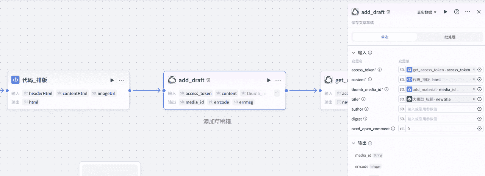

搭配预览节点，获取预览地址

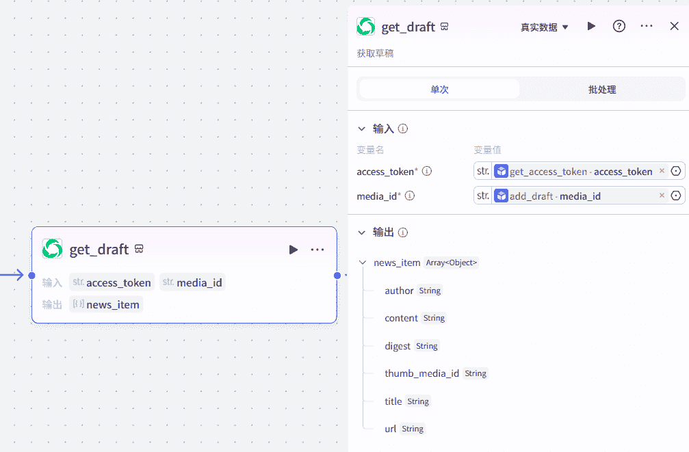

我们找一篇对标文章，看下执行效果

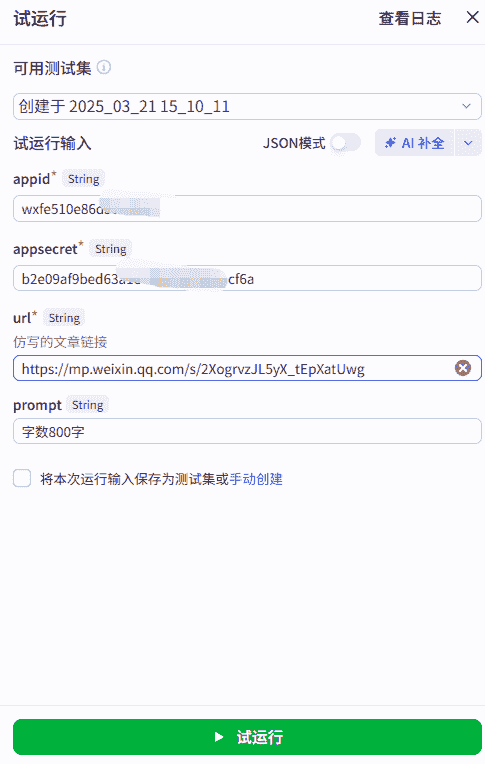

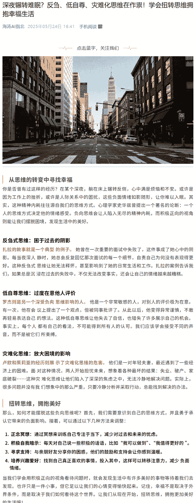

可以看到，引导关注、首图、正文排版、关键句子标注等实现效果。

以上。

如果觉得有用欢迎点点关注，感谢支持！