# OpenClaw实践：10分钟拥有你的个人助理

> 来源：[https://zinxkclpk97.feishu.cn/docx/IGr1d3rD5ohOGgxtB62cXnTmncc](https://zinxkclpk97.feishu.cn/docx/IGr1d3rD5ohOGgxtB62cXnTmncc)

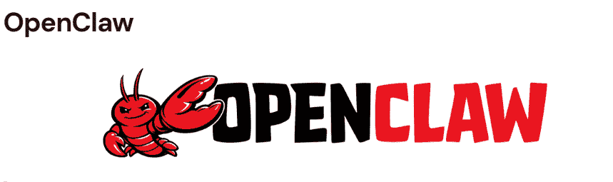

hello，朋友们，本周刚开工，春节期间被讨论更多的是一只龙虾~

就是这个项目OpenClaw，它的持续火爆，github star数破20w，🛰️指数热度也是翻倍。

> https://github.com/openclaw/openclaw

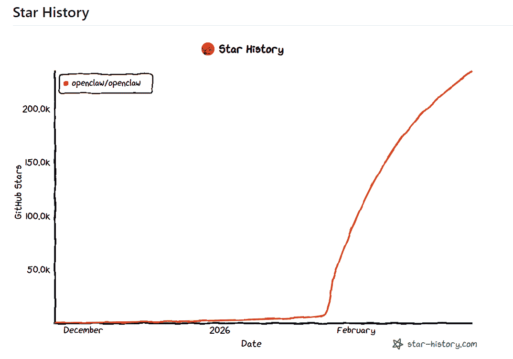

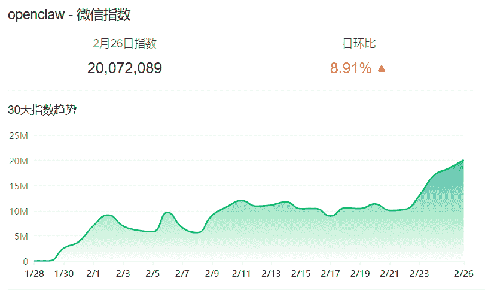

网上有已经有非常多的实践教程和玩法，但还是有不少用户卡在安装部署环节。看到要买云服务器、接国外的AI模型、以及配置命令就有点头晕。

最近扣子、Kimi、MiniMax也陆续上线了自家的Claw，支持用户一键启用OpenClaw，进一步简化了部署流程。

其中MiniMax是OpenClaw作者首推的国内模型，其性价比对于初级用户是比较友好的。

接下来，我们以MiniMax的MaxClaw为例，演示如何部署和接入飞书，10分钟拥有你的龙虾🦞助理

### 登录MinMax网站

登录网站，点击立即开始

> agent.minimaxi.com

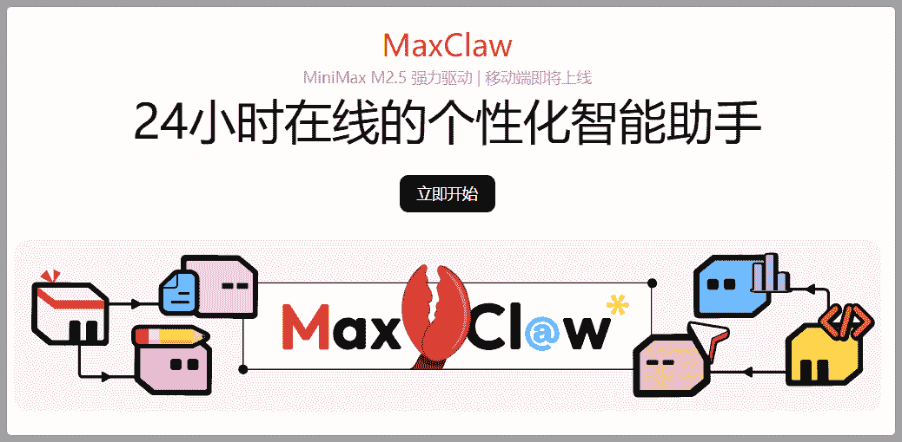

这里我们可以选择基础版套餐进行体验

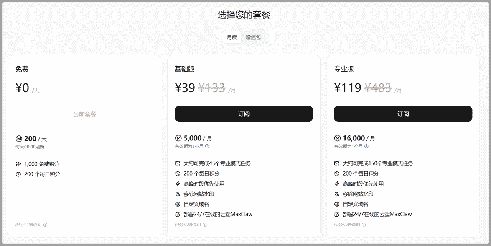

开通后前往获取部署OpenClaw，稍等片刻启动完成

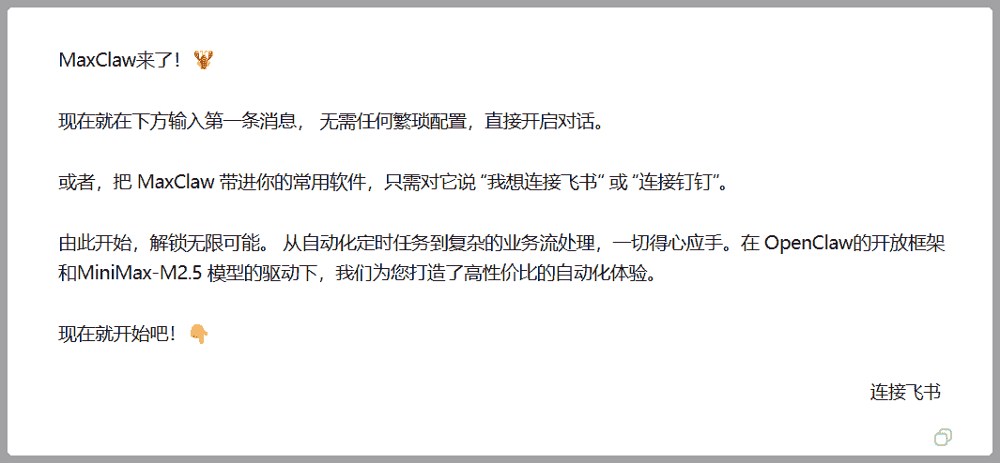

到这里我们可以直接在网页端对话框使用它，也可以将其接入到飞书机器人。

### 飞书应用授权配置

> ps：预选安装飞书客户端

下一步进行飞书授权，我们按照指引完成操作

1、创建飞书应用，获取 App ID 和 App Secret

> 前往飞书开放平台https://open.feishu.cn/，选择自建应用

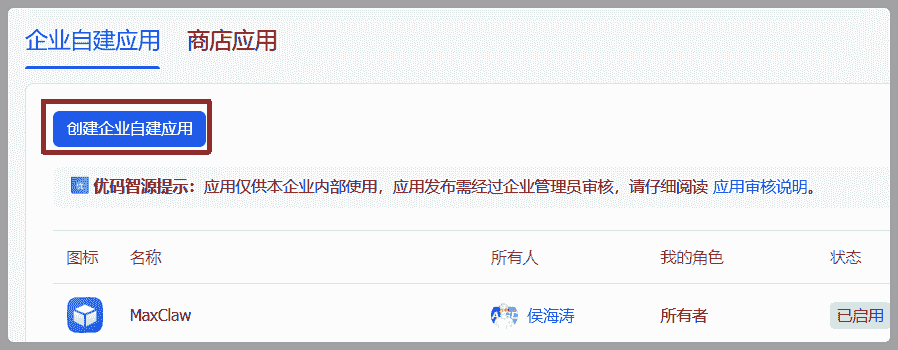

填写应用信息

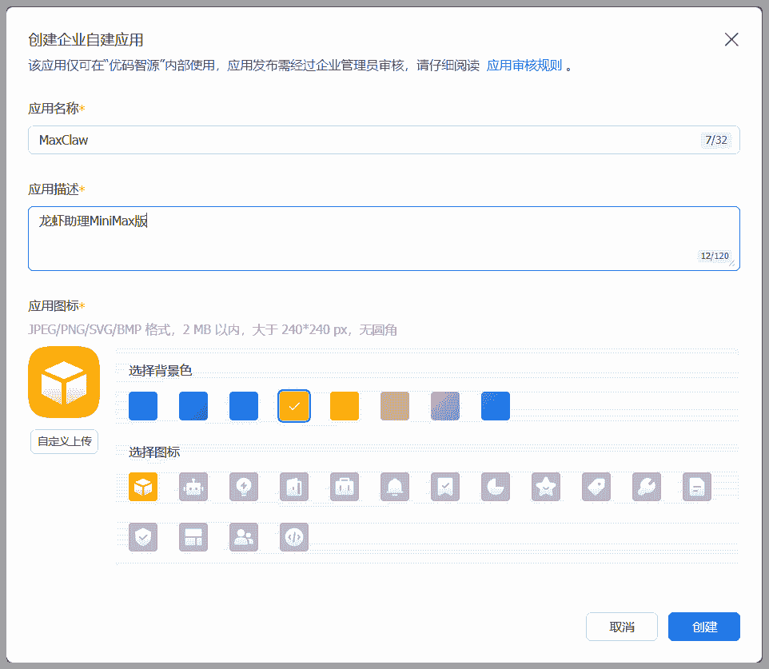

创建完成后，可以获取到关键的appid和appsecret信息。

2、将appid和appsecret凭证信息复制下来

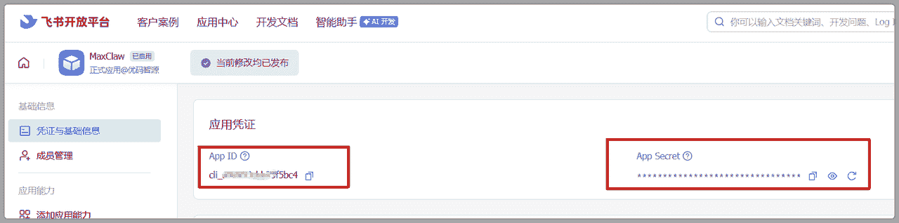

发送给MaxClaw，让它自己完成配置

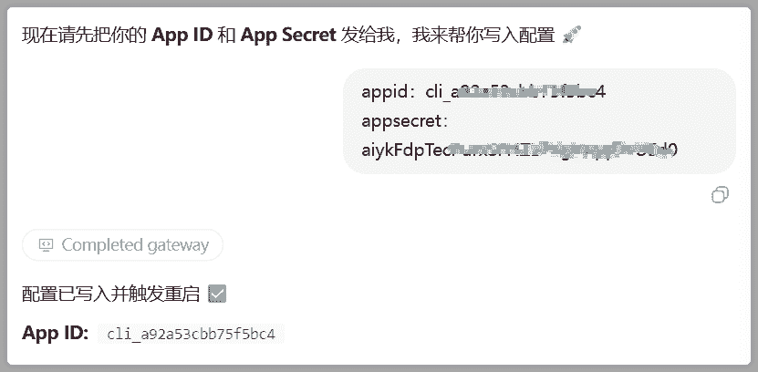

3、权限配置

进入你的应用 → 「权限管理」→「批量导入」，粘贴以下权限 JSON。

```
{
  &quot;scopes&quot;: {
    &quot;tenant&quot;: [
      &quot;im:message&quot;,
      &quot;im:message:send_as_bot&quot;,
      &quot;im:message:readonly&quot;,
      &quot;im:message.p2p_msg:readonly&quot;,
      &quot;im:message.group_at_msg:readonly&quot;,
      &quot;im:chat.members:bot_access&quot;,
      &quot;im:chat.access_event.bot_p2p_chat:read&quot;,
      &quot;im:resource&quot;,
      &quot;contact:user.employee_id:readonly&quot;,
      &quot;application:application:self_manage&quot;,
      &quot;application:bot.menu:write&quot;
    ],
    &quot;user&quot;: [&quot;im:message&quot;,&quot;im:chat.access_event.bot_p2p_chat:read&quot;]
  }
}
```

4、开启机器人能力

找到「应用能力」→「机器人」→ 点击添加机器人

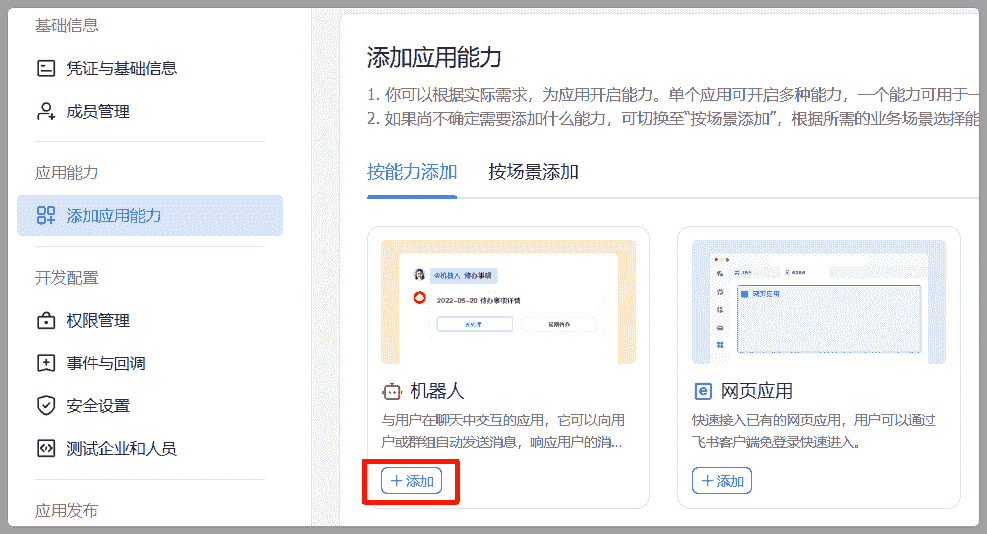

5、发布版本

「版本管理与发布」→ 创建版本 → 发布上线

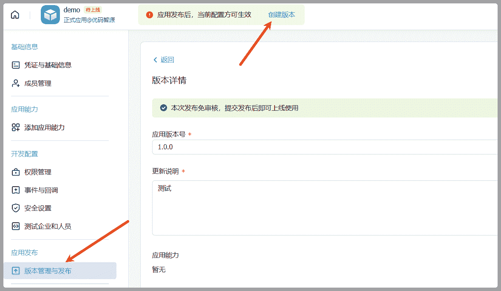

发布完成后，在飞书中可以看到对应的消息

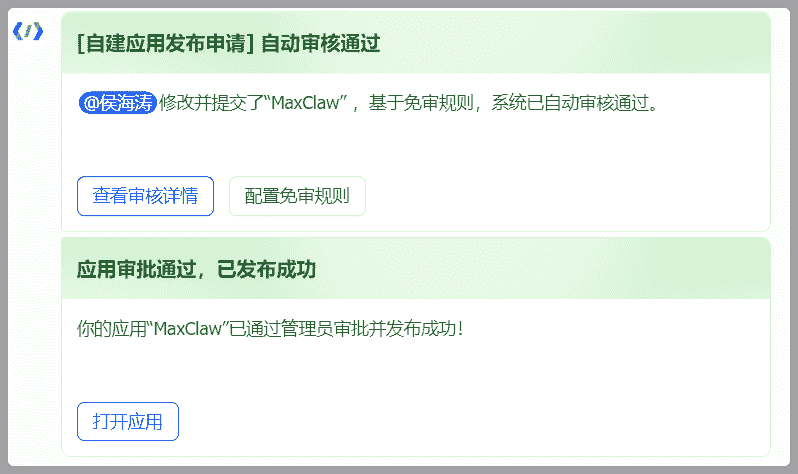

6、重启服务并配置事件订阅

到这里我们完成初步的配置，下一步是前往MaxClaw重启服务，这步很关键，重启完成后继续配置事件订阅，完成最后一步

在MinMax中点击右上角重启MaxClaw


最后一步，回到飞书开发者后台，配置事件订阅

进入你的应用 → 「事件与回调」→「事件订阅」→ 订阅方式选择使用长连接接收事件，点击保存

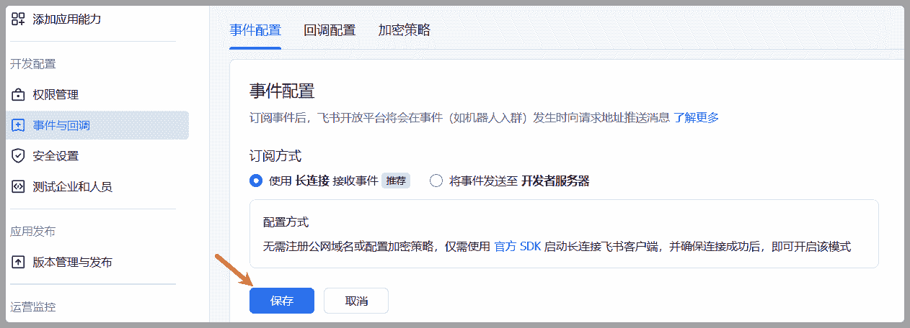

添加事件im.message.receive_v1，然后保存后发布新版本

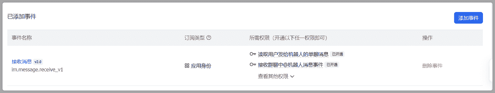

完成后，在飞书里给机器人发条消息试试，看看能不能正常对话

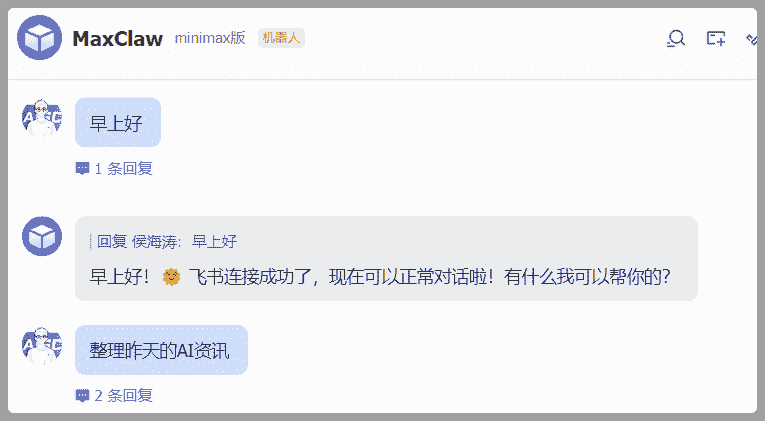

以上是MaxClaw和飞书的配置，相对简单一些，可以收藏学习。

很多伙伴反馈或不知道OpenClaw是什么，不知道对自己有什么帮助。我也有同感~

当我们拥有一个超级牛马AI，接下来就是养成系游戏了。

后续我会继续分享关于OpenClaw的基础教学和最佳实践，或许对你会有新的启发，欢迎一键三连关注，共同开启养龙虾之旅。

相关链接

https://agent.minimaxi.com/

https://github.com/openclaw/openclaw

https://clawhub.ai/

https://open.feishu.cn/app