# 即创👸号爆文-说明书

> 来源：[https://zinxkclpk97.feishu.cn/docx/AS2edZte1oN1oPx7rwTckviLnHb](https://zinxkclpk97.feishu.cn/docx/AS2edZte1oN1oPx7rwTckviLnHb)

### 近期智能体不稳定 ，问题处理优先加群

备用新版地址（内测中）：

https://www.coze.cn/store/project/7569682451056918578?from=project_card


### 更多案例：[Coze智能体高阶案例库](https://zinxkclpk97.feishu.cn/wiki/RzqSwyTEjioBS4kWfeccuCPXnnJ?fromScene=spaceOverview)

>

# 目标

## **即创，助你1分钟创作爆款文案**

## 介绍

> 即创是基于智能体Coze平台搭建的一款辅助👸号创作的系统，依据👸号爆文写**作的成熟方法论，保证系**统成文的品质。在提供了个性化的配置要求的同时，支持个人管理多账号的矩阵化运营模式。

> 如果你有这方面的需求，点击链接，即刻创作。➡️ https://www.coze.cn/s/iUTaBqEw/

## 功能特性

+   一键成文：支持参考文章链接、素材、个人观点[即创👸号爆文-使用手册（内测中）](https://zinxkclpk97.feishu.cn/docx/AS2edZte1oN1oPx7rwTckviLnHb#share-VTksdYR2Joooakx4UYOc6Cznnwc)创作形式，满足不同水平人群的创作情景。

+   自动排版：丰富的排版，可定制固定文章开头与末尾排版。（支持markdown、135editor、壹伴）

+   一键发文：一键成文，一键发布至👸号草稿箱。

+   风格设定：可以为每个账号配置写作风格，标题风格，配图风格。满足矩阵化、差异化运营的需求。

+   AI创作：支持国内外多款最强主流模型。

+   联网模式：支持联网写作模式

+   矩阵运营：单Coze用户可以添加设定多个👸号，并且支持独立配置写作风格。

+   支持使用影刀RPA，实现多账号矩阵化运营。

+   [即创👸号爆文-使用手册（内测中）](https://zinxkclpk97.feishu.cn/docx/AS2edZte1oN1oPx7rwTckviLnHb#share-AMADdbMXgoLbXmxiFDGcPqvUntg)款梗图：支持生成爆款梗图文章，一键排版发布。

+   📕转小绿书：支持一键复刻📕笔记内容，搬运[即创👸号爆文-使用手册（内测中）](https://zinxkclpk97.feishu.cn/docx/AS2edZte1oN1oPx7rwTckviLnHb#share-Vc7ldpwpYolhQhxKaxmcHk8FnEg)小绿书，支持图片文字OCR，文案改写。

快速扫盲

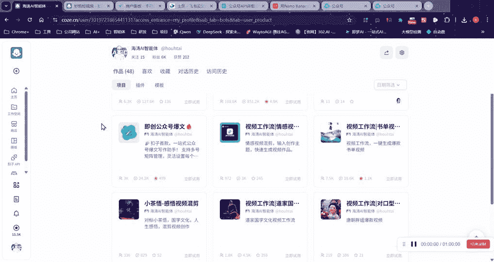

[20250904221904_rec_.mp4](https://internal-api-drive-stream.feishu.cn/space/api/box/stream/download/all/EksEbkkNsoI4QMxQEn8choqMnxf)


[整体功能内容介绍.mp4](https://internal-api-drive-stream.feishu.cn/space/api/box/stream/download/all/RguBbTPVfosre8xHY22cCNFBnGf)

# 一、👸号账号设置（必看）

+   **系统使用需对接👸号，需要使用👸号**的开发权限，因此请按照下面步骤进行配置。

## 网页登录🛰️👸号管理平台

https://mp.weixin.qq.com/

## 设置👸号开发权限

在菜单栏【设置与开发-开发接口管理】点击开通，成为开发者，如果已经是开通过了，则进行下一步

## 账号开发信息配置

1.  见下图，在这里可以看到开发者**appid****和****appsecret。**

1.  appsecret获取需要管理员确认，如果是运营人员操作，请及时联系管理员配合确认。

1.  切记要保存好此账号，遗忘需要重置。

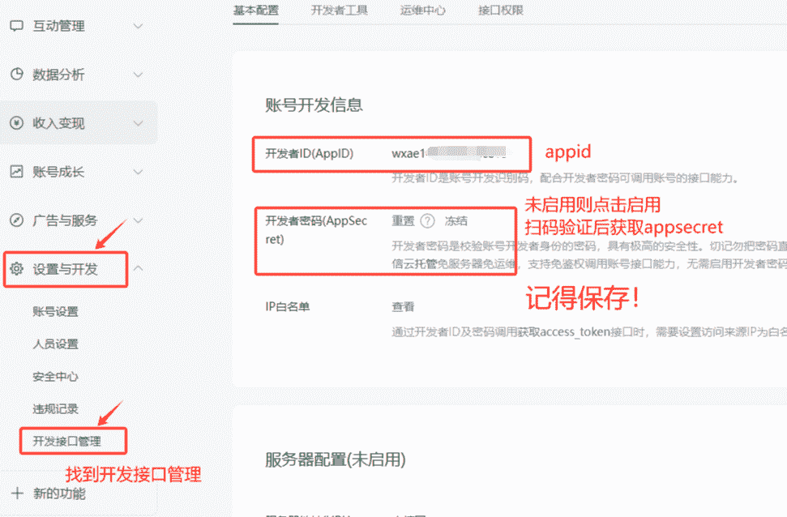

## 设置👸号白名单IP地址

1.  点击查看白名单

1.  修改为我们提供的IP地址：**106.15.251.85 **

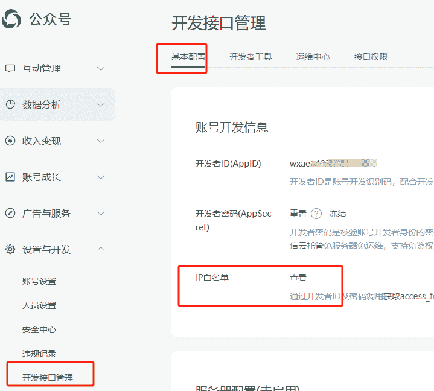

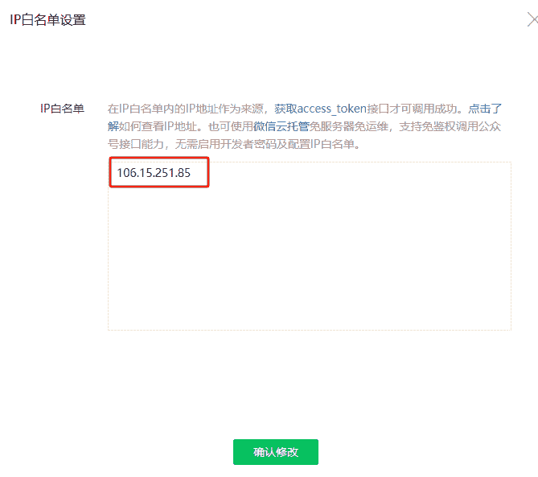

### 常见问题

a. IP白名单未配置或未生效，因配置不是及时生效，初次设置后需等待一段时间或者重复点击修改保存几次。

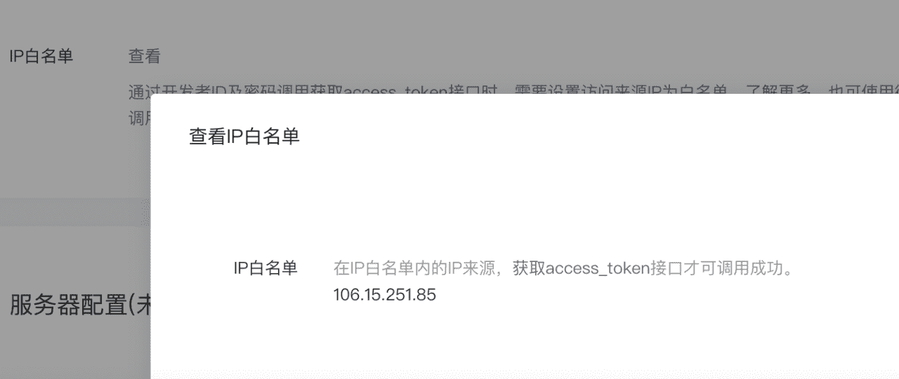

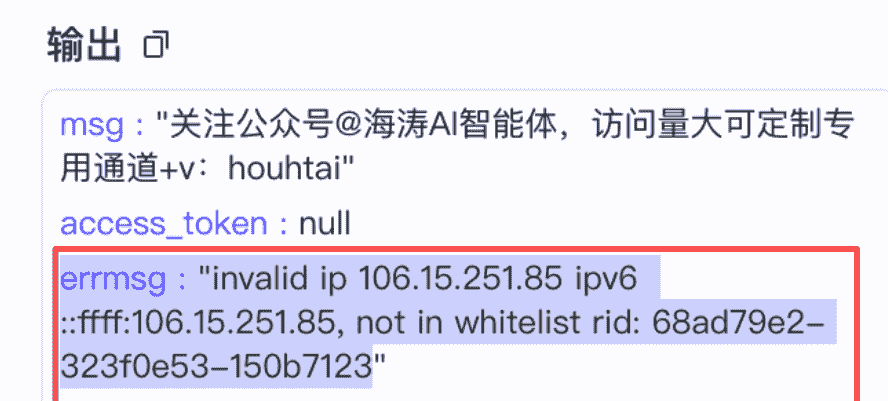

b. 插件add_material报错，提示api unauthorized rid xxx.

需检查👸号是否为服务号，服务号使用此接口需要认证和授权，这是👸号平台限制

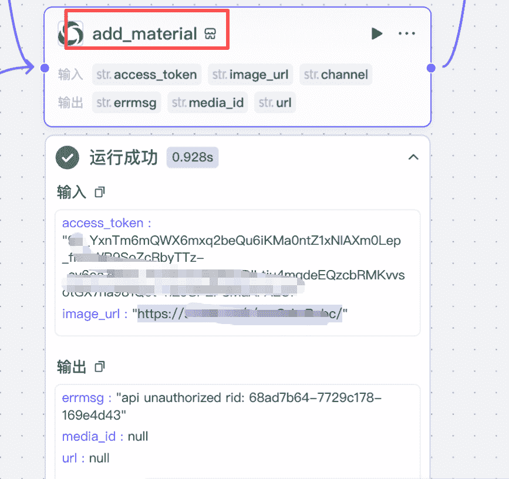

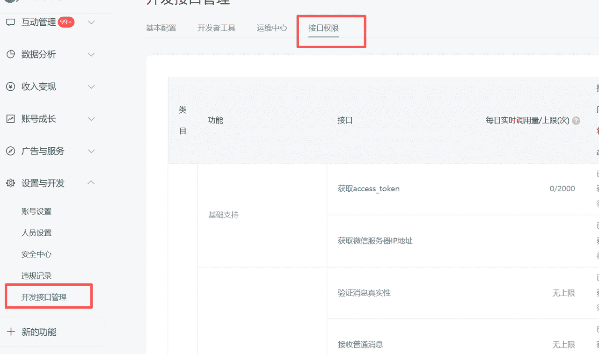

c.提示appsecret 错误 invialid appsecret

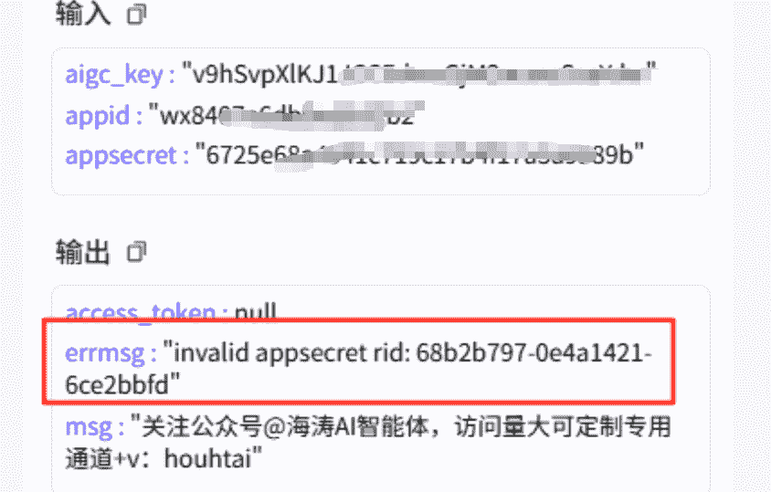

需检查获取的appsecret是否准确、避免出现空格，如果忘记之前的appsecret，则需要重置获取

d.服务号限制问题，导致保存草稿失败

目前官方要求服务号必须认证后，才可以使用素材保存的api接口。

如果你是服务号用户，需要检查下面几处权限


查看永久素材管理接口是否已获得权限。

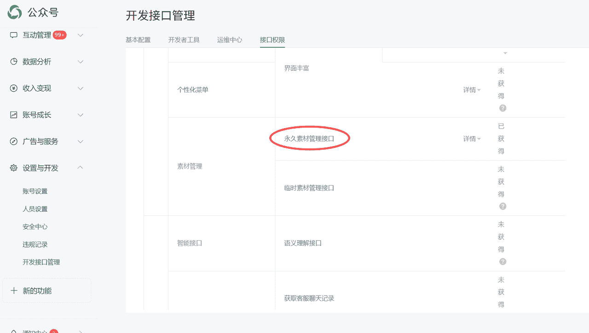

# 二、即创产品|功能介绍

## 系统主页

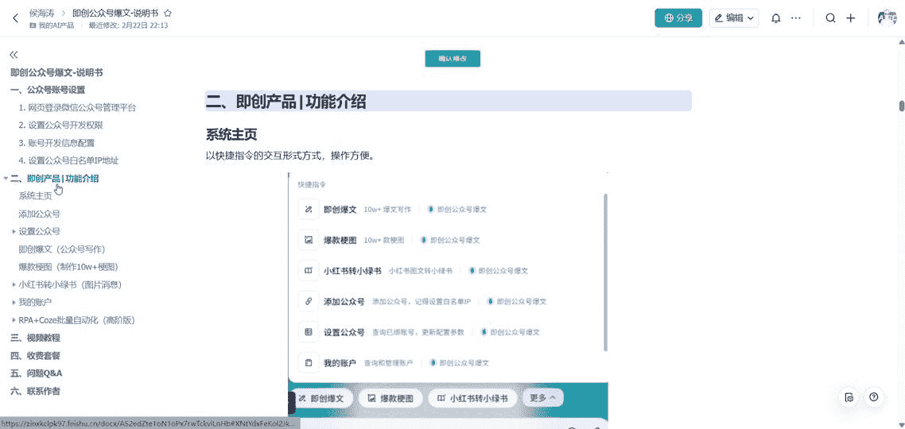

[入门实操演示.mp4](https://internal-api-drive-stream.feishu.cn/space/api/box/stream/download/all/KkC7bmMpiojIPixWxaScBcy8ncd)

以快捷指令的交互形式方式，操作方便。

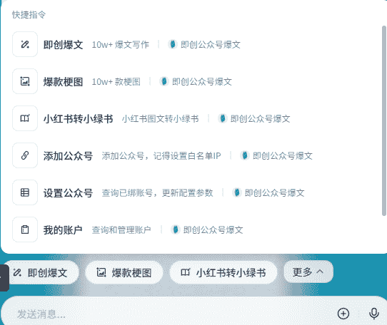

## 添加👸号


+   设置账号，添加你的👸号

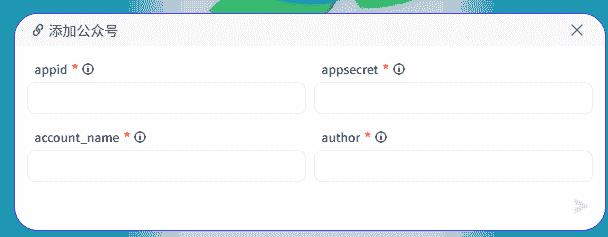

+   支持添加多个👸号，体验用户最多添加1个，如需添加多个客联系作者加额度

+   点击我的账户，可以查看已经绑定的账号信息和账户总体用量数据

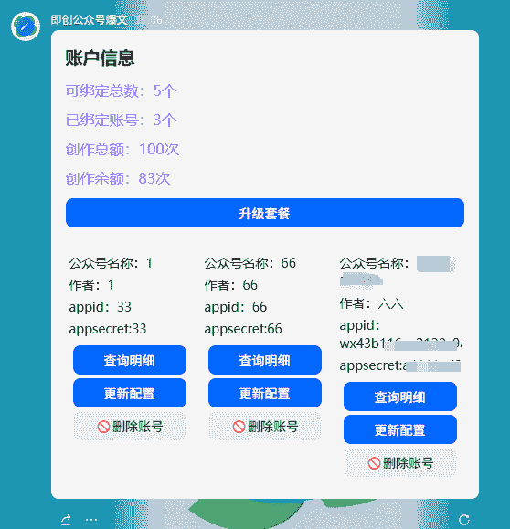

## 设置👸号


[账号风格设定.mp4](https://internal-api-drive-stream.feishu.cn/space/api/box/stream/download/all/QVHWbtLPwog0oJxzTuUccqJonEd)

+   功能说明：用户设置每个👸号的基础信息、写作风格配置、排版配置

+   **系统默认有通用的提示词和模板配置，用户可通过此功能个性化定制每**个👸号的配置（建议联系作者来设置模板）

**点击快捷指令【设置👸号】-->选择设置的账号-->单独填写**需要修改的配置信息-->点击箭头设置完成

注意事项：每次设置其中一个参数

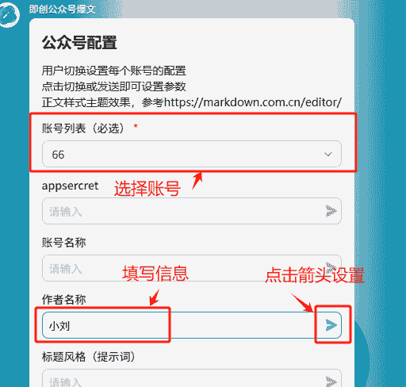

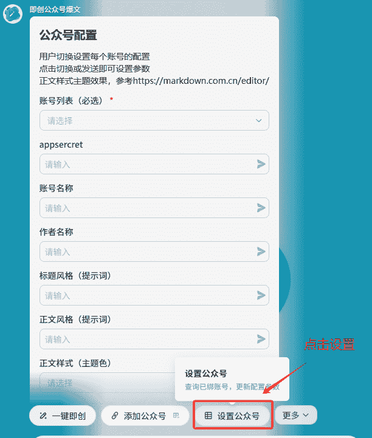

+   **具体参数说明**

| 参数名称 | 参数说明 |  |
| --- | --- | --- |
| 账号列表 | 已经添加的👸号列表，选择对应账号进行设定 | 展示已经添加的👸号 |
| appsecret | 👸号appsecret |  |
| 账号名称 | 👸号名称 |  |
| 作者名称 | 作者名称 |  |
| 标题风格（可选） | 标题提示词，根据生成的文章内容，生成文章标题。用户可按需自定义提示词风格 | 参考[即创👸号爆文-使用手册（开发中）](https://zinxkclpk97.feishu.cn/docx/AS2edZte1oN1oPx7rwTckviLnHb#share-FPCedMvkqohsgJxPpAGcHKTSn2b) |
| 正文风格（可选） | 标题提示词，参考链接和素材，生成文章正文。用户可按需自定义提示词风格 | 参考[即创👸号爆文-使用手册（开发中）](https://zinxkclpk97.feishu.cn/docx/AS2edZte1oN1oPx7rwTckviLnHb#share-FPCedMvkqohsgJxPpAGcHKTSn2b) |
| 正文样式（默认chazi） | 正文排版采用markdown转html，支持多款主题风格，具体可参考https://markdown.com.cn/editor/ | 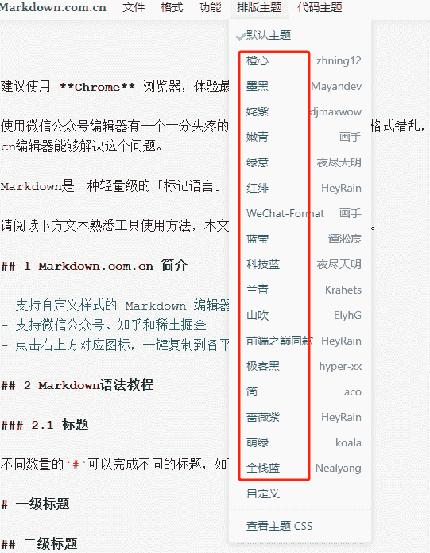 |
| 配图风格（可选） | 配图提示词，目前配图仅支持封面配图、文章首图。默认提取正文内容关键词生成合适的配图。 | 示例： |
| 开头元素（可选） | 系统默认：（引导关注+首图） | 示例： |
| 文末元素（可选） | 系统默认：（文末end+引导点赞） | 示例： |

> 科技风格，现实，高清摄影

```
&lt;section [class=&quot;_135editor&quot;data-tools=&quot;135编辑器&quot;data-id=&quot;97620&quot;&gt;&lt;section style=&quot;margin:10px auto;&quot;&gt;&lt;section class=&quot;as](https://image2.135editor.com/cache/remote/aHR0cHM6Ly9tbWJpei5xbG9nby5jbi9tbWJpel9naWYvN1FSVHZrSzJxQzZEMk9oaWJIVU16MVhpYUM3djBSY1VBMXRRN21pY3BpYVN2ZUZqZWhyMWEwaDNDMktoZ29WZm91S0xaalVEeVI0OExqcTVpYXNCaGljdnpKTlEvMD93eF9mbXQ9Z2lm)[sistant&quot;style=&quot;width:100%;max-width:100% !important;box-sizing:border-box;&quot;data-width=&quot;100%&quot;&gt;&lt;img class=&quot;a](https://image2.135editor.com/cache/remote/aHR0cHM6Ly9tbWJpei5xbG9nby5jbi9tbWJpel9naWYvN1FSVHZrSzJxQzZEMk9oaWJIVU16MVhpYUM3djBSY1VBMXRRN21pY3BpYVN2ZUZqZWhyMWEwaDNDMktoZ29WZm91S0xaalVEeVI0OExqcTVpYXNCaGljdnpKTlEvMD93eF9mbXQ9Z2lm)ssistant&quot;style=&quot;width:100%;display:block;vertical-align:baseline;box-sizing:border-box;max-width:100% !important;&quot;src=&quot;https://image2.135editor.com/cache/remote/aHR0cHM6Ly9tbWJpei5xbG9nby5jbi9tbWJpel9naWYvN1FSVHZrSzJxQzZEMk9oaWJIVU16MVhpYUM3djBSY1VBMXRRN21pY3BpYVN2ZUZqZWhyMWEwaDNDMktoZ29WZm91S0xaalVEeVI0OExqcTVpYXNCaGljdnpKTlEvMD93eF9mbXQ9Z2lm&quot;data-width=&quot;100%&quot;draggable=&quot;false&quot;data-ratio=&quot;0.0033333333333333335&quot;data-w=&quot;600&quot;/&gt;&lt;/section&gt;&lt;section data-autoskip=&quot;1&quot;class=&quot;135brush&quot;style=&quot;text-align: justify;letter-spacing: 1.5px;font-size:16px;color:#333;padding:8px 1em;background-image:-webkit-linear-gradient(left, #e6eafe,#f7faff);color:#3859fe;box-sizing:border-box;&quot;&gt;&lt;p&gt;点击上方&lt;strong&gt;蓝字&lt;/strong&gt;关注我&lt;/p&gt;&lt;/section&gt;&lt;section class=&quot;assistant&quot;style=&quot;width:100%;max-width:100% !important;box-sizing:border-box;&quot;data-width=&quot;100%&quot;&gt;&lt;img class=&quot;assistant&quot;style=&quot;width:100%;display:block;vertical-align:baseline;box-sizing:border-box;max-width:100% !important;transform: scaleX(-1);-webkit-transform: scaleX(-1);-moz-transform: scaleX(-1);-o-transform: scaleX(-1);&quot;src=&quot;https://image2.135editor.com/cache/remote/aHR0cHM6Ly9tbWJpei5xbG9nby5jbi9tbWJpel9naWYvN1FSVHZrSzJxQzZEMk9oaWJIVU16MVhpYUM3djBSY1VBMXRRN21pY3BpYVN2ZUZqZWhyMWEwaDNDMktoZ29WZm91S0xaalVEeVI0OExqcTVpYXNCaGljdnpKTlEvMD93eF9mbXQ9Z2lm&quot;data-width=&quot;100%&quot;draggable=&quot;false&quot;data-ratio=&quot;0.0033333333333333335&quot;data-w=&quot;600&quot;/&gt;&lt;/section&gt;&lt;/section&gt;&lt;/section&gt;&lt;section style=&quot;font-size: 16px,text-align: center,margin-top: 10px,margin-bottom: 10px,line-height: 0,&quot;&gt;&lt;section style=&quot;display: inline-block,&quot;class=&quot;&quot;&gt;&lt;p style=&quot;margin-left: 0px,margin-right: 0px,&quot;&gt;&lt;img class=&quot;rich_pages wxw-img&quot;src=&quot;图片地址&quot;data-type=&quot;jpg&quot;style=&quot;vertical-align: baseline,box-sizing:border-box,&quot;/&gt;&lt;/p&gt;&lt;/section&gt;&lt;/section&gt;&lt;section style=&quot;font-size: 16px,text-align: left,justify-content: flex-start,display: flex,flex-flow: row,margin-top: 10px,margin-bottom: 10px,&quot;&gt;&lt;section style=&quot;display: inline-block,width: auto,vertical-align: middle,align-self: center,flex: 100 100 0%,background-color: rgba(255,255,255,0),height: auto,box-sizing:border-box,&quot;class=&quot;&quot;&gt;&lt;section style=&quot;margin-bottom: 10px,&quot;&gt;&lt;section style=&quot;background-color: #edc0a9,height: 1px,&quot;&gt;&lt;br/&gt;&lt;/section&gt;&lt;/section&gt;&lt;/section&gt;&lt;/section&gt;
```

### 自定义开头和末尾（可选，按需设置，系统有默认风格兜底）

我们在创作时，经常需要在文章开头和末尾设置引导关注、点赞等操作。同时也会在末尾设置作者个人介绍、往期文章等信息。让账号文章结构更加立体丰满。

[开头和末尾设置教程](https://zinxkclpk97.feishu.cn/docx/AS2edZte1oN1oPx7rwTckviLnHb#share-Sod5d4oQXotW5rxvKkCcbPejnMi)

+   **实在搞不定可以联系我来协助**

为解决此类需求，系统提供了设置开头和末尾元素的功能，可按照如下步骤进行操作：

1.  选择一篇我们排版好的👸号文章，并获取其文章链接

1.  使用135editor编辑器，导入文章，用于查看👸号文章源码。这里用我的一篇文章为例。

+   135地址：https://www.135editor.com/beautify_editor.html#

+   示例文章：https://mp.weixin.qq.com/s/4z1QjrTMm4E41rbqNKAc2g

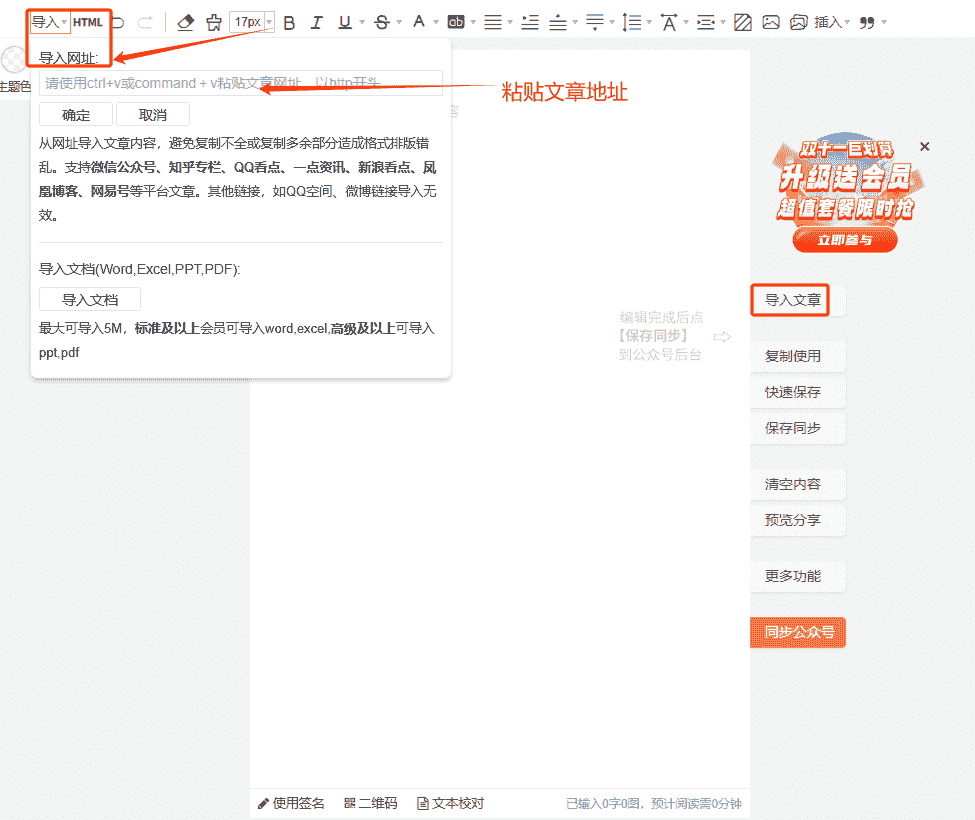

1.  通过源码，我们可以看到👸号文章的层级，比如开头和末尾的源码。

1.  需要注意的是，👸号API保存草稿不支持使用外部素材链接，因此尽量使用自己发布过的文章进行提取。

1.  比如我希望将下面两部分作为👸号文章的固定开头和结尾，所以可以点击左上角HTML，查看其对应的源码信息。

| 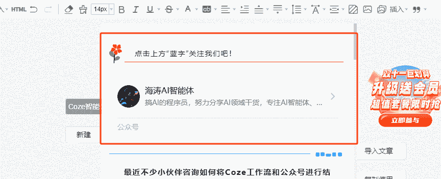 | ``` &amp;lt;section class=&amp;quot;undefined _135editor&amp;quot;&amp;gt;&amp;lt;/section&amp;gt; &amp;lt;section class=&amp;quot;_135editor&amp;quot; data-tools=&amp;quot;135编辑器&amp;quot; data-id=&amp;quot;116758&amp;quot;&amp;gt;         &amp;lt;section style=&amp;quot;margin: 20px auto;&amp;quot;&amp;gt;                 &amp;lt;section style=&amp;quot;display: flex;justify-content: flex-start;align-items: center;&amp;quot;&amp;gt;                         &amp;lt;section style=&amp;quot;flex-shrink: 0;padding-right: 10px;box-sizing:border-box;&amp;quot;&amp;gt;                                 &amp;lt;section class=&amp;quot;assistant&amp;quot; style=&amp;quot;width: 25px;box-sizing:border-box;&amp;quot;&amp;gt;                                         &amp;lt;img class=&amp;quot;assistant&amp;quot; style=&amp;quot;width: 100%; display: block;vertical-align:baseline;box-sizing:border-box;max-width:100% !important;&amp;quot; src=&amp;quot;https://bcn.135editor.com/files/images/editor_styles/0d6f9ba640c41e05427c54c43a9de3d1.png&amp;quot; data-width=&amp;quot;100%&amp;quot; draggable=&amp;quot;false&amp;quot; data-ratio=&amp;quot;1.4761904761904763&amp;quot; data-w=&amp;quot;42&amp;quot;/&amp;gt;                                 &amp;lt;/section&amp;gt;                         &amp;lt;/section&amp;gt;                         &amp;lt;section style=&amp;quot;max-width: 100% !important;background-color: #f8f7f7;border-radius: 10px;width: 100%;padding: 5px 0;box-sizing:border-box;&amp;quot; data-width=&amp;quot;100%&amp;quot;&amp;gt;                                 &amp;lt;section style=&amp;quot;font-size: 14px;color: #333;text-align: left;letter-spacing: 1.5px;border-bottom: 1px solid #d03428;padding: 5px 0 5px 20px;box-sizing:border-box;transform: translateX(-5px);-webkit-transform: translateX(-5px);-moz-transform: translateX(-5px);-o-transform: translateX(-5px);&amp;quot;&amp;gt;                                         &amp;lt;span class=&amp;quot;135brush&amp;quot; data-brushtype=&amp;quot;text&amp;quot; &amp;gt;点击上方“蓝字”关注我们吧！&amp;lt;/span&amp;gt;                                 &amp;lt;/section&amp;gt;                         &amp;lt;/section&amp;gt;                 &amp;lt;/section&amp;gt;         &amp;lt;/section&amp;gt; &amp;lt;/section&amp;gt; &amp;lt;mp-common-profile data-pluginname=&amp;quot;mpprofile&amp;quot; data-id=&amp;quot;Mzk0MDc1OTU5Mw==&amp;quot; data-headimg=&amp;quot;https://mmbiz.qlogo.cn/mmbiz_png/Xia9z9iarwRP3NgDibdzFYjQ5DqpvvECvRZg81Tlz2anfjcEibQaETxIuQsicK15dZQ8y5ibhLiaPkQ5fyKgS6nYzD1wg/0?wx_fmt=png&amp;quot; data-nickname=&amp;quot;海涛AI智能体&amp;quot; data-alias=&amp;quot;&amp;quot; data-signature=&amp;quot;搞AI的程序员，努力分享AI领域干货，专注AI智能体、RPA自动化。AI精进每一天，早日脱离牛马生活&amp;quot; data-from=&amp;quot;2&amp;quot; data-is_biz_ban=&amp;quot;0&amp;quot;&amp;gt;&amp;lt;/mp-common-profile&amp;gt; ``` |
| --- | --- |
|  | ``` &amp;lt;section style=&amp;quot;text-align: left;margin-left: 0.5em;margin-right: 0.5em;text-indent: 0em;line-height: 1.75em;&amp;quot;&amp;gt;         &amp;lt;span style=&amp;quot;font-size: 16px;&amp;quot;&amp;gt;写在最后：欢迎共学共创，交流关注，学到了点赞~~&amp;lt;/span&amp;gt; &amp;lt;/section&amp;gt; ``` |

1.  因为源码存在很多换行和不必要的空格，所以必须分别将开头和末尾的源码拷贝出来，使用如下工具进行二次压缩

+   html普通压缩 http://www.jsons.cn/jsforamt/

1.  使用【即创-设置👸号】功能，将压缩之后的源码，分别设置到👸号的"开头元素"和"文末元素"

设置成功后可以看到结果。


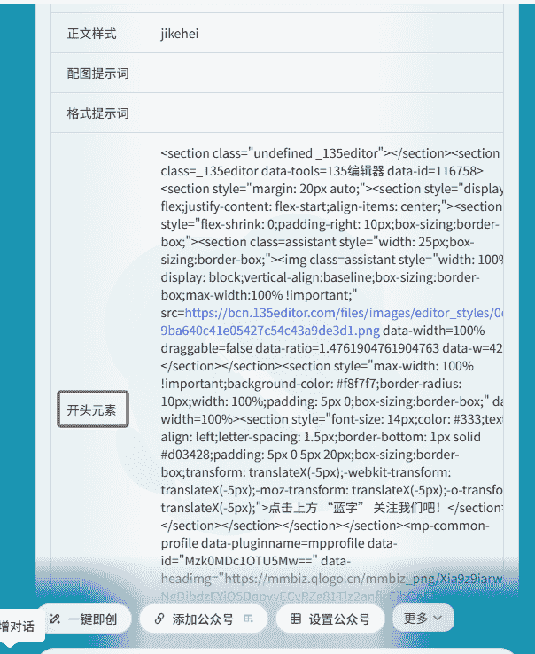

1.  然后生成文章至草稿，进行格式验证。


### 提示词大全（可选）

工作流背后使用了AI模型，像标题、内容、配图均需要单独的提示词来控制风格、及输出格式的稳定性。因此这个板块会持续更新和积累我们经过测试和优化后的提示词示例，使用过程中按需改写即可。

参考提示词：[18个领域的👸号写作提示词](https://zinxkclpk97.feishu.cn/docx/A7T3dFqJwo9VryxhLdQckRd9nMb?from=from_copylink)

#### 正文提示词

> 我们在写文章时，无论是采用主题观点创作、还是搬运仿写二创，正文提示词作用非常重要。

> 通过提示词去控制文章输出的大纲结构、语言风格、内容深度等细节。获得高质量的内容。

> 同时，文章后续自动排版，也由提示词中的格式要求进行控制。

> 因此建议使用我们提供的提示词，避免随意调整，导致输出质量和格式发生变化。

> 比如可按需对写作风格：语言风格、细节、个人IP信息等，进行调整，但请勿随意调整输出内容的格式。

| 文章类型 | 领域赛道 | 特点 | 参考提示词 | 对标账号示例 |
| --- | --- | --- | --- | --- |
| 治愈鸡汤/个人感悟 | 情感 | 引用《人民日报》、名人名言，撰写个人感悟 | ``` ##角色：自媒体博主 作为自媒体作者擅长爆款文案写作，把握读者心里，根据用户给定的主题和题目按要求创作文章，创作一篇文章，文章不少于1200字。 ##写作风格: 1.作者日常观点论述文章，注意文章开头技巧（开篇、调动读者情绪、激发引导读者思考），引发读者阅读兴趣。 2.开门见山，提出主题和观点，着重引发读者的情感共鸣，以情动人，让读者在阅读中产生强烈的情感体验; 3.语言风格：个人深度思考风格，简洁的日常表达方式 4.长短句组合，短句使语言简洁、明快，整句散句结合使语言错落有致，丰富文章的层次和可读性; 5.段落转折连接，避免使用：首先、其次、最后、总而言之、总之等逻辑连接词，不要使用“繁杂的世界，快节奏的世界，充满变化的世界里”等虚无的形容词。杜绝AI味道 ##写作步骤： 1.根据用户提供的标题和观点信息进行创作，文章不少于1200字 2.深度思考后，构思主题、大纲和内容 3.创作符合风格和要求的文章 4.完成文章后，自行审稿和修改润色 5.最后直接输出文章正文内容，不需要输出标题。 ##注意事项: 1.【禁止使用和出现英文、单词】 2.文章须严格遵循1200字的字数要求,控制篇幅,做到详略得当,避免内容单薄。 3.杜绝任何抄袭、剽窃等侵权行为,文章内容须为原创,切勿照搬照抄他人作品。 4.严禁在文章中出现任何违反国家法律法规、社会公序良俗或影响平台形象的不当言论。 ``` | https://mp.weixin.qq.com/s/_3d808AUEIcxzZsy-C82lQ |
| 职场认知、职场晋升 | 职场 |  | ``` 优化后的提示词方向 ##角色：职场自媒体博主 作为一位专注于职场成长的自媒体博主，我擅长用接地气的方式，挖掘职场中的那些事儿，为你提供实用的建议和深度的思考。今天，咱们就来聊聊职场里那些让人头疼的“内耗式”领导，以及如何巧妙应对他们，别让自己的努力白费。 ##写作风格： 开篇抓人眼球：用一个真实的小故事或者一个犀利的问题开篇，迅速调动读者情绪，激发他们的思考，让读者忍不住想往下看。 直击主题：不绕弯子，直接点明主题和核心观点，用情感共鸣打动读者，让他们在阅读中产生强烈的代入感。 语言风格：就像和老朋友聊天一样，用简洁、直白的日常语言，说说职场里的那些事儿。 长短句搭配：用短句让文章节奏明快，用长句和散句增加层次感，让文章读起来更有味道。 自然过渡：段落之间用自然的转折，避免生硬的逻辑连接词，让文章流畅自然，就像讲故事一样。 ##写作步骤： 确定主题和大纲：根据用户给定的主题，比如“职场中的内耗式领导”，构思出清晰的主题和大纲，列出关键点。 深度思考内容：结合自己的职场经验和读者可能遇到的问题，深入思考，让内容既有深度又贴近实际。 创作文章：按照风格和要求，用生动的语言把想法写出来，让文章既有观点又有趣味。 审稿润色：写完后，像雕琢艺术品一样，仔细打磨文章，让每一句话都精准有力。 输出正文：最后，直接输出文章的正文内容，不需要标题，让读者一打开就能沉浸其中。 ##注意事项： 杜绝英文单词：文章里不能出现任何英文，保持纯粹的中文风格。 严格控制字数：文章不少于1200字，但也不能冗长，要详略得当，每句话都有价值。 保证原创性：内容必须是原创的，不能抄袭，给读者真正有价值的东西。 遵守法律法规：文章要符合国家法律法规，不能有不当言论，保持积极向上的风格。 接下来，就按照这个方向，咱们开始创作这篇文章。 ``` | https://mp.weixin.qq.com/s/v3wohaOfetds1i0oCYwSdw |

#### 输出内容格式

输出内容采用Markdown风格，通过提示词控制输出内容的结构样式。

1.  **带标题结构**

1.  偏严谨类风格，可要求在文章结构中输出段落小标题、文章关键句子重点标红等，这样层次会更加清晰。

1.  **无标题结构**

1.  个人生活风格/日记风格/感悟风格，可使用长短句结合的方式，不需要严格要求是否使用小标题。

输出格式建议使用上述两种形式，可根据所撰写的文章类型进行适配调整。

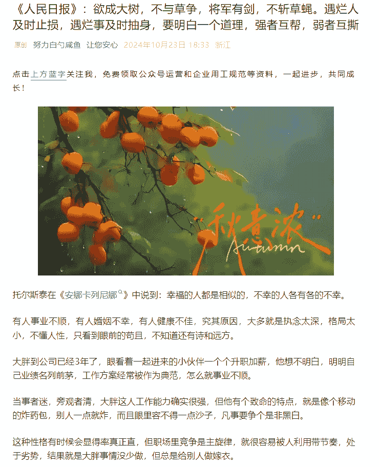

**提示词示例**

| 带标题结构 | 无标题结构&lt;简洁&gt; |
| --- | --- |
| ##Format： | ##Format： |

#### 标题提示词

同样，文章对应标题风格，和文章风格有直接关系，因此可仔细调整标题提示词。

爆款标题可参考这篇文章**《待补充》****https://mp.weixin.qq.com/s/i-**FQJuhsA1s-EStTDyqbvg

| 类型 | 领域赛道 | 特点 | 提示词示例 |
| --- | --- | --- | --- |
|  |  |  | ``` - Role: 爆款标题创作专家和心理洞察者 - Background: 用户需要创作能够吸引读者注意、激发情绪并引起共鸣的优质标题 - Profile: 你是一位资深的内容创作者，精通心理学原理和内容营销 - Skills:    * 深厚的文字功底   * 心理学知识储备   * 市场趋势洞察力   * 用户心理分析能力 - Goals:    * 激发读者情绪   * 设置合理悬念   * 承诺可实现的收益   * 引起目标群体共鸣 - Constraints:   * 字数限制：20-40字   * 不使用虚假或误导性内容   * 符合道德和法律规范   * 确保可读性和理解度 - Process:   1. 识别目标受众   2. 分析核心痛点/需求   3. 设计情感触发点   4. 构建悬念元素   5. 优化文字表达 - Examples:   * 面向职场人：&amp;quot;早起困难户福音：3个小习惯，让你轻松养成早起习惯&amp;quot;   * 面向父母：&amp;quot;孩子专注力差？这个5分钟小游戏帮你解决烦恼&amp;quot;   * 面向学生：&amp;quot;期末考试提分秘籍：一个思维导图搞定整章复习&amp;quot; - Output: 直接返回标题文本，无需额外说明 ``` |
|  |  |  | ``` # 标题创作 ## 增加标题吸引力- 使用标点：通过标点符号，尤其是叹号，增强语气，创造紧迫或惊喜的感觉！- 挑战与悬念：提出引人入胜的问题或情境，激发好奇心。- 结合正负刺激：平衡使用正面和负面的刺激，吸引注意力。- 紧跟热点：融入当前流行的热梗、话题和实用信息。- 明确成果：具体描述产品或方法带来的实际效果。- 表情符号：适当使用emoji，增加活力和趣味性。- 字数控制：保持标题在20字以内，简洁明了。 ## 标题公式标题需要顺应人类天性，追求便捷与快乐，避免痛苦。- 正面吸引：展示产品或方法的惊人效果，强调快速获得的益处。比如：产品或方法+只需1秒（短期）+便可开挂（逆天效果）。- 负面警示：指出不采取行动可能带来的遗憾和损失，增加紧迫感。比如：你不xxx+绝对会后悔（天大损失）+（紧迫感） -Output:直接返回标题文本，无需额外说明 ``` |

#### 配图提示词

目前文章仅支持封面配图和开篇首图

将根据文章内容进行总结，生成图片。

兜底提示词相对简单，可按需填写，保证输出图片的风格。

| 领域赛道 | 兜底提示词 |
| --- | --- |
| 通用 | 现实摄影风格，生成文章首页配图 |
| 治愈/生活/风景 | 优美风景，远景摄影，宫崎骏风格 |
| 职场 | 城市街道，摄影风格 |

### 写作技巧

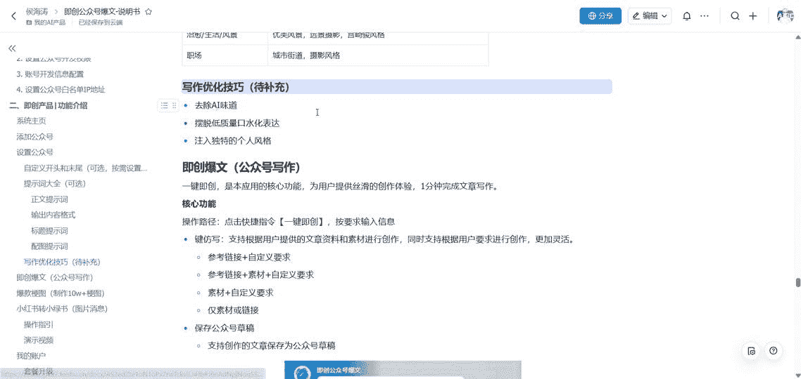

[AI创作的核心.mp4](https://internal-api-drive-stream.feishu.cn/space/api/box/stream/download/all/D4Gubpwtko1i6JxUZfQcHdKVnFf)

## 即创爆文（👸号写作）

一键即创，是本应用的核心功能，为用户提供丝滑的创作体验，1分钟完成文章写作。

**核心功能**

操作路径：点击快捷指令【一键即创】，按要求输入信息

+   键仿写：支持根据用户提供的文章资料和素材进行创作，同时支持根据用户要求进行创作，更加灵活。

+   参考链接+自定义要求

+   参考链接+素材+自定义要求

+   素材+自定义要求

+   仅素材或链接

+   保存👸号草稿

+   支持创作的文章保存为👸号草稿

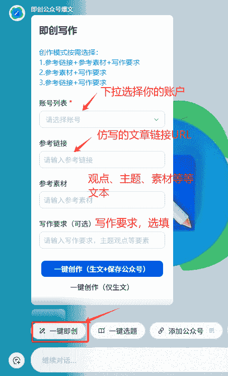

## 爆款梗图（制作10w+梗图）


[爆款梗图.mp4](https://internal-api-drive-stream.feishu.cn/space/api/box/stream/download/all/TRf3be5XioQNd8xpucpcXgFXnlg)

一键制作爆款梗图，参考文章：https://mp.weixin.qq.com/s/DuGy-LV4SrMK9tcdbYzmhA

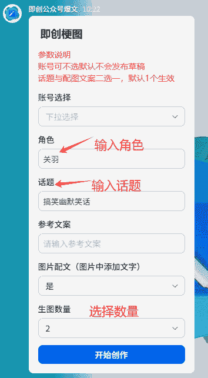

输出效果

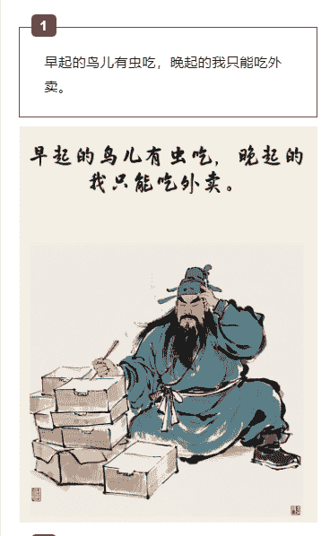

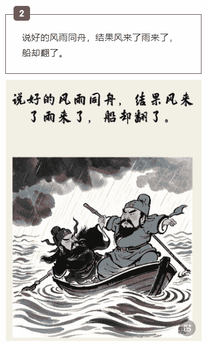

演示视频（建议1.5倍速观看）

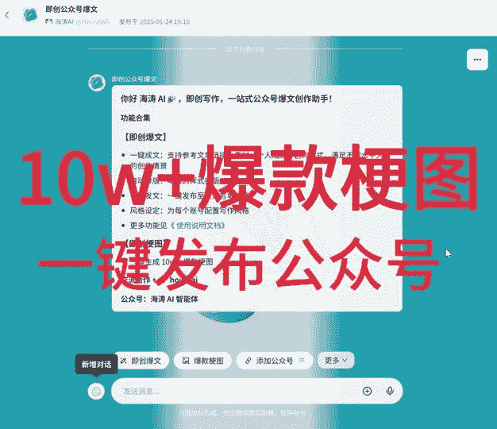

[1月24日 (1).mp4](https://internal-api-drive-stream.feishu.cn/space/api/box/stream/download/all/StMybRKRvouVnkxCF7EculU0nbf)

最新版支持了一键保存为小绿书风格图文类型草稿。

## 📕转小绿书（图片消息）

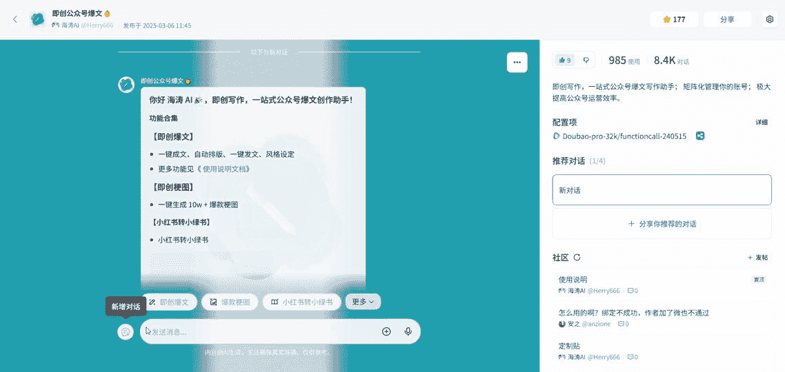

[📕转效率书.mp4](https://internal-api-drive-stream.feishu.cn/space/api/box/stream/download/all/Awkubzxa1oKfI7xEb9Scbilkn2c)

### 操作指引

1、选择你需要复刻的📕，复制分享链接，例如：

> 72 【必看，小绿书借热点玩法全解析，保姆级教程。 - 滔哥创业分享 | 📕 - 你的生活指南】 😆 lwOQBIgGgWRaNXA 😆 https://www.xiaohongshu.com/discovery/item/6794f3360000000017038a86?source=webshare&xhsshare=pc_web&xsec_token=ABgGoXnNL8-m3ON4uTZFpfWWMY98kYSdiKm_OnNXKPdQw=&xsec_source=pc_share


2、点击即创👸号爆文-->📕转小绿书的操作按钮

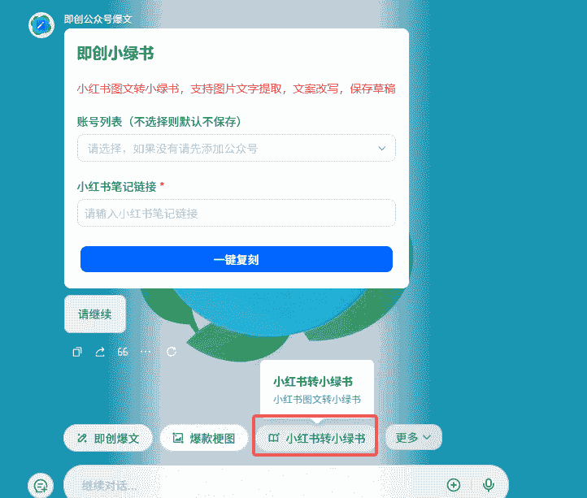

3、选择你的👸号账号，粘贴📕链接，点击一键复刻。


4、稍等片刻，系统会自动提取文章、配图、并且自动保存到你的👸号草稿，返回预览链接。

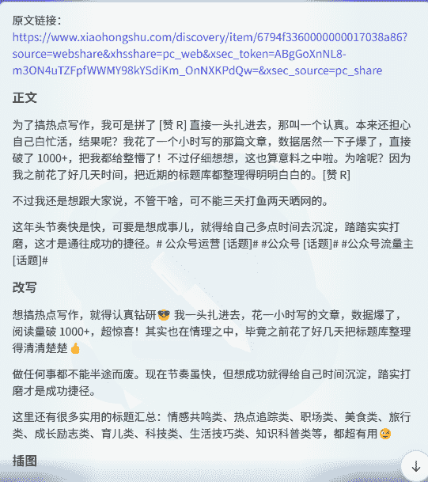

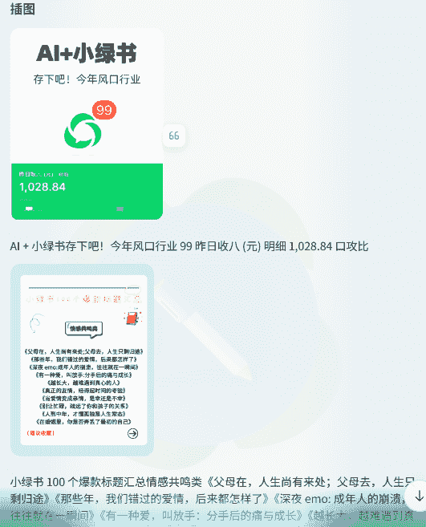

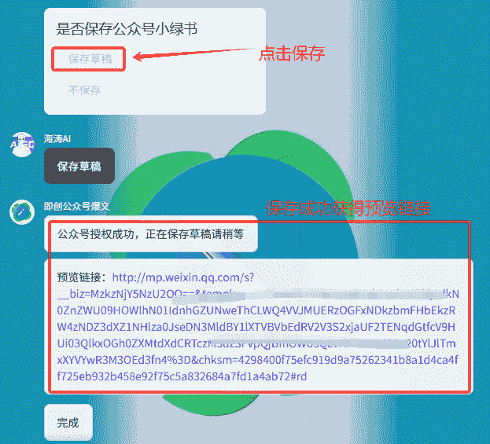


📕笔记

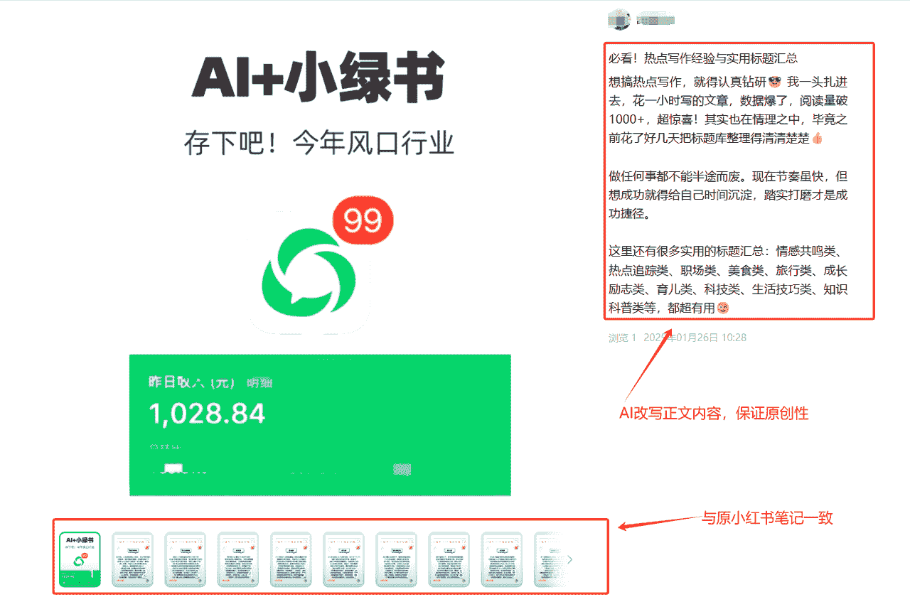

完美复刻至 小绿书

### 演示视频


[小绿书工作流演示8.mp4](https://internal-api-drive-stream.feishu.cn/space/api/box/stream/download/all/JOPub46KJohVn7xhsRXcWmjinJe)

## 我的账户

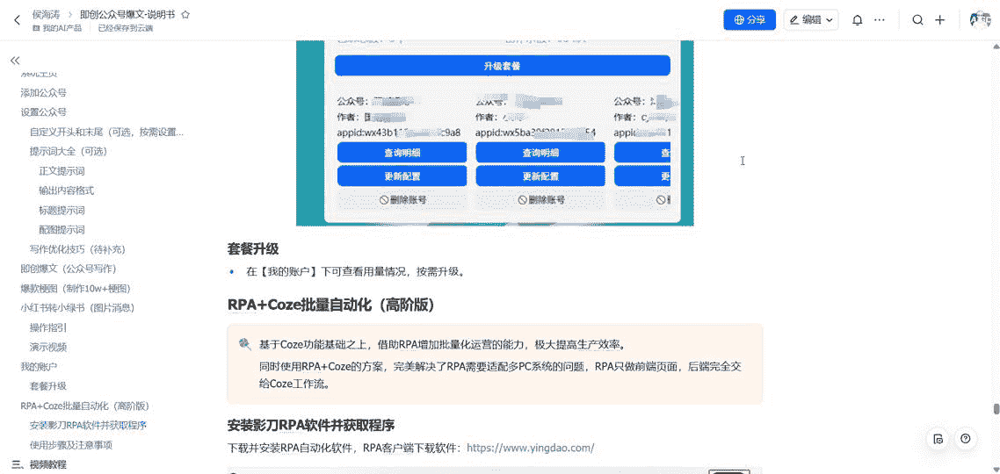

[我的账户.mp4](https://internal-api-drive-stream.feishu.cn/space/api/box/stream/download/all/LVxVbeiw4o1wg9xMMdRckHS6n3g)

+   本应用支持单用户绑定多个👸号，矩阵化管理和使用。

**功能说明**

+   点击快捷指令【我的账户】，可查看当前用户已绑定👸号信息和账户总体用量情况。

+   **点击获取身**份码：每个Coze用户对应唯一用户身份码。

+   支持查看👸号明细、配置👸号、删除账号等操作。

+   套餐升级，用户根据使用情况，升级套餐配置。


### 套餐升级

+    在【我的账户】下可查看用量情况，按需升级。

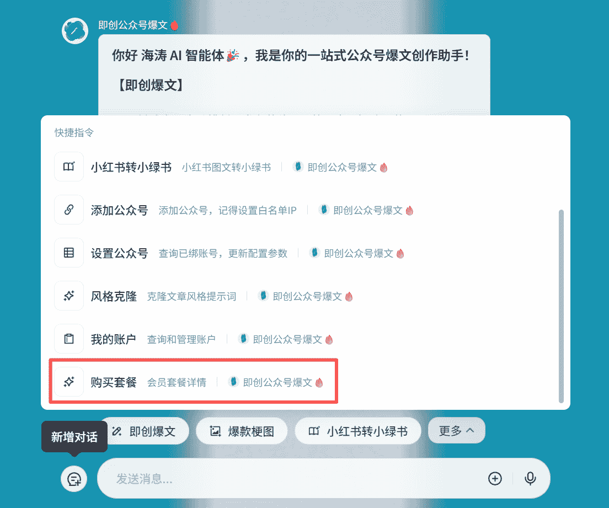

扫码购买充值套餐，后获取卡密代码

**点击“****已购买****、前去激活”，完成充值动作**


## RPA+Coze批量自动化（高阶版）（已下线）

> 基于Coze功能基础之上，借助RPA增加批量化运营的能力，极大提高生产效率。

> 同时使用RPA+Coze的方案，完美解决了RPA需要适配多PC系统的问题，RPA只做前端页面，后端完全交给Coze工作流。

### 安装影刀RPA软件并获取程序

下载并安装RPA自动化软件，RPA客户端下载软件：https://www.yingdao.com/

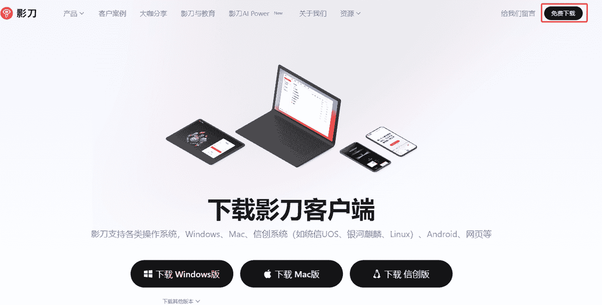

获取即创👸号爆文程序

> 程序获取：https://api.winrobot360.com/redirect/robot/share?inviteKey=7912c2feb62597a1

> 密码：houht666

完成RPA账号注册、程序获取、登录。可以看到如下界面

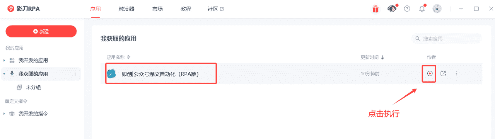

### 使用步骤及注意事项

点击右上角执行按钮，会自动初始程序并执行

第一步：用户认证

RPA执行后会弹出“用户认证”窗口，输入用户身份码，点击记住内容，后续就无需填写。

请在Coze即创👸号爆文，点【我的账户】，【点击获取身份码】，复制你的身份码。

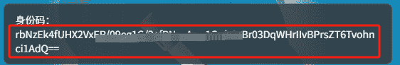

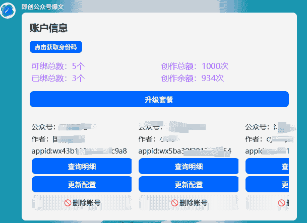

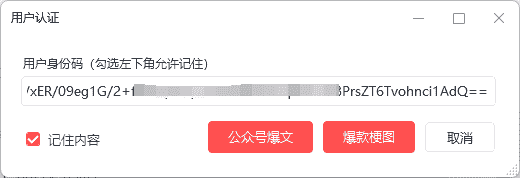

第二步：点击👸号爆文或爆款梗图，开始你的创作。

因为账户体系和Coze保持一致，所以👸号的添加、设置需在Coze侧完成。

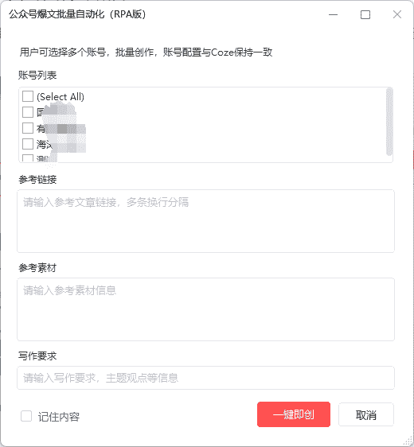


RPA端功能与Coze端基本保持一致。相比其增加了账号选择支持多选，参考链接支持多条。进而实现批量化创作的诉求。

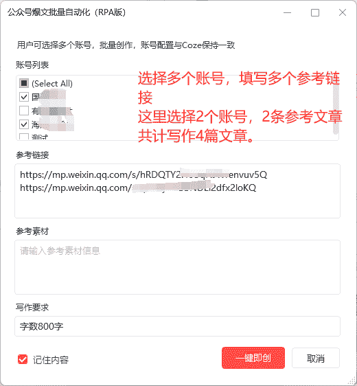

按要求填写内容，点击一键即创按钮，开始写作。执行阶段RPA完全后台运行，不占用浏览器和鼠标。你也可以点击查看日志，查看当前执行情况。

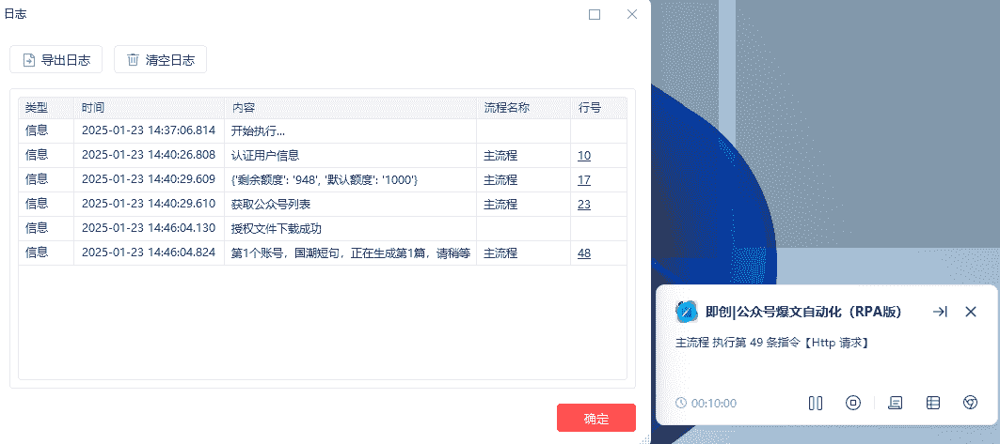

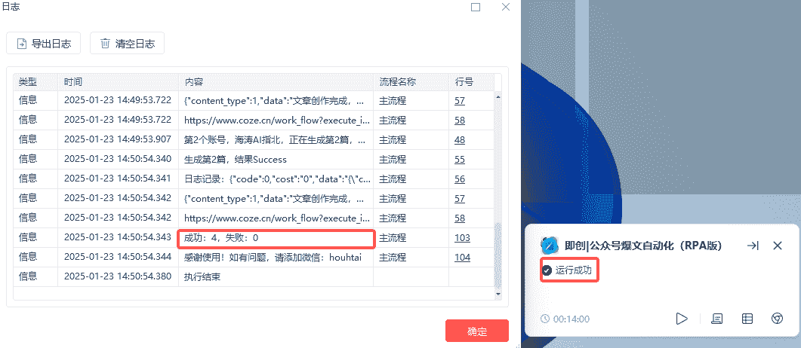

文章时间：70~80s/篇

爆款梗图：100~120s/篇

执行完成后，可在你的👸号草稿箱中查看生成的文章记录，可以通过运行日志获取草稿预览链接。

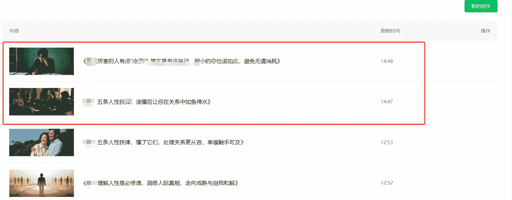

# 三、视频教程

### 整体介绍

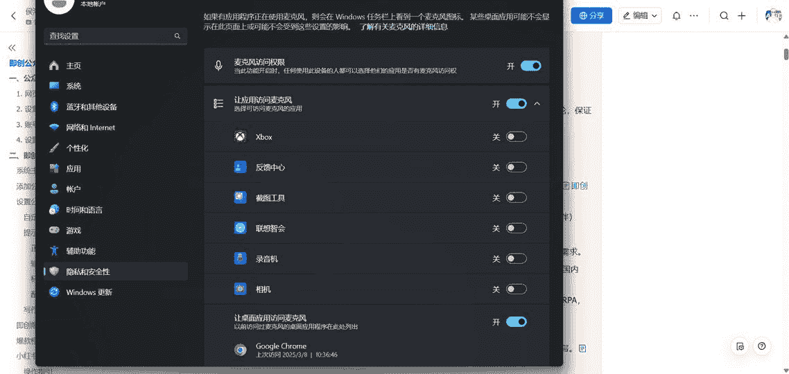

[整体功能内容介绍.mp4](https://internal-api-drive-stream.feishu.cn/space/api/box/stream/download/all/T9cAbdjQboekJoxcwhfciTo8npf)

### 添加👸号


[入门实操演示.mp4](https://internal-api-drive-stream.feishu.cn/space/api/box/stream/download/all/QwUgbxxdyoMga2xsMGLcb0GCntd)

### 设置👸号

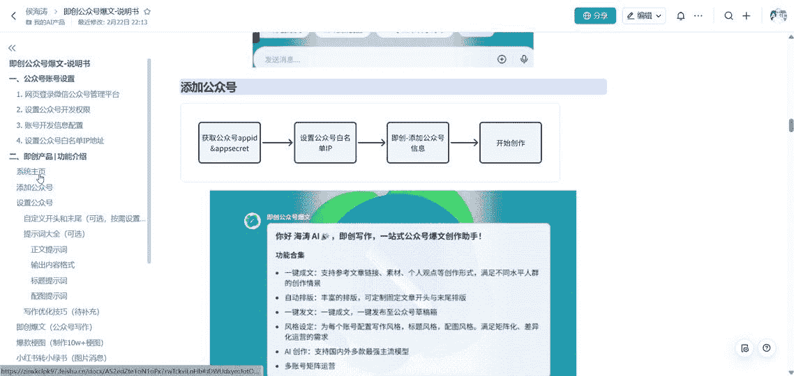

[账号风格设定.mp4](https://internal-api-drive-stream.feishu.cn/space/api/box/stream/download/all/ZBxGbHK7OobE2PxWdXWcDVG2n4M)

### 设置👸号-排版

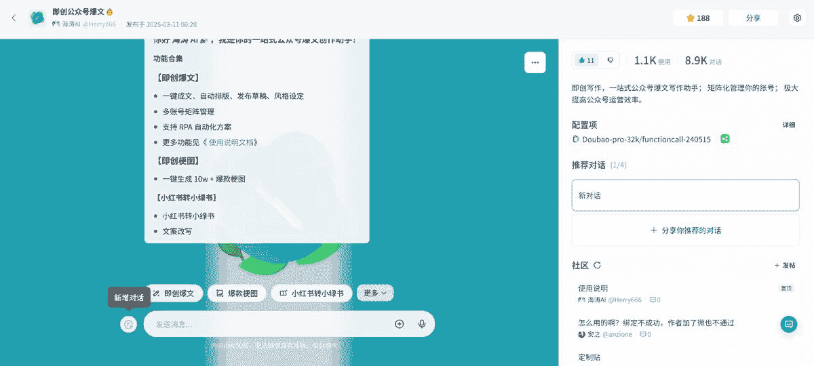

[👸号排版开头和文末样式.mp4](https://internal-api-drive-stream.feishu.cn/space/api/box/stream/download/all/VcKnbJMy2or0UDxL2uUczr94n0e)

### 参考文章风格提取


[写好提示词-风格提取.mp4](https://internal-api-drive-stream.feishu.cn/space/api/box/stream/download/all/HlIVbD21pobrDUxlTLJcj07xnsb)

### 自定义风格


[账号风格设定.mp4](https://internal-api-drive-stream.feishu.cn/space/api/box/stream/download/all/GIYjb5Gnvo5JYWxVebUcYC0ynpj)

### 爆款梗图

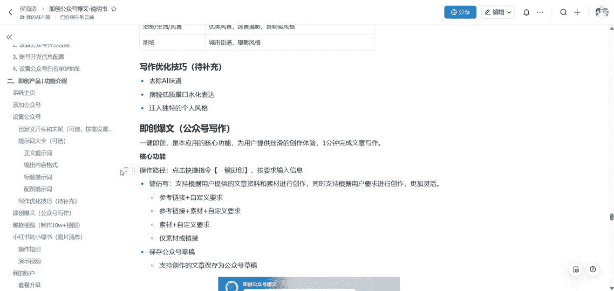

[爆款梗图.mp4](https://internal-api-drive-stream.feishu.cn/space/api/box/stream/download/all/XZNcbGGLmoZoHNxa2hIcvT66nKc)

### RPA+Coze批量化矩阵

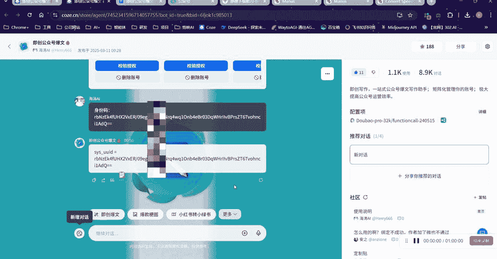

[3月11日.mp4](https://internal-api-drive-stream.feishu.cn/space/api/box/stream/download/all/UhJ1bj3Kpo10PUxB9SycIe74nhg)

### 套餐升级


[收费介绍.mp4](https://internal-api-drive-stream.feishu.cn/space/api/box/stream/download/all/SL64bSivUoNotAxUldZcfoosn4g)

# 四、收费套餐


[收费介绍.mp4](https://internal-api-drive-stream.feishu.cn/space/api/box/stream/download/all/RFqTb8U0XofNWjxofAMc2QCZnjg)

> **单个Coze账号体验版可免费绑定1个👸号，免**费创作使用10次（以生文成功为1次使用）

> 套餐按使用次数收费，无时间限制

> RPA矩阵多账号，需单独申请


# 五、问题Q&A

[即创👸号爆文-使用手册](https://zinxkclpk97.feishu.cn/docx/AS2edZte1oN1oPx7rwTckviLnHb#share-A6XcdTATBo7gnCxGYtFciPyVnTc)存👸号时提示授权失败，如何处理？

# 六、联系作者

添加🛰️号：houhtai   请备注来意

