# DeepSeek的使用技巧，就是没有技巧。

> 来源：[https://zinxkclpk97.feishu.cn/docx/JyKFdtmGJobapZxg1LgcVp68nWb](https://zinxkclpk97.feishu.cn/docx/JyKFdtmGJobapZxg1LgcVp68nWb)

DeepSeek是什么？

DeepSeek（深度求索）是一家专注于通用人工智能（AGI）研究的中国初创公司，成立于2023年，总部位于杭州。公司由量化私募巨头幻方量化创始人梁文锋创立，目标是开发高性能、低成本的人工智能模型。

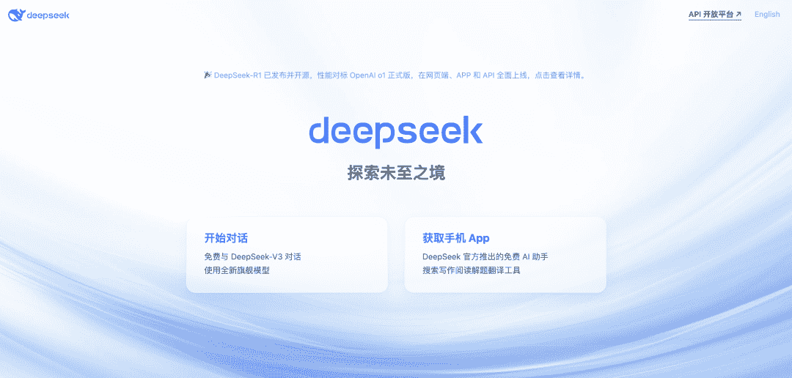

公司背景：

DeepSeek的创立得益于梁文锋在量化投资领域的成功。梁文锋此前通过人工智能和算法在金融领域积累了大量财富，并将这些资源投入到DeepSeek中。公司目前仍处于纯技术研究阶段，尚未进行商业化或外部融资。DeepSeek的团队规模较小，但成员大多来自中国顶尖高校，如北大、清华和北航

技术特点

DeepSeek的核心技术优势在于其高效的模型架构和训练方法。以下是其主要技术特点：

高性能与低成本：DeepSeek的模型在自然语言处理、数学推理、编程辅助等领域表现出色，同时训练成本和API服务定价远低于行业巨头。

开源与社区共建：DeepSeek的模型开源，允许用户自由使用、修改和商业化，这促进了技术的快速传播和改进。

创新的模型架构：DeepSeek-V3采用混合专家（MoE）架构，结合多头潜在注意力（MLA）和无辅助损失的负载均衡策略，显著提高了模型的推理效率和训练成本。

多模态支持：DeepSeek Janus-Pro在多模态理解任务中，模型性能匹配甚至超越任务专用模型；在图像生成方面，能够生成高质量的384x384分辨率图像，适配多种场景。在部分文生图基准测试中，Janus-Pro 70亿参数模型表现好于OpenAI的DALL-E 3、Stability AI的Stable Diffusion 3-Meduim等。

如何注册：

登录官方网址：https://www.deepseek.com/

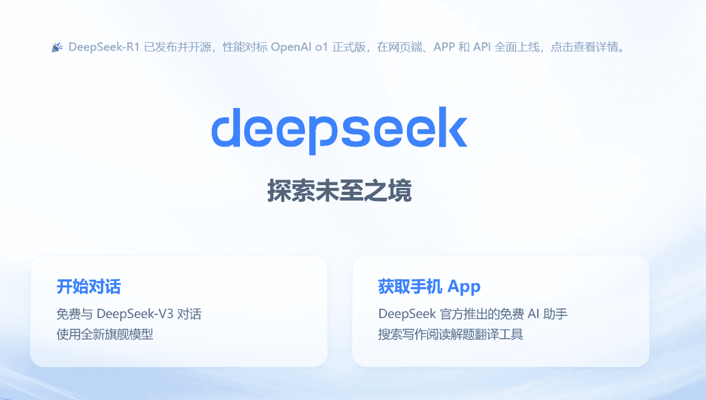

登录之后，可以看到对话界面。

点击勾选“深度思考R1”，可以体验其深度思考功能，同时其也支持联网搜索。

目前通道比较拥挤，会偶发失败，建议多一些耐心。

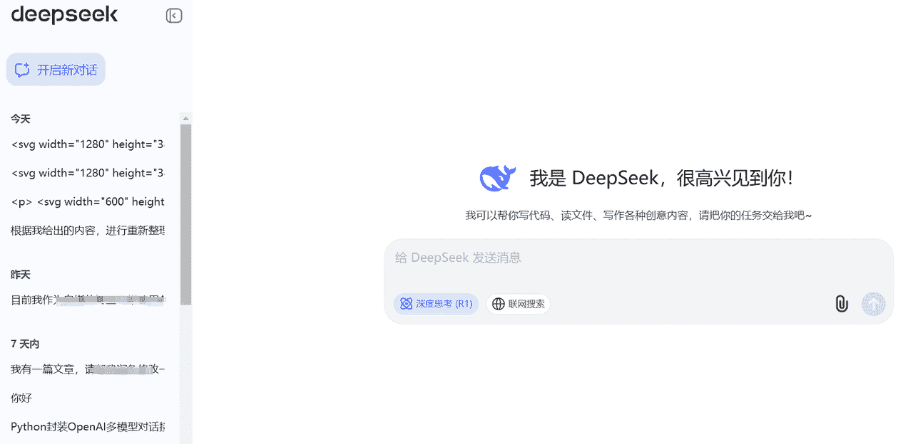

看到DeepSeek的火爆，老外们也坐不住了，引来海外的恶意网络攻击。

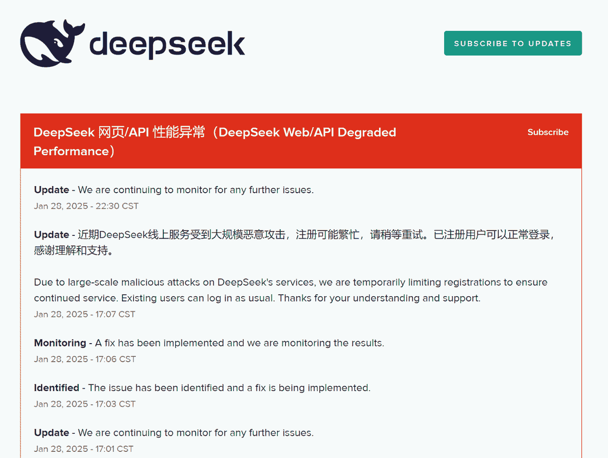

移动App，APP商城搜安装即可，手机端操作与网页端功能基本一致。

+   **智能对话**：基于 DeepSeek-V3 模型，提供高智商、流畅的对话体验。

+   **文件处理**：支持快速阅读文件内容，提升办公效率。

+   **AI 搜索**：实时全网搜索，结合深度思考解决复杂问题（如学术、技术难题）。

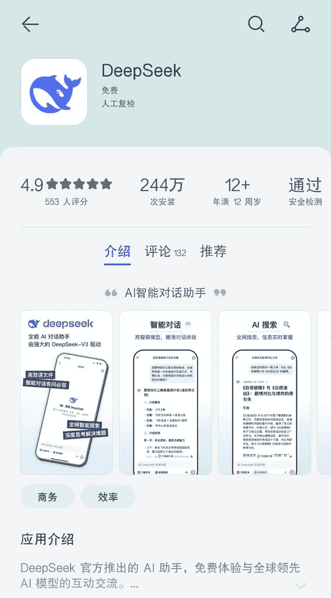

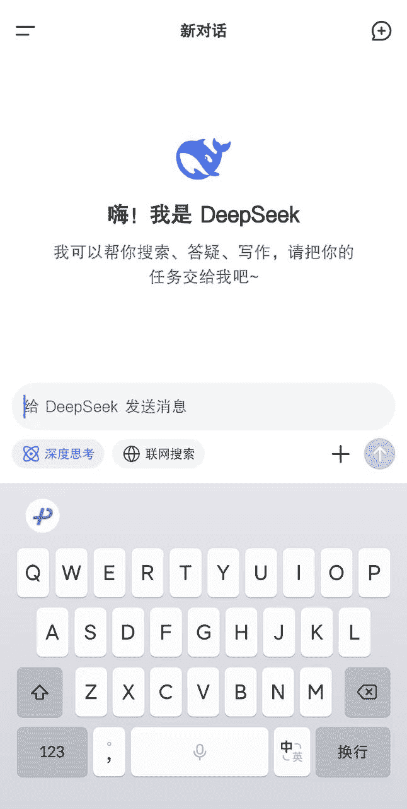

网页端可以点击右上角API开放平台，获得API-Key接入本地客户端使用。

我常用的免费CherryStudio客户端，支持配置多种模型接口

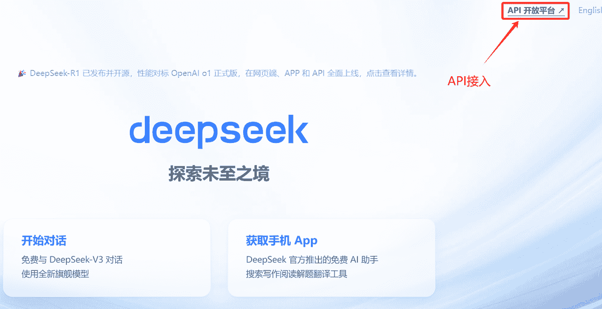

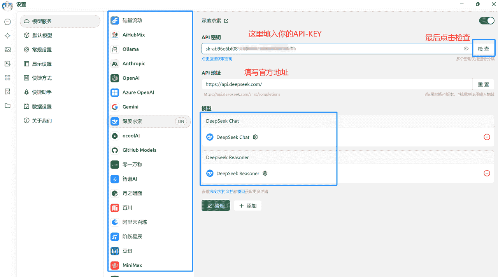

在对话助手中，切换DeepSeek模型试下效果。R1模型太火爆，能不能连上全看自己运气🤦‍♂️。

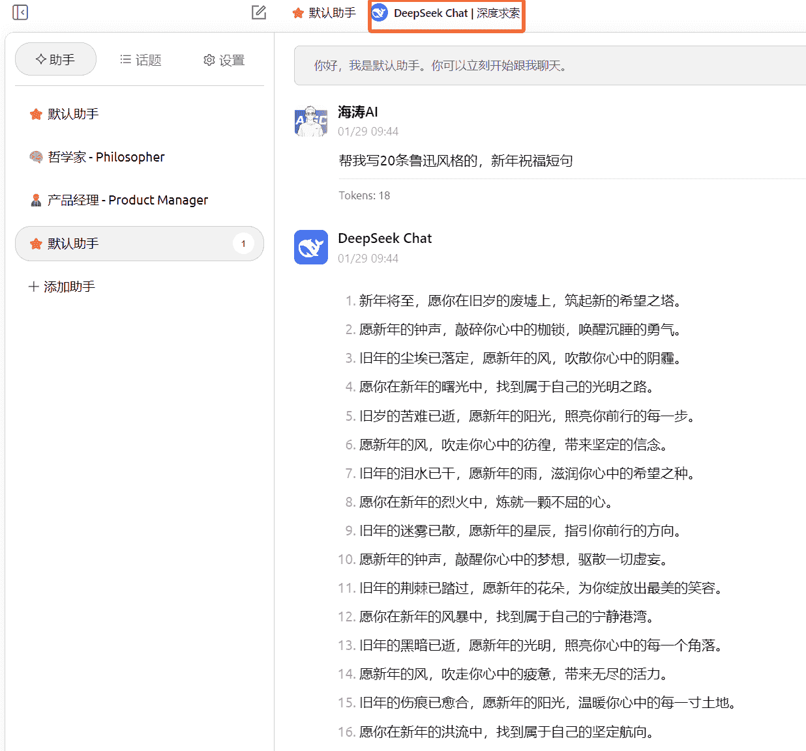

其API也支持了OpenAI标准协议，我们也可以无缝接入到Coze、Dify等智能体平台。

如何与DeepSeek对话？

首先我们明确的是DeepSeek R1模式是推理模型，因此过往我们那种标准且复杂的提示词，实测下来，并没有太好的效果。

DeepSeek R1 像GPT o1一样，拥有自己的内部思维链，其会逐步去分析和思考你的问题，并且对联网搜索到的相关资料进行总结。

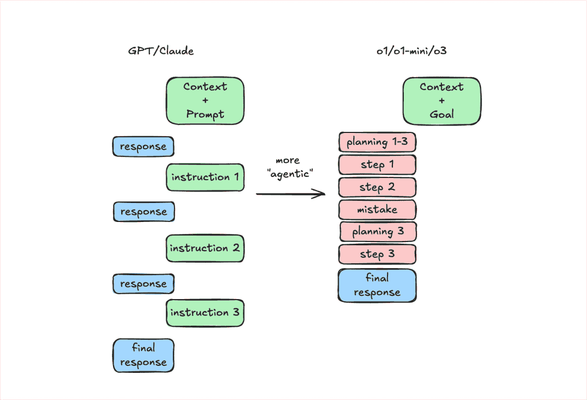

以往我们会设置提示词模板，告知大模型你扮演的角色、技能、工作流1、2、3等等。

现在需要改变我们的提问方式，将其当作一个拥有决策和思考能力的正常人进行提问，描述清楚你的背景和目的，其会自行规划和处理这个问题。

这里给一个万能的提示词模板，“你是谁+背景信息+你的目标”，背景信息越详细，模型越能准确完成任务。

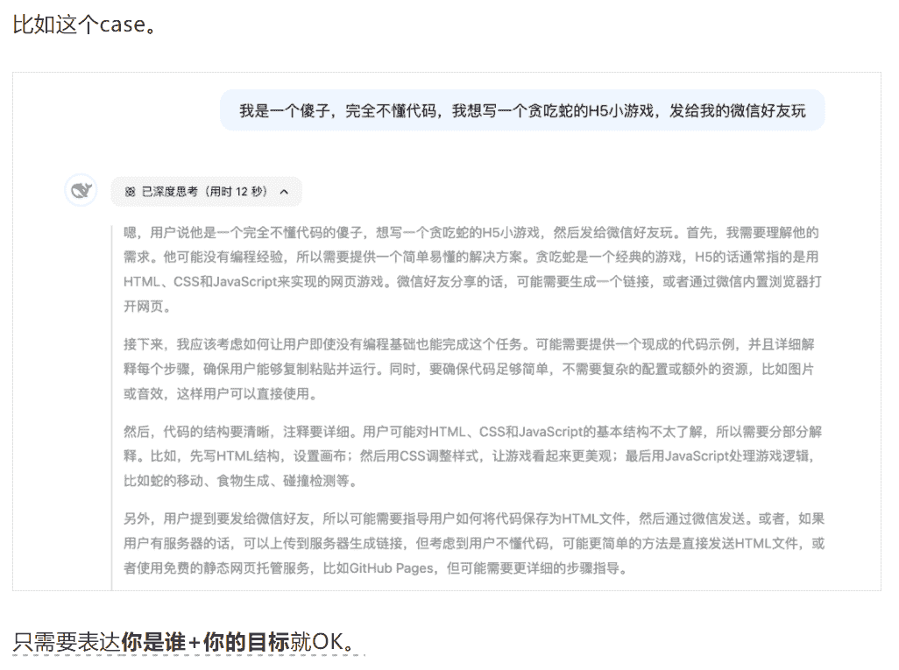

关于提示词技巧，最好的提示词技巧是没有技巧，大道至简，用日常用语清晰表达需求即可。

比如一个小技巧，告诉模型，“说人话”，其就可以理解并用普通人就可以理解的表达方式，解释复杂的理念。

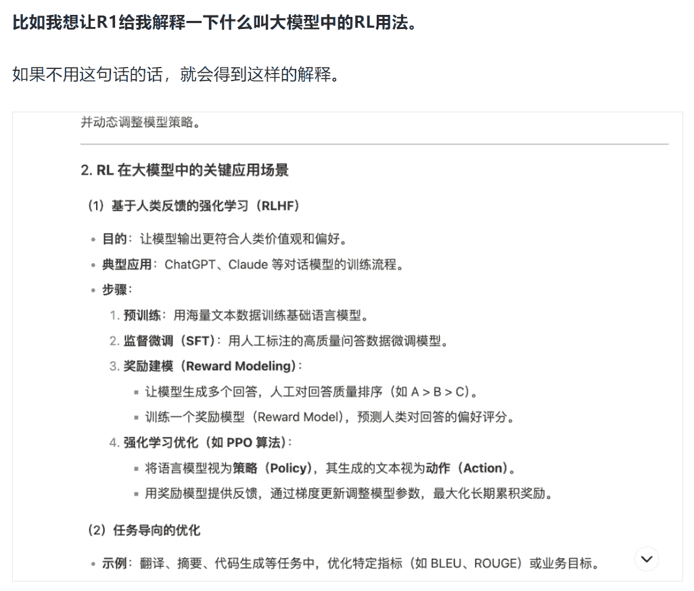

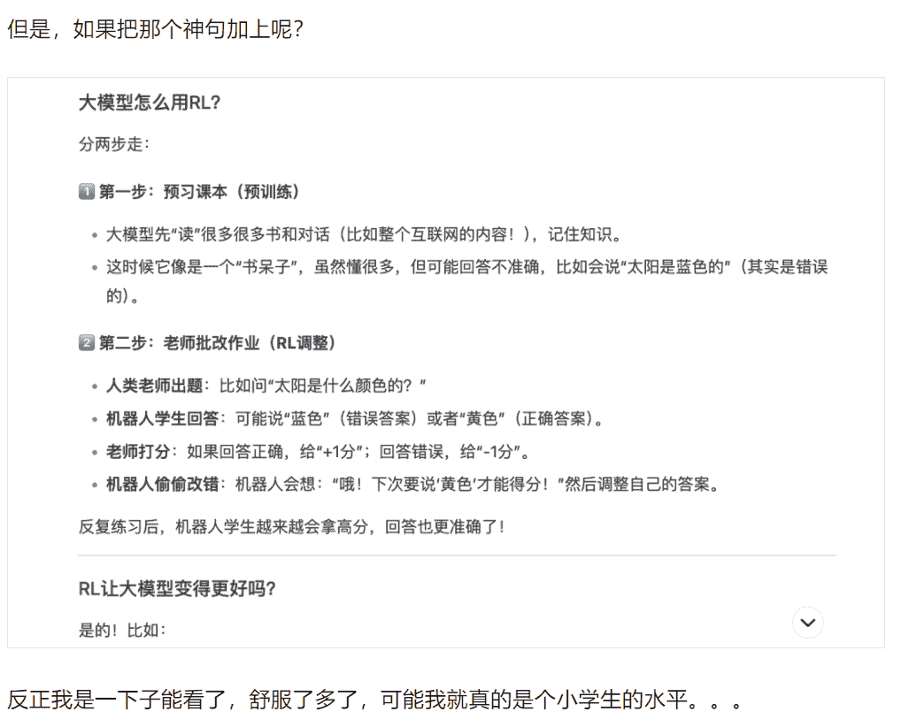

R1模型的本地部署成本如何？

DeepSeek推出的模型均可开源商用，一些极客朋友想要快速体验，可通过ollama来部署，官网： https://ollama.com/，安装完成后搜索deepseek-r1模型。

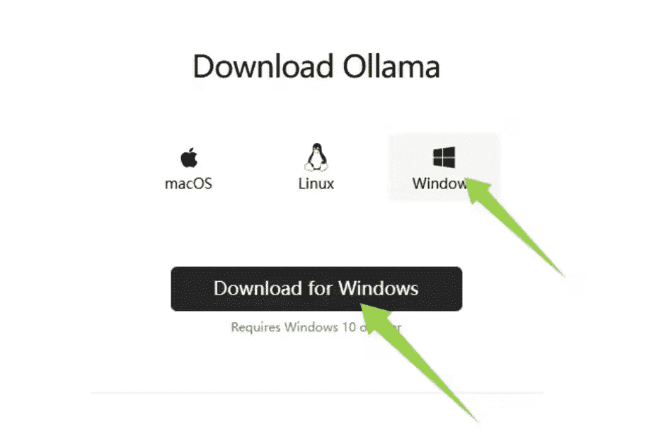

参考如下配置选择合适的模型。

没有GPU：1.5B Q8推理 或者 8B Q4推理

4G GPU：8B Q4推理

8G GPU：32B Q4推理 或者 8B Q4推理

16G GPU：32B Q4推理 或者 32B Q8推理

24G GPU: 32B Q8推理 或者 70B Q2推理

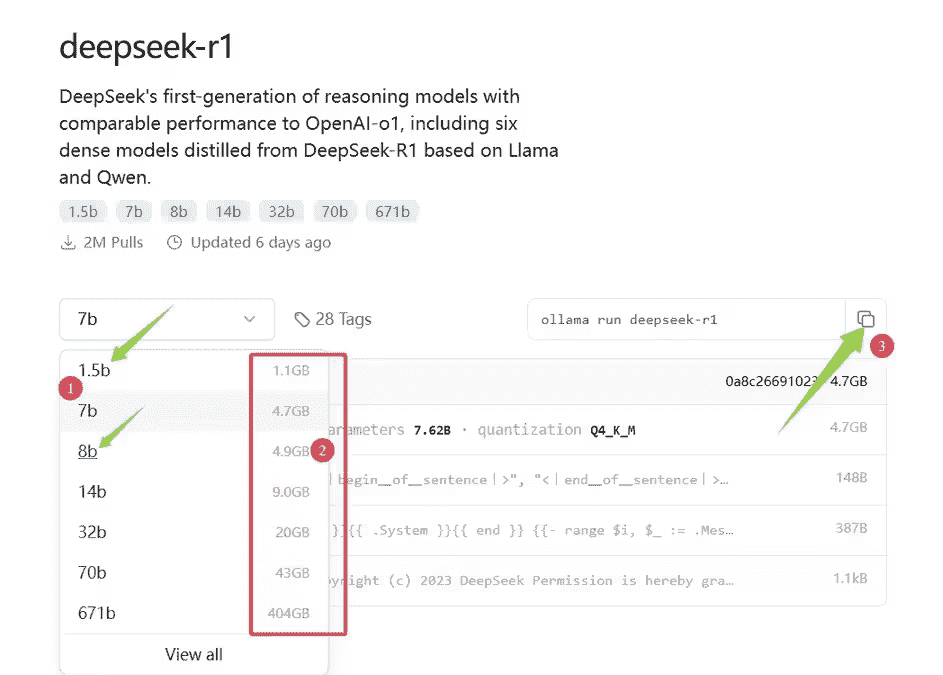

以上，DeepSeek的全球出圈，推理模型、多模态模型，惊喜连连。作为普通人，能够不断有新的体验，让人异常兴奋。

过去两年，国产模型一直是追赶的姿态，面临外部算力限制，用更加创新的模式，实现突破。

更加让人自豪。

最后，新的一年也希望国产大模型蒸蒸日上，国产AI应用遍地开花。