# 短想法

> 来源：[https://docs.feishu.cn/docx/QTy4dEL9no57iDxzTQyc4zqhnfe](https://docs.feishu.cn/docx/QTy4dEL9no57iDxzTQyc4zqhnfe)

# 2025 年

+   《确实来钱快》 -- 2025.6.7

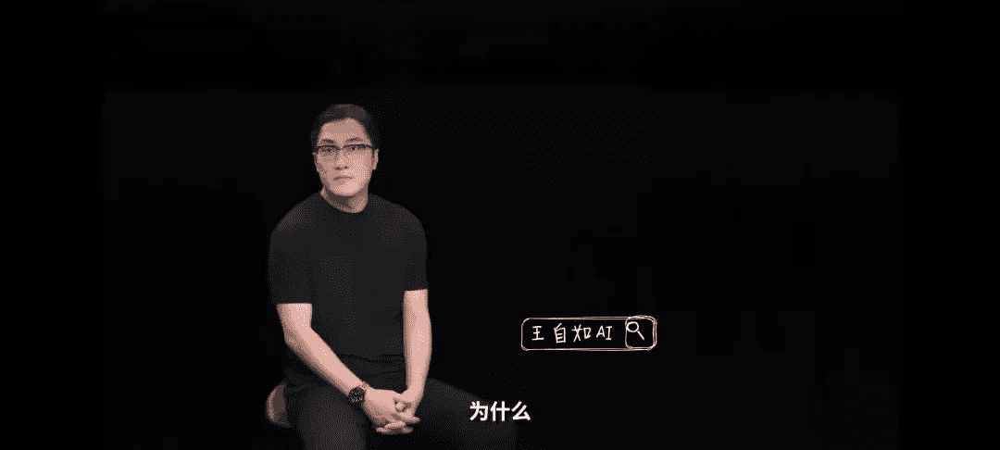

+   我太爱《灵笼》的世界观，从第一部到第二部追更了 5 年，近期上线了 《灵笼 2》，每周五 11 点更新，这是我一周最期待的事情 ✌️ -- 2025.6.6

+   最近听到一期很喜欢的播客，时长 305 分钟（如果你不介意时长），讲述张一鸣和字节跳动成长历史的同时也把互联网史串起来了。我一直很喜欢看传记，关于平庸、失败、挫折、成功....那些人都是如何成为他今天的样子的，我很好奇。张一鸣传：平庸有重力，需要逃逸速度 -- 2025.5.29

+   人生最大的两个爱好：1）信息收集和处理 2）人文摄影。 -- 2025.5.22

+   后来养成了一个习惯，给 ChatGPT 写 Prompt 的时候，总会在末尾加上一条：“其他任何你觉得重要但可能被我忽略的点”。-- 2025.5.24

+   [碎瓜](https://mazzzystar.com/) 做了一个网站，里面可以记录自己此时此刻在做的事情，同时你也可以看到他人发的事件，这真是一个很棒的 Idea ，和一个很有趣的产品！！链接在这里：https://whatpeopledoingnow.com -- 2025.5.20

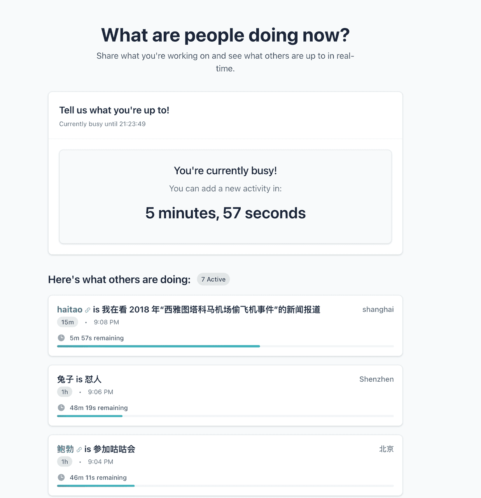

+   好几个星期前听了 Xmind  园长的那期播客，里面提到了佛学中的因果观，原话说了什么不太记得清了。今天散步的时候联想起这件事情，我把我对因果的理解总结成一句话：见果知因，见因知果。在看到事情的果的时候思考是什么因造成的，在看到事情的因的时候推断会出现什么果。（我平常不太喜欢分享说教性的言论，但此刻确实蛮感顿悟，一点私心，见谅～） -- 2025.5.17

+   上海的多抓鱼线下门店有一只叫兔子的小猫，我问店员：为什么一只猫要叫兔子，我不同意！ -- 2025.5.14

+   上海的多抓鱼线下门店有一只叫兔子的小猫，我问店员：为什么一只猫要叫兔子，我不同意！ -- 2025.5.14

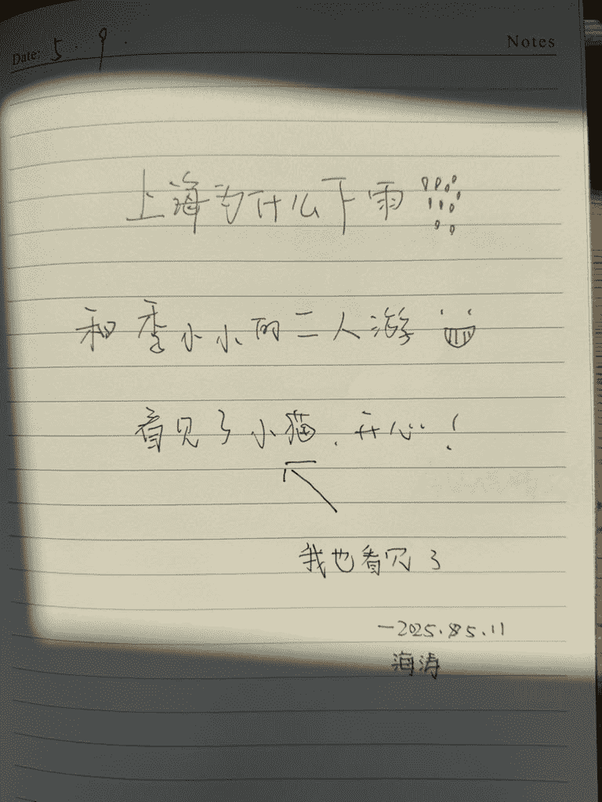

+   真的真的很喜欢久保田博二的这部作品：《早春的中国》，里面记录了 70-80 年代的中国真实的样子。-- 2025.5.14

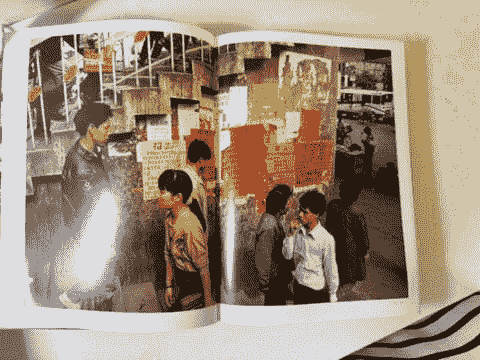

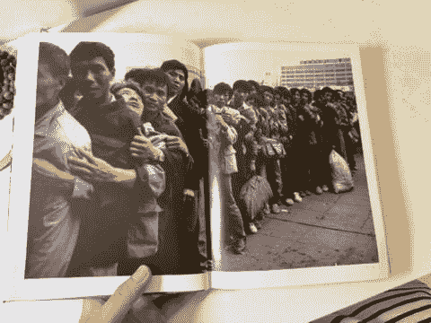

+   用一张截图记录一下这个时代的印记：AI 自媒体、邀请码、全球首款 xx 产品。 -- 2025.5.14

+   打车的时候遇到一位曾经是百万富翁的司机，后面因为生意失败背了不少贷款，一个人瞒着家人偷偷跑到上海开滴滴，不为了挣钱，只为了让自己忙起来。下面这张照片拍摄的是他的店里的监控，没错，他还有几家餐厅在营业。 -- 2025.5.13

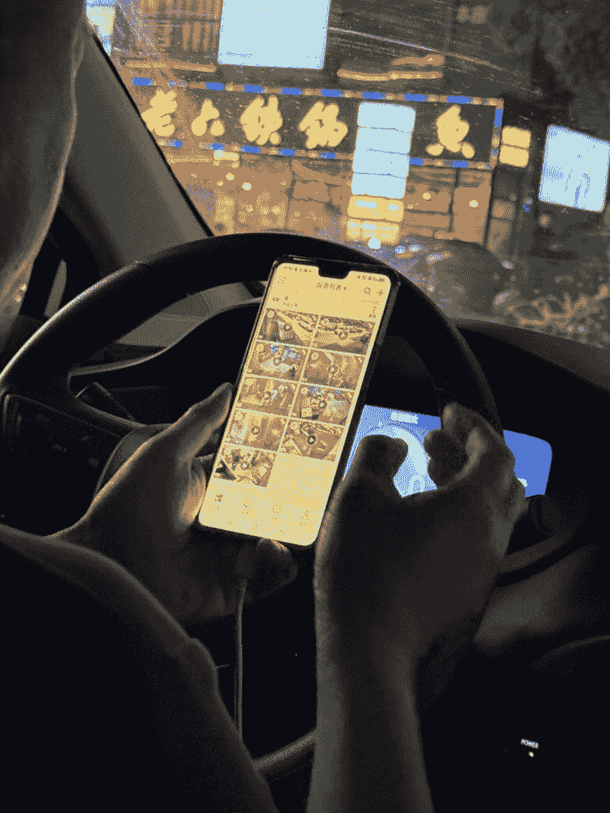

+   喜欢这个抽象的风格，如这张专辑 -- 2025.5.9

+   “投资未来的人，必须比未来更疯狂”。 -- 2025.5.8

+   我喜欢身处在咖啡店或者闹市中工作和学习，那样能让我获得内心的平静。我喜欢看身边人人来人往的样子，并且把自己想象成他们。我意识到了自己是一个观察者，不断的观察和记录是我与这个世界相处的相处方式。 -- 2025.5.5

+   ChatGPT 的记忆能力是我最喜欢的功能，解锁了反思的应用场景，我常常会问它，今天给你的这些任务中，有哪些是我没有想到，但却很重要的点，它的回复总能给我新的启发 -- 2025.5.5

+   新增了一个爱好：散步，一整天的那种 -- 2025.5.4

+   我准备用三个画框将这只鲨鱼裱起来挂在卧室，那样酷毙了！ -- 2025.5.3

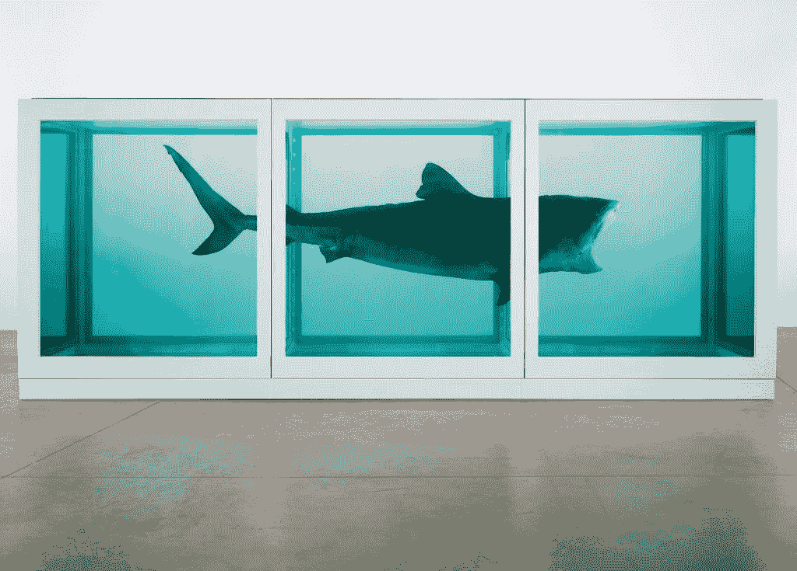

+   最近单曲循环的歌单：The Flood - Single

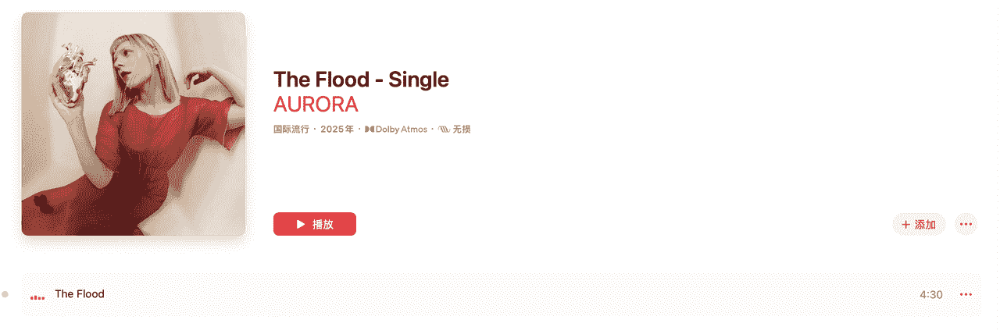

+   今天去逛了 Nike 专卖店，准备买两件跑步穿的衣服，结果老板误以为我是  The North Face 的店员，看我的眼神怪怪的，瞬间让我没有买东西的欲望（怪我那天穿着北面的短袖 ） -- 2025.5.2

+   我的小床换上了蓝色新皮肤 ✌️ -- 2025.5.2

+   从小我被家人教育吃饭的时候不要浪费食物，要把剩菜吃完。这个习惯跟随了我 20 余年的人生，以至于我每天吃饭的时候，都要跟犯了强迫症的病人一样要吃到光盘为止。直到上周，我的医生和我说这样的习惯有损肠胃健康，我才意识到问题，从那以后，我会刻意在吃饭的时候的问自己吃饱了吗？好的，吃饱了，剩下的可以不要了 -- 2025.5.1

+   五一假期的第一天，把家里深度清理了一遍，买了很多新物品，也丢了很多旧的东西。我从来没有像今天这样轻松，知道家里有多少件物品，他们都放在哪里。此刻，我才觉得自己真正拥有了他们-- 2025.5.1

+   空调报修单 🥲 -- 2025.4.30

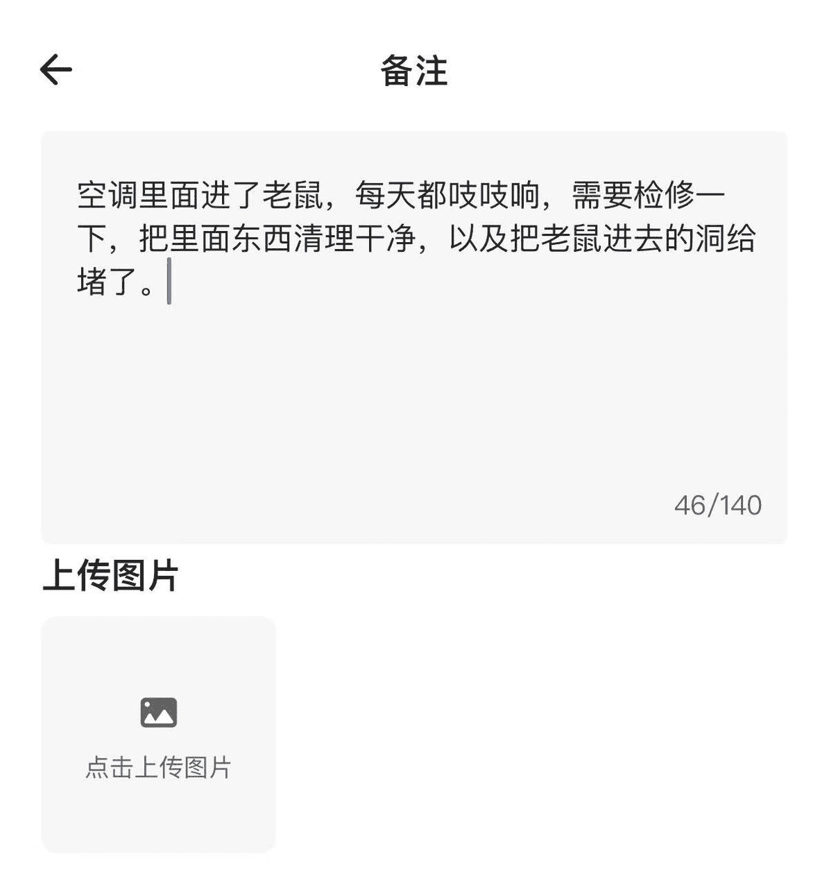

+   上海的春天 - 2025.4.13

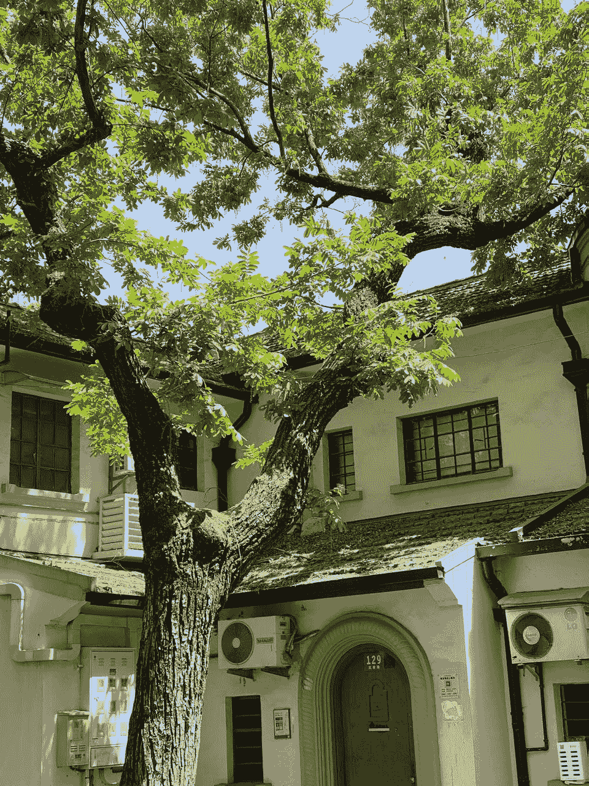

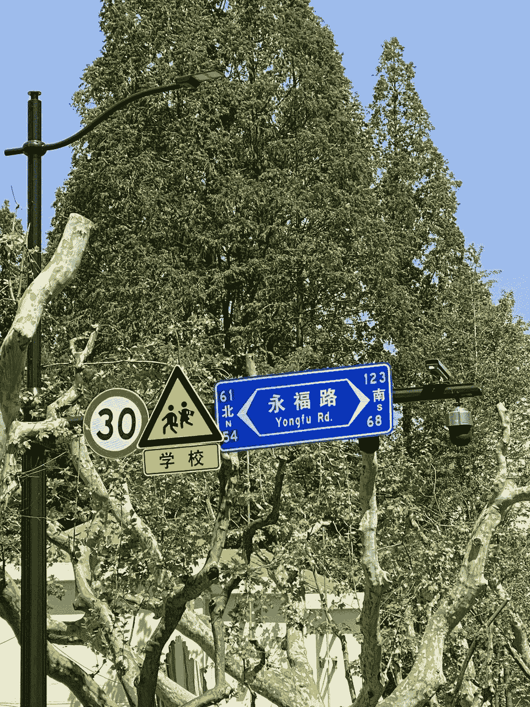

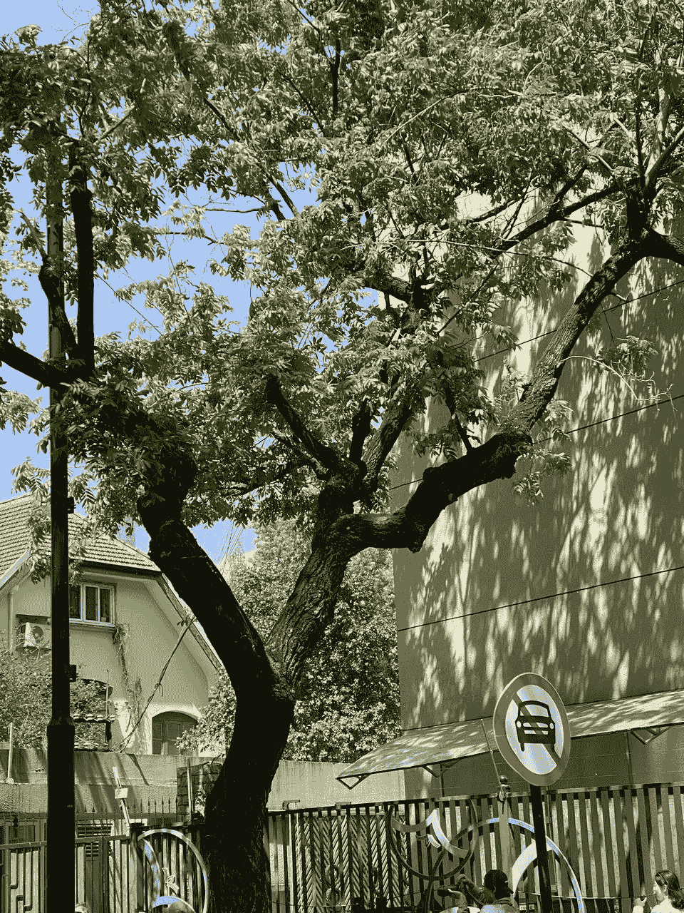

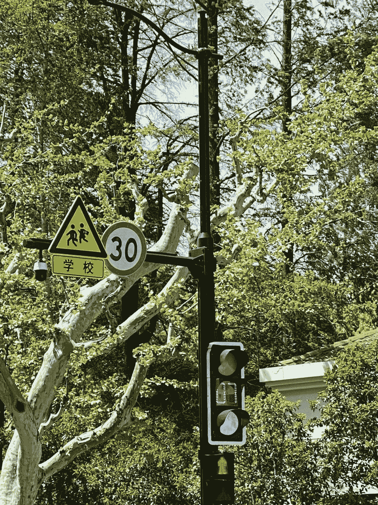

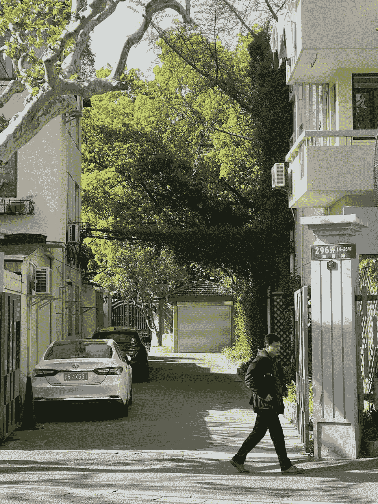

+   🙂 突破信息茧房 -- 2025.4.10

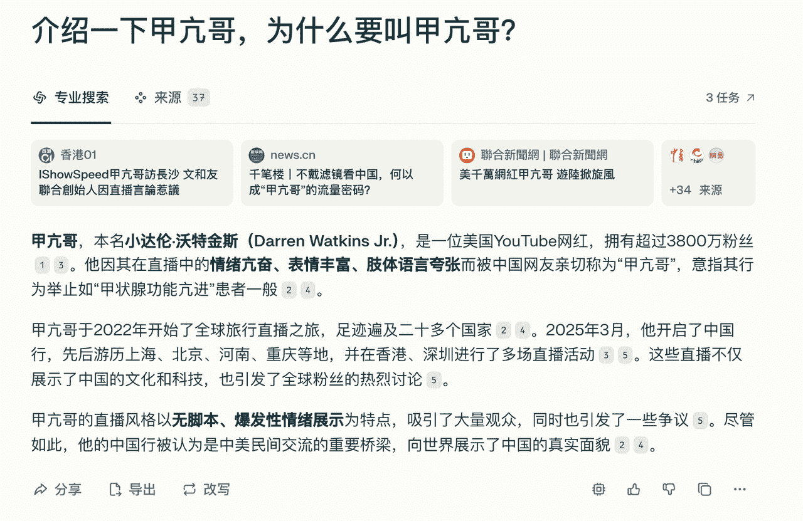

+   我想做一个跑步的 AI  Agent，提取我跑步时所有的数据，给我实时的跑步建议和加油、鼓励！--2025.3.22

+   我已经迫不及待想用上  Dia 了，原因：ARC 浏览器一天在我电脑崩溃多次 🥲 -- 2025.3.22

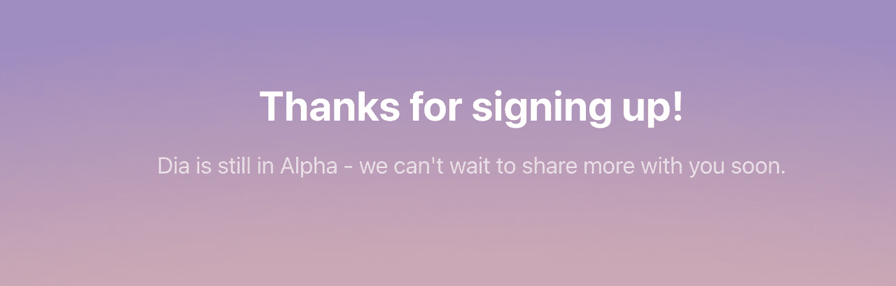

+   一个公式：y = wx + b -- 2025.3.20

+   Pebbling：放鹅卵石 -- 2025.3.17

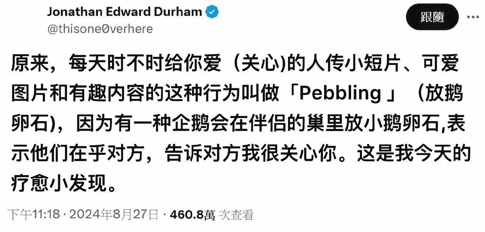

+   我看了一下历史记录，我发现今年看了 104 部电影，我太爱看电影了！ -- 2025.3.5

+   在使用逗逗游戏伙伴玩原神后，我发现 AI 情感陪伴产品的解法是和用户一起经历一些事情。 -- 2025.2.23

+   好的问题来自好的答案 -- 2025.2.21

+   使用 ACE Studio 生成的音乐，完全听不出来 AI 唱的，不信你听听 -- 2024.11.12

[ACE studio｜分分钟需要你.mp3](https://internal-api-drive-stream.feishu.cn/space/api/box/stream/download/all/LH59bEPXNoVtnyx65fScYIm0n3g)

# 2024 年

+   **2023年8月14日**

1.  晚上突然来了兴致，想看看《红楼梦》，小学的时候我的语文老师让我仿写游大观园这一回去写一个游记，奈何当时自己资历太浅，现在读起来才能体会老师当年说在课堂中的表达的含义。“宝鼎茶闲烟尚绿，幽窗棋罢指犹凉”，这个是宝玉和贾父游大观园写下的诗句，类似的诗句文中还有很多，这是一部带有中式浪漫的小说。

+   **2023年8月13日**

1.  早上听了孙杨的采访，重新认识了这位游泳健将，加油！期待2028年奥运相见

1.  和好几个很久没有联系的朋友打了电话，询问近况

+   **2024年8月8日**

1.  技术平权后，审美是会成为第一生产力

1.  最近看了太多书，写代码和搞设计的时间少了，给我整的有点焦虑

1.  今年的市场挺有趣的，大家都在期待一位 Al 产品界的张小龙

1.  这个时代每一个人都挺希望自己他人被看见的，所以衍生出很多的产品：音乐榜单、播客榜单、MBIT，还有几个职业：算命、塔罗牌、企业教练、coach...

+   **2024年8月7日**

时间过得好快，不知不觉就到了8月，不知不觉就到了立秋。

+   **2024年6月12日**

有两篇关于学习的文章写的很棒，一个强调如何学习，一个探讨了如何对待生活中高频的事情：

1.  [一种亲证有效的学习“笨办法”](https://m.okjike.com/originalPosts/6405dbf70b8ff06a83130717)

1.  [“高频”二字非常重要](https://m.okjike.com/originalPosts/65df78bc164d89e6018775bd)

+   **2024年6月7日**

做一个虚拟形象学习方向的探索和研究

链接：https://mp.weixin.qq.com/s/R0KZHescJRVeUIZS7KQZxg

+   **2024年6月4日**

我发现当我感到莫名其妙的烦躁、自我怀疑以及消极的时候，通常有以下三种情况：1、没睡足觉 2、没阅读/写作 3、没运动

+   **2024 年 5 月**

1.  我得系统性的研究一下 区块链 和 web3，以及 AI 在这一块的应用

1.  最近在思考科技与人文结合的事情

1.  👀 我最近特别想做一个「 AI 复古电话」，点击拨号以后，可以和皮卡丘、马斯克对话的那种

1.  我老去的时候，这个知识库希望能够做成二维码刻在我的墓碑上，每一个进的人都知道我曾经过了一个精彩的人生

1.  今天给一位路边乞讨的老奶奶扫码捐款，但我马上就后悔了，老奶奶怎么会用手机微信？！呜呜呜，我的钱...

1.  昨天跑了17公里，前天跑了19公里，聊天跑了36公里，从中跑出了一些心得

1.  跑长距离的时候一定要给自己设置路线的参照物

1.  沿着自己设置的参照物跑，尽量不要有偏移

1.  好好研究一下 GPT-4o 会带来哪些新的产品形态

1.  昨天晚上和栋栋在麦克花园聚餐啦！

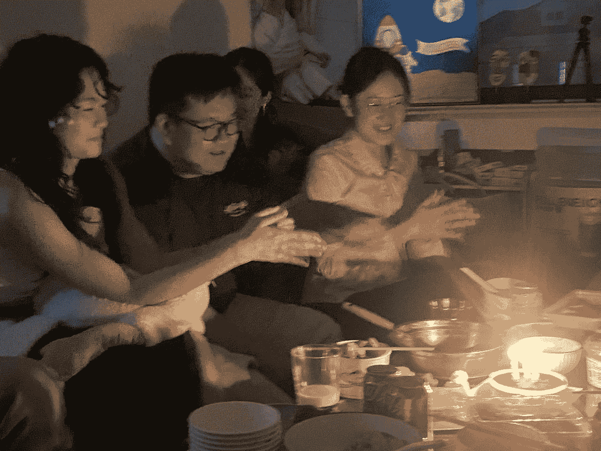

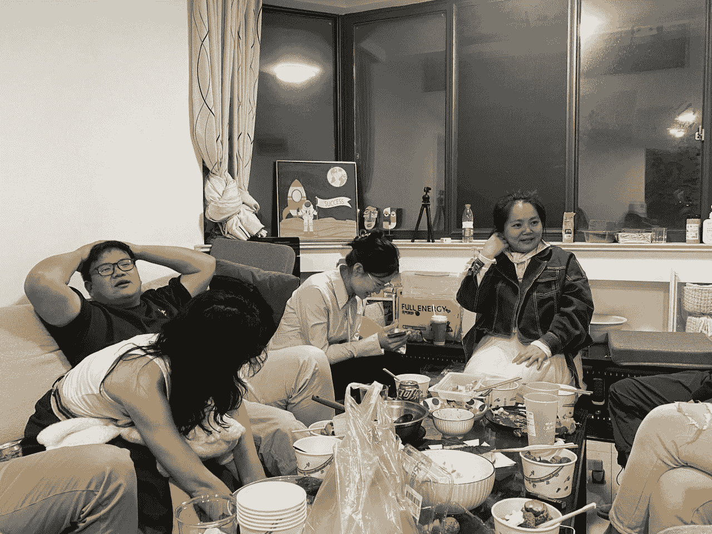

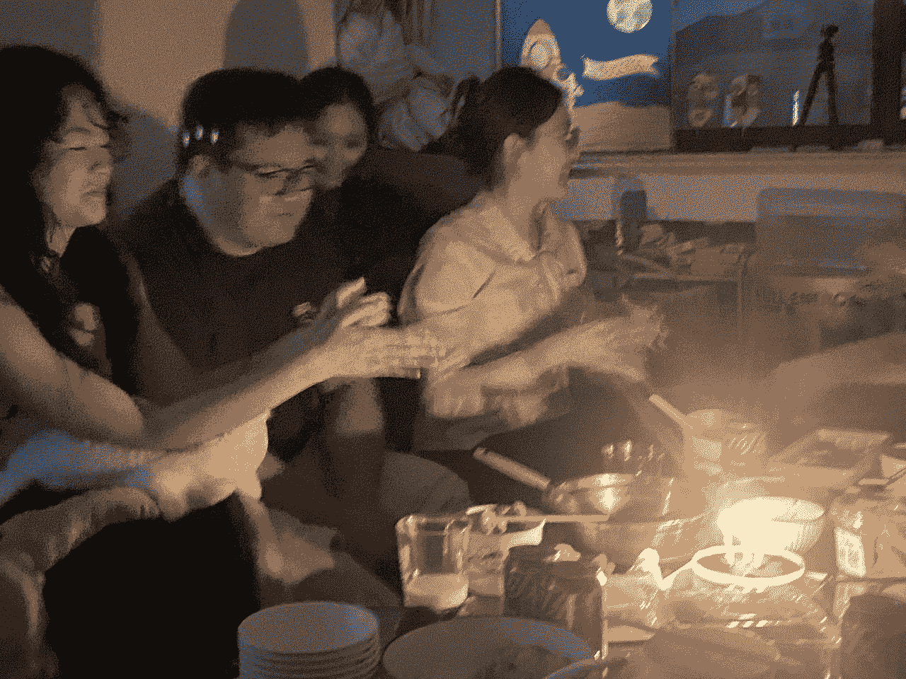

1.  时间是这个世界上最有魅力的东西

1.  学习从来不是轻松的事情，熟练的技能来自于10000小时的刻意练习，不要低估时间力量

1.  伟大的巫师经常独自行事，只要空气中的元素依然回应他的咒语和呼唤。链接：https://quail.ink/lyric/p/great-wizards-usually-act-alone

1.  早上看了一部超棒的电影，叫《对你的想象》，这部电影的风格很像是《爱在黎明破晓前》，太磕了，喜欢+1

1.  能让我们谦卑的书都是好书，能够指导行动的知识都是好知识

1.  我又浪费了一天的时间，啥也没干，有时候这实在令我焦虑 😐

1.  哈哈哈哈哈，我五一看完了《玩具总动员》、《赛车总动员》、《疯狂动物城》、《心灵奇旅》、《功夫熊猫》、《你的名字》、《天气之子》、《星际牛仔》...

1.  桌游太好玩啦！我想天天玩桌游

+   **2024 年 4 月**

1.  在动手实验室捏了一个AI 朋友圈 Bot，每当你发布一条朋友圈以后，许多虚拟角色会根据内容在你的朋友圈底下进行评论、聊天、吵架...

1.  文档：[AI Agent 构建｜AI 朋友圈](https://raen302qpak.feishu.cn/wiki/BpIhw6AYkiAcuMkbAKCcTgyHn8f?from=from_copylink)

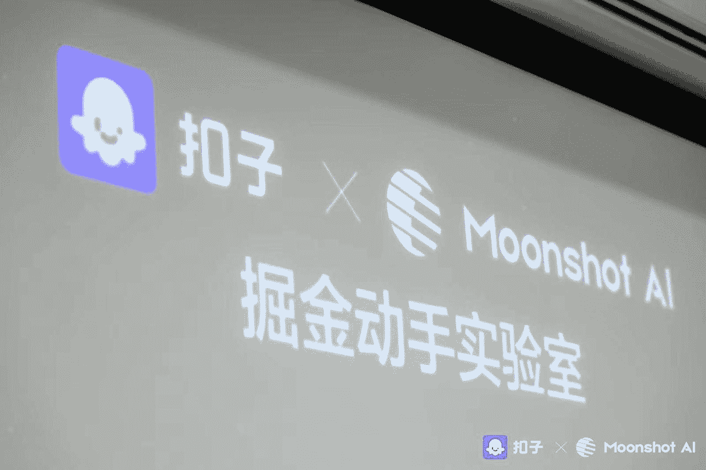

1.  打卡人生第一个半程马拉松 ✌️

1.  今年最推荐的书籍是《深度学习革命》，看完下楼跑了几圈

1.  我喜欢跑步时，把总公里数分段，并设立一个一个参照物，眼里只盯着参照物，这样可以跑的更远一些，同样的方法适用在工作时，比如可以把任务拆解，坐在电脑前的那一刻眼里只盯着具体的问题。这是在跑步时候学到的

1.  “我写得不太好。也没有梦想，写了就写了，不写就不写了，我不是那种这辈子非要做成什么事儿的人。基本上什么事儿我都不想做，但做的话会认真，这个博客内容也是我认真写的”。这是《李诞》在笑场这本书写的，我本来想作为博客的卷首语，但感觉有点刷流氓

1.  每天起床后喝杯鲜牛奶的感觉很好

1.  往后会不会出现不同的 AI 信仰派，喜欢Claude的用户一派，喜欢ChatGPT的占一派，彼有一天意见不合，发起了星球大战 🪐

1.  富兰克林说：早睡早起，会让你健康、富有、又聪明

1.  看了很多 AI Agent 的应用案例，比如一句话定机票和外卖、一句话生出行业研究报告、AI Agent 是人的个人助理，这其中一个很重要的问题是：人真的需要个人助理吗？一天中需要个人助理的场景有多少次呢？我们需要思考一个真正重要的问题：AI Agent 应该去什么事情

1.  做自媒体需要有一个很核心的能力：如何将内容转换成喜闻乐见的作品

1.  我有一个疯狂的想法，想做一个产品，这个产品名为一起，一起吃饭、一起写作业、一起去图书馆、一起去逛公园，我们设置很多这样一起做的事情，然后用户可以参与匹配一起完成的这个事情的人

1.  看到Gemini 1.5 Pro开放API的报道，我开始思考一些事情

1.  AI 能够理解图片会有哪些应用场景

1.  AI 能将理解视频会有哪些应用场景

1.  RPA 是一个不错的工具，学习学习

1.  永远去做复利高的事情，比如：跑步、阅读、写代码

1.  我 TM 再也不吃绝味鸭脖了，拉了两天肚子 😭

1.  定一个Flag：一周研究一个 AI 垂直领域，这周研究了两个，哈哈哈哈

1.  刚刚在听李飞飞教授的演讲，他说教计算机理解图像如同孩子通过眼睛去理解世界，人的眼睛是200毫秒拍摄一张照片， 当我们3岁的时候，就会有几亿张照片，通过这几亿张照片，我们理解了世界运行的规律。这里面让我在思考一个很有意思的问题：你是怎么样的人，取决于输入给你的训练数据

1.  这两个问题我研究一下

1.  为什么计算机能够理解照片和视频？

1.  如何让大模型拥有长文本的能力？