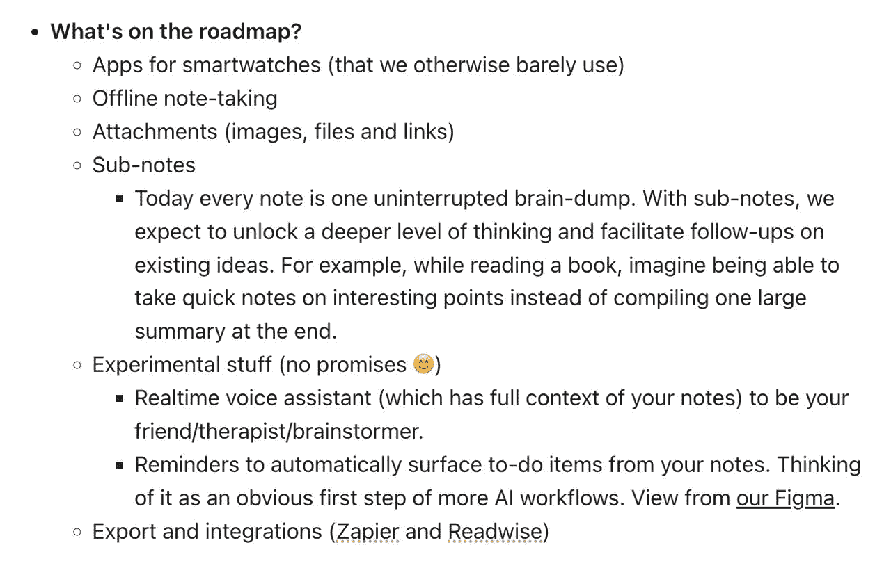

# AI教程 ｜做一个实时对话字幕

> 来源：[https://docs.feishu.cn/docx/OoW9dMvMFoSws4xUe0Lc12swnhM](https://docs.feishu.cn/docx/OoW9dMvMFoSws4xUe0Lc12swnhM)

# 📝 What is？

## 1.1 关于本项目

有一种说法，人类的理解速度的瓶颈在于眼睛寻找文字的速度，而不是大脑理解文字的速度。如果把一大段语音实时转成文字，那么人们就能迅速理解其中的意义，理论上直接看文字比听文字获取信息的效率更快。

我在 B 站学习文字快闪视频的时候，发现有一种文字快闪方式叫倒鸭子，一些博主会把纯文字说话的视频配上字幕，这个字幕由于是倒放的，所有被称之为到鸭子，由于我暂时还没有想好这个项目要叫什么名字，目前可以称之为倒鸭子App

> 图｜说话的过程中字幕会实时改变

## 1.2 产品简介

👀 倒鸭子App这个产品是将实时字幕转化成视频动画，并且带有实时AI会议纪要的功能，可以适用于访谈、对话、授课、圆桌讨论、教育等场景，方便现场的用户快速理解嘉宾演讲的内容。

可能口头上说大家还不理解，我在下方画了一个原型图。你也可以看看苹果的这个文字快闪视频和一段AI 会议纪要图示帮助你理解这个产品想要解决的核心问题

1.  文字快闪视频

<https://player.bilibili.com/player.html?bvid=1SW411C7T3>

1.  AI 实时会议纪要

## 1.3 产品原型

假设你在现场听一个论坛，台下是嘉宾演讲，屏幕上实时显示文字内容，和会议纪要...

> 实时的快闪动效字幕显示ing

> 分享嘉宾1:

> 分享嘉宾2:

> 实时会议纪要

> 问题：

1.  回答1

1.  回答2

# 🍟 技术思路

> 实时字幕实现思路：

1.  构建一个 web 网页

1.  调用  讯飞听见 流式对话API

1.  将对话内容以动画的形式呈现在画布上

>

> 实时会议纪要实现思路：

1.  调用 OpenAI API 接口

1.  隔一分钟刷新一次会议纪要内容

# 📚 参考项目

1.  [桌面字幕——实时语音翻译](https://github.com/ch3nnn/DesktopSubtitles)

1.  [TMSpeech](https://github.com/jxlpzqc/TMSpeech)

1.  【开源】Windows实时字幕软件（网课/开会必备）

1.  [轻量的 macOS 实时双语字幕程序，在收听](https://www.bilibili.com/video/BV1VZ42177G8/?vd_source=951ad8008b9d7f8c6f599d1a40278c2a)播客或观看视频时提供高质量的双语流式字幕

1.  世界杯无障碍字幕直播间背后的流式语音技术 火山语音

1.  FlickerReader-Zh 闪烁阅读插件