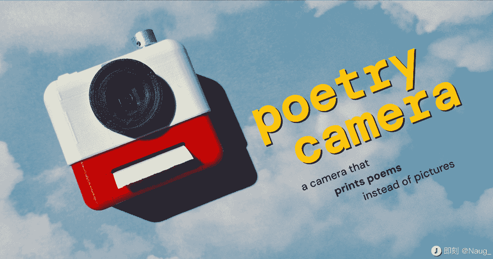
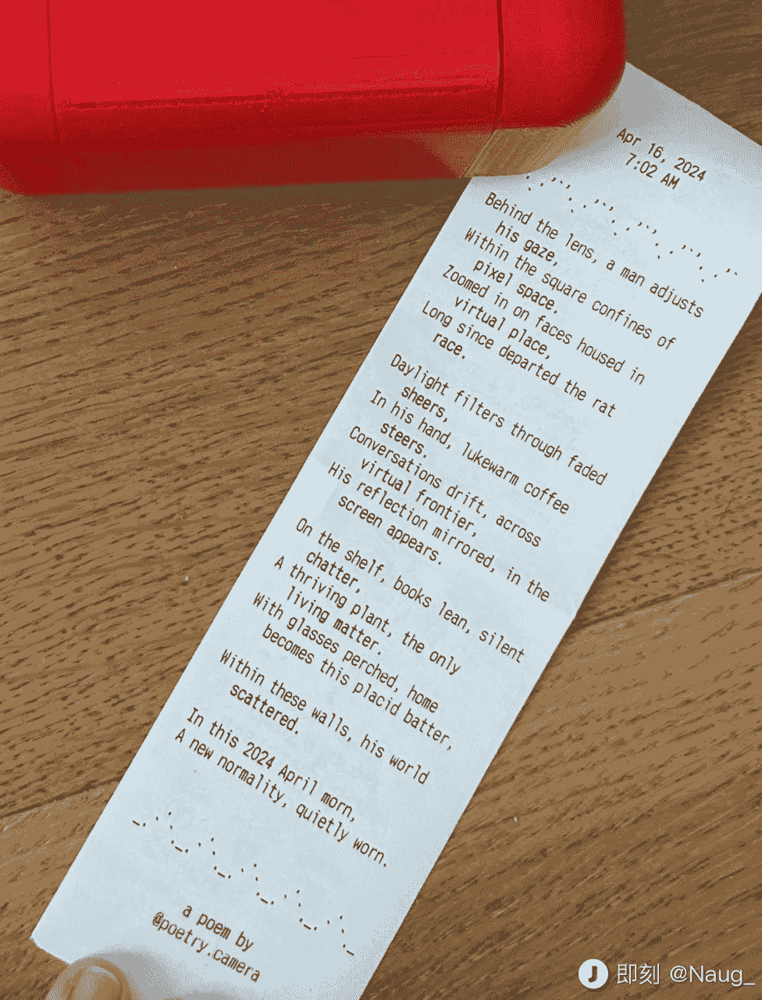
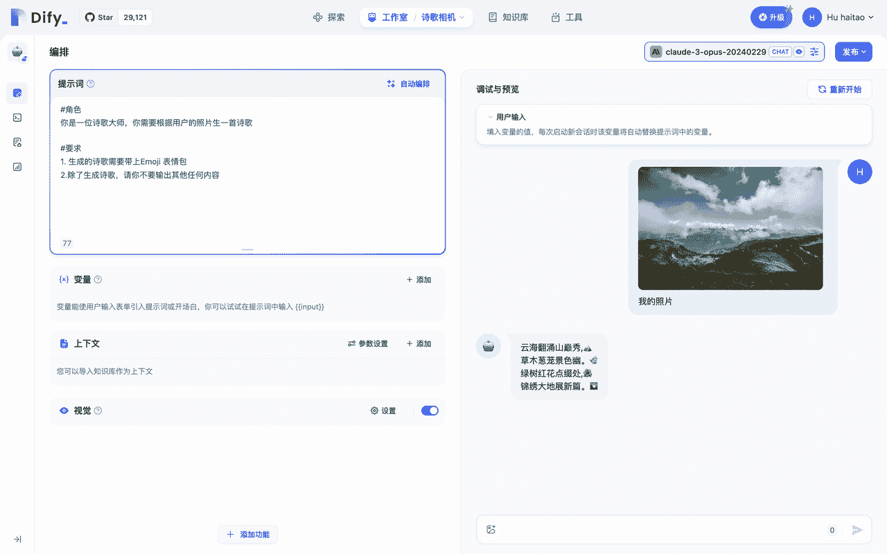
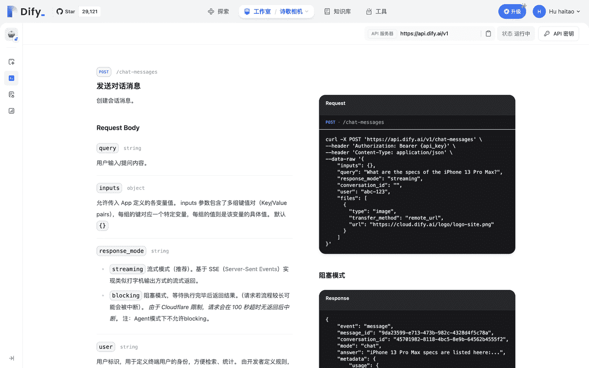

# AI 教程｜做一个诗歌相机

> 来源：[https://docs.feishu.cn/docx/SdcEdGKX7ojO8Pxa0MVc57gbny4](https://docs.feishu.cn/docx/SdcEdGKX7ojO8Pxa0MVc57gbny4)

# 🍟 1. KeyPoint

> 我在思考这个产品怎么做的时候，发现已经有人做了！作者还把这个项目开源项目，包含所需硬件清单和软件代码。

1.  官网链接：[poetry.camera](https://poetry.camera/)

1.  DIY 教程：[github.com](https://github.com/carolynz/poetry-camera-rpi)





# 📷 2.诗歌相机

## 2.1 什么是诗歌相机

1.  故事背景：我发现我快丧失了语言表达的能力，有好好几次我看到很美很美的风景的时候，我都无法用语言概括这种美丽，古人会说“轻重已过万重山”、“落霞与孤鹜齐飞，秋水共长天一色”，而我只会说“我靠，太好看了！YYDS”...

1.  诗歌相机是一个拍照以后生成诗歌的这么一个东西

1.  有点像是拿在手上的拍立得

1.  拍立得拍照后会生成照片，我希望诗歌相机在拍照以后能够友AI生成一首诗歌，然后把诗歌以一张纸条的方式吐出来，这张纸条记录下了你看到的风景

1.  感觉是一个很浪漫的东西，下单！

## 2.2 如何构建诗歌相机

### 2.2.1 软件层面

> 通过 Coze、Dify 搭建根据照片生成诗歌的工作流

1.  提示词

```
#角色
你是一位诗歌大师，你需要根据用户的照片生一首诗歌

#要求
1. 生成的诗歌需要带上Emoji 表情包
2.除了生成诗歌，请你不要输出其他任何内容
```

1.  使用 Claude 视觉模型



1.  调用API



### 2.2.2 硬件层面

> 可以参考这位作者的 DIY 教程：[github](https://github.com/carolynz/poetry-camera-rpi)[.com](https://github.com/carolynz/poetry-camera-rpi)