# 母婴行业怎么做好私域、视频号？丁香妈妈🛰️全域运营策略拆解

> 来源：https://my.feishu.cn/docx/Hs7NdoOTIozj5Sx15V2cKephn7e  
> 原文链接：https://mp.weixin.qq.com/s/7ZkvJLOn1h7X9Sf4_LuLKA?token=1505294899&lang=zh_CN  
> 剪存时间：2025-02-17 15:30:24 (UTC+8)  
> 本文档由 [飞书剪存](https://www.feishu.cn/hc/zh-CN/articles/606278856233?from=in_ccm_clip_doc) 一键生成

河林成长说 2024年11月29日 08:01 浙江

编者荐语：

2024年5月首发于每日运营案例库👸号，欢迎学习交流，未经授权禁止全篇复制、转载。

以下文章来源于每日运营案例库，作者河林

**每日运营案例库**

每天分享1个优质案例拆解，涵盖私域全链路、视频号直播、游戏化、品牌全域营销等领域，带你掌握运营底层技能，一起探讨和洞察行业趋势。案例拆解训练营持续招募中，戳菜单栏预约名额~

前情提要：

这是我5月份做的一篇案例拆解，首发在每日运营案例库知识星球&👸号。  
当时写完就忘了，今天想起来觉得应该同步在👸号这里，于是转发出来。

以下为本次拆解备忘录：

此次拆解写于2024年5月，当时的情况与现在不同，丁香妈妈视频号矩阵整体运营水平有明显提升，所以很多部分目前再看会存在差异。  
受到时间、精力限制，仅对丁香妈妈主账号的🛰️全域做了拆解，也存在来不及深入拆解的部分。  
全部拆解内容由我个人独自完成，主要目的为学习、借鉴，提升营销水平，受个人主观意见影响会存在偏差部分，不代表实际客观情况，有不足的部分欢迎探讨、交流。

## 1 丁香妈妈IP背景

丁香园是中国领先的医疗领域连接者以及数字化领域专业服务供应商，深耕17年，平台汇聚了国内医学、药学和生命科学的专业工作者超过550万，专业医生会员超过200万名，占中国医生总人数近七成。  
其主体公司观澜网络(杭州)有限公司（丁香园），目前处在E轮融资5亿美金阶段（2020.12.28），员工2000人。  
丁香医生和丁香妈妈是健康及母婴领域的头部内容品牌，新榜健康榜、母婴榜常年排名top 1，全网用户超过5000万。2023年丁香医生和丁香妈妈开始涉足视频号直播，并建立了🛰️全域账号矩阵。  
丁香妈妈和丁香医生账号矩阵的电商主营阵地有两个店铺+视频号直播。

- 丁妈商城：丁香妈妈app，主要定位人群是1-3岁的宝妈人群。
- 丁香家：小程序商城，健康主题商店，以院外健康场景为核心组货逻辑，定位人群是较为优质的高线城市人群。

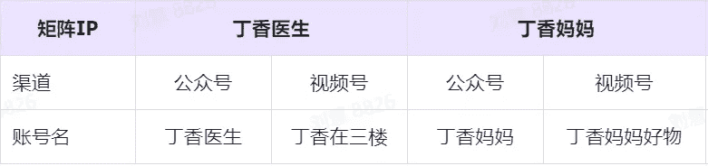

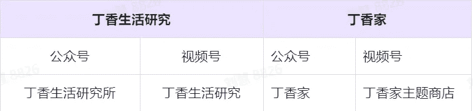

## 2 私域运营拆解

### 一、私域引流

#### 1 丁香生活研究所

##### 1）👸号

- ①自动回复：小程序/APP/小程序客服。目的是APP拉新/老用户留存/售后处理。
- ②菜单栏(健康商品——丁香家粉丝福利群)：添加企业🛰️→入企微群。目的是留存&转化（粉丝福利群）。

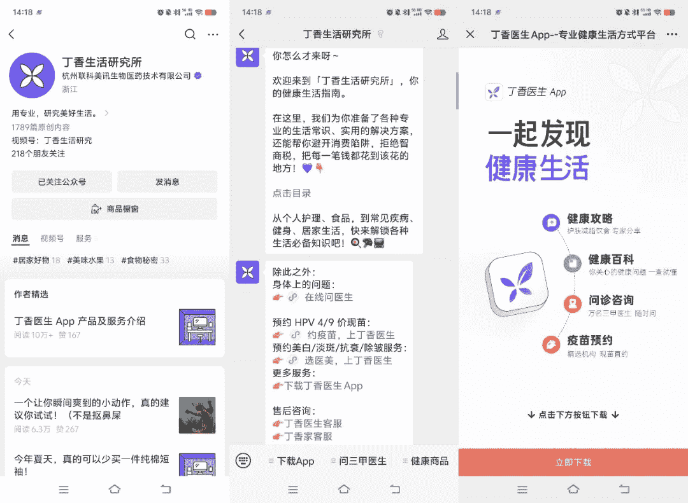

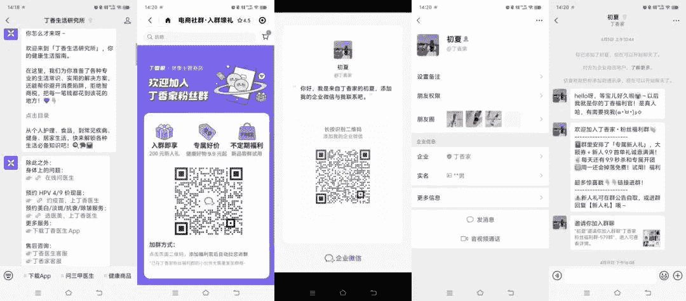

##### 2）视频号

- ①视频号主页：客服入口。目的是售后处理。

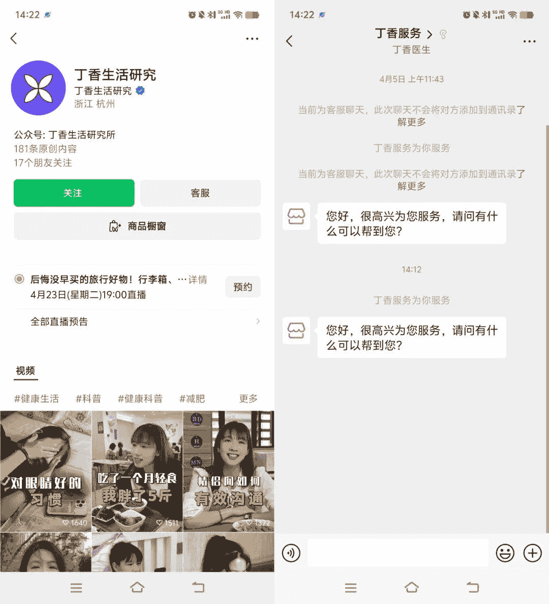

#### 2 丁香妈妈

##### 1）👸号

- ①自动回复：添加企微→入企微群。目的是留存&转化（早教群）。
- ②👸号文章：添加企微→入企微群。目的是留存&转化（绘本群）。
- ③👸号文章：添加企微→入企微群。目的是留存&转化（丁香家粉丝福利群）。

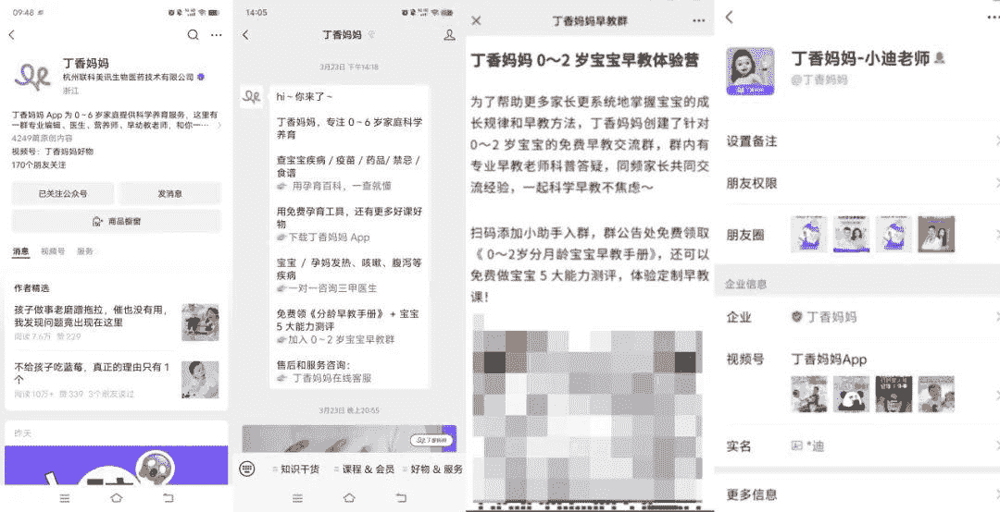

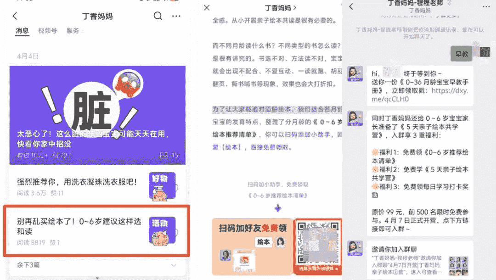

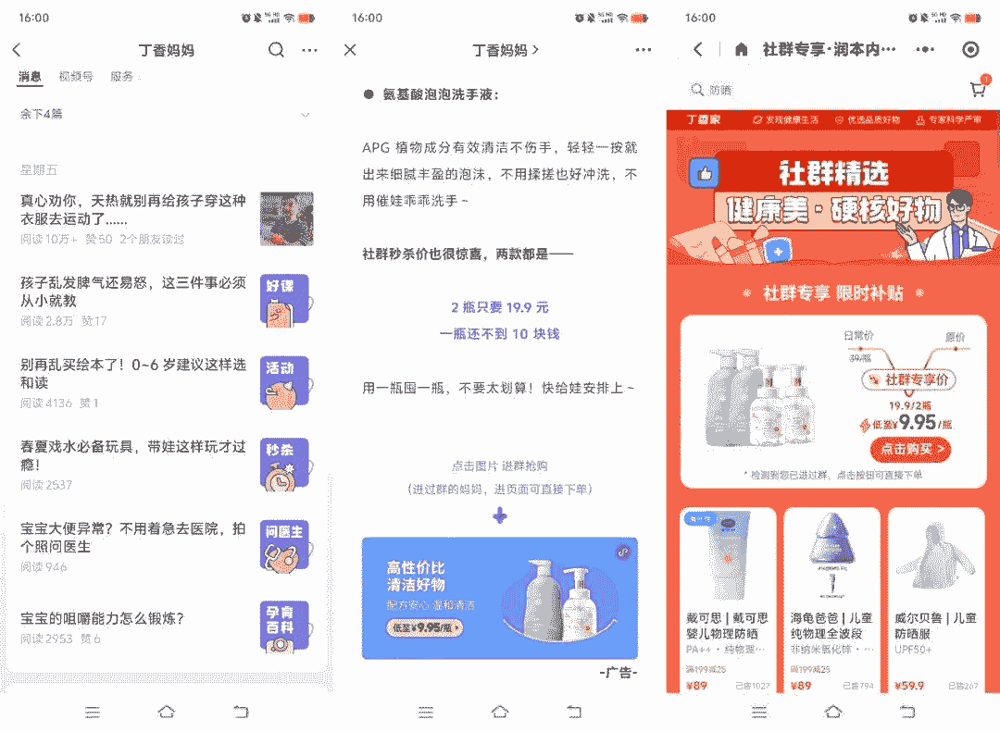

##### 2）视频号

- ①视频号主页：客服入口。目的是售后处理。

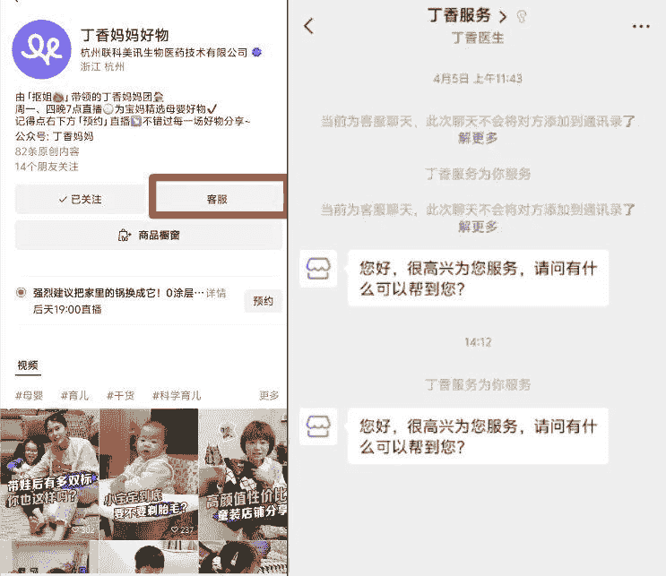

##### 3）APP

- ①丁香妈妈APP：添加企微→入企微群。目的是留存&转化（育儿交流群）。

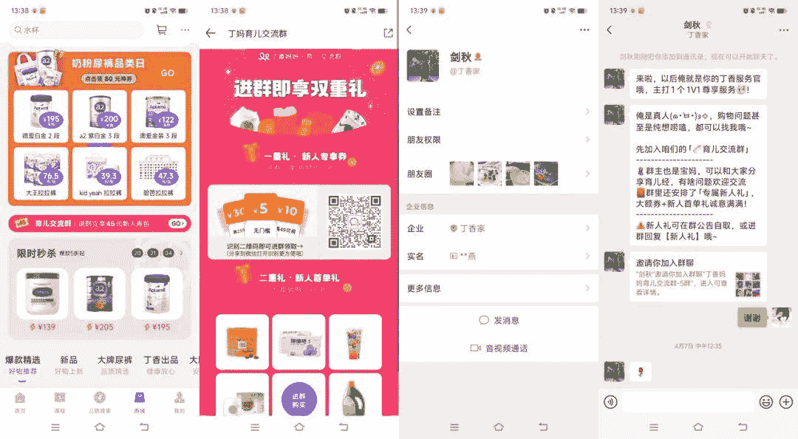

#### 3 丁香家

##### 1）👸号

- ①菜单栏：添加企微→入企微群。目的是留存&转化（粉丝福利群）。
- ②自动回复：入企微群。目的是留存&转化（粉丝福利群）。

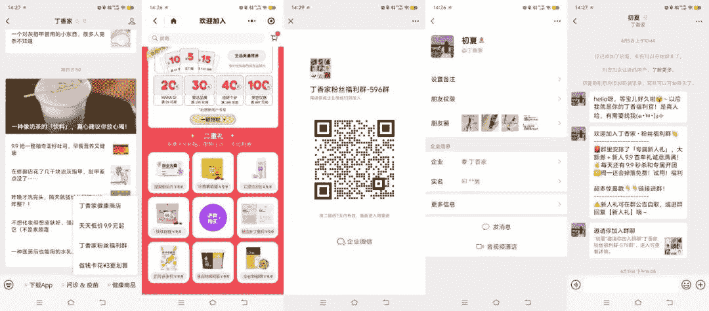

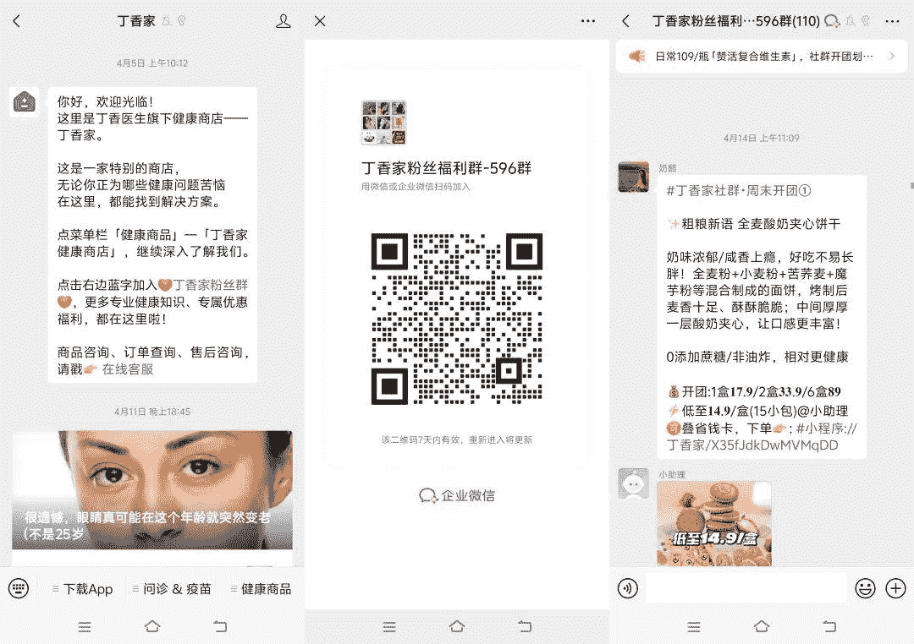

### 二、企微运营

主要以丁香妈妈账号的企业🛰️为例：

#### 1 私域引流路径

丁香妈妈👸号——绘本文章——企微码

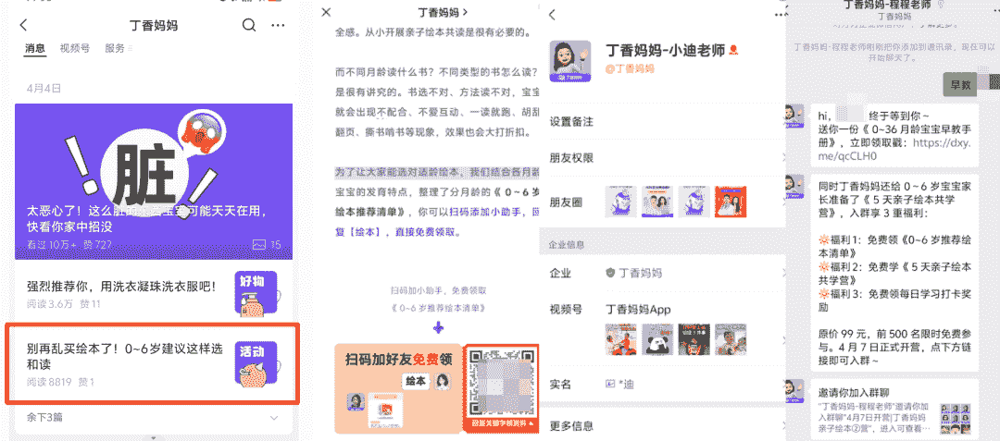

#### 2 企业🛰️人设

- 昵称：丁香妈妈-妮妮老师。
- 人设：以老师为主，昵称不固定，每一个账号都有各自分别的昵称，以凸显品牌IP为首要人设。
- 头像：动漫头像+丁香妈妈品牌名。
- 关联企微视频号：丁香妈妈APP。

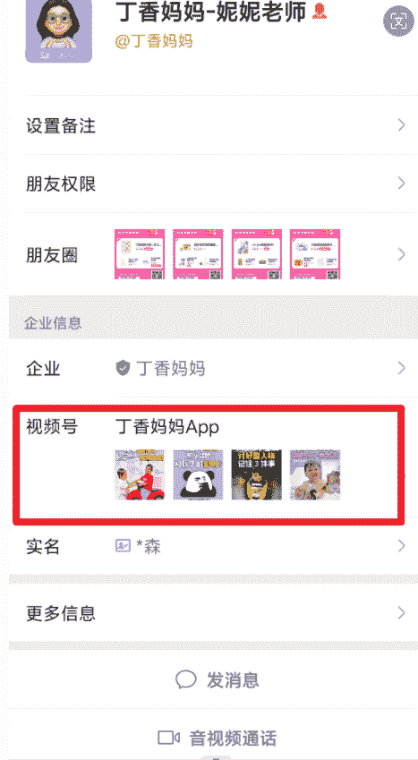

#### 3 欢迎语

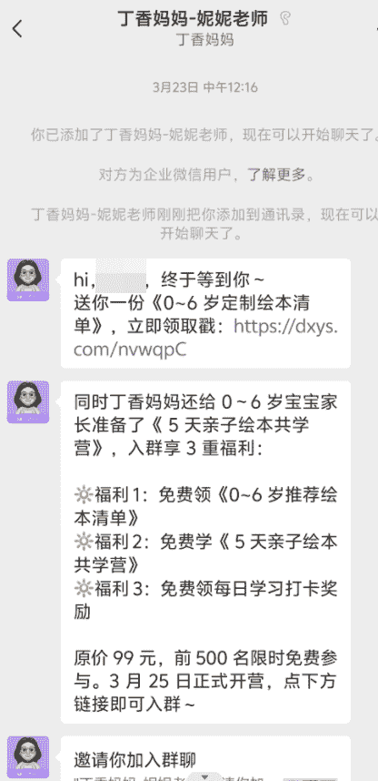

#### 4 私戳消息

私戳消息主要为介绍绘本课拼团特惠内容

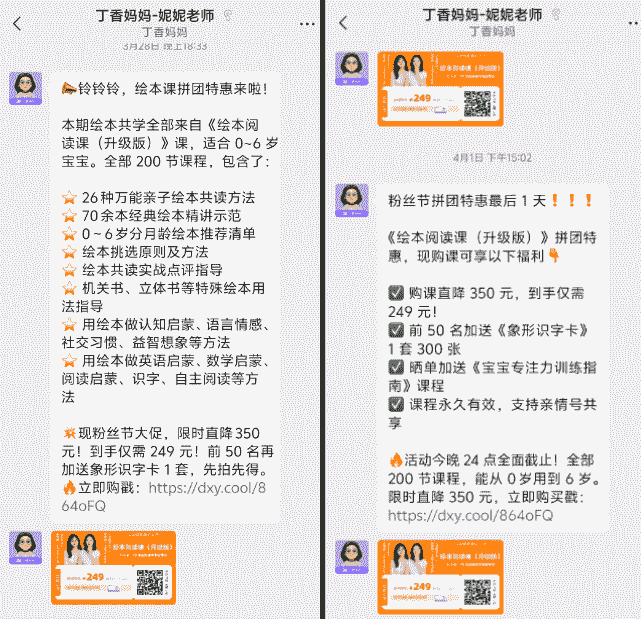

#### 5 朋友圈运营

- 朋友圈背景：文字「孕育有难题，上丁香妈妈APP一查都有」。
- 更新频次：每日更新朋友圈，每天2条。
- 每日领券/秒杀：每天10点定时发送一次，主要目的是电商小程序转化。
- 直播转发：文案中介绍直播利益点，在直播中转发「丁香妈妈好物」、「丁香生活研究」视频号直播间。
- 视频号视频转发：带视频标签转发视频号内容。

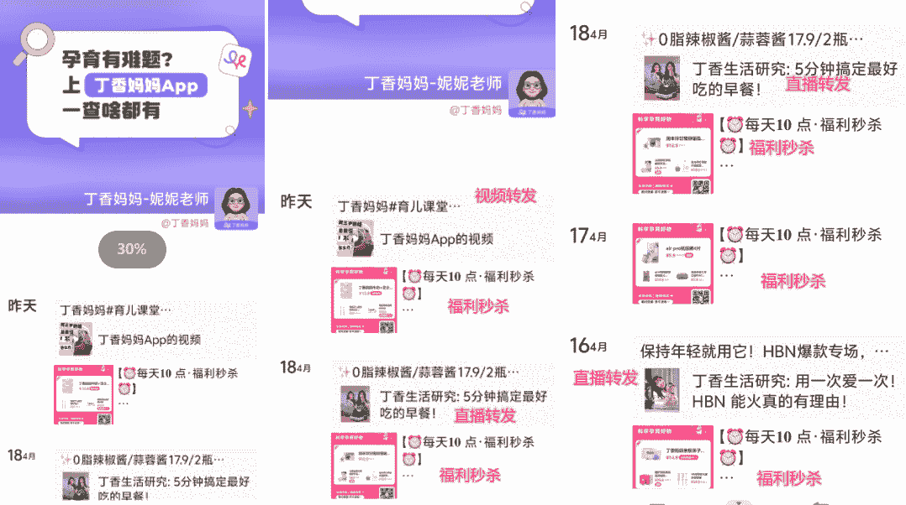

### 三、社群运营

以丁香妈妈号建立的私域社群「育儿交流群」为例：

#### 1 群名

丁香妈妈|育儿交流11群（原名：丁香妈妈|亲子绘本4营）

#### 2 群定位

团购期：绘本阅读课团购群  
日常期：亲子育儿交流群

#### 3 群公告

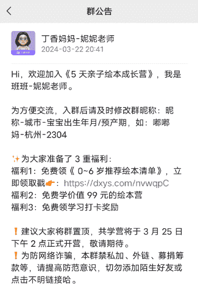

#### 4 群规模

人数250人到300人左右

#### 5 群人员配置

企微共有7人，主要活跃的班主任为3人左右。

- 丁香妈妈福利官-云朵妈：福利秒杀。
- 丁香妈妈-园园老师：课程信息答疑。
- 丁香妈妈-妮妮老师：管理员、班主任、亲子绘本课运营。

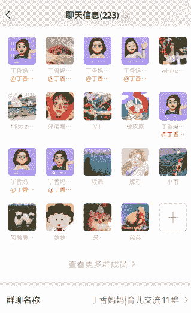

#### 6 群运营节奏（亲子绘本阅读课团购期）

亲子绘本课团购期共5天

- 丁香妈妈-妮妮老师运营。
- 亲子绘本共读小知识分享。
- 每日共学打卡接龙+打卡奖励发放。
- 《绘本阅读课》介绍及大促团购。

#### 7 群运营节奏（日常运营育儿交流群期）

团购结束后/日常运营期

- 丁香妈妈福利官-云朵妈运营。
- 群内每日10:00 福利秒杀：1次。
- 丁妈社群 每日开团：2次。
- 每月固定活动：囤奶日等其他社群活动。
- 育儿交流及答疑。

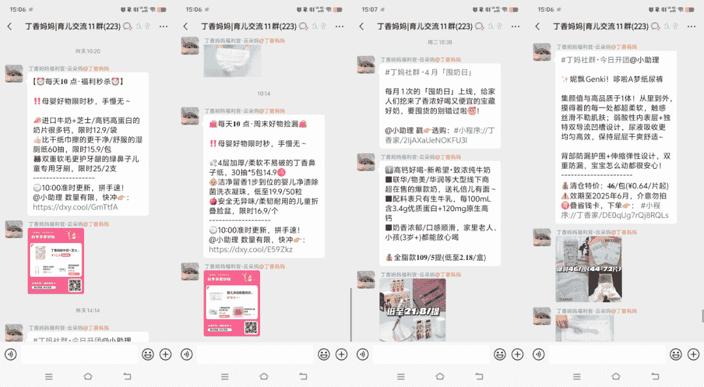

### 四、阶段性总结

#### 1 丁香矩阵账号运营

丁香妈妈IP建立了丰富的账号矩阵，丁香妈妈、丁香家、丁香生活研究三个矩阵账号，分别建立了相关联的👸号和视频号，共6个账号建立起来的账号矩阵，实现了功能、定位、人群区分。  
能够通过矩阵化的内容输出提高整个IP本身持续获客的能力，而且还能够在各自的矩阵下实现精细化运营，矩阵运营能力强。

#### 2 丁香妈妈私域引流

丁香妈妈的主要私域引流手段是通过👸号文章发布绘本内容，引流用户到绘本阅读群，👸号能够定期发布文章引流，引流规模和频次都能得到保障，引流效率高。  
丁香家和丁香生活研究的主要私域引流手段是通过在👸号菜单和自动回复，引导用户加入丁香家粉丝群。

#### 3 丁香妈妈社群运营

丁香妈妈家社群在主要产品是亲子绘本课拼团，绘本课拼团限时运营5天时间，绘本课运营结束后没有解散，而是转为常规社群「育儿交流群」运营。  
这个运营策略还是很有意义的，没有浪费已有的私域用户，能够稳步给私域积攒用户规模，来实现电商转化目标。

## 3 视频号拆解

### 一、视频号内容拆解

以丁香妈妈好物视频号内容为例拆解

#### 1 基础信息

- ①更新时间：2023年9月开始更新，账号目前每周更新4至5条视频左右。
- ②账号简介：
  - 由「抠姐」带领的丁香妈妈团。
  - 周一、四晚7点直播为宝妈精选母婴好物。
  - 记得点右下方「预约」直播不错过每一场好物分享。

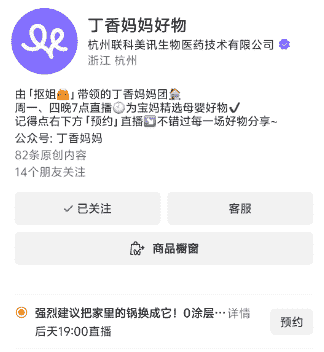

#### 2 账号数据

- ①视频的小红心喜欢数平均在500左右
- ②1000以上的小红心爆款视频共15个左右
- ③平均每5期视频会出现1期1000喜欢以上的爆款视频

#### 3 视频封面

- ①标题：形成了固定版式，2行字做主标题
- ②图片：一般都为妈妈+孩子出镜。

#### 4 视频选题

- ①科学育儿干货
- ②带娃日常分享
- ③育儿话题讨论
- ④母婴好物推荐

#### 5 视频结构

视频时长一般为5到10秒以内，通过讨论引入话题或者场景向引入话题，然后展开讨论，提出解决方案。

- 开头引入：我遇到了一个xxx育儿问题，直接以情景化形式展现问题本身。
- 主体：讨论问题原因，讨论解决方法，分析不同方法利弊。
- 结论：为用户提供解决方案，达成共识结论。

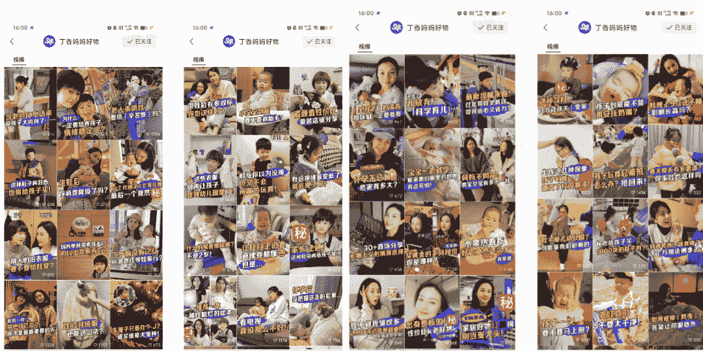

### 二、视频号直播间拆解

#### ①直播频次

直播目前均为带货直播，固定时间为每周一、周四开播。

#### ②出镜主播

扣姐（日常视频出镜人设和主播一致）。

#### ③直播引流渠道

目前可观察到的丁香妈妈好物视频号主要引流渠道如下：

- 视频号主页：引流效率低，策略为日常自然流量。
- 私域朋友圈：引流效率中，策略为直播过程中直接带直播利益点文案转发直播到朋友圈。
- 👸号：引流效率高，策略为在👸号推文内发布直播预约文章，介绍直播利益点，引导用户预约直播间、进入直播间。
- 视频号：引流效率高，策略为直播前发布品牌引流视频。

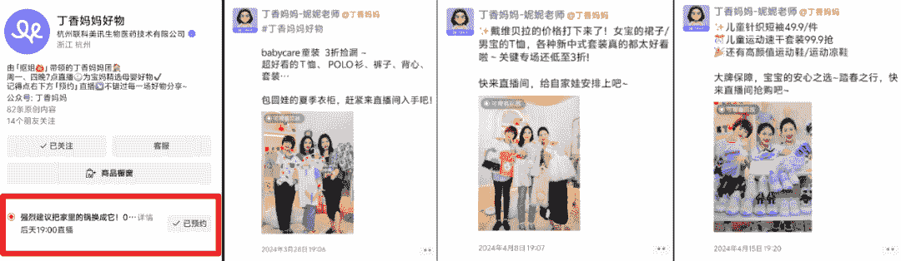

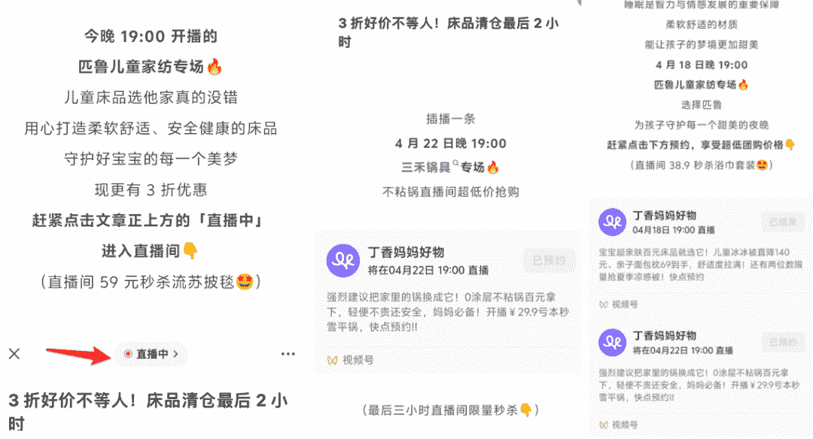

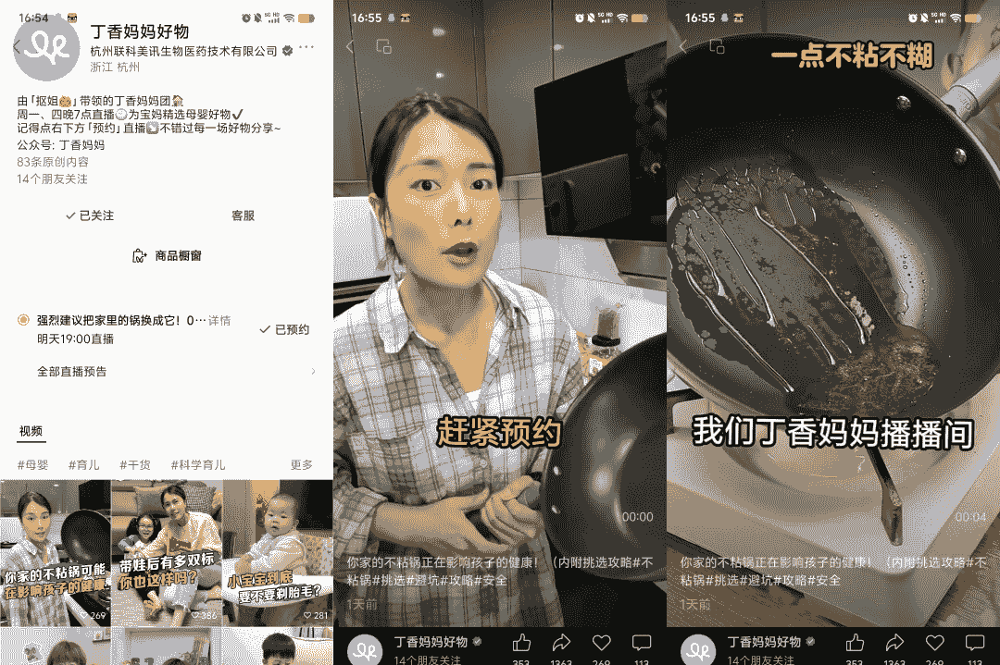

#### ④直播策略+话术拆解

以3.28日的「丁香妈妈好物视频号」童装专场直播为例拆解：

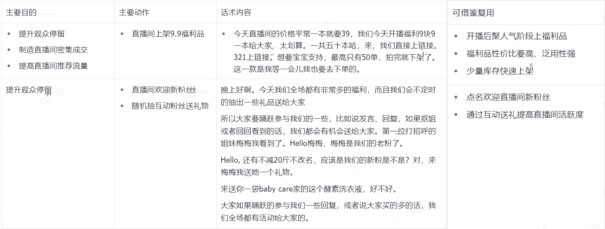

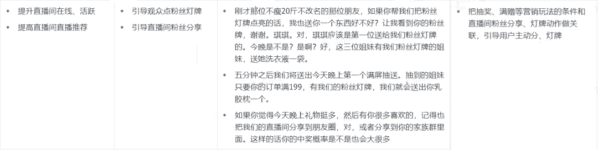

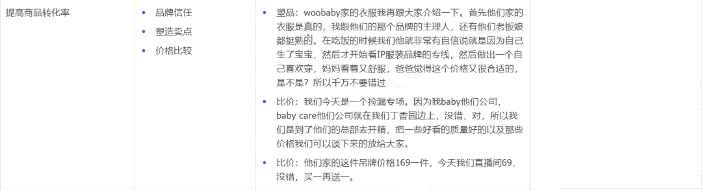

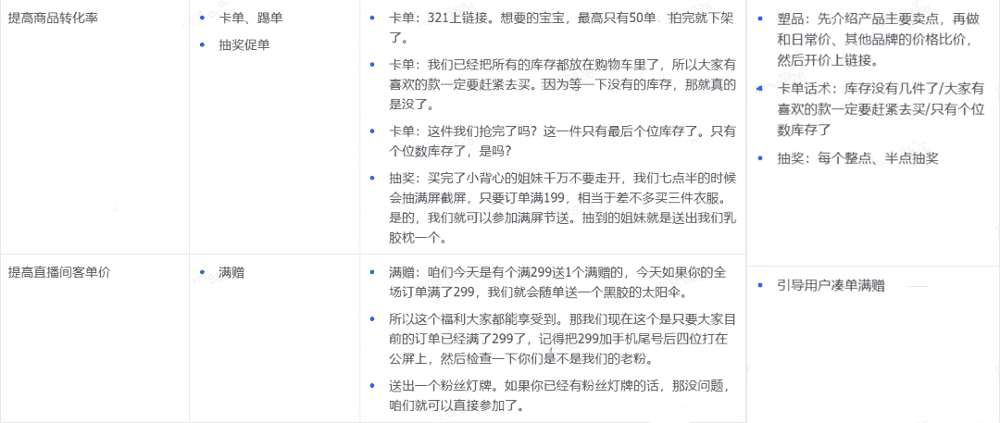

### 三、阶段性总结

#### 1 内容

视频号内容做得非常扎实，利他性强，选题与妈妈群体真实场景关联性强，容易引起用户共鸣。  
能看出来丁香妈妈好物视频号团队虽然正式起步运营不足一年时间，但是有着非常成熟的内容创作方法论，发挥了丁香团队的内容优势。

#### 2 人设

视频号的主要出镜人设为「抠姐」带领的妈妈团成员，日常通过视频内容出镜，直播时也直接在直播间作为主播带货，视频出镜人和直播出镜人一致非常好，能在主播和用户之间建立更强的信任感，对直播间的信任塑造也有积极作用。  
「抠姐」人设身份为丁香妈妈团的代表人物，和用户关系距离更近。丁香妈妈好物号主播的综合能力也比较强，对直播效果也有稳定的保障。

#### 3 阶段

从账号数据、视频更新频次、直播频次可以判断出丁香妈妈好物账号目前处在数据成长期，内容频次和直播频次都没有全量拉满，处在稳步提升内容质量，追求更高数据的爬坡阶段。

#### 4 直播流量

最主要的直播流量来源是👸号文章，这也是丁香妈妈好物的优势，👸号内容预热做得很充分。  
标题直接体现「主推品+卖点+利益点」，文章中通过「预热文案+设计图片」体现直播货盘和利益感，种草效果强，预约来的流量也更加精准。  
同时，由于直播频次固定为每周2场，为每一场直播都预留了充分的自然增长时间，视频号短视频流量也有充分时间为每一场直播提高预约量，对预约也有较大的加成作用。

## 4 小程序拆解

丁香妈妈IP矩阵只有一个主小程序「丁香家」，所以这次拆解的小程序部分主要针对「丁香家」小程序做拆解。

### 一、小程序设计

#### 1 首页

- 视觉设计：icon图标、商品主图视觉设计观感好，颜色设计舒服，且商品利益点露出足够。
- 板块设计：从上到下依次为商品主题、天天低价、好物榜单、今日种草、双列feed流。

#### 2 分类

按照「健康主题」和「商品品类」划分电商类目。

#### 3 购物车

#### 4 我的主页

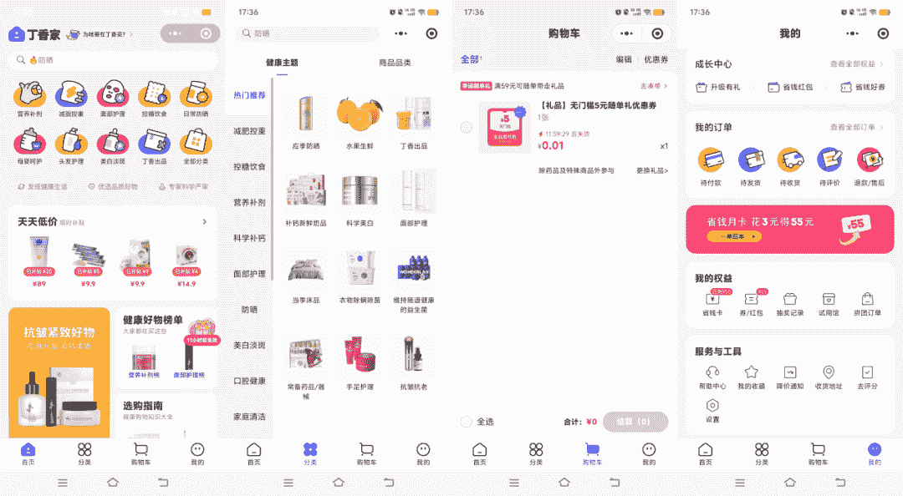

### 二、花粉会员

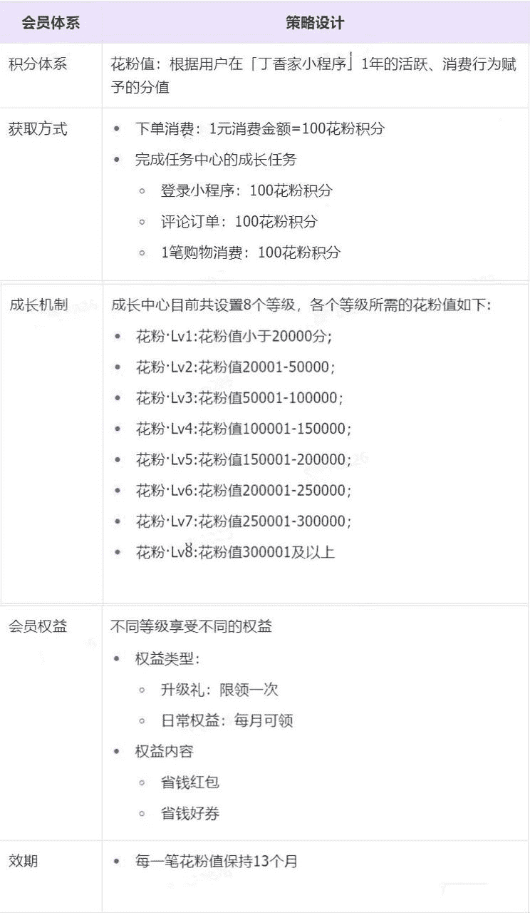

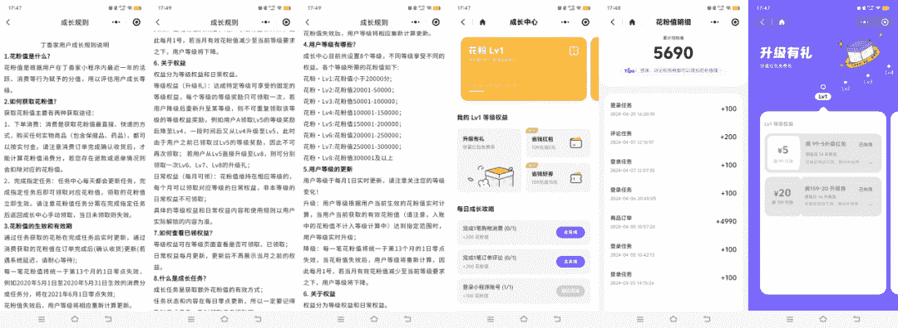

### 三、省钱月卡

丁香家小程序推出了小程序用户专属的「省钱月卡」，购买省钱月卡可获得多张红包券，主要起到激励新用户下单、激励老用户复购、提升粉丝粘性的作用。  
作为一个虚拟的电商产品，省钱月卡在某种程度上也算会员体系的一部分，和花粉会员体系可以相互补充，作为用户下单的双重激励。

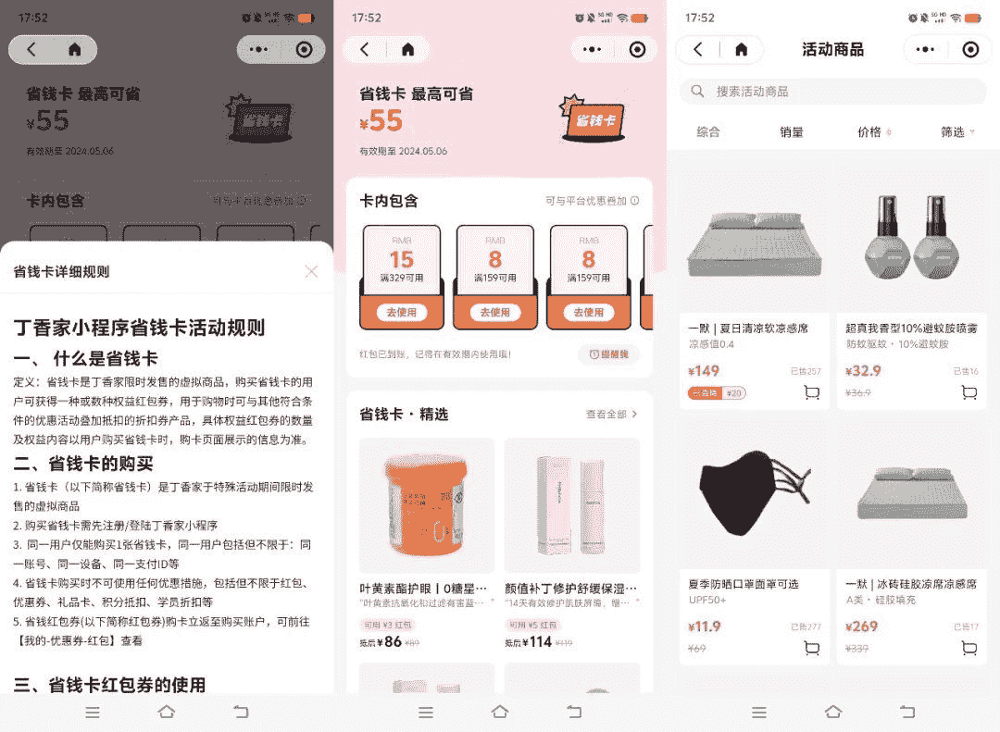

### 四、内容种草

#### 1 种草方式一

①小程序首页顶部「为啥要在丁香买」  
②亮点和特色

- 用长漫的形式做出「商品求职记」内容，生动形象。
- 展示了丁香家的选品流程和逻辑，体现了选品的严格性、专业程度。
- 更有说服力，增强了用户的品牌信任感。

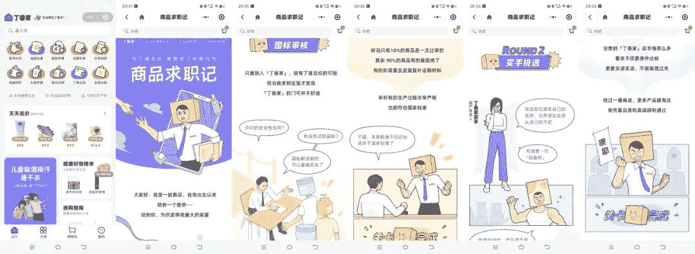

#### 2 种草方式二

①小程序首页上半部分「选购指南」  
②亮点和特色

- 小程序里的选购指南，介绍了各种不同类型商品的测评、选择标准。
- 体现了丁香家选品的专业度，也增加了种草内容的权威性，更能够得到用户信任。

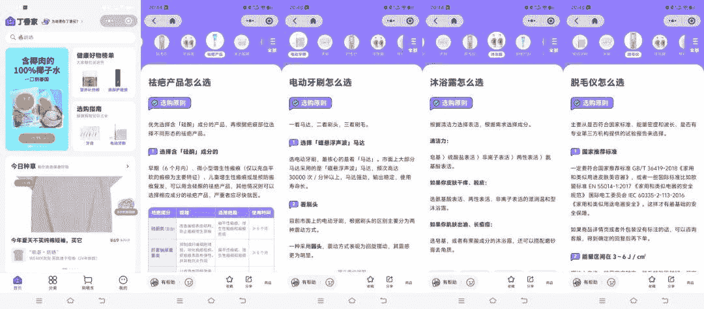

#### 3 种草方式三

①小程序首页中部「内容种草」  
②亮点和特色

- 以单品维度，展示爆款单品并搭配展示KOC的种草推荐语，UGC+PGC结合。
- 每一位种草官都有人设、title，推荐语的口吻更接近真实用户的使用体验，而又有种草官的独特专业视角，又能作为专业种草内容的补充，丰富种草内容类型。

#### 4 种草方式四

①小程序商品评论区  
②亮点和特色

- 用户的自发UGC评论也是内容种草的一部分。
- 丁香家小程序积攒了大量的、丰富的真实用户评论（尤其是丁香家自开发商品，评论数最多），能给用户的选购提供重要参考。
- 真实的用户评论积累本身就会成为用户在丁香家小程序下单、复购决策的重要因素。
- 毕竟一个单品如果能够在小程序积累9w+、10w+的评论，本身就是一种极强的信任背书，能让用户更信任这个渠道、这个商品。

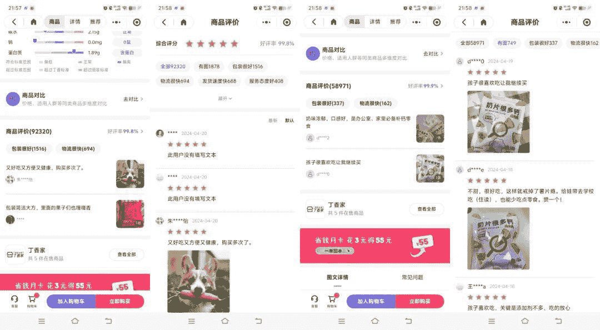

#### 5 种草方式五

①丁香妈妈APP内容社区  
②亮点和特色

- 内容社区：丁香妈妈的内容社区主要搭建在丁香妈妈APP上，丁香妈妈APP是丁香矩阵「内容社区」的主阵地。丁香妈妈的🛰️全域都对丁香妈妈APP有高度引流和曝光，所以可以把APP作为🛰️全域引流的一部分纳入拆解范围。
- 话题广场：UGC创作形式，引导用户主动根据社区话题来发布自己的真实感受，鼓励用户原创，相当于在APP建立起一套母婴版的「🧣话题」系统。
- 搜索百科：PGC创作形式，针对用户常搜索的问题建立由专家解答的内容库，相当于在APP内建立起一套母婴版「知乎」&「🧣热搜」系统。

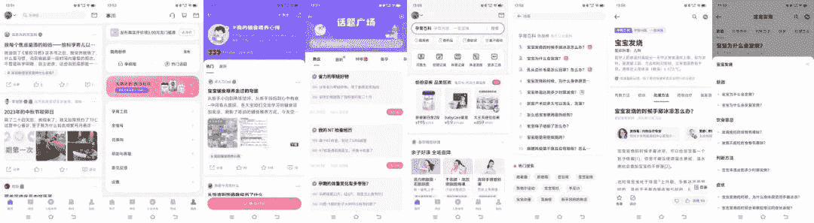

### 五、阶段性总结

#### 1 小程序设计

丁香家小程序功能板块设计清晰，主要承担：4个板块：首页、分类、购物车、我的。  
简洁清晰，购物属性强，符合小程序本身线上商城的定位，承担的核心功能就是线上购物，视觉风格设计也简洁好看。

#### 2 商品分类策略

小程序内的商品分类体系非常有亮点，不只按商品的「产品品类」划分类目，还会按照「健康主体」来划分商品类目。  
比如划分出了美白淡斑、日常防晒、面部护理、控糖饮食、减脂控重等多个主题，更加符合用户的使用场景和实际需求，更方便用户找到自己需要的产品。

#### 3 激励策略

通过花粉会员体系+省钱月卡体系，给用户提供了优惠券和红包的下单激励，也通过用户成长体系，激励用户持续复购。

#### 4 内容种草策略

丁香家小程序干货内容建设扎实，通过UGC+PGC的内容，实现科普+种草。  
科普精神体现在多处，利他性强，极大地发挥了丁香妈妈IP的内容能力优势，塑造了品牌的专业形象，也增强了用户信任，建立了丁香家的独特竞争力。

## 5 🛰️全域联动

# 一、触点组合

## 1、👸号+企业🛰️+视频号

### 具体玩法&路径

- 👸号文章
- 二维码添加企业🛰️
- 朋友圈转发
- 视频号短视频＆直播

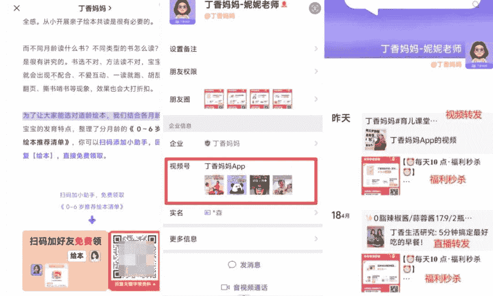

## 2、小程序+企业🛰️+视频号

### 具体玩法&路径

- 小程序
- 二维码添加企业🛰️
- 朋友圈转发
- 视频号短视频＆直播

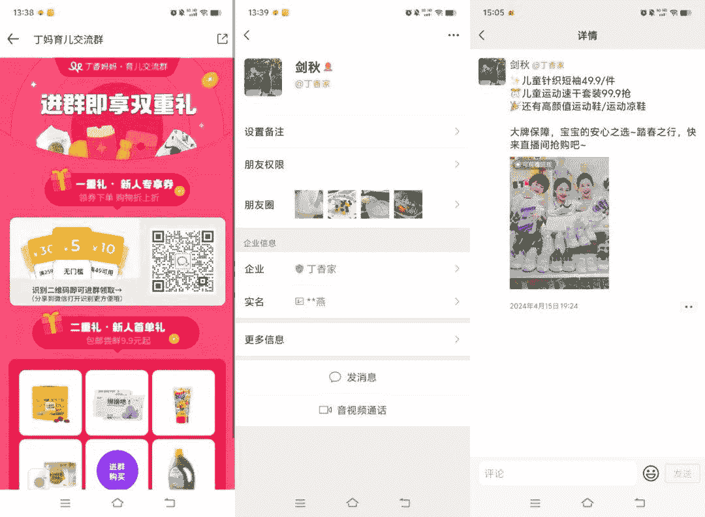

## 3、👸号+视频号直播

### 具体玩法&路径

- 👸号文章
- 直播预告按钮/直播中按钮
- 视频号直播

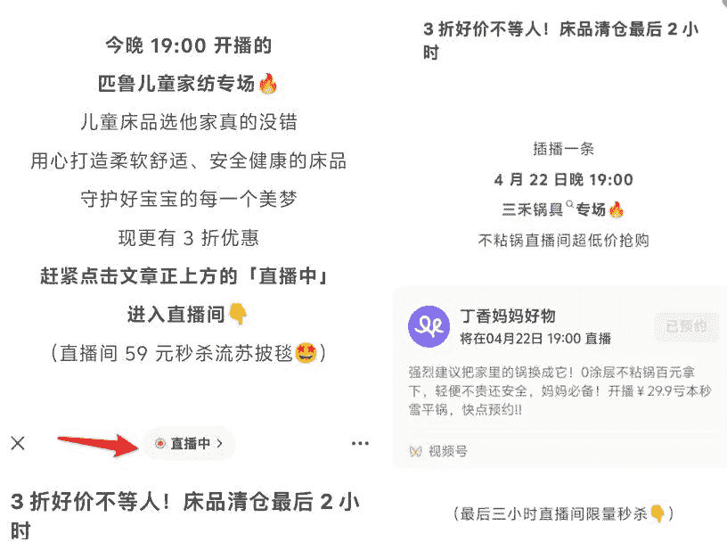

# 二、策略&目的

以公域的内容曝光为入口，打通公域-私域的获客闭环，并从私域反哺公域为视频号直播赋能，打造公私域联动闭环。

6

# 拆解总结

## 一、待优化的点

### 1、内容优势在私域社群没有得到充分展现

内容种草、内容科普是丁香妈妈IP的优势，但是根据目前的拆解来看，私域社群和私域企微的内容运营之中并没有加入内容种草、育儿分享、干货科普的分享，纯内容的比重很少。

从维系用户粘性，提供用户价值，提高私域活跃度的角度考虑，私域社群内是否能够增加干货内容转发的频次，来提高社群活跃度，或者在分享商品福利的时候，搭配小程序内容库的内容来做种草，更有利于转化。

### 2、包裹卡引流私域的渠道没有利用起来

在拆解过程中，从丁香家小程序和丁香妈妈APP下单了丁香家自营商品后，未观察到有随单的包裹卡，可以推测目前丁香家尚未在电商订单渠道加入包裹卡来引流。

对于有大量自营订单的丁香妈妈IP矩阵而言，包裹卡订单渠道如果能被利用，肯定也能发挥重要的私域引流作用。

### 3、小程序会员激励手段

目前对花粉会员的激励手段，所有等级、所有阶段本质上就只有一种奖励，就是用于商城下单的优惠券，而且都需要满足一定额度才能使用，而对于付费购买了省钱月卡的用户，得到的权益也依然是优惠券抵扣。

考虑到花粉会员的等级体系、消费门槛（等级体系最多到LV8、最高消费门槛需要3000+消费金额），这个激励手段可能有些单一。

如果想要更好地提升花粉会员的激励、促活、留存作用，也许可以尝试以下策略：

- 比如参考李佳琦直播间的私域积分体系：积分可以抵扣购买金额、积分可以单独使用用于兑换实物商品。
- 在高等级的花粉会员阶段，可以用实物商品来替代优惠券，作为高阶段的升级奖励。
- 考虑到目前花粉会员仅针对丁香家小程序下单的订单，而丁香妈妈APP上同样也建立了电商商城，但并没有建立同样的积分会员成长体系，是否可以把丁香妈妈APP下单的电商订单也通过积分转换程序，纳入丁香家小程序积分体系。

## 二、阶段性总结

### 1、丁香家小程序

丁香家小程序设计亮眼，设计简洁清晰，视觉风格统一、舒服，内容种草营销能力强，充分发挥了品牌的内容优势，同时小程序也起到了引流私域的作用。

### 2、👸号-私域-直播引流路径浅析

丁香妈妈的优势是👸号有着极大基数的用户规模和极高体量的活跃粉丝，能持续通过👸号优质内容，为自己的APP、私域引流。

#### ①从👸号-私域环节中

能看到丁香妈妈IP由于经营多个渠道，所以在不同渠道的引流、联动之间，依然存在优先级，资源分配上也存在取舍。

👸号的曝光资源中，首要目标是APP，比如在菜单栏、新关注自动回复、👸号文末，会首先引导用户下载丁香妈妈APP。

其次是电商小程序的日常售卖，而在电商文中内，主要渠道则是丁香家小程序，这些文章中几乎不会有导流私域、导流视频号的动作。

然后是解决售后问题，对于电商订单用户，会用各种方式先引导用户至🛰️在线客服聊天窗口解决订单问题，而不是企业🛰️。

最后才会在其他的资源位中，通过绘本课程、社群团购引流用户至企微私域。所以能够看到👸号引流私域的多条路径并没有被最大化地全量利用。

这样的引流策略也是各个渠道综合权衡的结果，也和丁香妈妈视频号尚处于成长期有关。

#### ②从私域-直播环节中

在私域✖️直播联动层面依然有提高空间，目前社群内依然以小程序电商推送为主，没有对视频号直播预告和视频号直播转发提供更多的资源和曝光，仅在朋友圈分发视频号直播，私域社群对直播的导流作用是可以提升的。

拆解迭代方向：

在拆解中发现，丁香妈妈、丁香家、丁香生活研究形成的账号矩阵的私域，存在互相导流、功能交叉的部分。

同时丁香生活研究视频号的数据在账号矩阵中表现很好，也有单独拿出来值得拆解的意义。

这次拆解的迭代方向：

- 可以重点拆解丁香家＆丁香生活研究的视频号运营和私域引流运营，把案例扩展为丁香矩阵的视频号拆解；
- 对于丁香妈妈视频号直播的拆解，由于丁香妈妈账号是达人账号，每场直播均为不同品牌的专场直播，受具体品牌本身影响大；
- 分析单一场次的货盘、直播玩法的作用有限，应该多场直播同时对比，提炼共通的玩法，找到达人账号做视频号直播中可复用的经验和方法论。

🔻欢迎交流，请多指教🔻

我是河林，98年出生，INFJ，base杭州，2年视频号达播运营经验。

我在这个👸号记录自己的生活、思考，如果对我感兴趣，欢迎交流、分享、留言。

