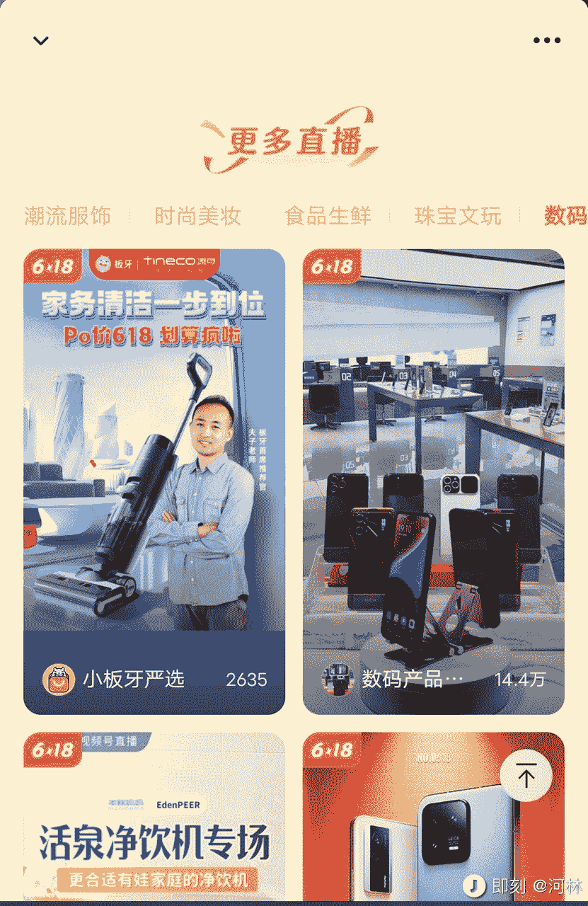
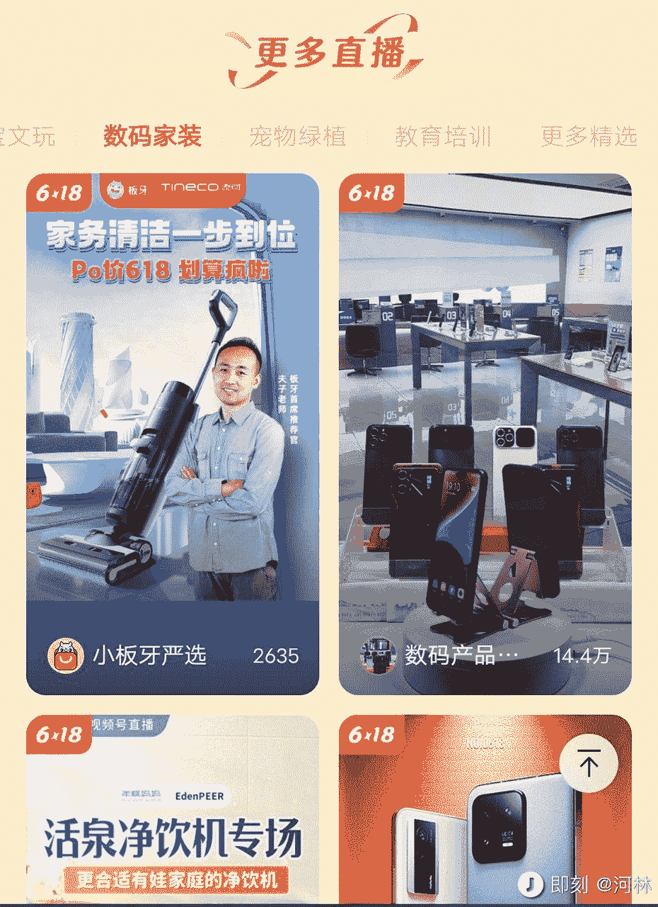
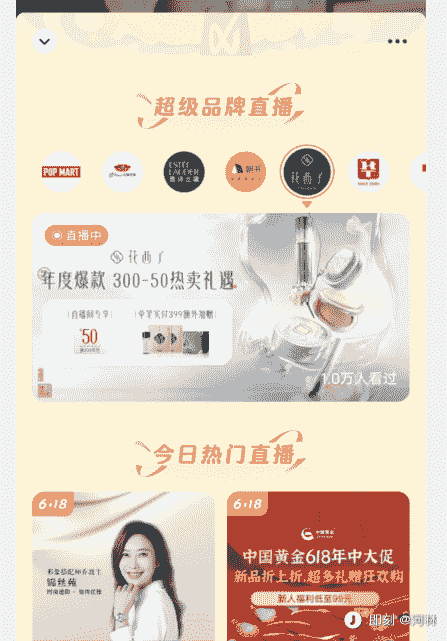

# 直播：从视频号618榜单看类目优先级

> 来源：[https://my.feishu.cn/docx/WRAwdczftoxPirxGhiYcGHCRnWb](https://my.feishu.cn/docx/WRAwdczftoxPirxGhiYcGHCRnWb)

2023/6/2：

在视频号卖什么最赚钱？

最火的4个类目，毫无疑问是服饰、美妆、生鲜、珠宝。

从618的活动榜单的优先级排序，也能看出来视频号官方对各个类目发展现状的态度。

视频号的618活动页面，在活动页面的品类榜单部分，按照展示次序的优先级从高到低，分别是潮流服饰、时尚美妆、食品生鲜、珠宝文玩、数码家装、宠物绿植、教育培训、更多精选。

在淘宝、京东这样的平台，618主打的心智肯定是数码电器以及美妆，但是在视频号，潮流服饰、时尚美妆、珠宝则是绝对的强势类目。

直接看看618带货总榜也很有意思，前20名里，美学、服饰、穿搭的达人占了绝大部分，

有个运营观点叫‘’精细化运营就是分类，分类就是一切。”，从分类上有时候能看出来很多事情。

多去观察和深究背后的原因，还是挺有意思的。

