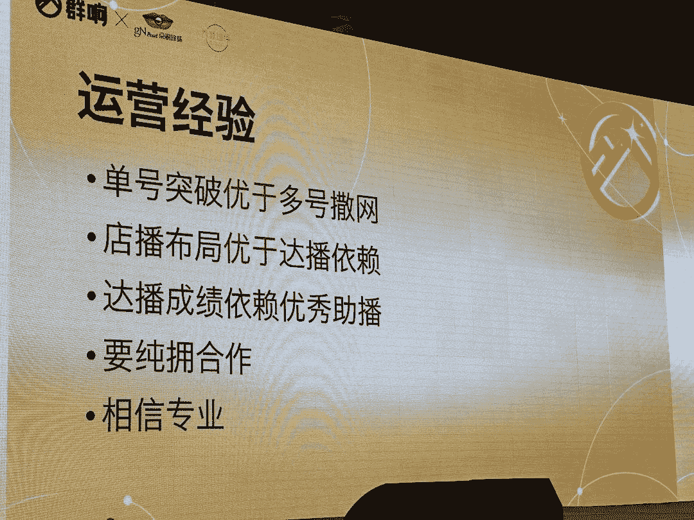

# 直播：近期对视频号直播的复盘和思考 2023.7.23

> 来源：[https://my.feishu.cn/docx/LAxvd3lFcoNWh2xH5UGcvbIxnVg](https://my.feishu.cn/docx/LAxvd3lFcoNWh2xH5UGcvbIxnVg)

> 🔗 原文链接： h[ttps://mp.weixin.q](https://mp.weixin.qq.com/s/dn75vouafCEgaZOI7Q-T1A)q.com/s/dn75voua...

> ⏰ 剪存时间：2023-07-24 21:51:50 (UTC+8)

> ✂️ 本文档由 [飞书剪存 ](https://www.feishu.cn/hc/zh-CN/articles/606278856233?from=in_ccm_clip_doc)一键生成

原创 河林 河林成长说

**这是河林的**第 42 篇👸号原创，内容分类为 营销笔记 。

**我是河林，我在这个公**众号记录自己的 成长心得、营销笔记 ；感谢你的阅读，欢迎交流讨论。

今天这一篇文章是我近期对视频号直播的一些思考， 主要是站在达人方的立场，对品牌和达人的视频号分佣合作带货直播的想法。

对这篇内容有任何想法，都欢迎交流讨论。

**0 1**

品牌想要在视频号直播拿到结果难在哪？

第一个问题，对于品牌而言，现在做视频号直播的难点在哪里？

我近期的感受有这几点：

**1. 我觉得首先是品类问题 **。

很多品类在合规属性、直播形式上天然不适合视频号，品类的合规问题首先就卡掉很多品牌。

比如最近我加到很多做大健康的同行，问我做视频号有没有什么机会， 我只能回答很难。

我不是主观认为大健康品类有什么问题，当然我知道很多行业的从业者都能提供充足的证明和证书，证明自己的合法合规性。

但是大健康产品、保健品类，由于各种原因，在视频号都是严重受监管的品类，再加上一些家用电器品类，很多类目的商品目前在视频号都是不能上架的。

连上架都不能上架，而且平台管控只会收紧，不会放松，所以这些类目在视频号有天然劣势，很难在视频号有什么起色，或者做大规模。

**2. 团队建设**

第二个难点我觉得在于团队建设。

一个好的视频号直播小组，至少应该有 主播、商务、直播运营、商品运营。

分开来看的话，每一个品牌本身首先肯定都是有商品运营和负责人的；而直播运营招聘难度不大，商务也容易培养，而且往往是品牌的商品负责人可以兼任的。

目前的难点可能在于主播。

在视频号，优秀的主播除了要有身为主播的优秀工作素养：口语表达力、表现力、亲和力、形象外观等等。

还需要有 2 点能在视频号吃得开的素质：

**一是适应视频号的直播节奏： **不被抖音直播养成的习惯带偏，能适应视频号直播的慢节奏，能在不依赖抖音式的营销手段的条件下，服务好视频号的用户。

**二是能塑造好产品价值的能力： **主播需要成为自己负责的类目产品的半个专家，并且能够站在用户视角挖掘出产品的使用场景和用户的痛点，并把产品的卖点讲解清楚。

无论是培养还是招聘，要找到一个能满足这些要求的主播，都是非常难的。

招聘的话，在视频号有积累、拿到结果的主播太少；培养的话，又极度依赖整个团队的综合能力，而且是需要花时间的，所以好的主播，往往不是一时半会就能召之即来的。

**3. 公域内容获客能力**

对于品牌，如果想要在视频号完成从0到1的品牌，在没有粉丝积累的情况下，不可能不去在公域找到“水源”，为自己注入流量。

要直播的话，就需要 **一定人数的直播预约 **来保证自己的开播流量；

而且直播间长期的发展， 少不了要建设私域，留住自己的忠实粉丝 ，那么公域引流也不可缺少。

所以找到适合自己的公域获客路径，也是需要考虑和规划的：

是依靠视频号开播来冷启动获客，还是靠在👸号、视频号做内容来获客，甚至是跳出🛰️生态，从站外其他平台导流？

无论哪条路径，都需要生产出相应的内容来建设品牌，而且不一定能马上见效，这也是品牌需要考虑的一个投入。

**4. 私域的流量导入**

私域流量是撬动公域直播间流量获客的重要方式，也是很多新起号的视频号直播间的主要流量和产出来源。

能否建设、维护好自己的私域客群，对一个直播间也非常重要。

因为私域是最忠实的粉丝群体，也是购买力最强、最容易转化的一部分用户，在直播间的流量和产出占比中都非常高。

而且 私域流量的承接，决定能否获得更多公域流量的推荐 ：私域导入直播间后，达到平台考核指标后，平台会给予即时性的免费流量奖励，以及直播后的流量券奖励，基础的奖励比例是私域:公域1:1，如果直播间的表现超过平均值，这个比例还会继续扩大。

如果一个直播间做不好私域、没办法把自己的私域用户持续引导到直播间转化，撬动不了平台的直播推荐流量，那么典型的直播情况就是：

**开播后30分钟就开始掉人，开播后1小时直播**间人数就减半，连100在线都维持不下去。

以上四个问题，是我自己个人总结的，品牌方在视频号直播从0到1起步的过程中，很可能遇到的问题。

不够全面，只是近期想到的一些碎片想法。

对于没想清楚要不要做视频号直播的品牌，最好都先考虑自己的团队能否解决、如何解决这4个问题，以及投入产出能否平衡，然后再开始规划自己的视频号直播营销方案，会清晰很多。

**0 2**

**视频号达播，大人和品牌方合作的痛**点在哪里？达人最想和什么样的品牌方合作？

第二个想法，是站在达人角度，回顾了近几期和品牌方的合作之后，盘点了和不同品牌方磨合时出现的一些问题，作为现阶段直播的记录。

如果这些问题在后续能够得到改进，在提前就和品牌方达成共识、采取措施规避，那么直播产出会好很多。

第一个想法是，品牌方的助播水平，非常影响直播转化。

京润珍珠的负责人在今天的群响北京站分享会上也提到了类似的观点——达播成绩依赖优秀助播。

很多品牌方不愿意承认的是，由于她们自身的助播能力不足，所以在达人直播的专场表现是差强人意的。

而由于品牌和达人合作直播的时候，产品的卖点讲解部分大部分都会交给品牌方自己的助播， 所以一旦助播表现平平，对整场直播带来的消极影响就是致命的。

很**多品牌的主播平时都负责的是自营视频号的日播，直播间都是品牌**的精准粉丝、直播时间长、节奏缓慢、讲品数量多，在这种环境下直播的主播， 有很多人在品牌价值塑造、产品痛点挖掘、针对目标人群的使用场景挖掘、直播间用户互动的能力上是缺乏的。

**这**就导致他们来到达人直播间的时候，在快节奏的过品情况下， 面对没有建立起品牌心智的用户，不抓产品使用场景和痛点，只会一味的品宣和重复卖点，塑造不好产品的价值，曝光和转化都会非常低，直接导致直播扑街。

**第二个想法是，建议所有的品牌方，都放下自己**的身段和傲慢，主动适应达人直播间的节奏。

很多品牌方，在和个别头部达人跑出了1套成熟的达播合作模式之后，就开始想着靠这一套打法“一招鲜吃遍天”。

当然，复制爆款场次的打法路径从运营策略角度是非常合理的，但是从品牌合作的角度来讲，用其他达人的方式去复刻到别的达人的直播间，是非常容易“水土不服”的。

因为每一个达人都有自己的独特魅力和特殊性，核心用户画像也有差别，团队经验程度也不同， 一味地去拿一套模板去“卡”所有的达人，是很难适配的。

而我们近期的多场合作中，出现的事故、失败、扑街的现象，**大多数都是品牌方执意要采用原来的策略， 不肯在我们的直播间临机**应变，反而在现场强行控场、打断节奏；以及对我们的直播间用户缺乏了解和准备导致的 。

我想对品牌方的负责人们和操盘手说的是，达人的用户也是用户，达人起盘和维系自己IP的第一要务就是维护好和老粉丝的关系，如果品牌方在和达人合作中，太过急功近利和以我为主，反而忽视了对达人粉丝群体的服务体验的话，不仅当下很难把一场直播做好，而且是很难在行业内建立好和达人之间的良好、长期的合作关系的。

第三点，品牌达播合作，货盘是灵魂。

达人合作中，货盘是灵魂。

每个品牌都有自己引以为傲的商品体系，但是这并不代表品牌满意的商品，拿到视频号直播就一定能成功。

在视频号直播中， **一个良好的货盘最好能按照福利款（秒杀款）**、主推款（利润款）、形象款的梯度去搭建。

而且，不是仅仅在价格上保持了梯度就足够了，这个货盘结构的核心在于，福利款和主推款， 本身的属性、质量都要一定能匹配上它的定位，完成交付给它的任务。

**一定要让用户想买、愿意买、看到价格后更觉得**买得值，这是不能从产品视角去自嗨的事情。

第四点， 做好库存管理和售后，是一个品牌方的底线和基本的职业操守。

库存管理和售后服务是基础中的基础了，如果这些都做不好，那么好的合作就无从谈起，这样的品牌方也不会得到达人的信任和尊重。

**0 3**

视频号单场直播破百万就算头部了吗？

另外一个问题是，最近听到过一个说法“ 在视频号直播单场破百万就算是头部了。”

我觉得这个说法虽然乍一看上去门槛太低，但是逻辑上简单粗暴，也挺有意思的。

仅仅是单场百万的话，这个头部应该算不上是整个视频号大平台的头部，而是在各个垂直类目下，可以算作头部。

在视频号，应该说如果是有单场百万，并且能稳定地连续多场复制实现的实力的话，确实可以算是头部了，或者说，能做到月GMV破千万的。

当然这只是一个比较粗暴的看法，实际数据还得看视频号官方的公布。

应该说在视频号的平台运营逻辑下，现在没有一枝独秀、遥遥领先的超级大头部，视频号不会像淘宝、抖音那样扶持出来李佳琦、罗永浩那样千万上亿级的超大量级的主播。

但是会倾向于扶持起来各个赛道的头部达人，以及在视频号平台起家的原生主播，去做好整个平台的运营生态。

所以在不同赛道，培养出几十个几百个在单场百万、月GMV千万水平的头部主播，会是视频号想看到的，也会是接下来的一个趋势。

以上就是我今天分享的关于视频号直播的一些思考了，感谢阅读。

最后再做一下自我介绍，我是河林， 98 年出生，坐标杭州，3 年运营经验。

目前是一名 **视频号直播运营 **，我在这个👸号输出自己的 **成长心得、运营笔记、营销观察 **。

我的👸号没有留言功能，如果想要交流、链接**，欢迎直接添**加我的个人🛰️，添加请备注 “👸号” ，请多指教，感谢关注。

▲ **点击卡片 **关注👸号

运营笔记 丨 个人成长 丨自我提升