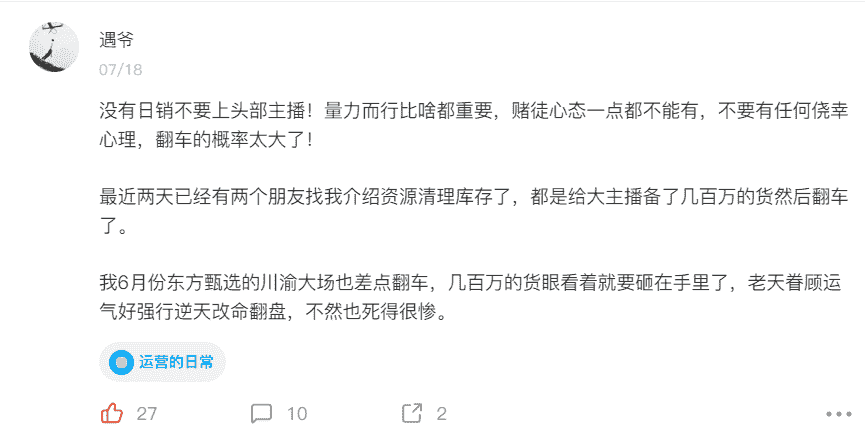
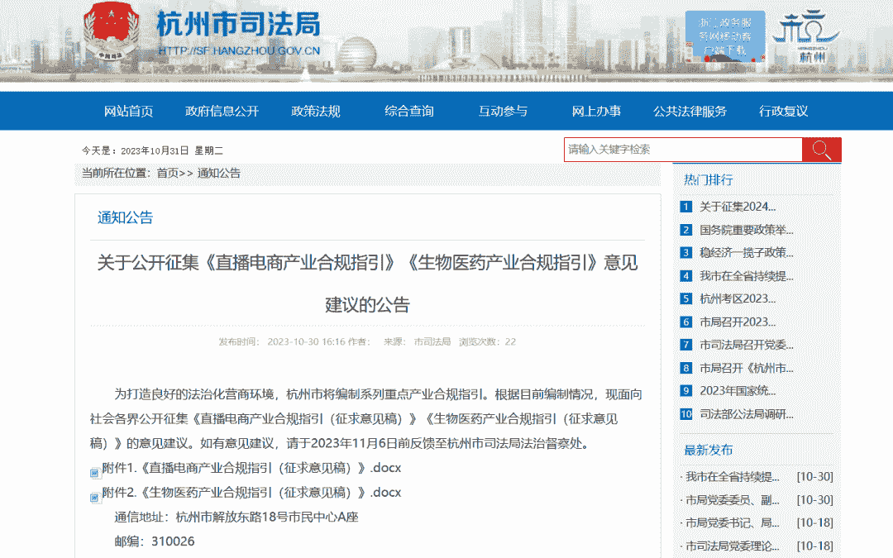

# 关于直播带货的碎碎念

> 来源：[https://my.feishu.cn/docx/HwUzdosOyoIcBJx4PfpcyghVnpc](https://my.feishu.cn/docx/HwUzdosOyoIcBJx4PfpcyghVnpc)

> 🔗 原文链接： h[ttps://mp.weixin.q](https://mp.weixin.qq.com/s/jst1cpni4bZPakX5W-uiVQ)q.com/s/jst1cpni...

> ⏰ 剪存时间：2023-11-12 15:57:42 (UTC+8)

> ✂️ 本文档由 [飞书剪存 ](https://www.feishu.cn/hc/zh-CN/articles/606278856233?from=in_ccm_clip_doc)一键生成

原创 河林 河林成长说

2023-11-03 19:40:12

精确发文时间由壹伴提供

2023-11-03 19:40 发表于 浙江

手机阅读

收录于合集

#营销笔记 10 个

#视频号直播 2 个

**这是河林的**第 48 篇公众号原创，内容分类为 营销笔记 。

**我是河林，我在这个公众号记录自**己的 成长心得、营销笔记、生活记录 ；感谢你的阅读，欢迎交流讨论。

今天这篇是我对近期 **关于直播带货的一些思考碎片。**

**多少为直播带货做些“辩护”**

最近社会舆论开始发酵蔓延一阵批判直播带货的风气，电商直播行业也人心惶惶。

作为直播行业的从业者，还是想在这个双十一，趁现在出来说点东西； 不然等到舆论一边倒的时候，也没什么机会说，也没什么必要了。

不对具体热点事件和个别公司做展开评论，只抒发一些自己的观察和想法。

不专业、纯主观、不一定对、欢迎指教。

**如果说不明白，肯定是我资历尚浅、经**验不足的缘故，也非常欢迎你的意见和补充。

直播带货的天价佣金和坑位费，毁了商家和品牌？

**直播行业最常被人诟病的罪状，就**是 所谓的天价坑位费以及高佣金率 的论调——主播拿走大部分利润，打压了品牌和商家，还让价格全部传导给消费者。

尤其是最近，在一些头部主播的热点事件里，很多营销号和不专业的媒体，特别喜欢拿着几个没有来源的数据说事——

例如“ 几根眉笔，主播带货佣金率80% ”、“头部主播高佣金还要收坑位费，商家赔本不赚钱”、“主播的佣金全让消费者买单”云云。

甚至很多所谓的互联网行业的运营也喜欢复读这些论调，这是非常可笑的。

**凡是做电商的，都要有一个**基础的能力， 那就是测算你的营收模型。

**首**先，从行业角度来讲，直播带货有能力做「 40%以上高佣金还要加收高额坑位费的」 ，或者「佣金能收到70%以上的」， 就只有极个别的头部达人，2只手数绝对得过来的那种，而且适用的品类、品牌极其狭窄，大多数都是非常极端的品牌（非标or极高客单or行业壁垒强）。

这一点毋庸置疑，因为但凡是普遍存在的情况，直播行业早就能传出诸多实例证明了，可事实是，目前传出来的所谓80%佣金，也仅仅只停留在微博营销号的道听途说。

眉笔以及绝大多数的品类， **天价佣金+高额坑位费，商业模型无论怎么测算，对于品牌都是不合算的，品**牌从一开始就不存在商业动机，更不会存在“被逼无奈签约、沦为主播的打工仔”的戏码。

即使存在这样的情况，但这件事的影响也远远无法让它颠覆整个行业。

试问，如果一个品类能把70%利润给达人，那么这个品牌的员工不吃饭吗？难道没有竞争对手吗？它在市场上的竞争对手不干活吗？

如**果一个品牌要哭穷“利润大头都被达人拿走了、**自己根本不赚钱”，那说明你自己的这一品类的商品，本就能用 30% 以内的成本生产， 那么这个品牌的竞争对手分分钟就能通过压价压低利润率的方式全渠道倾销铺货、占领市场。

那既然如此，消费者自然也永远有更低价、更性价比的竞品去选择，一个品牌的孤立行为是害不死一个行业的。

更本质的是，无 **论一个品牌给带货主播的佣金占比多少，都不代表**是品牌或者主播“从消费者手里拿走的钱”。

很多人喜欢说把给主播的佣金直接降价，不仅能给消费者让利，品牌也开心。看似有道理，但是在商业逻辑上，往往无法成立， 因为单纯的降价并不难换来相应的规模和品牌力 ，这是各种因素互相作用的结果。

这笔钱即使不是佣金，也大概率会以“营销费用”的形式在别处花掉，商务媒介、流量采买、广告投放、商务代言费用等等……。

喜欢拿着几个毫无根据的数据渲染整个行业风险的人，商业素养堪忧。

超级头部主播，不是品牌唯一的选择

实际的电商行业中，佣金和坑位费绝对不会像震惊体热搜新闻那样描述的那么夸张，但是 佣金+坑位费在头部达人以及头部MCN中，也基本是行业惯例。

很多品牌的公关和商务喜欢哭穷，常见的说辞无非是“达人主播要了自己利润的大头，自己直播越做越亏、根本不挣钱”；

然而很多人在讨论直播带货对商家、品牌、行业的影响时，都在回避和试图掩盖的问题是：

**- 难道除了找超级头部达**人直播以外， 品牌就没有别的选择了吗？

**- 难道不找头部达人**做直播带货， 品牌就活不下去了吗？

- 难道品牌在头部达人面前， **没有一点自己的议价权吗？**

当然不是，所有人都不能无视的前提是， 找超级头部达人直播带货，从来就不是品牌的必选项。

**电**商渠道的日销、微信生态的私域营销、淘宝京东的品牌自播、抖音的短视频×直播联动、小红书素人种草铺稿，腰部、中部、小达人的纯佣合作……

等等等等，都是一个品牌为了把货卖出去，可以经营的渠道，可以尝试的手段。

条条大路通罗马， **品牌本就应该基于自身优势，制定符合自**身特色、能为自己持续稳定获利的商业策略 ，而不是硬要把自己绑定在“一年几次”的超头直播间，被动地为大主播打工。

我在去年看李佳琦的《所有女生的offer2》的时候，就说过类似的观点： 达人直播永远只是一个选项，关键是品牌自己要知道自己要玩什么游戏。

李佳琦《所有女生的offer2》观后感：一档远超预期的商业综艺

高佣、坑位费找头部达人直播带货本就不是必选项，甚至不是唯一的选项，即使对绝大多数的品牌有无可替代的价值，但也依然要 结合自身所处的阶段、想要达成的目标，找到适合自己的玩法。

头部达人，不是品牌出道必拜的码头，不是破圈爆红的大力丸，更不是妙手回春、起死回生的神药。

如果承受不起直播带货的消耗， 品牌为什么不退出？

找头部主播做直播带货，不是让行业变坏的问题症结；

问题是很多品牌把这个选择当成了救命稻草，当成了万能神药。

品牌需要以终为始的思考，如果我愿意给达人直播支付高佣金+高坑位费，那么我的目的是什么？我要收获什么？

**规模的突破？新品类的认知教育？大规**模的流量曝光和品宣？精准优质的用户群体？

或者反向思考，是什么原因 让我不得不付这么一大笔钱给头部主播去带货？我缺的是什么？

凡是认真思考这个问题的品牌，大多 都能进一步明确适合自己的生存方向。

我对直播带货现状的理解是：

头部主播依靠自己的影响力和优势，俘获了大批忠实受众，获得了巨额、稳定的流量曝光，打出了声量，从而反向拉拢了所在平台的政策支持，让自己成为了比肩平台的重要渠道；

也因此获得了议价权，对外招商的刊例价自然也存在“溢价空间”，这是他们身为头部主播所获得的红利，也是牟利的策略，在这个机制下，自然会有部分品牌被“割韭菜”。

**当一个品牌要找头部达人带货，从一开始就要 想方设**法让自己在牌桌上打出一手好牌，不要让自己支付的价格成为溢价，去当那个被宰的冤大头。

这是品牌在一开始就需要思考的课题**，而最终达成的结果如**何，在很大程度上是 品牌自身的品牌力决 定的。

看过李佳琦《所有女生的offer》**这档综艺的人都能明显看得出来，李佳琦的 议**价能力、谈判主动权、争取到的机制，在面对国际知名大牌和国货品牌时，差异非常明显 ，这就是品牌自身影响力的差异。

品牌自身的 **品牌力、产品力、渠道能力、自播能力、私域运营**能力，都决定了品牌对头部主播的依赖程度。

因此，直播带货不是一个单一游戏，它是一个品牌综合营销战略的一环，很多品牌的失误之处在于全盘押注的赌徒心态：

在品牌战略及能力尚不足以支撑品牌的目标的情况下，急于入局这场直播带货的军备竞赛，那最终结果往往是求仁得仁。

既然如此，那就接受现实，一个愿打一个愿挨，如果意外翻车，也不要玩不起，在事后掀桌子、砸饭碗。

**直播电商打压实体经济？**

**对直播带货的另一种批判声音，认 为直播带货**行业压制了实体经济，如果要复兴实体经济，就需要压制、取缔、禁止直播电商。

前阵子杭州传出来疑似要取缔、禁止直播带货的传闻，也让这种观点一时热度高涨。

当然， 一刀切禁止直播带货对任何一个城市都是天方夜谭，更何况是在杭州。

事件源头的新闻，最终也被证实是自媒体营销号夸大事实、以讹传讹， 原文的表述只是 “杭州四季青的部分服装市场禁止商家在铺内直播销售” 而已。

关于那些主张“直播电商压制了实体经济”的论调，我个人一直是十分困惑的。

以我的能力，我无法轻易总结两者的关联程度、谁影响谁更大、带来了何种影响；

如果想要在直播电商和实体经济建立一个清晰明了的经济链条，是需要大量的研究和数据分析以及实证案例去支撑的。

对于2者关系的讨论，如果给到的论据不够充分，我无法信服。

我对这2者关系的模糊认知是，有替代和重合的部分，但是无法影响彼此的基本盘。

直播行业和线下的实体经济 都有无法替代的优势和无法取代的体验，本就不是非此即彼的关系 ，从商业逻辑上来讲不存在针锋相对的激烈对抗，

我的直观感受是，直播电商和线下实体之间至少存在3个显著差异，这3个显著差异使得直播电商和线下实体无法互相替代，也构不成直接的竞争关系；即使压制了直播带货的投入，也没法直接转嫁到实体经济上。：

**首先是消费场景和体验：**

做直播的品牌和线下的品牌，天生就不是重合的， 线上的很多品牌注定是不适合线下的，而线下实体经济，受物理空间的限制，本身能触达的人群也注定是有限的。

线下实体和直播场景也不存在天然的不兼容的关系，近两年很多线下商超品牌纷纷入驻视频号，靠自己在线下实体的背书，把商场开到线上的直播间，也依然拿到了结果；

很多线下实体经济的商家，也都用直播电商的线上渠道，扩充和发展了自己的业务。

**去看直播的人和去线下买东西的人，在 购买的时候**占用的不是同一个时空，消费的不是同一个场景，满足的也不是同一类型的购物需求。

**二**是效率，当直播电商获得了线上移动平台的流量和效率加持，它所能提供的服务和面对的人群，会远远超过线下实体经济能服务的量级 ，这一点很好理解，不再展开。

**三是成本；**

线下实体经济的房租成本+经营维护成本 ，是线下实体经济的痛点之一，只要这个成本居高不下，即使把全直播行业的人才和经济重新释放和回归到线下，实体依然不会更好做。

**直播电商的现状当然存在很多问题，自然不是当下经济的最优解， 但它仍然**是经济现状下，各方博弈、动态平衡的产物，它不是部分人一厢情愿臆想的“直播电商就是靠个别头部达人、机构、平台之间互相扶植”就能轻易达到的结果。

这不是一个打地鼠的游戏， 不是疯狂敲打直播带货电商，实体经济就会自然抬起头来。

如果真的靠人为因素强力把直播电商行业压下去，那大概率并不会推动整个经济生态的健康发展，实体经济也不会如很多人以为的那样会走向繁荣， 更不可能因为直播电商的衰落，而分到和直播电商同等规模的那杯羹。

直播行业，真正亟待解决的问题在于哪里？

如果要批判起直播行业，作为一个直播电商行业从业者，在某些方面，我也更有发言权。

首先，是直播间和全网最低价强绑定的心智，让整个直播行业越来越浮躁。

我觉得直播作为拥有大量公域曝光流量的渠道，天生不应该和全网最低价绑定， 除了自有私域以外，“最低价”不应该是任何一个渠道天生理应具备的优势。

头部主播因为自身流量和规模而拥有了议价权，能够和品牌去议价，争取最低价，这也是合理的。

但是在头部主播的标杆效应下，“直播=全网最低”的心智开始被整个直播行业反复强化，导致各个层级的达人和机构，都与品牌争取最低价的机制，竞相追逐这块金字招牌，就形成了一种非常吊诡的行业生态：

全网直播间都在吆喝自己是最低价；

达人直播间仿佛每天都在过双十一；

品牌的旗舰店价格永远更贵、永远被拿来比价；

**品牌做不好日销和搜索流量，忠实用户靠搜索反而没法用最优惠价格**购买产品，品牌的直通车流量费也越来越贵；

对品牌而言利润率最低的机制反而在流量最大的渠道被烂大街一样的倾销。

这种对“全网最低价”的狂热追求，也造就了直播行业越来越卷和浮躁：

❌越来越多的主播和机构 **过度依赖营销机制和玩法 **，而不重视直播本身的内容呈现，不重视达人本身的IP定位，不重视和粉丝群体的情感维护，不重视后端服务；

每个直播间都在 送 IPhone、送平板、送豪车 、吵吵闹闹地听半天听不到产品好在哪里，一地鸡毛。

❌ 头部主播有机制霸权，直播行业马太效应越来越明显 ，中小达人接不到大牌的商务合作，能接到的合作也没有机制优势，整个行业的生态做不起来，很难崛起。

甚至很多带货主播，为了生存和获利，最后只能去承接一些“黑五类”、山寨产品、以次充好、虚假宣传的产品，导致直播带货行业负评不断。

**❌反向塑造和培养了用户浮躁的购买行为， 大多数直播间的公域用户**都为最低价而来，一进入直播间就疯狂比价，直播间没有停留，只是快速倾销商品的卖场。

直播电商行业需要让自己摆脱每天都在双十一的定位，接受自己是众多销售渠道之一，而不是每天都在做倒闭清仓大甩卖的卖场。

没有节奏和起伏，每天都在冲刺，没有日常蓄水、教育、沉淀；在真正大促发力的时候自然就使不上劲，只能依赖大力出奇迹，自然容易在大促翻车；

而且因为过于浮躁，没有信任，也不对用户真诚，停留和留存越来越差，无法积累下用户资产，生命周期越来越短。

其次，是头部主播之间保价协议的扩大化。

保价**协议在某种程度上，是头部主播拥有议价权之后的合理选择，在合理范围内**无可指摘，但是保价一旦开始扩大化，例如不只主播所在的平台，反而扩大到全网、全平台，甚至对规格、机制都做出严格要求， 就总会游走在垄断的边缘，而且本质上是降低了交易效率的，也增加了用户的购物成本，不利于整个电商生态的发展，长期下来终究会得到反噬和潜在消费群体的反感

这导致大促期间，品牌只能倾力押注头部直播间，把直播间作为唯一重要的渠道，无疑是饮鸩止渴， 对平台的认知和品牌力的打造，都会造成一定程度的削弱，而与此同时 ，没有议价权的中小达人就更难做起来，对整个行业的生态都是不利的，自然也少不了抱怨和争议。

然后， 是虚假繁荣、烧钱内卷的不健康生态。

最共性的问题就是直播带货 **居高不下的退货率 **， 有规模，但商家和品牌没有利润；有流量，但直播间和品牌没有留存 。

**以及，直播间的流量只**能依赖巨额的投放，但投放又带不来高额ROI， 不烧钱，就活不下去。

这也是我今年开始做视频号直播之后，对视频号直播带货比较认可的原因。

视频号的直播带货，基于微信生态的营销模式，确实帮助了那些无法参与内卷的商家和品牌，老老实实地服务用户、介绍商品、靠产品力和服务积累自己的粉丝，打造自己的品牌；

而且视频号也成功做到了 **降低退货率、提高留存时长、积累用户资产，让商家在从**0到1做大规模的同时，也能同时积累利润。

最后，是直播电商行业的 各种牛鬼蛇神一般的乱象，我统一称之为“耍猴式”直播。

为了博取流量和关注的一切 **哗众取宠的直播乱象 **，包括但不限于：

**虚假宣传、夸张剧本、过度演绎、擦边低俗、**极端人设、制造对立、无底线蹭热度等等……

每一项都让直播带货行业路子走得更窄，最近三只羊网络的主播 “红绿灯的黄带货”带货 YSL 的直播风格引起的争议 ，就是一例代表。

如果品牌仅仅把流量和规模作为标准去筛选达人， 而忽视牌主播和自身品牌的调性、理念，稍一不慎，就会对品牌形象造成伤害。

**给品牌的建议：**

最后，站在直播行业从业者的身份，从个人角度给品牌一些实用而简单的营销建议。

1️⃣尽量摆脱大促期间对头部主播的绝对依赖。

如何在和头部主播的博弈中，既能争取达人渠道的曝光，又保障自己公域和私域粉丝的利益，不会因为粗暴的控价机制，伤害自己的老用户，流失掉自己的潜在用户群体，是每个品牌之后都需要思考的课题。

2️⃣不要孤注一掷，只把头部主播直播间作为重要渠道之一，但同时不松懈其他渠道的布局和运营，尤其是日销、自播、私域。

- **如果日销没有稳定就急于上头部直播间**，一旦大量备货但转化翻车，就会很吃不消；

- 品牌自播直播间和自有私域，也是非常值得发力的渠道 ，近两年来很多品牌开始在自有直播间拿到了大的结果，也扩大了品牌的影响力，积累了自身的用户资产。

引用一条 **遇爷 **的即刻，作为补充：

3️⃣慎重选择主播，不光看流量和曝光，还要考虑主播形象、风格、理**念与自己的品牌是否契合**，主播的受众与自身的目标用户是否重合，在有把握的情况下， 争取双赢，而不要赌博。

近期杭州市司法局也发布了 《直播电商产业合规指引》公开征集意见建议的公告 ，里面提到的不少内容也都很关键，如果感兴趣的可以看一看，或者提出一些自己的建议。

**后记**

以上就是我这一篇的思考了，读完之后我自己的感受是缺乏一些具体的案例、数据支撑，也缺少一些具体落地的方法论作为补充；

包括 实际上我自己也有一些没有想通的地方，毕竟这个话题也有些大，想要讲清楚，难度很高，我的见识和经历也不足够。

我大概用了两三个下班后的晚上写好了这篇文章，发之前也再犹豫，这一篇文章有没有价值？要不要发出来？ 如果要再完善打磨这一篇公众号文章，是不是能变得更好？

但是近期时间比较紧张，我也不希望自己养成拖延和犹豫的心态，那这次 也就不追求完美了。

**就这么发表出来，作为自己一些阶段性的模糊想法呈**现出来吧，不成熟的地方也请大家包容接纳。

**交流链接**

最后再做一下自我介绍，我是河林，98 年出生，坐标杭州，3 年运营经验。

目前是一名 **视频号直播运营 **，我在这个公众号输出自己的 **成长心得、运营笔记、营销观察。**

我的公众号没有留言功能，如果想要**交流、链接，欢迎直接添加我的个**人微信， 添加请备注意向或者“公众号”。

添加我的微信可以查看我的 **个人说明书＆运营知识库 **，请多指教，感谢关注。

▲ **点击卡片 **关注公众号

运营笔记 丨 个人成长 丨自我提升